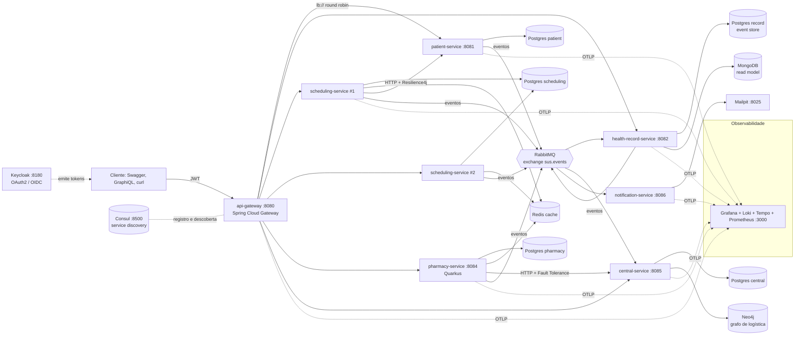

# SUS Jornada — Manual de Construção do Hackathon (Fase 5)

> **Prontuário único da jornada do paciente, do corte do cordão umbilical em diante.**
> Agenda inteligente com regras de falta, controle nacional de dispensação de medicamentos e logística de estoque com grafos.
> Só back-end e arquitetura, em microsserviços com Java 25.

Este manual é um livro de receitas. Você vai ler e fazer tudo sozinho, na ordem. Cada capítulo diz:

- **o que** vamos construir;
- **por que** escolhemos aquela tecnologia ou padrão (ligando com o que você aprendeu na pós);
- **como** fazer: site, botão, comando e código completo.

---

## Sumário

| Parte | Capítulo | O que você vai ter no fim |
|---|---|---|
| **I. Entender** | 1. O desafio do hackathon | Checklist do que a FIAP pede e como cada item vai ser atendido |
| | 2. O processo de trabalho (versão solo) | As "Dicas para a organização" aplicadas a quem trabalha sozinho |
| | 3. A solução SUS Jornada | Problema, personas, Event Storming, regras de negócio |
| | 4. A arquitetura | Diagrama, serviços, bancos, portas, comunicação, segurança |
| **II. Preparar** | 5. Ambiente: Windows, WSL2 (Ubuntu 24.04), VS Code e GitHub | Máquina pronta, repositório criado, CI configurado |
| | 6. Infraestrutura em Docker | Bancos, RabbitMQ, Keycloak, Consul e Grafana no ar |
| | 7. Padrões transversais | Clean Architecture, RFC 9457, JavaDoc, IDs, eventos, outbox, idempotência |
| **III. Construir** | 8. patient-service | Cadastro do paciente e do recém-nascido |
| | 9. health-record-service | Prontuário vitalício com Event Sourcing, CQRS, MongoDB e GraphQL |
| | 10. scheduling-service | Agenda, fila, faltas justificadas e não justificadas, telemedicina |
| | 11. pharmacy-service (Quarkus) | Estoque e dispensação com tolerância a falhas |
| | 12. central-service | Datacenter central: controle nacional e logística em grafos (Neo4j) |
| | 13. notification-service | Consumidor idempotente e e-mails |
| | 14. api-gateway | Porta de entrada, segurança, round robin e Swagger agregado |
| **IV. Operar** | 15. Observabilidade com Grafana | Logs, métricas, traces, dashboard e alerta |
| | 16. Testes e qualidade | Testes de domínio, ArchUnit, Testcontainers, k6 e caos controlado |
| | 17. Subindo tudo e roteiro de demonstração | Sistema completo no ar e script da demo |
| **V. Entregar** | 18. Entregáveis da FIAP | Relatório, vídeo do pitch, vídeo do MVP e entrega |
| | 19. Cronograma, aprendizados e próximos passos | Plano dia a dia e mapa do que você aprendeu |
| | 20. Apêndices | Problemas comuns, glossário e comandos úteis |

---

## Como usar este manual

1. **Leia a Parte I inteira antes de abrir o terminal.** É ela que dá sentido ao código.
2. **Faça a Parte II uma vez só.** Depois disso, o ambiente fica pronto para sempre.
3. **Na Parte III, construa um serviço por vez**, na ordem dos capítulos. Cada serviço depende de coisas que o anterior criou (eventos, filas, usuários).
4. **Ao fim de cada capítulo há um "Checkpoint"**: comandos para provar que funcionou. Só avance quando o checkpoint passar.
5. **Faça commits pequenos**, um por passo concluído. O manual sugere a mensagem.

### Convenções do manual

| Símbolo | Significado |
|---|---|
| `🖥️ Windows` | Faça no seu Windows (navegador, PowerShell) |
| `🐧 Ubuntu` | Faça no terminal do Ubuntu 24.04 no WSL2 (o terminal do VS Code conectado ao WSL) |
| `📁 arquivo` | Crie ou edite este arquivo, com este caminho exato |
| `✅ Checkpoint` | Teste antes de seguir |
| `💡 Por quê` | A razão por trás da decisão (use isso no relatório e no pitch) |
| `⚠️ Atenção` | Armadilha comum |

- **Código, nomes de classes, tabelas e JavaDoc ficam em inglês** (padrão de mercado). O manual, os textos de erro voltados ao usuário e a documentação do relatório ficam em português.
- Os caminhos de arquivo são sempre relativos à raiz do repositório `sus-jornada/`.
- Quando um bloco de código diz `// ... (igual ao capítulo X)`, é porque o trecho é idêntico ao já mostrado. O manual evita repetir código idêntico, mas nunca omite código novo.

### Sobre versões

O manual foi escrito para **Java 25 (LTS)**, **Spring Boot 4.x**, **Spring Cloud 2025.x** e **Quarkus 3.x**, a geração mais atual dessas ferramentas. Ao gerar os projetos no Spring Initializr e no code.quarkus.io, **use a versão estável mais recente que eles oferecerem**. Se algum import mudou de pacote numa versão nova, o VS Code sugere a correção com `Ctrl+.`. O Apêndice A lista as mudanças de pacote mais comuns do Spring Boot 4 (Jackson 3, pacotes de teste).


---

# Parte I — Entender

# Capítulo 1 — O desafio do hackathon

## 1.1 O que a FIAP pede, em uma frase

> Tema: **"Inovação para otimização de atendimento no SUS"**. Entregar um **MVP só de back-end e arquitetura**, mais **dois vídeos de até 8 minutos** e um **relatório**, tudo num Drive público cujo link vai num `.txt` ou `.doc` na plataforma da FIAP.

## 1.2 Os exemplos de problema do enunciado e como o SUS Jornada cobre cada um

O enunciado sugere seis áreas. A nossa solução cobre cinco delas de forma integrada. Esse é o primeiro argumento de **inovação**: não é uma ferramenta isolada, é uma jornada.

| Área sugerida no PDF | Como o SUS Jornada atende | Serviço |
|---|---|---|
| Agendamento de consultas e exames | Agenda por especialidade, fila de espera com prioridade, remarcação automática para quem justifica a falta e volta ao fim da fila para quem não justifica | `scheduling-service` |
| Gestão de prontuários eletrônicos | Prontuário **único e vitalício**, aberto no nascimento e nunca apagado (Event Sourcing), com leitura flexível em GraphQL e registro de quem acessou | `health-record-service` |
| Triagem e acolhimento inteligente | Prioridade na fila (urgência clínica, prioridade legal, remarcação justificada) | `scheduling-service` |
| Gestão de insumos e recursos | Estoque por unidade, controle nacional de gratuidade (não pega de graça duas vezes) e sugestão de remanejamento entre unidades com grafos | `pharmacy-service`, `central-service` |
| Telemedicina e atendimento remoto | **Ferramentas de controle** da teleconsulta (sessão, consentimento, início, fim e registro no prontuário). O vídeo em si fica fora do MVP, como você pediu | `scheduling-service` |
| Engajamento e educação em saúde | Fora do escopo do MVP. Entra como **próximo passo** (lembretes de vacina a partir do prontuário) | — |

## 1.3 As três entregas, item por item

### Entrega 1: vídeo do pitch (até 8 min)

| Bloco | Tempo | O que mostrar | Onde está no manual |
|---|---|---|---|
| Introdução | 1 min | Você (equipe de uma pessoa: arquiteto, dev e apresentador), o problema e por que importa | Cap. 18 (roteiro pronto) |
| A solução | 3 min | Ideia principal, como resolve, diferencial | Cap. 3 e 18 |
| Impacto | 2 min | Benefícios para profissionais e pacientes, casos reais | Cap. 3 e 18 |
| Próximos passos | 2 min | Melhorias futuras | Cap. 19 |

### Entrega 2: vídeo do MVP funcionando (até 8 min)

Demonstração prática com **Swagger**, **GraphiQL**, **curl** e **Grafana**. O roteiro passo a passo está no Capítulo 17 e o roteiro de gravação no Capítulo 18.

### Entrega 3: relatório do projeto, com 7 itens obrigatórios

| Item obrigatório | Onde você vai produzir o conteúdo |
|---|---|
| 1. Resumo executivo | Cap. 18 (modelo pronto) |
| 2. Problema identificado | Cap. 3, seção 3.1 |
| 3. Descrição da solução | Cap. 3 e 4 |
| 4. Processo de desenvolvimento | Cap. 2: o diário e os artefatos de design thinking que você vai gerar |
| 5. Detalhes técnicos (tecnologias e diagrama) | Cap. 4 (diagrama Mermaid pronto) |
| 6. Links úteis | GitHub, Drive e coleção de requisições (Cap. 18) |
| 7. Aprendizados e próximos passos | Cap. 19 |

### Regras de formato da entrega

- O arquivo enviado na plataforma é um `.txt` ou `.doc` **com um link** para um Drive **público**.
- No Drive: os dois vídeos, o relatório (PDF) e, de preferência, o link do GitHub também.
- O Capítulo 18 mostra os cliques no Google Drive para deixar o acesso público.

## 1.4 Critérios de avaliação e como pontuar em cada um

| Critério | Peso | Estratégia |
|---|---|---|
| Problema e impacto | 20% | Problema real e mensurável (filas, faltas, desperdício de medicamento, prontuário fragmentado). Cite fontes oficiais (DataSUS, TCU, Ministério da Saúde); o Cap. 3 diz onde pesquisar |
| Inovação | 20% | Prontuário vitalício que nasce com a pessoa, imutável e auditável; o paciente vê quem leu o prontuário; gratuidade controlada nacionalmente; logística com grafos |
| Funcionalidade do MVP | **30%** | O maior peso. Tudo roda com **um comando** (`docker compose up`), tem dados de exemplo e um script de demonstração que não falha |
| Apresentação | 20% | Roteiros cronometrados no Cap. 18. Ensaie com cronômetro |
| Documentação | 10% | README, Swagger, JavaDoc, ADRs, diagrama e relatório |

> 💡 **Por quê o MVP é o centro do manual:** 30% da nota é funcionalidade. Por isso cada capítulo da Parte III termina com um checkpoint executável, e o Cap. 17 tem um script que demonstra tudo de ponta a ponta.

## 1.5 O que fica fora do MVP (de propósito)

- **Front-end**: o enunciado dispensa e você preferiu um back-end excelente.
- **Vídeo da teleconsulta**: construímos o controle (sessão, consentimento, registro), não o streaming.
- **Integração real com cartório, RNDS e DataSUS**: simulada por endpoints e eventos. Vira "próximo passo" no pitch.
- **Alta disponibilidade real** (vários servidores): demonstrada em escala local com réplicas, round robin e circuit breaker.

Deixar isso explícito no vídeo do MVP é exatamente o que o PDF pede: *"Se o MVP não estiver 100% funcional, explique as partes que não foram finalizadas e como elas seriam implementadas."*


---

# Capítulo 2 — O processo de trabalho (versão solo)

O PDF traz "Dicas para a organização do trabalho (não obrigatório)". Você decidiu **seguir as dicas**, com uma ressalva: o que só faz sentido em grupo vai ser **marcado como "não se aplica"**, sem inventar substitutos artificiais.

Tudo o que você produzir aqui vai para a pasta `docs/processo/` do repositório. Isso alimenta o **item 4 do relatório (Processo de desenvolvimento)**.

## 2.1 Tabela de decisão: cada dica do PDF

| # | Dica do PDF | Situação | O que você faz |
|---|---|---|---|
| 1 | Design Thinking: mapeamento do problema | ✅ Aplica | Lista de desafios (seção 2.2) |
| 1 | Design Thinking: mapa de empatia | ✅ Aplica | Um mapa por persona (seção 2.3) |
| 1 | Design Thinking: definir a persona | ✅ Aplica | Cinco personas (seção 2.3) |
| 1 | Design Thinking: explorar ideias com post-its (Miro, Whiteboard) | ✅ Aplica | Excalidraw ou Miro (seção 2.4) |
| 2 | Brainstorming: "Não julgue as ideias no momento da criação" | ❌ Não se aplica | É regra de dinâmica de grupo, para ninguém se inibir. Sozinho, não existe essa inibição |
| 2 | Brainstorming: "Incentive todos a contribuir" | ❌ Não se aplica | Equipe de uma pessoa |
| 2 | Brainstorming: combine e melhore ideias | ✅ Aplica | Seção 2.5 |
| 2 | Mapa mental | ✅ Aplica | Markmap no VS Code (seção 2.5) |
| 2 | Crazy 8 ("cada membro cria 8 ideias em 8 minutos") | ✅ Aplica (você é o único membro) | Uma rodada de 8 ideias em 8 minutos (seção 2.5) |
| 3 | Escolha a melhor ideia (impacto, viabilidade, inovação) | ✅ Aplica | Matriz de pontuação (seção 2.6) |
| 3 | Arquitetura técnica: decidir tecnologias | ✅ Aplica | Cap. 4 e ADRs (seção 2.7) |
| 3 | "Distribuir tarefas entre os membros da equipe" | ❌ Não se aplica | Equipe de uma pessoa. As tarefas viram issues para **você** (seção 2.8) |
| 4 | Priorize funcionalidades | ✅ Aplica | MoSCoW (seção 2.8) |
| 4 | Divisão de tarefas por área (front-end, back-end, design) | ❌ Não se aplica | Não há divisão entre pessoas e não há front-end |
| 4 | Organizar e acompanhar com Trello ou Notion | ✅ Aplica | GitHub Projects, que já fica junto do código (seção 2.8) |
| 4 | Desenvolvimento ágil em ciclos curtos | ✅ Aplica | Ciclos de 2 a 3 dias (Cap. 19) |
| 4 | Testes simples durante a construção | ✅ Aplica | Checkpoints de cada capítulo e Cap. 16 |
| 5 | Validação: testar como profissional de saúde ou paciente | ✅ Aplica | Roteiro de validação por persona (seção 2.9) |
| 5 | Ajustar interface, textos e fluxo | ✅ Aplica (adaptado) | Sem interface: você ajusta mensagens de erro, descrições do Swagger e fluxos |
| 6 | Preparação para o pitch | ✅ Aplica | Cap. 18 |
| Geral | Definir uma liderança | ❌ Não se aplica | Você é o time inteiro |
| Geral | Checkpoint frequente | ✅ Aplica | Revisão ao fim de cada ciclo (seção 2.10) |
| Geral | Comunicação clara com Slack ou Discord | ❌ Não se aplica | Não há com quem sincronizar |
| Geral | Cuidado com o tempo, reservar tempo para testes | ✅ Aplica | Folga de 20% no cronograma (Cap. 19) |

## 2.2 Mapeamento do problema

📁 `docs/processo/01-mapeamento-do-problema.md`

Copie e complete com o que você pesquisar:

```markdown
# Mapeamento do problema

## Desafios observados nas unidades de saúde
1. Prontuário fragmentado: cada unidade (UBS, hospital, maternidade) tem o seu; o histórico não acompanha o paciente.
2. Recém-nascido sem histórico desde o primeiro minuto: o registro clínico do parto fica no hospital e não vira a base do prontuário da vida inteira.
3. Faltas em consultas (absenteísmo): a vaga é perdida e a fila não anda.
4. Quem falta por motivo justo é tratado igual a quem esquece: volta ao fim da fila.
5. Dispensação duplicada de medicamento gratuito: retirada na UBS e de novo em outra unidade ou farmácia credenciada.
6. Estoque desbalanceado: falta remédio em uma unidade e sobra (e vence) em outra próxima.
7. Teleconsulta sem controle formal: consentimento, início, fim e registro no prontuário.
8. Pouca transparência para o paciente sobre quem acessa os seus dados (LGPD).

## Fontes de dados (pesquise e anote número + link)
- DataSUS / TabNet: produção ambulatorial, nascidos vivos (SINASC)
- CNES: quantidade de estabelecimentos
- Relatórios do TCU sobre filas e regulação no SUS
- Estudos sobre absenteísmo em consultas especializadas (busque no SciELO: "absenteísmo consultas SUS")
- Ministério da Saúde: Programa Farmácia Popular, RNDS, Meu SUS Digital
```

> ⚠️ **Atenção:** não invente números no pitch. Para cada número, anote a fonte e o ano. A banca valoriza "Problema e Impacto" (20%) com dados reais.

## 2.3 Personas e mapas de empatia

📁 `docs/processo/02-personas.md`

| Persona | Quem é | Dor principal | O que o SUS Jornada entrega |
|---|---|---|---|
| **Dra. Ana**, 38 anos | Médica de família em UBS | Atende sem histórico do paciente; refaz perguntas e exames | Linha do tempo completa do paciente, com resumo clínico (alergias, vacinas, diagnósticos) |
| **João**, 27 anos | Atendente do posto | Agenda lotada, faltas, remarcação manual | Fila automática, remarcação automática de falta justificada |
| **Maria**, 31 anos | Paciente, mãe de recém-nascido e diabética | Perde a vaga quando falta por motivo justo; não sabe quem vê os dados dela | Remarcação no horário mais próximo; vê quem acessou o prontuário |
| **Carla**, 45 anos | Farmacêutica da UBS | Não sabe se o paciente já retirou o remédio em outro lugar; estoque falta ou vence | Autorização nacional na hora da dispensação; alerta de conflito |
| **Paulo**, 52 anos | Gestor municipal de saúde | Não vê onde falta e onde sobra medicamento | Sugestão de remanejamento pelo menor caminho entre unidades |

Mapa de empatia (repita para cada persona):

```markdown
## Mapa de empatia — Dra. Ana
- **Pensa e sente:** "Será que esse paciente tem alergia? Não tenho como saber."
- **Vê:** fichas de papel, sistemas diferentes em cada unidade.
- **Ouve:** "Já fiz esse exame no hospital, doutora."
- **Fala e faz:** repete anamnese, pede exames de novo.
- **Dores:** tempo perdido, risco clínico, retrabalho.
- **Ganhos desejados:** histórico confiável em um lugar, em segundos.
```

## 2.4 Explorar ideias com post-its (Excalidraw)

🖥️ **Windows**

1. Abra **https://excalidraw.com** (gratuito, sem cadastro).
2. Na barra de ferramentas, escolha o **retângulo** (tecla `R`) e desenhe um post-it. Mude a cor de fundo no painel da esquerda (**Background**).
3. Uma cor por tipo: **amarelo** = problema, **verde** = ideia, **vermelho** = dúvida ou risco.
4. Escreva uma hipótese por post-it, no formato *"Se [tecnologia], então [benefício] para [persona]"*. Exemplo: *"Se o prontuário for uma sequência imutável de eventos, então a Dra. Ana confia no histórico e o paciente tem auditoria."*
5. Para salvar: menu ☰ → **Save to... → Save to disk**. Grave o arquivo como `docs/processo/03-ideias.excalidraw` no repositório. Também exporte uma imagem: ☰ → **Export image → PNG** → `docs/processo/03-ideias.png`.

> Se preferir o Miro: https://miro.com → **Sign up free** → **+ New board** → digite "Empathy map" na busca de templates.

## 2.5 Brainstorming solo: mapa mental, Crazy 8 e combinação de ideias

### Mapa mental no próprio VS Code (Markmap)

1. No VS Code, abra **Extensions** (`Ctrl+Shift+X`), procure **Markmap** (autor: Gerald Liu) e clique **Install**. Se o VS Code estiver conectado ao WSL, use o botão "Install in WSL: Ubuntu-24.04".
2. Crie 📁 `docs/processo/04-mapa-mental.md`:

```markdown
# Atendimento no SUS
## Prontuário
### Nasce com a pessoa (DNV)
### Imutável (eventos)
### Quem acessou (LGPD)
## Agenda
### Fila com prioridade
### Falta justificada → remarca no horário mais próximo
### Falta sem justificativa → fim da fila
## Medicamentos
### Gratuidade controlada nacionalmente
### Estoque por unidade
### Remanejamento por grafo
## Telemedicina
### Sessão, consentimento e registro
## Plataforma
### Microsserviços, mensageria, observabilidade
```

3. Com o arquivo aberto, clique no ícone **Markmap** no canto superior direito do editor. O mapa mental aparece renderizado.

### Crazy 8 (uma rodada)

1. Dobre uma folha A4 em 8 partes.
2. Cronômetro de **8 minutos**: uma ideia por quadro, só esboço.
3. Tire foto com o celular e salve como `docs/processo/05-crazy8.jpg`.

### Combinar ideias

Pegue pares de post-its verdes e escreva combinações. As que viraram o SUS Jornada:

- *Prontuário* + *registro de nascimento* = **prontuário que nasce no parto**.
- *Agenda* + *justificativa de falta* = **remarcação automática no horário mais próximo**.
- *Dispensação* + *datacenter central* = **gratuidade única em todo o país**.
- *Estoque* + *mapa de estradas em grafo* = **remanejamento pelo menor caminho**.
- *Telemedicina* + *prontuário* (o próprio exemplo do PDF) = **teleconsulta registrada automaticamente na linha do tempo**.

## 2.6 Escolher a melhor ideia: matriz de pontuação

📁 `docs/processo/06-matriz-de-decisao.md`

Nota de 1 a 5. Pesos: impacto 40%, viabilidade 30%, inovação 30%.

| Ideia | Impacto | Viabilidade | Inovação | Nota final |
|---|---|---|---|---|
| Prontuário vitalício desde o nascimento | 5 | 4 | 5 | **4,7** |
| Remarcação por justificativa de falta | 4 | 5 | 4 | **4,3** |
| Gratuidade controlada nacionalmente | 4 | 4 | 4 | **4,0** |
| Remanejamento de estoque por grafo | 4 | 3 | 5 | **4,0** |
| Vídeo da teleconsulta | 4 | 1 | 2 | 2,5 (fora do MVP) |
| App de educação em saúde | 3 | 2 | 2 | 2,4 (fora do MVP) |

Cálculo: `0,4 × impacto + 0,3 × viabilidade + 0,3 × inovação`.

**Decisão:** as quatro primeiras formam um sistema só e entram no MVP. As duas últimas viram "próximos passos".

## 2.7 Registro de decisões de arquitetura (ADRs)

Cada decisão técnica importante vira um arquivo curto. Isso prova processo e ajuda no relatório.

📁 `docs/adr/0001-microsservicos.md` (modelo; crie um por decisão listada no Cap. 4)

```markdown
# ADR 0001 — Microsserviços por contexto delimitado

## Status
Aceita

## Contexto
O domínio tem partes com ritmos e cargas diferentes: prontuário (escrita contínua, leitura flexível),
agenda (picos de manhã), farmácia (transacional), central (agregação nacional).

## Decisão
Um microsserviço por contexto delimitado descoberto no Event Storming, cada um com seu banco.

## Consequências
+ Deploy e escala independentes, falha isolada.
- Consistência eventual entre serviços, mais operação (resolvida com Docker Compose e observabilidade).
```

## 2.8 Organização: GitHub Projects e priorização MoSCoW

### Priorização MoSCoW

| Categoria | Funcionalidades |
|---|---|
| **Must** (sem isso não há MVP) | Cadastro de paciente e recém-nascido; prontuário com eventos; agenda com faltas; dispensação com controle central; gateway com segurança |
| **Should** | GraphQL do prontuário; fila de espera automática; logística em grafo; observabilidade |
| **Could** | Notificações por e-mail; limite de requisições no gateway; descoberta de serviço via Stork no Quarkus |
| **Won't** (agora) | Front-end; vídeo da teleconsulta; integração real com RNDS e cartórios |

### Criar o quadro no GitHub Projects

🖥️ **Windows**, depois de criar o repositório no Cap. 5:

1. No GitHub, abra o repositório `sus-jornada` → aba **Projects** → **Link a project** → **New project**.
2. Escolha o template **Board** → nome `SUS Jornada MVP` → **Create project**.
3. As colunas padrão são **Todo**, **In Progress** e **Done**. Adicione uma coluna **Blocked**: clique no **+** à direita das colunas.
4. Para cada capítulo da Parte III, crie uma issue: no quadro, **+ Add item** → digite o título → `Enter` → clique no item → **Convert to issue** → escolha o repositório.
5. Crie as labels: aba **Issues** → **Labels** → **New label**: `must`, `should`, `could`, `infra`, `docs`.

Sugestão de issues: uma por serviço (Caps. 8 a 14), uma para infraestrutura (Cap. 6), uma para observabilidade (Cap. 15), uma para testes (Cap. 16), uma para o relatório e uma para cada vídeo.

## 2.9 Validação interna: testar como cada persona

📁 `docs/processo/07-validacao.md`

| Persona | Cenário | Resultado esperado | OK? |
|---|---|---|---|
| Maternidade | Registrar nascimento com hora do corte do cordão | Paciente provisório + primeiro evento do prontuário com aquela hora | ☐ |
| João (atendente) | Vincular registro do cartório | Nome civil no cadastro e evento no prontuário | ☐ |
| Maria (paciente) | Faltar e justificar dentro do prazo | Nova consulta no horário livre mais próximo + e-mail | ☐ |
| Maria (paciente) | Faltar e não justificar | Volta ao fim da fila + e-mail | ☐ |
| Maria (paciente) | Ver quem acessou o prontuário | Lista com médico, data e operação | ☐ |
| Carla (farmacêutica) | Dispensar insulina duas vezes em unidades diferentes | Segunda vez: erro 409 com data da próxima retirada | ☐ |
| Carla (farmacêutica) | Dispensar com o central fora do ar | Dispensação provisória, reconciliada quando o central volta | ☐ |
| Paulo (gestor) | Pedir remanejamento de insulina | Lista de transferências com rota e km | ☐ |
| Dra. Ana | Teleconsulta: criar, consentimento, iniciar, finalizar | Evento de teleconsulta no prontuário | ☐ |

Para cada ❌, ajuste o texto do erro, a descrição no Swagger ou o fluxo, e anote o que mudou. Isso é o "ajustem textos ou fluxo" do PDF, adaptado para back-end.

## 2.10 Checkpoints e diário de desenvolvimento

📁 `docs/processo/DIARIO.md`. Escreva 5 linhas ao fim de cada dia de trabalho:

```markdown
## 2026-11-23 (ciclo 2, dia 1)
- Feito: patient-service com cadastro de recém-nascido e outbox.
- Aprendi: ON CONFLICT DO UPDATE ... WHERE torna a checagem e a gravação atômicas.
- Problema: Flyway reclamou da versão do PostgreSQL → atualizei a dependência.
- Amanhã: health-record-service, tabela de eventos.
- Risco: memória do WSL com todos os containers → medir com docker stats.
```

Ao fim de cada ciclo (2 a 3 dias), faça uma **revisão de 15 minutos**: o que saiu do plano, o que corta, o que entra. Esse diário vira, quase pronto, o item "Processo de desenvolvimento" do relatório.


---

# Capítulo 3 — A solução SUS Jornada

## 3.1 O problema

O atendimento no SUS acontece em muitos lugares: maternidade, UBS, hospital, farmácia da unidade, Farmácia Popular. **Cada lugar guarda um pedaço da história do paciente e nenhum lugar guarda a história inteira.** Isso causa:

1. **Retrabalho clínico e risco:** o médico não vê alergias, vacinas e diagnósticos anteriores.
2. **Filas que não andam:** faltas desperdiçam vagas, e quem faltou por motivo justo é punido igual a quem esqueceu.
3. **Desperdício e fraude de medicamentos:** o mesmo medicamento gratuito pode ser retirado em lugares diferentes; uma unidade fica sem estoque enquanto outra deixa vencer.
4. **Falta de transparência:** o paciente não sabe quem acessou os dados de saúde dele, que a LGPD trata como **dado pessoal sensível** (Lei 13.709/2018, art. 5º, II, e art. 11).

### Contexto legal (cite no relatório)

| Norma | O que diz e por que importa aqui |
|---|---|
| Lei 13.709/2018 (LGPD) | Dado de saúde é sensível. Justifica o controle de acesso por papel e o registro de quem acessou |
| Lei 13.787/2018 | Regras para a digitalização e a guarda do prontuário do paciente |
| Resolução CFM 1.821/2007 | Guarda do prontuário eletrônico; o registro não pode ser simplesmente apagado. Justifica o modelo imutável (Event Sourcing) |
| Lei 14.510/2022 | Autoriza e regulamenta a telessaúde. Justifica o consentimento registrado na teleconsulta |
| Declaração de Nascido Vivo (DNV) e SINASC | O documento que existe **antes** da certidão do cartório. É ele que abre o prontuário no parto |
| Cartão Nacional de Saúde (CNS) | Identificador do paciente no SUS, com dígito verificador (validado no `patient-service`) |
| CNES | Código de cada estabelecimento de saúde (usado para identificar unidades) |
| CID-10 | Classificação de diagnósticos (usada nos registros de consulta) |

> ⚠️ **Atenção:** confira o texto de cada norma antes de citar no relatório. Use o site do Planalto (planalto.gov.br) para leis e o portal do CFM para resoluções.

### Alternativas que já existem e o nosso diferencial

Seja honesto no pitch: o SUS já tem iniciativas. O diferencial precisa ser claro.

| Já existe | O que faz | O que o SUS Jornada acrescenta |
|---|---|---|
| e-SUS APS (PEC) | Prontuário da atenção primária | Prontuário que **nasce no parto**, é **imutável por construção** (eventos) e mostra **quem acessou** |
| RNDS e Meu SUS Digital | Integração e visualização de dados nacionais | Modelo **nó municipal + central** com sincronização assíncrona e **funcionamento degradado** quando o central cai |
| Farmácia Popular | Autorização de dispensação nas farmácias credenciadas | Uma **única regra de gratuidade** para UBS **e** farmácias, mais **remanejamento de estoque por grafo** |
| Sistemas de agendamento municipais | Marcação de consultas | Regra explícita de **falta justificada × não justificada** com remarcação automática e fila com prioridade |

## 3.2 A ideia em um parágrafo (decore para o pitch)

> O SUS Jornada é uma plataforma de microsserviços em que **cada brasileiro tem um prontuário único que começa no corte do cordão umbilical** e nunca é apagado: cada fato da vida de saúde é um evento imutável, com data e hora até o milissegundo. Em cima desse prontuário, a plataforma **organiza a agenda** (quem justifica a falta é remarcado no horário mais próximo; quem não justifica volta para a fila), **controla a gratuidade de medicamentos em todo o país** (quem retirou de graça no posto não retira de novo em outra farmácia) e **sugere remanejamento de estoque** entre unidades pelo menor caminho, usando grafos. Cada cidade roda o seu nó e sincroniza com o datacenter central do SUS.

## 3.3 Event Storming solo (do curso para o projeto)

Na disciplina 2 você aprendeu o Event Storming de Alberto Brandolini. Aqui ele é usado no formato **Design Level**, que serve para modelar microsserviços.

🖥️ No Excalidraw, monte o quadro com estas cores (padrão do curso):

| Cor | Elemento | Escrito como |
|---|---|---|
| 🟧 Laranja | Evento de domínio | No passado: "Bebê nasceu" |
| 🟦 Azul | Comando | Imperativo: "Registrar nascimento" |
| 🟨 Amarelo | Agregado | Substantivo: "Paciente" |
| 🟪 Lilás | Política (reação) | "Quando X, então Y" |
| 🟥 Vermelho | Hot spot (dúvida) | Pergunta |
| 🟩 Verde | Read model | "Linha do tempo do paciente" |

### Linha do tempo de eventos (resultado)

| Contexto | Comando 🟦 | Agregado 🟨 | Evento 🟧 | Política 🟪 |
|---|---|---|---|---|
| Cadastro | Registrar nascimento | Paciente | **PatientBorn** | Quando nasce, abrir prontuário com o evento de nascimento |
| Cadastro | Vincular registro civil | Paciente | **PatientCivilRegistryLinked** | Quando vincula, registrar no prontuário |
| Cadastro | Cadastrar paciente adulto | Paciente | **PatientRegistered** | Quando cadastra, abrir prontuário (histórico anterior fica fora) |
| Prontuário | Registrar consulta, vacina, alergia, exame, retificação | Prontuário | **RecordEventAppended** | Quando um evento entra, atualizar linha do tempo e resumo (CQRS) |
| Agenda | Abrir agenda | Horário (slot) | **SlotsOpened** | Quando abre horário, alocar o próximo da fila |
| Agenda | Agendar | Consulta | **AppointmentScheduled** | Quando agenda, notificar |
| Agenda | (relógio) | Consulta | **AppointmentNoShow** | Quando falta, abrir prazo de 48 h para justificar |
| Agenda | Justificar falta | Consulta | **AppointmentRescheduled** | Quando justifica no prazo, remarcar no horário livre mais próximo |
| Agenda | (relógio) | Fila | **WaitlistRequeued** | Quando o prazo vence, voltar ao fim da fila |
| Teleconsulta | Criar, consentir, iniciar, finalizar | Teleconsulta | **TeleconsultationCompleted** | Quando finaliza, registrar no prontuário |
| Farmácia | Dispensar medicamento | Dispensação | **DispensationCompleted** | Quando dispensa, registrar no prontuário |
| Farmácia | Dispensar | Estoque | **StockLevelChanged** | Quando o estoque muda, atualizar o grafo do central |
| Central | Autorizar gratuidade | Direito (entitlement) | AuthorizationGranted / Denied | — |
| Farmácia | (relógio) Reconciliar | Dispensação | **DispensationConflict** | Quando o central nega uma dispensação provisória, alertar o gestor |

### Hot spots 🟥 e as decisões tomadas

| Dúvida | Decisão |
|---|---|
| A PK do evento pode ser a data e a hora até o milissegundo? | Sim, com um ajuste para não colidir (seção 3.5) |
| O que acontece se o central cair na hora da dispensação? | Modo degradado: dispensação **provisória** + reconciliação depois |
| Pode corrigir um registro errado no prontuário? | Nunca apagar nem editar. Corrige-se com um **novo evento de retificação** que aponta para o original |
| Quanto tempo para justificar a falta? | 48 horas (configurável) |
| Quem justifica mas não há horário livre? | Entra **no topo** da fila, com prioridade de remarcação |

### Dos contextos aos microsserviços

Cada contexto delimitado vira um serviço (lição do curso: *"o micro é responsabilidade, não linhas de código"*):

| Contexto | Serviço | Por quê separado |
|---|---|---|
| Cadastro | `patient-service` | Fonte da verdade da identidade (CNS, nascimento, registro civil) |
| Prontuário | `health-record-service` | Escrita contínua e imutável; leitura flexível (CQRS) |
| Agenda e teleconsulta | `scheduling-service` | Picos de acesso, jobs de relógio, várias réplicas |
| Farmácia | `pharmacy-service` | Transacional, precisa funcionar mesmo com o central fora |
| Central SUS | `central-service` | Visão nacional: gratuidade, índice de pacientes, logística |
| Notificação | `notification-service` | Efeito colateral assíncrono, fácil de escalar |

## 3.4 Regras de negócio detalhadas

### R1. Recém-nascido: o prontuário nasce no parto

1. A maternidade chama `POST /api/patients/newborns` com: CNS da mãe, **data e hora do nascimento** (o corte do cordão), sexo, peso, número da DNV e o CNES da maternidade.
2. O `patient-service` cria um paciente com status **PROVISIONAL** e gera um **CNS provisório** válido (começa com 7, com dígito verificador).
3. Ele publica `patient.born`. O `health-record-service` abre o prontuário com o primeiro evento, **BIRTH_REGISTERED**, cujo `occurredAt` é a hora do corte do cordão.
4. Dias depois, o cartório (simulado por um endpoint) envia o registro civil: `PATCH /api/patients/{id}/civil-registry` com nome e matrícula da certidão. O paciente vira **ACTIVE** e o prontuário recebe **CIVIL_REGISTRY_LINKED**.

> 💡 **Por quê:** o recém-nascido tem vida clínica (teste do pezinho, vacinas BCG e hepatite B) antes de ter nome no cartório. O prontuário não pode esperar o cartório.

### R2. Prontuário imutável

- Cada fato é um **evento** com `occurredAt` (quando aconteceu) e `recordedAt` (quando entrou no sistema). Isso se chama **modelo bitemporal**.
- O primeiro evento é sempre **BIRTH_REGISTERED** (nascidos no sistema) ou **RECORD_OPENED** (quem já existia antes do sistema).
- Nenhum evento é atualizado ou apagado. O banco **impede** isso com uma trigger.
- Uma correção é um evento **ENTRY_AMENDED** que aponta para o evento original.
- **Toda leitura é registrada** (quem, quando, qual operação), e o paciente pode consultar esse registro.
- O paciente só lê o próprio prontuário; médicos e atendentes leem por necessidade de atendimento.

### R3. Agenda, falta e fila

| Situação | Regra |
|---|---|
| Consulta agendada e o paciente não fez check-in até 15 min após o horário | Job marca **NO_SHOW** e abre prazo de **48 h** para justificar |
| Justificou dentro do prazo | Status **JUSTIFIED**; o sistema procura o **horário livre mais próximo** da mesma especialidade (a partir de 2 h no futuro) e agenda automaticamente. Se não houver, entra **no topo da fila** (prioridade de remarcação) |
| Não justificou até o fim do prazo | Status **REQUEUED**; entra **no fim da fila** (prioridade normal, data de entrada = agora) |
| Novo horário aberto (ou uma vaga cancelada) | O sistema aloca o **próximo da fila**: maior prioridade primeiro; entre iguais, quem entrou antes |
| Prioridades | 3 = remarcação justificada · 2 = urgência clínica · 1 = prioridade legal (idoso, gestante, pessoa com deficiência) · 0 = normal |
| Cancelamento pelo paciente | Até 24 h antes; o horário volta e é oferecido à fila |

### R4. Gratuidade nacional de medicamentos

1. A farmácia (UBS ou credenciada) pede ao central a autorização para dispensar um medicamento gratuito para um CNS.
2. O central guarda, por **(CNS, medicamento)**, a **próxima data permitida** (`next_allowed_at`). Se agora for antes dela, **nega** e informa a data e onde foi a última retirada.
3. A checagem e a gravação acontecem num **único comando SQL atômico**. Duas farmácias pedindo ao mesmo tempo não conseguem as duas.
4. Cada pedido tem uma **chave de idempotência**. Repetir o mesmo pedido (por retry) devolve a mesma resposta, sem consumir o direito duas vezes.
5. Se o central estiver fora: a farmácia consulta um **guarda local** (Redis) com as retiradas recentes daquela cidade. Se não houver registro, dispensa como **PROVISIONAL**. Um job reconcilia depois; se o central negar, vira **CONFLICT** e o gestor recebe alerta.
6. Medicamento não gratuito: venda ou dispensação **PAID**, sem consultar o central.

### R5. Remanejamento de estoque (grafos)

- Cada unidade é um **nó**; cada estrada entre unidades é uma **aresta** com a distância em km; o estoque é uma relação Unidade → Medicamento com quantidade, mínimo e máximo.
- **Nível ideal** = (mínimo + máximo) / 2. Unidade abaixo do mínimo **precisa**; unidade acima do ideal **pode doar** o excedente acima do ideal.
- Algoritmo guloso: atende primeiro quem tem a maior necessidade e, para cada uma, escolhe o doador **mais próximo** pelo **caminho mínimo de Dijkstra** no grafo de estradas.
- Saída: lista de transferências com origem, destino, quantidade, km e rota.

> 💡 **Por quê guloso:** é simples de explicar e de demonstrar. No pitch, cite como próximo passo o **fluxo de custo mínimo** (min-cost flow), que encontra a solução ótima global.

### R6. Ferramentas de teleconsulta

Fluxo: o médico **cria** a sessão (só para consulta agendada no modo telemedicina) → o paciente dá o **consentimento** → o médico **inicia** (só depois do consentimento) → o médico **finaliza** com resumo e CIDs → o prontuário recebe **TELECONSULTATION_COMPLETED**. A sala de vídeo é um link reservado (`roomUrl`), sem streaming no MVP.

## 3.5 A sua ideia da PK com data e hora (e o ajuste necessário)

Você propôs: *a PK do registro é a data, a hora, os segundos e os milissegundos em que ele entra na tabela, e as outras tabelas usam essa PK como FK.*

**O que é ótimo nessa ideia:**

- A chave já conta **quando** o registro entrou: a ordem física do índice é a ordem cronológica da vida do paciente.
- Inserções sempre no "fim" do índice: ótimo desempenho de escrita em B-tree.

**O problema:** dois eventos no mesmo milissegundo colidem. Basta duas unidades registrarem algo ao mesmo tempo, ou um lote de vacinas da campanha, para a PK duplicar e a gravação falhar.

**O ajuste: UUID versão 7 (RFC 9562).** Ele é exatamente a sua ideia com uma proteção:

```
 0193a1b2-c3d4-7e5f-8a6b-1c2d3e4f5a6b
 └──────────┘ └──────────────────────┘
  48 bits:     74 bits aleatórios
  milissegundos  (impedem colisão)
  desde 1970
```

- Os **primeiros 48 bits são o timestamp em milissegundos**. A chave continua ordenada por tempo e você consegue extrair a data e a hora dela. No PostgreSQL 18: `SELECT uuid_extract_timestamp(event_id)`.
- Os bits aleatórios eliminam a colisão.
- Ela funciona como **FK** em outras tabelas, como você queria. No Cap. 9, a tabela `record_event_diagnosis` usa `event_id` como FK.

Além disso, a tabela guarda `recorded_at` (o instante exato de entrada, legível) e `occurred_at` (quando o fato aconteceu, por exemplo o corte do cordão). **Você mantém a sua ideia e ganha segurança.** Isso vale um slide no pitch.

## 3.6 Nó municipal e datacenter central

```
   Cidade A (nó municipal)                 Datacenter central do SUS
 ┌──────────────────────────┐            ┌───────────────────────────┐
 │ patient · record ·       │  eventos   │ central-service           │
 │ scheduling · pharmacy ·  │ ─────────► │ · índice nacional de      │
 │ notification             │ (RabbitMQ) │   pacientes               │
 │                          │            │ · gratuidade nacional     │
 │                          │ ◄───────── │ · grafo de logística      │
 └──────────────────────────┘ autorização└───────────────────────────┘
                              síncrona (HTTP + circuit breaker)
```

- O **nó municipal** atende e funciona sozinho se a rede cair (modo degradado).
- Ele envia eventos ao **central** de forma **assíncrona e confiável** (padrão outbox).
- Só a autorização de gratuidade é **síncrona**, porque precisa da visão nacional no momento da dispensação, e mesmo ela tem plano B.
- No MVP, um único `docker compose` roda um nó municipal (código IBGE configurável) e o central. Em produção, cada cidade rodaria o seu nó.


---

# Capítulo 4 — A arquitetura

## 4.1 Diagrama geral

Este diagrama em Mermaid renderiza no GitHub e no VS Code (extensão **Markdown Preview Mermaid Support**). Copie-o para o README e para o relatório.



## 4.2 Serviços, portas e responsabilidades

| Serviço | Tecnologia | Porta | Banco | Responsabilidade |
|---|---|---|---|---|
| `api-gateway` | Spring Cloud Gateway (WebFlux) | 8080 | Redis (rate limit, opcional) | Entrada única, JWT, roteamento, round robin, circuit breaker, Swagger agregado |
| `patient-service` | Spring Boot | 8081 | PostgreSQL `patient_db` | Identidade: CNS, recém-nascido, registro civil |
| `health-record-service` | Spring Boot + GraphQL | 8082 | PostgreSQL `record_db` (escrita) + MongoDB (leitura) | Prontuário com Event Sourcing e CQRS |
| `scheduling-service` | Spring Boot (2 réplicas) | 8083 (interna) | PostgreSQL `scheduling_db` + Redis | Agenda, fila, faltas, teleconsulta |
| `pharmacy-service` | **Quarkus** | 8084 | PostgreSQL `pharmacy_db` + Redis | Estoque e dispensação |
| `central-service` | Spring Boot | 8085 | PostgreSQL `central_db` + **Neo4j** | Gratuidade nacional, índice nacional, logística |
| `notification-service` | Spring Boot | 8086 | Redis (idempotência) | E-mails a partir de eventos |

### Infraestrutura

| Componente | Imagem | Porta(s) no `localhost` | Para quê |
|---|---|---|---|
| PostgreSQL × 5 | `postgres:18` | 5433 a 5437 | Um banco por serviço, cada um no seu container |
| MongoDB | `mongo:8` | 27017 | Read model do prontuário |
| Redis | `redis:8-alpine` | 6379 | Cache, guarda local da farmácia, idempotência |
| Neo4j | `neo4j:5.26-community` + APOC | 7474 (web), 7687 (bolt) | Grafo de unidades, estradas e estoques |
| RabbitMQ | `rabbitmq:4-management` | 5672, 15672 (web) | Mensageria |
| Keycloak | `quay.io/keycloak/keycloak:26.4` | 8180 | Identidade, papéis, tokens |
| Consul | `hashicorp/consul:1.21` | 8500 | Service discovery e health check |
| Grafana LGTM | `grafana/otel-lgtm` | 3000 (web), 4317/4318 (OTLP) | Logs, métricas e traces |
| Mailpit | `axllent/mailpit` | 8025 (web), 1025 (SMTP) | Caixa de e-mail falsa para a demo |

> 💡 **Por quê um Redis e um MongoDB compartilhados?** Cada **banco de dados do sistema de registro** (os PostgreSQL) tem o seu container, como você pediu. O Redis é cache e controle técnico (nenhum dado vive só nele) e cada serviço usa um **prefixo de chave** próprio. O MongoDB tem um único dono, o `health-record-service`. Em produção, cada um teria a sua instância. Registre isso num ADR: é uma decisão consciente de custo de infraestrutura no MVP.

## 4.3 Onde entra cada coisa que você aprendeu

Esta tabela é o coração do relatório (item 5) e do pitch ("o padrão como eu gosto de trabalhar").

| Aprendizado | Onde aparece no SUS Jornada |
|---|---|
| Microsserviços | 6 serviços de negócio + gateway, cada um com seu banco |
| Clean Architecture e arquitetura hexagonal | Pacotes `domain`, `application`, `adapter` em todos os serviços; regra de dependência verificada por **ArchUnit** |
| SOLID | Uma interface por caso de uso (ISP), portas de saída invertendo dependências (DIP), agregados com responsabilidade única (SRP) |
| Clean Code | Nomes do domínio, métodos curtos, value objects (`Cns`, `PatientId`), sem `null` no domínio |
| Java 25 | `record`, `sealed interface`, `switch` com pattern matching, **virtual threads** |
| Spring Boot | 5 serviços |
| **Quarkus** | `pharmacy-service` (Panache, MicroProfile Fault Tolerance, REST Client, OIDC, Messaging) |
| Consul ("parecido com o Eureka, só que mais evoluído") | Registro e descoberta; health checks; o gateway usa `lb://` |
| API Gateway | Spring Cloud Gateway com rotas, segurança, retry, circuit breaker e Swagger agregado |
| Load balancer round robin | Spring Cloud LoadBalancer distribui entre as 2 réplicas do `scheduling-service` |
| Keycloak | Realm `sus`, papéis MEDICO, ATENDENTE, PACIENTE, FARMACEUTICO, GESTOR e SERVICE; client credentials entre serviços |
| GraphQL | Leitura do prontuário (linha do tempo, resumo, log de acesso) com GraphiQL |
| Banco relacional | PostgreSQL 18 com Flyway, constraints, índice parcial, trigger, `ON CONFLICT`, `FOR UPDATE SKIP LOCKED` |
| Banco não relacional | MongoDB (documentos do read model) e Redis (chave-valor) |
| **Consultas em grafos** | Neo4j + Cypher + APOC Dijkstra para logística |
| RabbitMQ | Exchange topic `sus.events`, filas por consumidor, DLQ, retry com backoff |
| Consumidores idempotentes | Três técnicas: `causation_id UNIQUE` (prontuário), tabela `processed_message` (central), `SETNX` no Redis (notificação) |
| Outbox transacional | `patient-service` e `scheduling-service`; o próprio event store no prontuário |
| Circuit breaker, retry com backoff, fallback | Resilience4j (Spring) e SmallRye Fault Tolerance (Quarkus) |
| Cache | Cache-aside no Redis (paciente para fallback, catálogo, horários livres) |
| Erros padronizados RFC 7807 | `ProblemDetail` em todos os serviços. A RFC 7807 foi substituída pela **RFC 9457**, que mantém o mesmo formato |
| Swagger / OpenAPI | springdoc em cada serviço Spring, SmallRye OpenAPI no Quarkus, tudo agregado no gateway |
| JavaDoc em inglês | Todas as classes e métodos públicos |
| Grafana (observabilidade) | Logs (Loki), métricas (Prometheus), traces (Tempo) via OpenTelemetry; dashboard e alerta |
| Event Storming | Modelagem do Cap. 3 |
| CQRS | Prontuário: escrita no PostgreSQL, leitura no MongoDB |
| Event Sourcing | Prontuário como sequência imutável de eventos |
| Saga e compensação | Farmácia cancela a autorização no central se o estoque falhar depois |
| Escalabilidade horizontal e serviços stateless | Réplicas do `scheduling-service`; jobs seguros com `SKIP LOCKED` |
| Alta disponibilidade e modo degradado | Dispensação provisória e reconciliação |
| CI/CD e governança de API | GitHub Actions; versão no caminho `/api/...`; contratos OpenAPI |
| Testes | JUnit 5, ArchUnit, Testcontainers, k6 |
| Docker | Um container por serviço e por banco, `docker compose` com healthchecks |

## 4.4 Comunicação entre serviços

### Síncrona (HTTP)

| De → Para | Para quê | Proteção |
|---|---|---|
| Cliente → gateway → serviços | Todas as APIs | JWT, retry só em GET, circuit breaker por rota |
| `scheduling` → `patient` | Validar paciente e obter contato | Resilience4j: timeout, retry com backoff exponencial e jitter, circuit breaker, fallback para o cache no Redis |
| `pharmacy` → `central` | Autorizar gratuidade | Fault Tolerance: `@Timeout`, `@Retry` + `@ExponentialBackoff`, `@CircuitBreaker`, `@Fallback` (modo degradado) e chave de idempotência |

### Assíncrona (RabbitMQ)

Uma exchange do tipo **topic** chamada `sus.events`. A routing key é o tipo do evento.

| Routing key | Produtor | Consumidores (fila) |
|---|---|---|
| `patient.registered` | patient | record (`record.inbox`), central (`central.patient-index`) |
| `patient.born` | patient | record (`record.inbox`), central (`central.patient-index`) |
| `patient.civil-registry-linked` | patient | record (`record.inbox`), central (`central.patient-index`) |
| `record.event-appended` | record | record (`record.projection`) |
| `appointment.scheduled`, `appointment.no-show`, `appointment.rescheduled`, `appointment.cancelled` | scheduling | notification (`notification.events`) |
| `waitlist.requeued` | scheduling | notification (`notification.events`) |
| `teleconsultation.completed` | scheduling | record (`record.inbox`) |
| `dispensation.completed` | pharmacy | record (`record.inbox`) |
| `dispensation.conflict` | pharmacy | notification (`notification.events`) |
| `stock.level-changed` | pharmacy | central (`central.stock`) |

Cada fila tem uma **dead letter queue** (`<fila>.dlq`) ligada à exchange `sus.dlx`. Uma mensagem que falha após as tentativas com backoff vai para a DLQ, em vez de travar a fila ou se perder.

> 💡 **Por quê topic:** com ela, um consumidor assina padrões como `patient.*`. Lembre dos tipos de exchange do curso: *direct* (chave exata), *fanout* (todas as filas), *topic* (padrões) e *headers* (cabeçalhos).

## 4.5 Segurança: papéis e permissões

| Papel (Keycloak) | Pode |
|---|---|
| `ATENDENTE` | Cadastrar paciente, vincular registro civil, agendar, colocar na fila, check-in |
| `MEDICO` | Tudo de leitura clínica, registrar no prontuário, teleconsulta, concluir consulta |
| `PACIENTE` | Ler **o próprio** cadastro e prontuário, ver quem acessou, agendar, cancelar, justificar falta, consentir teleconsulta |
| `FARMACEUTICO` | Dispensar, consultar e receber estoque |
| `GESTOR` | Abrir agenda, ver logística, negações e conflitos |
| `SERVICE` | Papel técnico: comunicação entre serviços (client credentials) |

- O paciente se autentica com o **CNS como nome de usuário**. Assim o token já carrega o CNS (`preferred_username`), e cada serviço verifica se o paciente está acessando os próprios dados.
- O gateway valida o token. **Cada serviço valida de novo** (defesa em profundidade).
- Toda leitura do prontuário gera um registro de acesso.

## 4.6 Estrutura do repositório (monorepo)

```
sus-jornada/
├── README.md
├── compose.yaml                 # sobe tudo
├── .env.example                 # variáveis (copie para .env)
├── Makefile                     # atalhos: make infra, make up, make demo
├── .github/workflows/ci.yml     # build e testes de cada serviço
├── docs/
│   ├── adr/                     # decisões de arquitetura
│   ├── processo/                # design thinking, diário
│   ├── relatorio/               # relatório da entrega
│   └── manual/                  # este manual
├── infra/
│   ├── keycloak/sus-realm.json
│   ├── consul/pharmacy-service.json
│   └── k6/load-test.js
├── scripts/
│   └── demo.sh                  # roteiro de demonstração
└── services/
    ├── api-gateway/
    ├── patient-service/
    ├── health-record-service/
    ├── scheduling-service/
    ├── pharmacy-service/        # Quarkus
    ├── central-service/
    └── notification-service/
```

> 💡 **Por quê monorepo:** sozinho, você ganha um único lugar para o código, os ADRs e o compose, e um link só para a banca. Cada serviço continua independente: tem o próprio `pom.xml`, o próprio Dockerfile e **nenhuma biblioteca de domínio compartilhada** (compartilhar domínio entre microsserviços cria acoplamento).

## 4.7 ADRs a criar (um arquivo cada em `docs/adr/`)

| Nº | Decisão |
|---|---|
| 0001 | Microsserviços por contexto delimitado |
| 0002 | Clean Architecture (hexagonal) em todos os serviços |
| 0003 | Prontuário com Event Sourcing e CQRS (PostgreSQL + MongoDB) |
| 0004 | UUID v7 como chave primária (a sua ideia de PK por data e hora, sem colisão) |
| 0005 | RabbitMQ com exchange topic, DLQ e outbox transacional |
| 0006 | Consul para descoberta de serviço, em vez do Eureka |
| 0007 | Keycloak para identidade; paciente autentica com o CNS |
| 0008 | Quarkus na farmácia (comparar com Spring no mesmo sistema) |
| 0009 | Neo4j para logística (consultas de caminho mínimo) |
| 0010 | RFC 9457 (sucessora da 7807) para erros |
| 0011 | OpenTelemetry + Grafana LGTM para observabilidade |
| 0012 | Redis e MongoDB compartilhados no MVP (custo de infraestrutura) |
| 0013 | Ambiente de desenvolvimento em WSL2 com Ubuntu 24.04 LTS (seção 4.8) |

## 4.8 Recursos da máquina (e por que WSL2)

A soma aproximada: 5 PostgreSQL (~100 MB cada), MongoDB (~300 MB), Neo4j (~700 MB), RabbitMQ (~150 MB), Keycloak (~600 MB), Grafana LGTM (~800 MB), 8 JVMs (~300 a 450 MB cada). **Total: entre 8 e 10 GB de RAM.**

O ambiente foi escolhido por essa conta:

| Opção | RAM | CPUs | Decisão |
|---|---|---|---|
| Servidor Ubuntu remoto | 7,7 GB | 4 | ❌ Não cabe o sistema inteiro com folga |
| **Windows + WSL2 (Ubuntu 24.04)** | 24 GB (16 GB reservados ao WSL) | 8 (6 ao WSL) | ✅ Sistema completo, com 2 réplicas da agenda |

Registre essa escolha num ADR (`0013-ambiente-wsl2.md`): é uma decisão de arquitetura baseada em medição, e mostra processo.

🐧 Confira no Ubuntu do WSL (depois de configurar o `.wslconfig`, seção 5.1.2):

```bash
free -h     # ~16Gi
nproc       # 6
df -h /     # espaço livre no disco virtual do WSL
```

- Com **16 GB ou mais** para o WSL: siga o manual como está.
- Com **8 GB**: rode uma réplica só do `scheduling-service` e suba os serviços por partes (o Cap. 17 mostra como). Deixe a demonstração de round robin para o fim.


---

# Parte II — Preparar

# Capítulo 5 — Ambiente: Windows, WSL2 (Ubuntu 24.04), VS Code e GitHub

O seu cenário: **VS Code no Windows**, conectado ao **Ubuntu 24.04 LTS rodando no WSL2**, onde ficam o código e o Docker. O código vive no Ubuntu e no GitHub.

> 💡 **Por quê WSL2 e não um servidor remoto:** o projeto inteiro usa de 8 a 10 GB de RAM só nos containers. O WSL2 usa a memória e as CPUs da sua máquina (aqui, 24 GB e 8 CPUs) e roda um **Ubuntu 24.04 LTS de verdade**, sem interface gráfica, igual a um servidor. O `docker compose up` funciona do mesmo jeito em qualquer Linux com Docker, inclusive na máquina da banca.

## 5.1 Ubuntu no WSL2 e VS Code

### 5.1.1 Instalar o Ubuntu 24.04 no WSL2

🖥️ **Windows**, no PowerShell:

```bash
wsl --install -d Ubuntu-24.04
```

Ele baixa a distro e pede um **usuário** e uma **senha** do Linux (a senha é a do `sudo`). Confira:

```bash
wsl -l -v
```

Esperado: `Ubuntu-24.04` com **VERSION 2**.

> ⚠️ **Se aparecer `HCS_E_CONNECTION_TIMEOUT`** no primeiro início: rode `wsl --shutdown` e depois `wsl -d Ubuntu-24.04`. Se o usuário não chegou a ser criado (o prompt aparece como `root@...`), a distro ainda está vazia: remova e instale de novo com `wsl --unregister Ubuntu-24.04` e `wsl --install -d Ubuntu-24.04`.

> ⚠️ **`wsl --unregister` apaga a distro inteira, sem volta.** Se for remover uma distro que já tem dados, faça antes um backup com `wsl --export <nome> C:\caminho\backup.tar`.

### 5.1.2 Reservar memória e CPU para o WSL

Por padrão, o WSL2 usa metade da RAM do Windows. Para o projeto caber com folga e o Windows continuar leve (navegador, VS Code e OBS na gravação), crie o arquivo **`C:\Users\<seu-usuario>\.wslconfig`**, sem extensão. O jeito mais seguro é pelo PowerShell:

```bash
Set-Content -Path "$env:USERPROFILE\.wslconfig" -Encoding ascii -Value "[wsl2]`nmemory=16GB`nprocessors=6`nswap=8GB"
```

Conteúdo resultante:

```ini
[wsl2]
memory=16GB
processors=6
swap=8GB
```

> Se preferir o Bloco de Notas: **Salvar como** → pasta `C:\Users\<seu-usuario>` → **Tipo: Todos os arquivos (\*.\*)** → nome `.wslconfig`. Sem escolher "Todos os arquivos", ele salva `.wslconfig.txt`, e o WSL ignora o arquivo.

Aplique e confira:

```bash
wsl --shutdown
```

```bash
wsl -d Ubuntu-24.04 -- free -h
```

Esperado: cerca de **16Gi** de memória e **8Gi** de swap. Ajuste os números à sua máquina: deixe pelo menos 6 a 8 GB para o Windows.

### 5.1.3 Onde guardar o código

Ao abrir o Ubuntu a partir de uma pasta do Windows, o prompt mostra algo como `eberl@Developer:/mnt/c/Users/...$`. O `/mnt/c` é o disco `C:` do Windows visto pelo Linux.

**Nunca trabalhe em `/mnt/c/...`.** O acesso a arquivos do Windows pelo WSL é muito mais lento (Maven e Docker sofrem), as permissões de execução (`./mvnw`) se perdem e, se a pasta for do OneDrive, a sincronização cria conflitos. Guarde tudo no disco do Linux:

```bash
cd ~ && mkdir -p projetos && cd projetos && pwd    # /home/<usuario>/projetos
```

### 5.1.4 VS Code conectado ao WSL

🖥️ **Windows**

1. Se ainda não tiver: baixe em **https://code.visualstudio.com** → **Download for Windows** → instale com as opções padrão. Marque **"Add to PATH"** e **"Add 'Open with Code' action"**.
2. Instale a extensão **WSL** (Microsoft): `Ctrl+Shift+X` → procure **WSL** → **Install**.
3. No terminal do Ubuntu, dentro da pasta do projeto, rode `code .`. Na primeira vez, o VS Code instala o seu "servidor" dentro do Ubuntu (leva alguns segundos). O canto inferior esquerdo fica azul ou verde, com **`WSL: Ubuntu-24.04`**.
4. Alternativa pelo VS Code: `F1` → **WSL: Connect to WSL using Distro...** → `Ubuntu-24.04` → **File → Open Folder** → `/home/<usuario>/projetos/...`.

> Não é preciso a extensão Remote-SSH: ela serve para servidores remotos.

### Extensões no WSL

Com a janela conectada ao WSL, abra `Ctrl+Shift+X` e instale cada uma com o botão **Install in WSL: Ubuntu-24.04**:

| Extensão | Autor | Para quê |
|---|---|---|
| Extension Pack for Java | Microsoft | Linguagem Java, debug, Maven, testes |
| Spring Boot Extension Pack | VMware / Broadcom | Suporte a `application.yml`, dashboard do Spring |
| Quarkus | Red Hat | Suporte ao `pharmacy-service` |
| Container Tools (ou Docker) | Microsoft | Ver containers, logs e imagens |
| GraphQL: Language Feature Support | GraphQL Foundation | Realce do schema `.graphqls` |
| REST Client | Huachao Mao | Executar requisições `.http` dentro do VS Code |
| Markdown Preview Mermaid Support | Matt Bierner | Ver os diagramas |
| Markmap | Gerald Liu | Mapa mental (Cap. 2) |
| EditorConfig for VS Code | EditorConfig | Respeitar o `.editorconfig` |

## 5.2 Preparar o Ubuntu 24.04

🐧 **Ubuntu (WSL).** Abra o terminal integrado do VS Code (`` Ctrl+` ``). Com a janela conectada ao WSL, ele já é o terminal do Ubuntu.

> ⚠️ **Docker Desktop:** não use. Este manual instala o **Docker Engine** dentro do Ubuntu, como num servidor. Se o Docker Desktop estiver instalado no Windows, desligue a integração em **Settings → Resources → WSL integration** (desmarque o `Ubuntu-24.04`), senão os dois disputam o comando `docker`.

> 💡 O Ubuntu 24.04 do WSL já vem com o **systemd** ativo (`/etc/wsl.conf` contém `systemd=true`). Por isso, o serviço do Docker sobe sozinho e as configurações em `/etc/sysctl.d/` valem como num servidor.

### Atualizar o sistema e instalar utilitários

```bash
sudo apt update && sudo apt upgrade -y
sudo apt install -y git curl unzip zip jq make ca-certificates gnupg
```

- `jq` formata e filtra JSON (usado no script de demonstração).
- `make` roda os atalhos do `Makefile`.
- `zip` e `unzip` são exigidos pelo SDKMAN.

### Docker Engine + Compose (método oficial)

Se `docker version` já funciona e mostra **Server** e `docker compose version` mostra v2, pule para "Java 25". Senão, siga a documentação oficial (https://docs.docker.com/engine/install/ubuntu/):

```bash
# 1. Adicionar a chave GPG oficial do Docker
sudo install -m 0755 -d /etc/apt/keyrings
sudo curl -fsSL https://download.docker.com/linux/ubuntu/gpg -o /etc/apt/keyrings/docker.asc
sudo chmod a+r /etc/apt/keyrings/docker.asc

# 2. Adicionar o repositório
echo "deb [arch=$(dpkg --print-architecture) signed-by=/etc/apt/keyrings/docker.asc] \
https://download.docker.com/linux/ubuntu $(. /etc/os-release && echo "$VERSION_CODENAME") stable" \
| sudo tee /etc/apt/sources.list.d/docker.list > /dev/null

# 3. Instalar
sudo apt update
sudo apt install -y docker-ce docker-ce-cli containerd.io docker-buildx-plugin docker-compose-plugin

# 4. Usar o Docker sem sudo
sudo usermod -aG docker $USER
```

Para o grupo `docker` valer, o WSL precisa reiniciar: feche o VS Code e os terminais do Ubuntu e rode no **PowerShell** `wsl --shutdown`. Abra o Ubuntu de novo (e o VS Code com `code .`). Teste:

```bash
docker run --rm hello-world
docker compose version
```

### Java 25 com SDKMAN

O SDKMAN instala e alterna versões de Java sem mexer no sistema.

```bash
curl -s "https://get.sdkman.io" | bash
source "$HOME/.sdkman/bin/sdkman-init.sh"
sdk list java | grep -E "25\..*-tem"
```

A lista mostra identificadores como `25.0.1-tem` (Temurin, da Eclipse Adoptium). Instale o mais recente da linha 25:

```bash
sdk install java 25.0.1-tem    # troque pelo identificador mais recente que apareceu
java -version                  # deve mostrar "openjdk version 25..."
```

> Não é preciso instalar o Maven: cada projeto gerado traz o **Maven Wrapper** (`./mvnw`), que baixa a versão certa sozinho.

### Ajustar o vm.max_map_count (MongoDB e Neo4j agradecem)

```bash
echo "vm.max_map_count=262144" | sudo tee /etc/sysctl.d/99-sus-jornada.conf
sudo sysctl --system
sysctl vm.max_map_count     # 262144 (confira de novo depois de um "wsl --shutdown")
```

## 5.3 Git e GitHub

### Identidade do Git

```bash
git config --global user.name "Seu Nome"
git config --global user.email "seu-email-do-github@exemplo.com"
git config --global init.defaultBranch main
git config --global pull.rebase true
```

### Chave SSH para o GitHub

```bash
ssh-keygen -t ed25519 -C "seu-email-do-github@exemplo.com"
# Enter, Enter, Enter (caminho padrão; senha opcional)
cat ~/.ssh/id_ed25519.pub
```

🖥️ **Windows** (navegador):

1. Copie a linha inteira que o `cat` mostrou (começa com `ssh-ed25519`).
2. GitHub → sua foto (canto superior direito) → **Settings** → **SSH and GPG keys** → **New SSH key**.
3. **Title**: `wsl-ubuntu-24.04`; **Key type**: Authentication Key; cole a chave → **Add SSH key**.

🐧 Teste:

```bash
ssh -T git@github.com
# Responda "yes" na primeira vez. Esperado: "Hi <seu-usuario>! You've successfully authenticated..."
```

### Criar o repositório

🖥️ **Windows**:

1. GitHub → **+** (canto superior direito) → **New repository**.
2. **Repository name**: `sus-jornada`.
3. **Description**: `Prontuário único da jornada do paciente no SUS — Hackathon FIAP Fase 5`.
4. Visibilidade: **Public** (a banca precisa acessar).
5. **Não** marque README, .gitignore ou licença (vamos criar).
6. **Create repository**. Copie a URL SSH: `git@github.com:<seu-usuario>/sus-jornada.git`.

🐧 Crie a estrutura no Ubuntu (no disco do Linux, nunca em `/mnt/c`):

```bash
mkdir -p ~/projetos && cd ~/projetos
mkdir sus-jornada && cd sus-jornada
git init
mkdir -p docs/{adr,processo,relatorio,manual} infra/{keycloak,consul,k6} scripts services .github/workflows
code .
```

O `code .` abre o VS Code já conectado ao WSL nessa pasta. Confie no autor quando perguntado.

> 💡 Para copiar este manual para dentro do repositório (pasta `docs/manual`), use o caminho do Windows visto pelo Linux: `cp "/mnt/c/Projetos/Fase5-Hackaton/manual/MANUAL_SUS_JORNADA.md" docs/manual/`. Para abrir no Explorer do Windows uma pasta do Ubuntu, rode `explorer.exe .` dentro dela.

## 5.4 Arquivos-base do repositório

📁 `.gitignore`

```gitignore
# Build
target/
*.class
*.jar
!.mvn/wrapper/maven-wrapper.jar

# IDE
.idea/
*.iml
.vscode/*
!.vscode/settings.json
!.vscode/extensions.json

# Env and secrets
.env

# OS
.DS_Store
Thumbs.db

# Logs
*.log
```

📁 `.editorconfig`

```ini
root = true

[*]
charset = utf-8
end_of_line = lf
insert_final_newline = true
indent_style = space
indent_size = 4
trim_trailing_whitespace = true

[*.{yml,yaml,json,graphqls}]
indent_size = 2

[*.md]
trim_trailing_whitespace = false
```

📁 `.gitattributes` (evita problemas de fim de linha entre Windows e Linux; o `mvnw` precisa de LF)

```gitattributes
* text=auto eol=lf
*.cmd text eol=crlf
*.bat text eol=crlf
*.png binary
*.jpg binary
*.jar binary
```

📁 `README.md` (versão inicial; você completa no fim)

````markdown
# SUS Jornada

Prontuário único da jornada do paciente no SUS, do corte do cordão umbilical em diante.
Hackathon FIAP — Pós-graduação em Arquitetura e Desenvolvimento Java, Fase 5.

## Como rodar

```bash
cp .env.example .env
docker compose up -d --build
./scripts/demo.sh
```

## Documentação
- Arquitetura: `docs/adr/`
- Swagger agregado: http://localhost:8080/swagger-ui.html
- GraphiQL do prontuário: http://localhost:8082/graphiql
- Grafana: http://localhost:3000
````

Primeiro commit:

```bash
git add .
git commit -m "chore: bootstrap repository structure"
git remote add origin git@github.com:<seu-usuario>/sus-jornada.git
git push -u origin main
```

## 5.5 Fluxo de trabalho com Git (solo, mas profissional)

- **Branch por funcionalidade**: `feat/patient-newborn`, `feat/record-event-store`, `chore/infra-compose`.
- **Conventional Commits**: `feat:`, `fix:`, `docs:`, `test:`, `chore:`, `refactor:`. Exemplo: `feat(scheduling): reschedule justified no-show to nearest slot`.
- **Pull Request para a main**, mesmo sozinho: o CI roda os testes e a banca vê um histórico organizado.

```bash
git switch -c feat/patient-newborn
# ... trabalho ...
git add . && git commit -m "feat(patient): register newborn with provisional CNS"
git push -u origin feat/patient-newborn
```

Depois, no GitHub: **Compare & pull request** → **Create pull request** → espere o CI ficar verde → **Merge pull request** → **Delete branch**. No Ubuntu:

```bash
git switch main && git pull
```

### Proteger a main

GitHub → repositório → **Settings** → **Branches** → **Add branch ruleset** (ou **Add rule**) → **Branch name pattern**: `main` → marque **Require a pull request before merging** e **Require status checks to pass** → **Create**. Sozinho, deixe **Required approvals = 0**.

## 5.6 CI com GitHub Actions

Cada serviço é compilado e testado num job separado (matriz). Os testes com Testcontainers rodam no GitHub porque os runners Ubuntu já têm Docker.

📁 `.github/workflows/ci.yml`

```yaml
name: CI

on:
  push:
    branches: [main]
  pull_request:

jobs:
  build:
    name: ${{ matrix.service }}
    runs-on: ubuntu-latest
    strategy:
      fail-fast: false
      matrix:
        service:
          - patient-service
          - health-record-service
          - scheduling-service
          - pharmacy-service
          - central-service
          - notification-service
          - api-gateway
    defaults:
      run:
        working-directory: services/${{ matrix.service }}
    steps:
      - uses: actions/checkout@v4

      - name: Set up Java 25
        uses: actions/setup-java@v4
        with:
          distribution: temurin
          java-version: '25'
          cache: maven

      - name: Build and test
        run: ./mvnw -B verify
```

> ⚠️ **Atenção:** o CI só passa quando todos os serviços existem. Até lá, comente na matriz os serviços que você ainda não criou.

## 5.7 Acessar os serviços pelo navegador do Windows

No WSL2 **não é preciso encaminhar portas**. Uma porta publicada pelo Docker no Ubuntu (por exemplo, `8180`) já responde em `http://localhost:8180` no navegador do Windows. Isso vale para todas as portas do manual: `8080` a `8086`, `8180`, `3000`, `15672`, `8500`, `7474`, `8025`.

Se uma página não abrir no Windows, mas `curl localhost:<porta>` funcionar no Ubuntu:

1. Confira se o container está de pé: `docker compose ps`.
2. Rode `wsl --shutdown` no PowerShell e abra o Ubuntu de novo (o encaminhamento de `localhost` é reiniciado).
3. Verifique se nenhum programa do Windows já usa a mesma porta: `netstat -ano | findstr :8080` no PowerShell.

> ⚠️ **Atenção:** o Keycloak vai emitir tokens com o emissor `http://localhost:8180`. Por isso, **sempre peça tokens em `localhost:8180`** (no terminal do Ubuntu ou no navegador do Windows; os dois são o mesmo `localhost`). O Cap. 6 explica a configuração que faz isso funcionar também dentro dos containers.

## ✅ Checkpoint do Capítulo 5

```bash
pwd                    # /home/<usuario>/projetos/sus-jornada (nunca /mnt/c/...)
free -h                # ~16Gi de memória (do .wslconfig)
java -version          # 25
docker compose version # v2.x
ssh -T git@github.com  # Hi <usuario>!
git log --oneline      # 1 commit
```

E, no GitHub, o repositório `sus-jornada` aparece com o README.


---

# Capítulo 6 — Infraestrutura em Docker

Neste capítulo, você sobe **toda a infraestrutura** com um único `compose.yaml`. Os serviços Java entram no mesmo arquivo depois, um por capítulo.

## 6.1 Variáveis de ambiente

📁 `.env.example` (versionado; o `.env` real não vai para o Git)

```dotenv
# Node identity (IBGE code of the municipality running this node)
SUS_NODE_IBGE=3550308

# PostgreSQL (one container per service) — test values for local development only
PATIENT_DB_PASSWORD=patient
RECORD_DB_PASSWORD=record
SCHEDULING_DB_PASSWORD=scheduling
PHARMACY_DB_PASSWORD=pharmacy
CENTRAL_DB_PASSWORD=central

# MongoDB
MONGO_USER=sus
MONGO_PASSWORD=sus

# RabbitMQ
RABBIT_USER=sus
RABBIT_PASSWORD=sus

# Neo4j (minimum 8 characters)
NEO4J_PASSWORD=sus-neo4j-dev

# Keycloak admin console
KC_ADMIN=admin
KC_ADMIN_PASSWORD=admin

# Service account used by pharmacy-service to call central-service
PHARMACY_CLIENT_SECRET=pharmacy-dev-secret
```

🐧

```bash
cp .env.example .env
```

> ⚠️ **Atenção:** esses valores são só para desenvolvimento local. Num ambiente real, segredos ficam num cofre (Vault, AWS Secrets Manager) e nunca no Git.

## 6.2 O `compose.yaml` da infraestrutura

📁 `compose.yaml`

```yaml
name: sus-jornada

# Reusable blocks (YAML anchors)
x-postgres-healthcheck: &pg-healthcheck
  interval: 5s
  timeout: 3s
  retries: 20

services:

  # ───────────── PostgreSQL: one container per service ─────────────
  postgres-patient:
    image: postgres:18
    environment:
      POSTGRES_DB: patient_db
      POSTGRES_USER: patient
      POSTGRES_PASSWORD: ${PATIENT_DB_PASSWORD}
    ports: ["5433:5432"]
    volumes: [pg-patient:/var/lib/postgresql]
    healthcheck:
      test: ["CMD-SHELL", "pg_isready -U patient -d patient_db"]
      <<: *pg-healthcheck

  postgres-record:
    image: postgres:18
    environment:
      POSTGRES_DB: record_db
      POSTGRES_USER: record
      POSTGRES_PASSWORD: ${RECORD_DB_PASSWORD}
    ports: ["5434:5432"]
    volumes: [pg-record:/var/lib/postgresql]
    healthcheck:
      test: ["CMD-SHELL", "pg_isready -U record -d record_db"]
      <<: *pg-healthcheck

  postgres-scheduling:
    image: postgres:18
    environment:
      POSTGRES_DB: scheduling_db
      POSTGRES_USER: scheduling
      POSTGRES_PASSWORD: ${SCHEDULING_DB_PASSWORD}
    ports: ["5435:5432"]
    volumes: [pg-scheduling:/var/lib/postgresql]
    healthcheck:
      test: ["CMD-SHELL", "pg_isready -U scheduling -d scheduling_db"]
      <<: *pg-healthcheck

  postgres-pharmacy:
    image: postgres:18
    environment:
      POSTGRES_DB: pharmacy_db
      POSTGRES_USER: pharmacy
      POSTGRES_PASSWORD: ${PHARMACY_DB_PASSWORD}
    ports: ["5436:5432"]
    volumes: [pg-pharmacy:/var/lib/postgresql]
    healthcheck:
      test: ["CMD-SHELL", "pg_isready -U pharmacy -d pharmacy_db"]
      <<: *pg-healthcheck

  postgres-central:
    image: postgres:18
    environment:
      POSTGRES_DB: central_db
      POSTGRES_USER: central
      POSTGRES_PASSWORD: ${CENTRAL_DB_PASSWORD}
    ports: ["5437:5432"]
    volumes: [pg-central:/var/lib/postgresql]
    healthcheck:
      test: ["CMD-SHELL", "pg_isready -U central -d central_db"]
      <<: *pg-healthcheck

  # ───────────── NoSQL ─────────────
  mongo:
    image: mongo:8
    environment:
      MONGO_INITDB_ROOT_USERNAME: ${MONGO_USER}
      MONGO_INITDB_ROOT_PASSWORD: ${MONGO_PASSWORD}
    ports: ["27017:27017"]
    volumes: [mongo-data:/data/db]
    healthcheck:
      test: ["CMD", "mongosh", "--quiet", "--eval", "db.adminCommand('ping').ok"]
      interval: 5s
      timeout: 5s
      retries: 20

  redis:
    image: redis:8-alpine
    ports: ["6379:6379"]
    healthcheck:
      test: ["CMD", "redis-cli", "ping"]
      interval: 5s
      timeout: 3s
      retries: 20

  neo4j:
    image: neo4j:5.26-community
    environment:
      NEO4J_AUTH: neo4j/${NEO4J_PASSWORD}
      NEO4J_PLUGINS: '["apoc"]'
      NEO4J_server_memory_heap_max__size: 512m
    ports: ["7474:7474", "7687:7687"]
    volumes: [neo4j-data:/data]
    healthcheck:
      test: ["CMD-SHELL", "cypher-shell -u neo4j -p ${NEO4J_PASSWORD} 'RETURN 1' || exit 1"]
      interval: 10s
      timeout: 10s
      retries: 30

  # ───────────── Messaging ─────────────
  rabbitmq:
    image: rabbitmq:4-management
    environment:
      RABBITMQ_DEFAULT_USER: ${RABBIT_USER}
      RABBITMQ_DEFAULT_PASS: ${RABBIT_PASSWORD}
    ports: ["5672:5672", "15672:15672"]
    volumes: [rabbit-data:/var/lib/rabbitmq]
    healthcheck:
      test: ["CMD", "rabbitmq-diagnostics", "-q", "ping"]
      interval: 10s
      timeout: 10s
      retries: 20

  # ───────────── Identity ─────────────
  keycloak:
    image: quay.io/keycloak/keycloak:26.4
    command: ["start-dev", "--import-realm", "--http-port=8180"]
    environment:
      KC_BOOTSTRAP_ADMIN_USERNAME: ${KC_ADMIN}
      KC_BOOTSTRAP_ADMIN_PASSWORD: ${KC_ADMIN_PASSWORD}
      KC_HEALTH_ENABLED: "true"
      # Tokens always carry iss=http://localhost:8180/realms/sus,
      # while containers can still reach Keycloak at http://keycloak:8180
      KC_HOSTNAME: http://localhost:8180
      KC_HOSTNAME_BACKCHANNEL_DYNAMIC: "true"
    ports: ["8180:8180"]
    volumes:
      - ./infra/keycloak/sus-realm.json:/opt/keycloak/data/import/sus-realm.json:ro
    healthcheck:
      test: ["CMD-SHELL", "exec 3<>/dev/tcp/localhost/9000 && echo -e 'GET /health/ready HTTP/1.1\\r\\nHost: localhost\\r\\nConnection: close\\r\\n\\r\\n' >&3 && cat <&3 | grep -q 'UP'"]
      interval: 10s
      timeout: 5s
      retries: 30

  # ───────────── Service discovery ─────────────
  consul:
    image: hashicorp/consul:1.21
    command: ["agent", "-dev", "-client=0.0.0.0", "-ui", "-config-dir=/consul/config"]
    ports: ["8500:8500"]
    volumes:
      - ./infra/consul:/consul/config:ro
    healthcheck:
      test: ["CMD", "consul", "members"]
      interval: 5s
      timeout: 3s
      retries: 20

  # ───────────── Observability (Grafana + Loki + Tempo + Prometheus + OTel Collector) ─────────────
  lgtm:
    image: grafana/otel-lgtm:latest
    ports: ["3000:3000", "4317:4317", "4318:4318"]
    volumes: [lgtm-data:/data]

  # ───────────── Fake mailbox for the demo ─────────────
  mailpit:
    image: axllent/mailpit:latest
    ports: ["8025:8025", "1025:1025"]

volumes:
  pg-patient:
  pg-record:
  pg-scheduling:
  pg-pharmacy:
  pg-central:
  mongo-data:
  neo4j-data:
  rabbit-data:
  lgtm-data:
```

### O que observar neste arquivo

| Ponto | Explicação |
|---|---|
| `volumes: [pg-patient:/var/lib/postgresql]` | ⚠️ No **PostgreSQL 18** o volume é montado em `/var/lib/postgresql`, não mais em `/var/lib/postgresql/data` como nas versões anteriores. Montar no lugar antigo faz o container recusar a inicialização |
| `ports: ["5433:5432"]` | Cada PostgreSQL usa a porta 5432 **dentro** do container. No `localhost` (Ubuntu e Windows), as portas são 5433 a 5437 para não conflitarem. Entre containers, use o nome do serviço e a porta 5432 (`postgres-patient:5432`) |
| `healthcheck` | Os serviços Java só sobem depois que o banco responde (`depends_on: condition: service_healthy`) |
| `KC_HOSTNAME` + `KC_HOSTNAME_BACKCHANNEL_DYNAMIC` | Os tokens sempre têm `iss = http://localhost:8180/realms/sus`, mas os containers buscam as chaves públicas em `http://keycloak:8180` |
| `NEO4J_PLUGINS: '["apoc"]'` | Baixa o APOC, que traz o algoritmo de Dijkstra usado na logística |
| `grafana/otel-lgtm` | Um container só com Grafana, Loki (logs), Tempo (traces), Prometheus (métricas) e o OpenTelemetry Collector. Ideal para desenvolvimento. Depois que funcionar, fixe a versão: `docker image inspect grafana/otel-lgtm --format '{{index .RepoTags 0}} {{.Id}}'` |

## 6.3 Keycloak: entender pelos cliques e versionar como arquivo

O realm vai ser **importado de um arquivo** para que qualquer pessoa (e a banca) suba o sistema igual. Mas, antes de usar o arquivo, entenda o que ele contém, fazendo uma vez à mão.

### 6.3.1 Exercício guiado na interface (para entender)

Suba só o Keycloak, sem o arquivo de import ainda:

```bash
docker run --rm -p 8180:8180 -e KC_BOOTSTRAP_ADMIN_USERNAME=admin -e KC_BOOTSTRAP_ADMIN_PASSWORD=admin \
  quay.io/keycloak/keycloak:26.4 start-dev --http-port=8180
```

🖥️ No navegador do Windows, abra **http://localhost:8180** (o WSL2 já expõe a porta, sem encaminhamento):

1. **Login** com `admin` / `admin`.
2. **Criar o realm:** no canto superior esquerdo, clique no seletor de realm (mostra `Keycloak` ou `master`) → **Create realm** → **Realm name**: `sus` → **Create**.
3. **Criar papéis:** menu lateral **Realm roles** → **Create role** → **Role name**: `MEDICO` → **Save**. Repita para `ATENDENTE`, `PACIENTE`, `FARMACEUTICO`, `GESTOR` e `SERVICE`.
4. **Criar o client de testes (público):** **Clients** → **Create client** → **Client ID**: `sus-cli` → **Next** → em **Capability config** deixe **Client authentication: Off** e marque **Direct access grants** → **Next** → **Save**.
5. **Criar o client da farmácia (confidencial):** **Clients** → **Create client** → **Client ID**: `pharmacy-service` → **Next** → **Client authentication: On**, desmarque **Standard flow**, marque **Service accounts roles** → **Next** → **Save**. Na aba **Credentials**, você vê o **Client secret**. Na aba **Service accounts roles** → **Assign role** → filtre por **realm roles** → marque `SERVICE` → **Assign**.
6. **Criar um usuário:** **Users** → **Create new user** → **Username**: `dra.ana`, **Email**: `dra.ana@sus-jornada.test`, **First name**: `Ana`, **Last name**: `Ribeiro`, **Email verified: On** → **Create**. Aba **Credentials** → **Set password** → digite a senha, **Temporary: Off** → **Save**. Aba **Role mapping** → **Assign role** → `MEDICO` → **Assign**.
7. **Ver o token:** no terminal do Ubuntu:

```bash
curl -s -X POST http://localhost:8180/realms/sus/protocol/openid-connect/token \
  -d grant_type=password -d client_id=sus-cli -d username=dra.ana -d password='<a senha que você definiu>' \
  | jq -r .access_token | cut -d. -f2 | base64 -d 2>/dev/null | jq .
```

Você vê `iss`, `preferred_username` e `realm_access.roles` contendo `MEDICO`. É isso que os serviços leem.

8. **Exportar (opcional, para comparar):** **Realm settings** → menu **Action** (canto superior direito) → **Partial export** → marque **Include groups and roles** e **Include clients** → **Export**. Os usuários não vêm no export parcial; por isso o arquivo final abaixo foi escrito à mão.

Pare o container com `Ctrl+C`.

### 6.3.2 O arquivo do realm (o que o compose importa)

📁 `infra/keycloak/sus-realm.json`

```json
{
  "realm": "sus",
  "enabled": true,
  "accessTokenLifespan": 1800,
  "roles": {
    "realm": [
      { "name": "MEDICO", "description": "Physician" },
      { "name": "ATENDENTE", "description": "Health unit front desk" },
      { "name": "PACIENTE", "description": "Patient (username is the CNS)" },
      { "name": "FARMACEUTICO", "description": "Pharmacist" },
      { "name": "GESTOR", "description": "Health manager" },
      { "name": "SERVICE", "description": "Machine-to-machine calls" }
    ]
  },
  "clients": [
    {
      "clientId": "sus-cli",
      "name": "SUS Jornada CLI and Swagger",
      "enabled": true,
      "publicClient": true,
      "directAccessGrantsEnabled": true,
      "standardFlowEnabled": false
    },
    {
      "clientId": "pharmacy-service",
      "enabled": true,
      "publicClient": false,
      "secret": "pharmacy-dev-secret",
      "serviceAccountsEnabled": true,
      "standardFlowEnabled": false,
      "directAccessGrantsEnabled": false
    }
  ],
  "users": [
    {
      "username": "dra.ana", "enabled": true, "emailVerified": true,
      "firstName": "Ana", "lastName": "Ribeiro", "email": "dra.ana@sus-jornada.test",
      "credentials": [{ "type": "password", "value": "Sus@12345", "temporary": false }],
      "realmRoles": ["MEDICO"]
    },
    {
      "username": "atendente.joao", "enabled": true, "emailVerified": true,
      "firstName": "Joao", "lastName": "Pereira", "email": "joao@sus-jornada.test",
      "credentials": [{ "type": "password", "value": "Sus@12345", "temporary": false }],
      "realmRoles": ["ATENDENTE"]
    },
    {
      "username": "farm.carla", "enabled": true, "emailVerified": true,
      "firstName": "Carla", "lastName": "Mendes", "email": "carla@sus-jornada.test",
      "credentials": [{ "type": "password", "value": "Sus@12345", "temporary": false }],
      "realmRoles": ["FARMACEUTICO"]
    },
    {
      "username": "gestor.paulo", "enabled": true, "emailVerified": true,
      "firstName": "Paulo", "lastName": "Almeida", "email": "paulo@sus-jornada.test",
      "credentials": [{ "type": "password", "value": "Sus@12345", "temporary": false }],
      "realmRoles": ["GESTOR"]
    },
    {
      "username": "211512751720009", "enabled": true, "emailVerified": true,
      "firstName": "Maria", "lastName": "Souza", "email": "maria@sus-jornada.test",
      "credentials": [{ "type": "password", "value": "Sus@12345", "temporary": false }],
      "realmRoles": ["PACIENTE"]
    },
    {
      "username": "153325085310009", "enabled": true, "emailVerified": true,
      "firstName": "Jose", "lastName": "Lima", "email": "jose@sus-jornada.test",
      "credentials": [{ "type": "password", "value": "Sus@12345", "temporary": false }],
      "realmRoles": ["PACIENTE"]
    },
    {
      "username": "service-account-pharmacy-service",
      "enabled": true,
      "serviceAccountClientId": "pharmacy-service",
      "realmRoles": ["SERVICE"]
    }
  ]
}
```

> ⚠️ **Atenção:** a senha `Sus@12345` e o segredo `pharmacy-dev-secret` são **valores de teste** deste repositório. O segredo precisa ser igual ao `PHARMACY_CLIENT_SECRET` do `.env`.

> 💡 **Por quê o CNS como usuário do paciente:** o token passa a carregar o CNS em `preferred_username`. Cada serviço compara esse valor com o CNS do recurso pedido e bloqueia um paciente que tenta ler os dados de outro. Não precisamos de atributos customizados no Keycloak.

| Usuário (teste) | Papel | Persona |
|---|---|---|
| `dra.ana` | MEDICO | Dra. Ana |
| `atendente.joao` | ATENDENTE | João |
| `farm.carla` | FARMACEUTICO | Carla |
| `gestor.paulo` | GESTOR | Paulo |
| `211512751720009` | PACIENTE | Maria Souza (mãe do recém-nascido da demo) |
| `153325085310009` | PACIENTE | José Lima |

## 6.4 Consul: registro do serviço Quarkus

Os serviços Spring se registram sozinhos no Consul. O Quarkus vai ser registrado por **arquivo de definição** (o próprio Consul faz o health check).

📁 `infra/consul/pharmacy-service.json`

```json
{
  "service": {
    "name": "pharmacy-service",
    "id": "pharmacy-service-1",
    "address": "pharmacy-service",
    "port": 8084,
    "tags": ["quarkus"],
    "check": {
      "http": "http://pharmacy-service:8084/q/health/ready",
      "interval": "10s",
      "timeout": "2s"
    }
  }
}
```

## 6.5 Makefile de atalhos

📁 `Makefile`

```makefile
INFRA = postgres-patient postgres-record postgres-scheduling postgres-pharmacy postgres-central \
        mongo redis neo4j rabbitmq keycloak consul lgtm mailpit

.PHONY: infra up down logs ps clean demo token

infra:            ## Start infrastructure only
	docker compose up -d $(INFRA)

up:               ## Build and start everything
	docker compose up -d --build

down:             ## Stop everything (keeps data)
	docker compose down

clean:            ## Stop everything and DELETE all data volumes
	docker compose down -v

logs:             ## Follow logs of one service: make logs s=patient-service
	docker compose logs -f $(s)

ps:
	docker compose ps

demo:
	./scripts/demo.sh

token:            ## Print a token: make token u=dra.ana
	@curl -s -X POST http://localhost:8180/realms/sus/protocol/openid-connect/token \
	  -d grant_type=password -d client_id=sus-cli -d username=$(u) -d password=Sus@12345 | jq -r .access_token
```

> ⚠️ **Atenção:** no Makefile, as linhas de comando começam com **TAB**, não com espaços. O `.editorconfig` usa espaços; se o `make` reclamar de "missing separator", troque os espaços iniciais por um TAB.

## 6.6 Subir e conferir

```bash
make infra
docker compose ps
```

Espere todos ficarem **healthy** (o Neo4j e o Keycloak levam até 1 minuto na primeira vez).

| Teste | Como | Esperado |
|---|---|---|
| RabbitMQ | http://localhost:15672, login `sus` / `sus` | Painel abre |
| Keycloak | http://localhost:8180 → admin → realm `sus` | 6 papéis, 2 clients, 7 usuários |
| Token | `make token u=dra.ana` | Um JWT longo |
| Consul | http://localhost:8500 | Serviço `consul` verde; `pharmacy-service` vermelho (ainda não existe) |
| Neo4j | http://localhost:7474, conecte com `neo4j` e a senha do `.env` | Rode `RETURN apoc.version()` e veja a versão |
| Grafana | http://localhost:3000, login `admin` / `admin` | Página inicial; em **Connections → Data sources** aparecem Prometheus, Loki e Tempo |
| Mailpit | http://localhost:8025 | Caixa de entrada vazia |
| PostgreSQL | `docker compose exec postgres-patient psql -U patient -d patient_db -c "select version();"` | PostgreSQL 18 |

## ✅ Checkpoint do Capítulo 6

```bash
docker compose ps --format "table {{.Service}}\t{{.Status}}"
git add . && git commit -m "chore(infra): add compose with databases, rabbitmq, keycloak, consul and lgtm"
```


---

# Capítulo 7 — Padrões transversais

Este capítulo define **o jeito de construir** que vale para todos os serviços. Os capítulos seguintes aplicam o que está aqui. Leia com calma: é aqui que está "o padrão como você gosta de trabalhar".

## 7.1 Clean Architecture (hexagonal) no SUS Jornada

```
                 ┌────────────────────────────────────────────┐
  HTTP, GraphQL  │ adapter/in  (web, graphql, messaging)      │
  RabbitMQ ─────►│        │ chama                             │
                 │        ▼                                   │
                 │ application (use cases, ports)             │
                 │        │ usa                               │
                 │        ▼                                   │
                 │ domain (entities, value objects, rules)    │◄── não depende de NADA externo
                 │        ▲                                   │
                 │        │ implementa as portas de saída     │
                 │ adapter/out (persistence, messaging, http) │──► PostgreSQL, RabbitMQ, outros serviços
                 └────────────────────────────────────────────┘
```

**A regra de dependência:** as setas de código apontam sempre para dentro.

| Pacote | Contém | Pode depender de |
|---|---|---|
| `domain.model` | Entidades, agregados, value objects (`record`) | Só Java |
| `domain.event` | Eventos de domínio (`sealed interface` + `record`) | Só Java |
| `domain.exception` | Exceções de negócio | Só Java |
| `application.port.in` | Uma interface por caso de uso + o `record` do comando | `domain` |
| `application.port.out` | Interfaces do que o caso de uso precisa (repositório, publicador, cliente) | `domain` |
| `application.service` | Implementação dos casos de uso | `domain`, `port` e `@Transactional` do Spring (concessão pragmática, ver abaixo) |
| `adapter.in.web` | Controllers, DTOs, mappers, tratamento de erro | `application` |
| `adapter.in.messaging` | Listeners do RabbitMQ | `application` |
| `adapter.out.persistence` | Entidades JPA, repositórios Spring Data, adaptadores | `application`, `domain` |
| `adapter.out.messaging` | Outbox e publicação | `application`, `domain` |
| `config` | Beans, segurança, OpenAPI | tudo |

> 💡 **Por quê a concessão no `@Transactional`:** a forma "pura" seria uma porta `TransactionRunner`. Isso adiciona código sem ganho real num MVP. A concessão fica registrada no ADR 0002, e o **domínio continua 100% puro**, o que o ArchUnit verifica a cada build.

### SOLID aplicado (cite no relatório)

| Princípio | Onde |
|---|---|
| **S** — Responsabilidade única | Cada caso de uso numa classe; o agregado só cuida das próprias regras |
| **O** — Aberto/fechado | Novo tipo de evento no prontuário = novo `record` na `sealed interface`, sem mexer nos existentes |
| **L** — Substituição de Liskov | Qualquer implementação de `PatientRepository` (JPA ou memória nos testes) funciona no caso de uso |
| **I** — Segregação de interfaces | `RegisterNewbornUseCase` separado de `LinkCivilRegistryUseCase` |
| **D** — Inversão de dependência | O caso de uso depende de `EventPublisher` (interface); o outbox implementa |

## 7.2 Criar um projeto Spring Boot (vale para todos os serviços Spring)

### Opção A (recomendada): pelo terminal do Ubuntu

O Spring Initializr tem uma API. Um comando gera o projeto já dentro do repositório:

```bash
cd ~/projetos/sus-jornada/services
curl -s https://start.spring.io/starter.zip \
  -d type=maven-project -d language=java -d javaVersion=25 \
  -d groupId=br.com.susjornada -d artifactId=patient-service -d name=patient-service \
  -d packageName=br.com.susjornada.patient -d packaging=jar -d configurationFileFormat=yaml \
  -d dependencies=web,data-jpa,postgresql,flyway,validation,actuator,oauth2-resource-server,amqp,cloud-consul-discovery,testcontainers \
  -o patient-service.zip
unzip patient-service.zip -d patient-service && rm patient-service.zip
```

Se o Initializr mudar um identificador e devolver erro, liste os válidos com:

```bash
curl -s https://start.spring.io/dependencies | jq -r '.dependencies | keys[]'
```

### Opção B: pelo site (para ver as opções)

🖥️ Abra **https://start.spring.io**:

1. **Project**: Maven · **Language**: Java · **Spring Boot**: a maior versão **sem** `SNAPSHOT` ou `M` (milestone).
2. **Group**: `br.com.susjornada` · **Artifact**: `patient-service` · **Package name**: `br.com.susjornada.patient`.
3. **Packaging**: Jar · **Configuration**: YAML · **Java**: 25.
4. **ADD DEPENDENCIES** (`Ctrl+B`) e procure pelo nome: Spring Web, Spring Data JPA, PostgreSQL Driver, Flyway Migration, Validation, Spring Boot Actuator, OAuth2 Resource Server, Spring for RabbitMQ, Consul Discovery, Testcontainers.
5. **GENERATE** (`Ctrl+Enter`) baixa um `.zip` no Windows.
6. O `.zip` vai para a pasta **Downloads** do Windows. No Ubuntu, copie para `services/` e descompacte (troque `<seu-usuario-windows>`): `cp /mnt/c/Users/<seu-usuario-windows>/Downloads/patient-service.zip . && unzip patient-service.zip -d patient-service && rm patient-service.zip`. Outra forma: arraste o `.zip` do Explorer do Windows para a pasta `services/` no Explorer do VS Code conectado ao WSL.

> 💡 **Dica:** o botão **EXPLORE** mostra os arquivos antes de baixar. Use para conferir o `pom.xml`.

### Dependências extras (fora do Initializr)

Em todos os serviços Spring, adicione ao `pom.xml`, dentro de `<dependencies>`:

```xml
<!-- OpenAPI 3 + Swagger UI (use the 3.x line for Spring Boot 4) -->
<dependency>
    <groupId>org.springdoc</groupId>
    <artifactId>springdoc-openapi-starter-webmvc-ui</artifactId>
    <version>3.0.0</version>
</dependency>

<!-- UUID v7 generator (time-ordered ids) -->
<dependency>
    <groupId>com.fasterxml.uuid</groupId>
    <artifactId>java-uuid-generator</artifactId>
    <version>5.1.0</version>
</dependency>

<!-- Architecture rules as tests -->
<dependency>
    <groupId>com.tngtech.archunit</groupId>
    <artifactId>archunit-junit5</artifactId>
    <version>1.4.1</version>
    <scope>test</scope>
</dependency>
```

> ⚠️ **Atenção:** antes de copiar, confira a última versão de cada uma em **https://central.sonatype.com** (busque pelo `artifactId`). Em especial, a linha do springdoc precisa ser a compatível com o seu Spring Boot (a página do projeto, springdoc.org, tem a tabela de compatibilidade).

## 7.3 Identificadores: UUID v7

Porta no domínio (o domínio não sabe qual biblioteca gera o id):

📁 `src/main/java/br/com/susjornada/patient/application/port/out/IdGenerator.java`

```java
package br.com.susjornada.patient.application.port.out;

import java.util.UUID;

/**
 * Generates unique identifiers for aggregates and events.
 *
 * <p>Implementations must return time-ordered UUIDs (version 7, RFC 9562): the first 48 bits
 * hold the Unix timestamp in milliseconds, so primary keys keep chronological order.
 */
public interface IdGenerator {

    /**
     * Returns a new time-ordered identifier.
     *
     * @return a UUID version 7, never {@code null}
     */
    UUID newId();
}
```

📁 `src/main/java/br/com/susjornada/patient/adapter/out/id/UuidV7Generator.java`

```java
package br.com.susjornada.patient.adapter.out.id;

import br.com.susjornada.patient.application.port.out.IdGenerator;
import com.fasterxml.uuid.Generators;
import com.fasterxml.uuid.impl.TimeBasedEpochGenerator;
import java.util.UUID;
import org.springframework.stereotype.Component;

/**
 * {@link IdGenerator} backed by the Java UUID Generator library, producing UUID version 7.
 */
@Component
public class UuidV7Generator implements IdGenerator {

    private final TimeBasedEpochGenerator generator = Generators.timeBasedEpochGenerator();

    @Override
    public UUID newId() {
        return generator.generate();
    }
}
```

Um `Clock` como bean torna o tempo testável (nos testes você usa `Clock.fixed(...)`):

📁 `src/main/java/br/com/susjornada/patient/config/TimeConfig.java`

```java
package br.com.susjornada.patient.config;

import java.time.Clock;
import org.springframework.context.annotation.Bean;
import org.springframework.context.annotation.Configuration;

/** Provides the system clock so business code never calls {@code Instant.now()} directly. */
@Configuration
public class TimeConfig {

    /**
     * UTC clock used by use cases and adapters.
     *
     * @return the system UTC clock
     */
    @Bean
    public Clock clock() {
        return Clock.systemUTC();
    }
}
```

## 7.4 Erros padronizados: RFC 9457 (antiga RFC 7807)

Todo erro de API sai neste formato (`Content-Type: application/problem+json`):

```json
{
  "type": "/problems/dispensation-already-granted",
  "title": "Conflito com o estado atual",
  "status": 409,
  "detail": "Medicamento gratuito já retirado. Próxima retirada a partir de 2026-12-20.",
  "instance": "/api/pharmacy/dispensations",
  "code": "dispensation-already-granted",
  "timestamp": "2026-11-20T18:20:00Z",
  "nextAllowedAt": "2026-12-20T18:00:00Z"
}
```

### Exceções de domínio (puras)

📁 `src/main/java/br/com/susjornada/patient/domain/exception/DomainException.java`

```java
package br.com.susjornada.patient.domain.exception;

import java.util.Map;

/**
 * Base type for business errors raised by the domain or application layers.
 *
 * <p>Each error carries a stable machine-readable {@code code} (used in the problem {@code type} URI)
 * and optional details that are exposed to API clients.
 */
public abstract class DomainException extends RuntimeException {

    private final String code;
    private final Map<String, Object> details;

    /**
     * Creates a domain exception.
     *
     * @param code    stable error code in kebab-case, e.g. {@code patient-not-found}
     * @param message human-readable message in Portuguese, shown to API clients
     * @param details extra properties exposed in the problem response
     */
    protected DomainException(String code, String message, Map<String, Object> details) {
        super(message);
        this.code = code;
        this.details = Map.copyOf(details);
    }

    /** @return the stable error code */
    public String code() {
        return code;
    }

    /** @return extra properties for the problem response (never {@code null}) */
    public Map<String, Object> details() {
        return details;
    }
}
```

📁 `.../domain/exception/NotFoundException.java`

```java
package br.com.susjornada.patient.domain.exception;

import java.util.Map;

/** Raised when a requested resource does not exist. Mapped to HTTP 404. */
public class NotFoundException extends DomainException {

    /**
     * @param code    error code
     * @param message message in Portuguese
     */
    public NotFoundException(String code, String message) {
        super(code, message, Map.of());
    }
}
```

📁 `.../domain/exception/BusinessRuleViolationException.java`

```java
package br.com.susjornada.patient.domain.exception;

import java.util.Map;

/** Raised when a command breaks a business rule. Mapped to HTTP 422. */
public class BusinessRuleViolationException extends DomainException {

    /**
     * @param code    error code
     * @param message message in Portuguese
     */
    public BusinessRuleViolationException(String code, String message) {
        super(code, message, Map.of());
    }

    /**
     * @param code    error code
     * @param message message in Portuguese
     * @param details extra properties for the client
     */
    public BusinessRuleViolationException(String code, String message, Map<String, Object> details) {
        super(code, message, details);
    }
}
```

📁 `.../domain/exception/ConflictException.java`

```java
package br.com.susjornada.patient.domain.exception;

import java.util.Map;

/** Raised when a command conflicts with the current state (duplicates, races). Mapped to HTTP 409. */
public class ConflictException extends DomainException {

    /**
     * @param code    error code
     * @param message message in Portuguese
     */
    public ConflictException(String code, String message) {
        super(code, message, Map.of());
    }

    /**
     * @param code    error code
     * @param message message in Portuguese
     * @param details extra properties for the client
     */
    public ConflictException(String code, String message, Map<String, Object> details) {
        super(code, message, details);
    }
}
```

### O tradutor para HTTP (adapter de entrada)

📁 `.../adapter/in/web/GlobalExceptionHandler.java`

```java
package br.com.susjornada.patient.adapter.in.web;

import br.com.susjornada.patient.domain.exception.BusinessRuleViolationException;
import br.com.susjornada.patient.domain.exception.ConflictException;
import br.com.susjornada.patient.domain.exception.DomainException;
import br.com.susjornada.patient.domain.exception.NotFoundException;
import java.net.URI;
import java.time.Instant;
import java.util.List;
import java.util.Map;
import org.slf4j.Logger;
import org.slf4j.LoggerFactory;
import org.springframework.http.HttpHeaders;
import org.springframework.http.HttpStatus;
import org.springframework.http.HttpStatusCode;
import org.springframework.http.ProblemDetail;
import org.springframework.http.ResponseEntity;
import org.springframework.security.access.AccessDeniedException;
import org.springframework.web.bind.MethodArgumentNotValidException;
import org.springframework.web.bind.annotation.ExceptionHandler;
import org.springframework.web.bind.annotation.RestControllerAdvice;
import org.springframework.web.context.request.WebRequest;
import org.springframework.web.servlet.mvc.method.annotation.ResponseEntityExceptionHandler;

/**
 * Translates exceptions into RFC 9457 problem details (the successor of RFC 7807).
 */
@RestControllerAdvice
public class GlobalExceptionHandler extends ResponseEntityExceptionHandler {

    private static final Logger log = LoggerFactory.getLogger(GlobalExceptionHandler.class);

    /** Resource not found → 404. */
    @ExceptionHandler(NotFoundException.class)
    public ProblemDetail handleNotFound(NotFoundException ex) {
        return toProblem(HttpStatus.NOT_FOUND, "Recurso não encontrado", ex);
    }

    /** Business rule broken → 422. */
    @ExceptionHandler(BusinessRuleViolationException.class)
    public ProblemDetail handleBusinessRule(BusinessRuleViolationException ex) {
        return toProblem(HttpStatus.UNPROCESSABLE_CONTENT, "Regra de negócio violada", ex);
    }

    /** State conflict → 409. */
    @ExceptionHandler(ConflictException.class)
    public ProblemDetail handleConflict(ConflictException ex) {
        return toProblem(HttpStatus.CONFLICT, "Conflito com o estado atual", ex);
    }

    /** Authenticated but not allowed → 403. */
    @ExceptionHandler(AccessDeniedException.class)
    public ProblemDetail handleAccessDenied(AccessDeniedException ex) {
        ProblemDetail problem = ProblemDetail.forStatusAndDetail(HttpStatus.FORBIDDEN,
                "Você não tem permissão para esta operação.");
        problem.setType(URI.create("/problems/access-denied"));
        problem.setTitle("Acesso negado");
        problem.setProperty("timestamp", Instant.now());
        return problem;
    }

    /** Unexpected error → 500 without leaking internals. */
    @ExceptionHandler(Exception.class)
    public ProblemDetail handleUnexpected(Exception ex) {
        log.error("Unexpected error", ex);
        ProblemDetail problem = ProblemDetail.forStatusAndDetail(HttpStatus.INTERNAL_SERVER_ERROR,
                "Erro inesperado. Tente novamente; se persistir, contate o suporte.");
        problem.setType(URI.create("/problems/internal-error"));
        problem.setTitle("Erro interno");
        problem.setProperty("timestamp", Instant.now());
        return problem;
    }

    /** Bean Validation errors → 400 with one entry per invalid field. */
    @Override
    protected ResponseEntity<Object> handleMethodArgumentNotValid(MethodArgumentNotValidException ex,
            HttpHeaders headers, HttpStatusCode status, WebRequest request) {
        List<Map<String, String>> errors = ex.getBindingResult().getFieldErrors().stream()
                .map(e -> Map.of("field", e.getField(), "message", String.valueOf(e.getDefaultMessage())))
                .toList();
        ProblemDetail problem = ProblemDetail.forStatusAndDetail(HttpStatus.BAD_REQUEST,
                "Um ou mais campos são inválidos.");
        problem.setType(URI.create("/problems/validation-error"));
        problem.setTitle("Requisição inválida");
        problem.setProperty("timestamp", Instant.now());
        problem.setProperty("errors", errors);
        return ResponseEntity.badRequest().body(problem);
    }

    private ProblemDetail toProblem(HttpStatus status, String title, DomainException ex) {
        ProblemDetail problem = ProblemDetail.forStatusAndDetail(status, ex.getMessage());
        problem.setType(URI.create("/problems/" + ex.code()));
        problem.setTitle(title);
        problem.setProperty("code", ex.code());
        problem.setProperty("timestamp", Instant.now());
        ex.details().forEach(problem::setProperty);
        return problem;
    }
}
```

> ⚠️ **Atenção:** em versões do Spring anteriores à 7, a constante `UNPROCESSABLE_CONTENT` se chama `UNPROCESSABLE_ENTITY`. Se não compilar, troque.

No `application.yml` de cada serviço: `spring.mvc.problemdetails.enabled: true`. Assim, erros que o próprio Spring gera (404 de rota, 405) também saem no formato RFC 9457.

## 7.5 Segurança: resource server com papéis do Keycloak

O Keycloak coloca os papéis em `realm_access.roles`. O Spring espera `ROLE_...`. Este conversor faz a ponte.

📁 `.../config/security/KeycloakJwtConverter.java`

```java
package br.com.susjornada.patient.config.security;

import java.util.Collection;
import java.util.List;
import java.util.Map;
import org.springframework.core.convert.converter.Converter;
import org.springframework.security.authentication.AbstractAuthenticationToken;
import org.springframework.security.core.authority.SimpleGrantedAuthority;
import org.springframework.security.oauth2.jwt.Jwt;
import org.springframework.security.oauth2.server.resource.authentication.JwtAuthenticationToken;

/**
 * Converts a Keycloak JWT into a Spring authentication.
 *
 * <p>Realm roles ({@code realm_access.roles}) become {@code ROLE_*} authorities and the principal
 * name is {@code preferred_username} (the CNS for patients).
 */
public final class KeycloakJwtConverter implements Converter<Jwt, AbstractAuthenticationToken> {

    @Override
    public AbstractAuthenticationToken convert(Jwt jwt) {
        List<SimpleGrantedAuthority> authorities = realmRoles(jwt).stream()
                .map(role -> new SimpleGrantedAuthority("ROLE_" + role))
                .toList();
        return new JwtAuthenticationToken(jwt, authorities, jwt.getClaimAsString("preferred_username"));
    }

    @SuppressWarnings("unchecked")
    private static Collection<String> realmRoles(Jwt jwt) {
        Map<String, Object> realmAccess = jwt.getClaimAsMap("realm_access");
        if (realmAccess == null || !(realmAccess.get("roles") instanceof Collection<?> roles)) {
            return List.of();
        }
        return (Collection<String>) roles;
    }
}
```

📁 `.../config/security/SecurityConfig.java`

```java
package br.com.susjornada.patient.config.security;

import org.springframework.context.annotation.Bean;
import org.springframework.context.annotation.Configuration;
import org.springframework.security.config.annotation.method.configuration.EnableMethodSecurity;
import org.springframework.security.config.annotation.web.builders.HttpSecurity;
import org.springframework.security.config.http.SessionCreationPolicy;
import org.springframework.security.web.SecurityFilterChain;

/** Stateless JWT resource server; fine-grained rules live in {@code @PreAuthorize}. */
@Configuration
@EnableMethodSecurity
public class SecurityConfig {

    /**
     * Public: health, OpenAPI and Swagger UI. Everything else requires a valid token.
     *
     * @param http the security builder
     * @return the filter chain
     * @throws Exception on configuration errors
     */
    @Bean
    public SecurityFilterChain securityFilterChain(HttpSecurity http) throws Exception {
        http.csrf(csrf -> csrf.disable())
                .sessionManagement(s -> s.sessionCreationPolicy(SessionCreationPolicy.STATELESS))
                .authorizeHttpRequests(auth -> auth
                        .requestMatchers("/actuator/health/**", "/actuator/info",
                                "/v3/api-docs/**", "/swagger-ui/**", "/swagger-ui.html").permitAll()
                        .anyRequest().authenticated())
                .oauth2ResourceServer(oauth -> oauth.jwt(jwt ->
                        jwt.jwtAuthenticationConverter(new KeycloakJwtConverter())));
        return http.build();
    }
}
```

📁 `.../adapter/in/web/security/CurrentUser.java` (quem está chamando)

```java
package br.com.susjornada.patient.adapter.in.web.security;

import org.springframework.security.core.Authentication;
import org.springframework.security.core.context.SecurityContextHolder;
import org.springframework.stereotype.Component;

/** Reads the authenticated caller from the security context. */
@Component
public class CurrentUser {

    /** @return the username (the CNS when the caller is a patient) */
    public String username() {
        return authentication().getName();
    }

    /** @return {@code true} when the caller has the PACIENTE role */
    public boolean isPatient() {
        return authentication().getAuthorities().stream()
                .anyMatch(a -> "ROLE_PACIENTE".equals(a.getAuthority()));
    }

    private static Authentication authentication() {
        return SecurityContextHolder.getContext().getAuthentication();
    }
}
```

Trecho do `application.yml` (igual em todos os serviços Spring):

```yaml
spring:
  security:
    oauth2:
      resourceserver:
        jwt:
          # Expected "iss" claim (always localhost because of KC_HOSTNAME)
          issuer-uri: http://localhost:8180/realms/sus
          # Where to download the public keys (inside Docker: http://keycloak:8180/...)
          jwk-set-uri: ${KEYCLOAK_JWKS:http://localhost:8180/realms/sus/protocol/openid-connect/certs}
```

> 💡 **Por quê os dois:** com `jwk-set-uri` definido, o Spring baixa as chaves desse endereço e **não** faz a descoberta pelo `issuer-uri`; ele só usa o `issuer-uri` para validar o campo `iss` do token.

## 7.6 OpenAPI e Swagger

📁 `.../config/OpenApiConfig.java`

```java
package br.com.susjornada.patient.config;

import io.swagger.v3.oas.annotations.OpenAPIDefinition;
import io.swagger.v3.oas.annotations.enums.SecuritySchemeType;
import io.swagger.v3.oas.annotations.info.Info;
import io.swagger.v3.oas.annotations.security.SecurityRequirement;
import io.swagger.v3.oas.annotations.security.SecurityScheme;
import org.springframework.context.annotation.Configuration;

/** OpenAPI metadata and the bearer token scheme used by the "Authorize" button in Swagger UI. */
@Configuration
@OpenAPIDefinition(
        info = @Info(title = "SUS Jornada — Patient Service", version = "v1",
                description = "Patient identity: CNS, newborn registration and civil registry linking."),
        security = @SecurityRequirement(name = "bearer-jwt"))
@SecurityScheme(name = "bearer-jwt", type = SecuritySchemeType.HTTP, scheme = "bearer", bearerFormat = "JWT")
public class OpenApiConfig {
}
```

No Swagger UI: clique em **Authorize**, cole o token (sem a palavra `Bearer`) → **Authorize** → **Close**. Todas as chamadas passam a enviar o token.

## 7.7 Eventos de integração: o envelope

Toda mensagem no RabbitMQ tem o mesmo envelope JSON:

```json
{
  "eventId": "0193a1b2-c3d4-7e5f-8a6b-1c2d3e4f5a6b",
  "type": "patient.born",
  "occurredAt": "2026-11-20T14:03:27.512Z",
  "source": "patient-service",
  "ibgeCode": "3550308",
  "data": { "...": "conteúdo específico do evento" }
}
```

- `eventId` é UUID v7 e também vai no **message-id** do AMQP: é a chave de idempotência dos consumidores.
- `type` é igual à routing key.
- `ibgeCode` diz de qual nó municipal veio.
- Os consumidores usam `@JsonIgnoreProperties(ignoreUnknown = true)` (padrão **tolerant reader**): um produtor pode acrescentar campos sem quebrar ninguém.

### Topologia do RabbitMQ (declarada em código)

📁 `.../config/messaging/RabbitTopology.java` (versão do produtor; os consumidores acrescentam as filas)

```java
package br.com.susjornada.patient.config.messaging;

import org.springframework.amqp.core.Declarables;
import org.springframework.amqp.core.TopicExchange;
import org.springframework.context.annotation.Bean;
import org.springframework.context.annotation.Configuration;

/** Declares the shared exchanges. Declaration is idempotent: every service may declare them. */
@Configuration
public class RabbitTopology {

    /** Topic exchange where every integration event is published. */
    public static final String EVENTS_EXCHANGE = "sus.events";

    /** Dead-letter exchange receiving messages that exhausted their retries. */
    public static final String DEAD_LETTER_EXCHANGE = "sus.dlx";

    /**
     * @return the durable exchanges
     */
    @Bean
    public Declarables exchanges() {
        return new Declarables(
                new TopicExchange(EVENTS_EXCHANGE, true, false),
                new TopicExchange(DEAD_LETTER_EXCHANGE, true, false));
    }
}
```

Para consumidores, um método utilitário cria a fila, a DLQ e as ligações (usado nos Caps. 9, 12 e 13):

```java
/**
 * Declares a durable queue bound to {@code sus.events} plus its dead-letter queue.
 *
 * @param queue       queue name, e.g. {@code record.inbox}
 * @param routingKeys routing key patterns, e.g. {@code patient.*}
 * @return queue, DLQ and bindings
 */
public static Declarables queueWithDeadLetter(String queue, String... routingKeys) {
    Queue main = QueueBuilder.durable(queue)
            .deadLetterExchange(DEAD_LETTER_EXCHANGE)
            .deadLetterRoutingKey(queue)
            .build();
    Queue dlq = QueueBuilder.durable(queue + ".dlq").build();
    List<Declarable> all = new ArrayList<>(List.of(main, dlq,
            new Binding(dlq.getName(), Binding.DestinationType.QUEUE, DEAD_LETTER_EXCHANGE, queue, null)));
    for (String key : routingKeys) {
        all.add(new Binding(queue, Binding.DestinationType.QUEUE, EVENTS_EXCHANGE, key, null));
    }
    return new Declarables(all);
}
```

(Imports: `org.springframework.amqp.core.*`, `java.util.ArrayList`, `java.util.List`.)

Retentativas do consumidor com backoff, e DLQ ao esgotar (no `application.yml` de quem consome):

```yaml
spring:
  rabbitmq:
    listener:
      simple:
        default-requeue-rejected: false   # after retries, reject → goes to the DLQ
        retry:
          enabled: true
          max-attempts: 4
          initial-interval: 1s
          multiplier: 2.0
          max-interval: 10s
```

## 7.8 Outbox transacional (publicar sem perder evento)

**O problema:** salvar no banco e publicar no RabbitMQ são duas operações. Se o serviço cair entre elas, ou o evento se perde, ou é publicado um evento de algo que não foi salvo.

**A solução:** gravar o evento numa tabela `outbox_message` **na mesma transação** do dado de negócio. Um processo separado (o *relay*) lê a tabela e publica.

```
 caso de uso ──► [ TRANSAÇÃO: patient + outbox_message ] ──commit──► relay (a cada 1 s) ──► RabbitMQ
```

Garantia: **pelo menos uma vez** (at-least-once). Se o relay publicar e cair antes de marcar como publicado, ele publica de novo. Por isso **todo consumidor é idempotente** (seção 7.9).

### Porta de saída

📁 `.../application/port/out/EventPublisher.java`

```java
package br.com.susjornada.patient.application.port.out;

/** Publishes integration events reliably (transactional outbox). */
public interface EventPublisher {

    /**
     * Stores the event to be published after the current transaction commits.
     *
     * @param event the event to publish
     */
    void publish(OutgoingEvent event);
}
```

📁 `.../application/port/out/OutgoingEvent.java`

```java
package br.com.susjornada.patient.application.port.out;

import java.time.Instant;
import java.util.UUID;

/**
 * An integration event ready to leave the service.
 *
 * @param eventId    unique id (UUID v7), also used as the AMQP message id
 * @param type       event type, equal to the routing key (e.g. {@code patient.born})
 * @param occurredAt when the fact happened
 * @param data       event-specific payload (a record), serialized as JSON
 */
public record OutgoingEvent(UUID eventId, String type, Instant occurredAt, Object data) {
}
```

### Migração da tabela (entra no Flyway de cada produtor)

```sql
CREATE TABLE outbox_message (
    id           UUID PRIMARY KEY,
    routing_key  VARCHAR(100) NOT NULL,
    payload      JSONB        NOT NULL,
    created_at   TIMESTAMPTZ  NOT NULL,
    published_at TIMESTAMPTZ
);

-- Partial index: only pending messages are indexed, so the relay query stays fast forever
CREATE INDEX idx_outbox_pending ON outbox_message (created_at) WHERE published_at IS NULL;
```

### Entidade e repositório

📁 `.../adapter/out/messaging/OutboxMessageEntity.java`

```java
package br.com.susjornada.patient.adapter.out.messaging;

import jakarta.persistence.Column;
import jakarta.persistence.Entity;
import jakarta.persistence.Id;
import jakarta.persistence.Table;
import java.time.Instant;
import java.util.UUID;
import org.hibernate.annotations.JdbcTypeCode;
import org.hibernate.type.SqlTypes;

/** A pending or published integration event stored in the outbox table. */
@Entity
@Table(name = "outbox_message")
public class OutboxMessageEntity {

    @Id
    private UUID id;

    @Column(name = "routing_key", nullable = false)
    private String routingKey;

    @JdbcTypeCode(SqlTypes.JSON)
    @Column(nullable = false, columnDefinition = "jsonb")
    private String payload;

    @Column(name = "created_at", nullable = false)
    private Instant createdAt;

    @Column(name = "published_at")
    private Instant publishedAt;

    /** Required by JPA. */
    protected OutboxMessageEntity() {
    }

    /**
     * @param id         event id
     * @param routingKey routing key / event type
     * @param payload    full envelope as JSON
     * @param createdAt  creation instant
     */
    public OutboxMessageEntity(UUID id, String routingKey, String payload, Instant createdAt) {
        this.id = id;
        this.routingKey = routingKey;
        this.payload = payload;
        this.createdAt = createdAt;
    }

    /**
     * Marks the message as sent to the broker.
     *
     * @param when publication instant
     */
    public void markPublished(Instant when) {
        this.publishedAt = when;
    }

    public UUID getId() { return id; }
    public String getRoutingKey() { return routingKey; }
    public String getPayload() { return payload; }
}
```

📁 `.../adapter/out/messaging/OutboxJpaRepository.java`

```java
package br.com.susjornada.patient.adapter.out.messaging;

import java.util.List;
import java.util.UUID;
import org.springframework.data.jpa.repository.JpaRepository;
import org.springframework.data.jpa.repository.Query;
import org.springframework.data.repository.query.Param;

/** Spring Data repository for the outbox. */
public interface OutboxJpaRepository extends JpaRepository<OutboxMessageEntity, UUID> {

    /**
     * Locks the next pending messages. {@code SKIP LOCKED} lets several replicas relay in parallel
     * without sending the same message twice at the same time.
     *
     * @param limit maximum batch size
     * @return locked pending messages in creation order
     */
    @Query(value = """
            SELECT * FROM outbox_message
            WHERE published_at IS NULL
            ORDER BY created_at
            LIMIT :limit
            FOR UPDATE SKIP LOCKED
            """, nativeQuery = true)
    List<OutboxMessageEntity> lockNextBatch(@Param("limit") int limit);
}
```

### O publicador (grava na outbox)

📁 `.../adapter/out/messaging/OutboxEventPublisher.java`

```java
package br.com.susjornada.patient.adapter.out.messaging;

import br.com.susjornada.patient.application.port.out.EventPublisher;
import br.com.susjornada.patient.application.port.out.OutgoingEvent;
import java.time.Clock;
import java.util.LinkedHashMap;
import java.util.Map;
import org.springframework.beans.factory.annotation.Value;
import org.springframework.stereotype.Component;
import tools.jackson.databind.json.JsonMapper;

/** {@link EventPublisher} that writes the envelope to the outbox table in the caller's transaction. */
@Component
public class OutboxEventPublisher implements EventPublisher {

    private final OutboxJpaRepository repository;
    private final JsonMapper jsonMapper;
    private final Clock clock;
    private final String source;
    private final String ibgeCode;

    /**
     * @param repository outbox repository
     * @param jsonMapper Jackson 3 mapper configured by Spring Boot
     * @param clock      system clock
     * @param source     this service name
     * @param ibgeCode   municipality code of this node
     */
    public OutboxEventPublisher(OutboxJpaRepository repository, JsonMapper jsonMapper, Clock clock,
            @Value("${spring.application.name}") String source,
            @Value("${sus.node.ibge-code}") String ibgeCode) {
        this.repository = repository;
        this.jsonMapper = jsonMapper;
        this.clock = clock;
        this.source = source;
        this.ibgeCode = ibgeCode;
    }

    @Override
    public void publish(OutgoingEvent event) {
        Map<String, Object> envelope = new LinkedHashMap<>();
        envelope.put("eventId", event.eventId());
        envelope.put("type", event.type());
        envelope.put("occurredAt", event.occurredAt());
        envelope.put("source", source);
        envelope.put("ibgeCode", ibgeCode);
        envelope.put("data", event.data());
        String json = jsonMapper.writeValueAsString(envelope);
        repository.save(new OutboxMessageEntity(event.eventId(), event.type(), json, clock.instant()));
    }
}
```

> ⚠️ **Atenção (Jackson 3):** o Spring Boot 4 usa o **Jackson 3**, cujo pacote é `tools.jackson.*` e cujas exceções não são mais checadas (não exigem `try/catch`). As **anotações** continuam em `com.fasterxml.jackson.annotation.*`. Se você estiver em Spring Boot 3, troque `JsonMapper` por `com.fasterxml.jackson.databind.ObjectMapper` e trate a `JsonProcessingException`.

### O relay (publica no RabbitMQ)

📁 `.../adapter/out/messaging/OutboxRelay.java`

```java
package br.com.susjornada.patient.adapter.out.messaging;

import br.com.susjornada.patient.config.messaging.RabbitTopology;
import java.nio.charset.StandardCharsets;
import java.time.Clock;
import org.springframework.amqp.core.Message;
import org.springframework.amqp.core.MessageBuilder;
import org.springframework.amqp.core.MessageDeliveryMode;
import org.springframework.amqp.core.MessageProperties;
import org.springframework.amqp.rabbit.core.RabbitTemplate;
import org.springframework.scheduling.annotation.Scheduled;
import org.springframework.stereotype.Component;
import org.springframework.transaction.annotation.Transactional;

/**
 * Polls the outbox and publishes pending events to RabbitMQ (at-least-once delivery).
 */
@Component
public class OutboxRelay {

    private static final int BATCH_SIZE = 50;

    private final OutboxJpaRepository repository;
    private final RabbitTemplate rabbitTemplate;
    private final Clock clock;

    /**
     * @param repository     outbox repository
     * @param rabbitTemplate AMQP template
     * @param clock          system clock
     */
    public OutboxRelay(OutboxJpaRepository repository, RabbitTemplate rabbitTemplate, Clock clock) {
        this.repository = repository;
        this.rabbitTemplate = rabbitTemplate;
        this.clock = clock;
    }

    /**
     * Publishes one batch. If the broker is down, the exception rolls the transaction back and
     * the same messages are retried on the next run.
     */
    @Scheduled(fixedDelayString = "${sus.outbox.relay-interval-ms:1000}")
    @Transactional
    public void relay() {
        for (OutboxMessageEntity pending : repository.lockNextBatch(BATCH_SIZE)) {
            Message message = MessageBuilder
                    .withBody(pending.getPayload().getBytes(StandardCharsets.UTF_8))
                    .setContentType(MessageProperties.CONTENT_TYPE_JSON)
                    .setMessageId(pending.getId().toString())
                    .setDeliveryMode(MessageDeliveryMode.PERSISTENT)
                    .build();
            rabbitTemplate.send(RabbitTopology.EVENTS_EXCHANGE, pending.getRoutingKey(), message);
            pending.markPublished(clock.instant());
        }
    }
}
```

Na classe principal da aplicação, ative o agendador com `@EnableScheduling`.

## 7.9 Consumidores idempotentes: três técnicas

Com entrega "pelo menos uma vez", a mesma mensagem pode chegar duas vezes. **Processar duas vezes não pode mudar o resultado.**

| Técnica | Onde | Como |
|---|---|---|
| **Chave natural única** | `health-record-service` | O evento do prontuário guarda `causation_id` (o `eventId` da mensagem que o causou) com `UNIQUE`. A segunda gravação viola a constraint e é ignorada |
| **Tabela de mensagens processadas** | `central-service` | `INSERT INTO processed_message (message_id) ... ON CONFLICT DO NOTHING`, na mesma transação do efeito. Se inseriu 0 linhas, a mensagem é repetida e é ignorada |
| **SETNX no Redis com TTL** | `notification-service` | `SET notif:{eventId} 1 NX EX 604800`. Se a chave já existia, pula. Útil quando o efeito não é um banco (enviar e-mail) |

Em projeções (MongoDB), outra técnica natural: **upsert pelo id do evento** (`_id = eventId`). Gravar duas vezes o mesmo documento dá o mesmo resultado.

## 7.10 Logs com correlação

No `application.yml` de cada serviço Spring:

```yaml
logging:
  pattern:
    level: "%5p [${spring.application.name:},%X{trace_id:-},%X{span_id:-}]"
```

O agente do OpenTelemetry (Cap. 15) coloca `trace_id` e `span_id` no MDC. Cada linha de log mostra o trace, e no Grafana você pula do log para o trace com um clique.

## 7.11 JavaDoc em inglês

Regras:

- Toda **classe pública** tem um resumo de uma frase.
- Todo **método público** de porta, caso de uso e controller tem `@param`, `@return` e `@throws` quando aplicável.
- Explique o **porquê** (a regra de negócio), não o óbvio. Exemplo bom: *"Rejects the dispensation when the patient already received this free medication within the coverage window."*
- `record`: documente os componentes com `@param` no JavaDoc do próprio record.

Gerar o site do JavaDoc:

```bash
./mvnw javadoc:javadoc
# Output: target/reports/apidocs/index.html
```

## 7.12 Recursos do Java 25 que vamos usar

| Recurso | Exemplo no projeto |
|---|---|
| `record` | Value objects (`Cns`), comandos, DTOs, eventos |
| `sealed interface` | Tipos de evento do prontuário: o compilador sabe todos os casos |
| `switch` com pattern matching | Gerar o resumo de cada tipo de evento sem `instanceof` em cascata |
| Text blocks (`"""`) | Consultas SQL e Cypher legíveis |
| **Virtual threads** | `spring.threads.virtual.enabled: true`: cada requisição roda numa thread virtual, barata; ótimo para I/O (bancos e HTTP) |

## 7.13 Dockerfile padrão (serviços Spring)

📁 `services/<servico>/Dockerfile`

```dockerfile
# ---------- Build stage ----------
FROM maven:3.9-eclipse-temurin-25 AS build
WORKDIR /workspace
COPY .mvn .mvn
COPY mvnw pom.xml ./
RUN ./mvnw -q -B dependency:go-offline
COPY src src
RUN ./mvnw -q -B package -DskipTests

# ---------- Runtime stage ----------
FROM eclipse-temurin:25-jre
WORKDIR /app

# OpenTelemetry Java agent: traces, metrics and logs without code changes
ADD https://github.com/open-telemetry/opentelemetry-java-instrumentation/releases/latest/download/opentelemetry-javaagent.jar /otel/opentelemetry-javaagent.jar
RUN chmod 644 /otel/opentelemetry-javaagent.jar \
    && groupadd --system app && useradd --system --gid app app

COPY --from=build --chown=app:app /workspace/target/*.jar /app/app.jar
USER app

ENV JAVA_TOOL_OPTIONS="-javaagent:/otel/opentelemetry-javaagent.jar -XX:MaxRAMPercentage=75"
ENTRYPOINT ["java", "-jar", "/app/app.jar"]
```

| Linha | Por quê |
|---|---|
| Duas etapas (`build` e runtime) | A imagem final só tem o JRE e o jar: menor e mais segura |
| `dependency:go-offline` antes de copiar `src` | Cache de camadas: mudar o código não baixa as dependências de novo |
| `useradd` + `USER app` | Não roda como root |
| `MaxRAMPercentage=75` | A JVM respeita o limite de memória do container |
| Agente OpenTelemetry | Observabilidade sem alterar código (Cap. 15) |

> ⚠️ **Atenção:** o `ADD` com `latest` baixa a versão mais nova do agente a cada build sem cache. Depois que tudo funcionar, troque `latest/download` por `download/v<versão>` para builds reproduzíveis.

## 7.14 Teste de arquitetura com ArchUnit

📁 `src/test/java/br/com/susjornada/patient/ArchitectureTest.java`

```java
package br.com.susjornada.patient;

import static com.tngtech.archunit.lang.syntax.ArchRuleDefinition.noClasses;

import com.tngtech.archunit.core.importer.ImportOption;
import com.tngtech.archunit.junit.AnalyzeClasses;
import com.tngtech.archunit.junit.ArchTest;
import com.tngtech.archunit.lang.ArchRule;

/** Enforces the Clean Architecture dependency rule on every build. */
@AnalyzeClasses(packages = "br.com.susjornada.patient", importOptions = ImportOption.DoNotIncludeTests.class)
class ArchitectureTest {

    @ArchTest
    static final ArchRule domainIsFrameworkFree = noClasses()
            .that().resideInAPackage("..domain..")
            .should().dependOnClassesThat().resideInAnyPackage(
                    "org.springframework..", "jakarta.persistence..", "tools.jackson..",
                    "com.fasterxml..", "..application..", "..adapter..", "..config..");

    @ArchTest
    static final ArchRule applicationDoesNotKnowAdapters = noClasses()
            .that().resideInAPackage("..application..")
            .should().dependOnClassesThat().resideInAnyPackage("..adapter..", "..config..");

    @ArchTest
    static final ArchRule inboundAdaptersDoNotUseOutboundAdapters = noClasses()
            .that().resideInAPackage("..adapter.in..")
            .should().dependOnClassesThat().resideInAPackage("..adapter.out..");
}
```

Se alguém (você mesmo, com pressa) importar uma entidade JPA dentro do domínio, **o build quebra**. Essa é a melhor prova de Clean Architecture para mostrar à banca.


---

# Parte III — Construir

# Capítulo 8 — patient-service: a identidade do paciente

**O que ele faz:** cadastra o paciente adulto, registra o recém-nascido no parto com CNS provisório e vincula o registro civil do cartório. Ele é a **fonte da verdade da identidade** e publica eventos para os outros serviços.

**Este capítulo é o modelo para os outros.** Ele aplica todos os padrões do Cap. 7 em código completo. Nos capítulos seguintes, o que for igual será só referenciado.

## 8.1 Criar o projeto

🐧 Use o comando da seção 7.2 (Opção A), que já gera o `patient-service`. Depois:

```bash
cd ~/projetos/sus-jornada/services/patient-service
chmod +x mvnw
git switch -c feat/patient-service
```

Adicione ao `pom.xml` as três dependências extras da seção 7.2 (springdoc, java-uuid-generator e archunit).

Estrutura final de pacotes:

```
src/main/java/br/com/susjornada/patient/
├── PatientServiceApplication.java
├── domain/
│   ├── model/        Cns, Contact, Patient, PatientStatus, Sex
│   ├── event/        PatientEvent, PatientBorn, PatientRegistered, PatientCivilRegistryLinked
│   └── exception/    DomainException, NotFoundException, BusinessRuleViolationException, ConflictException
├── application/
│   ├── port/in/      RegisterPatientUseCase, RegisterNewbornUseCase, LinkCivilRegistryUseCase, FindPatientUseCase
│   ├── port/out/     PatientRepository, EventPublisher, OutgoingEvent, IdGenerator
│   └── service/      PatientService
├── adapter/
│   ├── in/web/       PatientController, dto/, GlobalExceptionHandler, security/CurrentUser
│   └── out/
│       ├── persistence/  PatientJpaEntity, PatientJpaRepository, PatientPersistenceAdapter
│       ├── messaging/    OutboxMessageEntity, OutboxJpaRepository, OutboxEventPublisher, OutboxRelay
│       └── id/           UuidV7Generator
└── config/           TimeConfig, OpenApiConfig, security/, messaging/RabbitTopology
```

Copie do Cap. 7, sem mudanças: as exceções (7.4), `GlobalExceptionHandler` (7.4), `KeycloakJwtConverter`, `SecurityConfig` e `CurrentUser` (7.5), `OpenApiConfig` (7.6), `RabbitTopology` (7.7), as classes de outbox e `EventPublisher`/`OutgoingEvent` (7.8), `IdGenerator`, `UuidV7Generator` e `TimeConfig` (7.3), o `Dockerfile` (7.13) e o `ArchitectureTest` (7.14).

## 8.2 Configuração

📁 `src/main/resources/application.yml`

```yaml
server:
  port: 8081

spring:
  application:
    name: patient-service
  threads:
    virtual:
      enabled: true
  datasource:
    url: jdbc:postgresql://${DB_HOST:localhost}:${DB_PORT:5433}/patient_db
    username: patient
    password: ${DB_PASSWORD:patient}
  jpa:
    open-in-view: false
    hibernate:
      ddl-auto: validate          # Flyway owns the schema; Hibernate only checks it
  flyway:
    enabled: true
  mvc:
    problemdetails:
      enabled: true
  rabbitmq:
    host: ${RABBIT_HOST:localhost}
    port: 5672
    username: ${RABBIT_USER:sus}
    password: ${RABBIT_PASSWORD:sus}
  cloud:
    consul:
      host: ${CONSUL_HOST:localhost}
      port: 8500
      discovery:
        register: ${CONSUL_REGISTER:false}     # true inside Docker
        prefer-ip-address: true
        instance-id: ${spring.application.name}:${random.value}
        health-check-path: /actuator/health
        health-check-interval: 10s
  security:
    oauth2:
      resourceserver:
        jwt:
          issuer-uri: http://localhost:8180/realms/sus
          jwk-set-uri: ${KEYCLOAK_JWKS:http://localhost:8180/realms/sus/protocol/openid-connect/certs}

management:
  endpoints:
    web:
      exposure:
        include: health,info
  endpoint:
    health:
      probes:
        enabled: true

springdoc:
  swagger-ui:
    path: /swagger-ui.html

logging:
  pattern:
    level: "%5p [${spring.application.name:},%X{trace_id:-},%X{span_id:-}]"

sus:
  node:
    ibge-code: ${SUS_NODE_IBGE:3550308}
  outbox:
    relay-interval-ms: 1000
```

> 💡 **Por quê variáveis com valor padrão (`${DB_HOST:localhost}`):** o mesmo arquivo serve para rodar no terminal (valores padrão apontam para as portas publicadas no `localhost`) e no Docker (o compose define as variáveis com os nomes dos containers).

## 8.3 Banco de dados com Flyway

📁 `src/main/resources/db/migration/V1__create_patient_and_outbox.sql`

```sql
CREATE TABLE patient (
    id                        UUID PRIMARY KEY,                 -- UUID v7 (time-ordered)
    cns                       VARCHAR(15)  NOT NULL UNIQUE,
    full_name                 VARCHAR(200),                     -- null for newborns until civil registry
    birth_at                  TIMESTAMPTZ  NOT NULL,            -- for newborns: the umbilical cord cut
    sex                       VARCHAR(15)  NOT NULL,
    mother_cns                VARCHAR(15),
    mother_name               VARCHAR(200),
    status                    VARCHAR(20)  NOT NULL,            -- PROVISIONAL | ACTIVE
    dnv_number                VARCHAR(20),                      -- Declaração de Nascido Vivo
    civil_registration_number VARCHAR(32),                      -- matrícula da certidão de nascimento
    email                     VARCHAR(200),
    phone                     VARCHAR(20),
    ibge_code                 VARCHAR(7)   NOT NULL,
    created_at                TIMESTAMPTZ  NOT NULL,
    updated_at                TIMESTAMPTZ  NOT NULL,
    version                   BIGINT       NOT NULL DEFAULT 0,
    CONSTRAINT ck_patient_status CHECK (status IN ('PROVISIONAL', 'ACTIVE')),
    CONSTRAINT ck_active_has_name CHECK (status <> 'ACTIVE' OR full_name IS NOT NULL)
);

CREATE INDEX idx_patient_mother_cns ON patient (mother_cns);

CREATE TABLE outbox_message (
    id           UUID PRIMARY KEY,
    routing_key  VARCHAR(100) NOT NULL,
    payload      JSONB        NOT NULL,
    created_at   TIMESTAMPTZ  NOT NULL,
    published_at TIMESTAMPTZ
);

CREATE INDEX idx_outbox_pending ON outbox_message (created_at) WHERE published_at IS NULL;
```

> 💡 **Por quê a constraint `ck_active_has_name`:** a regra "paciente ativo tem nome" fica no domínio **e** no banco. Se um bug passar pelo código, o banco recusa.

📁 `src/main/resources/db/migration/V2__seed_patients.sql` (dados de demonstração; os CNS são válidos e batem com os usuários do Keycloak)

```sql
INSERT INTO patient (id, cns, full_name, birth_at, sex, status, email, phone, ibge_code, created_at, updated_at)
VALUES
  ('0193a1b2-0000-7000-8000-000000000001', '211512751720009', 'Maria Souza',
   '1995-03-12T08:30:00Z', 'FEMALE', 'ACTIVE', 'maria@sus-jornada.test', '11990000001', '3550308', now(), now()),
  ('0193a1b2-0000-7000-8000-000000000002', '153325085310009', 'José Lima',
   '1958-07-01T10:00:00Z', 'MALE', 'ACTIVE', 'jose@sus-jornada.test', '11990000002', '3550308', now(), now());
```

## 8.4 Domínio

### Value object `Cns` (com o algoritmo oficial de validação)

O CNS tem 15 dígitos. É válido quando a soma de cada dígito multiplicado pelo seu peso (15, 14, ..., 1) é divisível por 11. Os definitivos começam com 1 ou 2; os provisórios, com 7, 8 ou 9.

📁 `.../domain/model/Cns.java`

```java
package br.com.susjornada.patient.domain.model;

import br.com.susjornada.patient.domain.exception.BusinessRuleViolationException;
import java.util.random.RandomGenerator;

/**
 * Cartão Nacional de Saúde (CNS), the SUS patient identifier.
 *
 * <p>A CNS has 15 digits. It is valid when the weighted sum of its digits (weights 15 down to 1)
 * is divisible by 11. Definitive numbers start with 1 or 2; provisional ones with 7, 8 or 9.
 *
 * @param value the 15 digits
 */
public record Cns(String value) {

    /** Validates the number on creation, so an invalid CNS can never exist in the domain. */
    public Cns {
        if (value == null || !value.matches("\\d{15}")) {
            throw new BusinessRuleViolationException("invalid-cns", "O CNS deve ter 15 dígitos numéricos.");
        }
        if ("12789".indexOf(value.charAt(0)) < 0 || weightedSum(value, 15) % 11 != 0) {
            throw new BusinessRuleViolationException("invalid-cns", "CNS inválido: " + value);
        }
    }

    /**
     * Generates a valid provisional CNS (starting with 7), used for newborns before civil registry.
     *
     * @param random the random source (inject a seeded one in tests)
     * @return a new provisional CNS
     */
    public static Cns generateProvisional(RandomGenerator random) {
        while (true) {
            StringBuilder digits = new StringBuilder("7");
            for (int i = 1; i < 14; i++) {
                digits.append(random.nextInt(10));
            }
            int checkDigit = (11 - weightedSum(digits.toString(), 14) % 11) % 11;
            if (checkDigit < 10) {
                return new Cns(digits.append(checkDigit).toString());
            }
        }
    }

    /** @return {@code true} for provisional numbers (first digit 7, 8 or 9) */
    public boolean isProvisional() {
        return value.charAt(0) >= '7';
    }

    private static int weightedSum(String digits, int length) {
        int sum = 0;
        for (int i = 0; i < length; i++) {
            sum += Character.getNumericValue(digits.charAt(i)) * (15 - i);
        }
        return sum;
    }
}
```

### Enums e value object de contato

📁 `.../domain/model/Sex.java`

```java
package br.com.susjornada.patient.domain.model;

/** Biological sex as recorded in the DNV; UNDETERMINED is a valid value at birth. */
public enum Sex { FEMALE, MALE, UNDETERMINED }
```

📁 `.../domain/model/PatientStatus.java`

```java
package br.com.susjornada.patient.domain.model;

/** PROVISIONAL until the civil registry is linked (newborns); ACTIVE afterwards. */
public enum PatientStatus { PROVISIONAL, ACTIVE }
```

📁 `.../domain/model/Contact.java`

```java
package br.com.susjornada.patient.domain.model;

/**
 * Contact channels used for notifications. Newborns inherit the mother's contact.
 *
 * @param email e-mail address, may be {@code null}
 * @param phone phone number, may be {@code null}
 */
public record Contact(String email, String phone) {
}
```

### Eventos de domínio

📁 `.../domain/event/PatientEvent.java`

```java
package br.com.susjornada.patient.domain.event;

import java.time.Instant;
import java.util.UUID;

/** Facts about a patient. Sealed: the compiler knows every possible event. */
public sealed interface PatientEvent permits PatientRegistered, PatientBorn, PatientCivilRegistryLinked {

    /** @return the patient the event refers to */
    UUID patientId();

    /** @return when the fact happened */
    Instant occurredAt();
}
```

📁 `.../domain/event/PatientBorn.java`

```java
package br.com.susjornada.patient.domain.event;

import java.time.Instant;
import java.util.UUID;

/**
 * A baby was born. {@code occurredAt} is the umbilical cord cut and opens the lifelong record.
 *
 * @param patientId     newborn id
 * @param cns           provisional CNS
 * @param sex           sex recorded in the DNV
 * @param motherCns     mother's CNS
 * @param motherName    mother's name
 * @param dnvNumber     Declaração de Nascido Vivo number
 * @param birthUnitCnes CNES of the maternity unit
 * @param weightGrams   birth weight
 * @param email         notification e-mail (the mother's)
 * @param phone         notification phone (the mother's)
 * @param occurredAt    birth instant
 */
public record PatientBorn(UUID patientId, String cns, String sex, String motherCns, String motherName,
        String dnvNumber, String birthUnitCnes, int weightGrams, String email, String phone,
        Instant occurredAt) implements PatientEvent {
}
```

📁 `.../domain/event/PatientRegistered.java`

```java
package br.com.susjornada.patient.domain.event;

import java.time.Instant;
import java.util.UUID;

/**
 * An existing person (born before the system) was registered.
 *
 * @param patientId  patient id
 * @param cns        CNS
 * @param fullName   full name
 * @param birthAt    birth instant
 * @param sex        sex
 * @param email      e-mail
 * @param phone      phone
 * @param occurredAt registration instant
 */
public record PatientRegistered(UUID patientId, String cns, String fullName, Instant birthAt, String sex,
        String email, String phone, Instant occurredAt) implements PatientEvent {
}
```

📁 `.../domain/event/PatientCivilRegistryLinked.java`

```java
package br.com.susjornada.patient.domain.event;

import java.time.Instant;
import java.util.UUID;

/**
 * The registry office (cartório) record was linked to a newborn.
 *
 * @param patientId               patient id
 * @param cns                     CNS
 * @param fullName                civil name
 * @param civilRegistrationNumber birth certificate registration number (matrícula)
 * @param occurredAt              linking instant
 */
public record PatientCivilRegistryLinked(UUID patientId, String cns, String fullName,
        String civilRegistrationNumber, Instant occurredAt) implements PatientEvent {
}
```

### O agregado `Patient`

📁 `.../domain/model/Patient.java`

```java
package br.com.susjornada.patient.domain.model;

import br.com.susjornada.patient.domain.event.PatientBorn;
import br.com.susjornada.patient.domain.event.PatientCivilRegistryLinked;
import br.com.susjornada.patient.domain.event.PatientEvent;
import br.com.susjornada.patient.domain.event.PatientRegistered;
import br.com.susjornada.patient.domain.exception.BusinessRuleViolationException;
import java.time.Instant;
import java.util.ArrayList;
import java.util.List;
import java.util.Objects;
import java.util.UUID;

/**
 * Patient aggregate: the identity of a person in SUS.
 *
 * <p>Newborns start as {@link PatientStatus#PROVISIONAL} with a provisional CNS and no name;
 * they become {@link PatientStatus#ACTIVE} when the civil registry is linked.
 */
public final class Patient {

    private final UUID id;
    private final Cns cns;
    private String fullName;
    private final Instant birthAt;
    private final Sex sex;
    private final String motherCns;
    private final String motherName;
    private PatientStatus status;
    private final String dnvNumber;
    private String civilRegistrationNumber;
    private final Contact contact;
    private final String ibgeCode;
    private final Instant createdAt;
    private Instant updatedAt;
    private final List<PatientEvent> pendingEvents = new ArrayList<>();

    private Patient(UUID id, Cns cns, String fullName, Instant birthAt, Sex sex, String motherCns,
            String motherName, PatientStatus status, String dnvNumber, String civilRegistrationNumber,
            Contact contact, String ibgeCode, Instant createdAt, Instant updatedAt) {
        this.id = Objects.requireNonNull(id);
        this.cns = Objects.requireNonNull(cns);
        this.fullName = fullName;
        this.birthAt = Objects.requireNonNull(birthAt);
        this.sex = Objects.requireNonNull(sex);
        this.motherCns = motherCns;
        this.motherName = motherName;
        this.status = Objects.requireNonNull(status);
        this.dnvNumber = dnvNumber;
        this.civilRegistrationNumber = civilRegistrationNumber;
        this.contact = contact == null ? new Contact(null, null) : contact;
        this.ibgeCode = Objects.requireNonNull(ibgeCode);
        this.createdAt = createdAt;
        this.updatedAt = updatedAt;
    }

    /**
     * Registers a person who already exists (born before the platform).
     *
     * @param id       new id
     * @param cns      CNS
     * @param fullName full name, required
     * @param birthAt  birth instant, cannot be in the future
     * @param sex      sex
     * @param contact  contact channels
     * @param ibgeCode municipality of this node
     * @param now      current instant
     * @return the new active patient, with a {@link PatientRegistered} event pending
     */
    public static Patient registerExisting(UUID id, Cns cns, String fullName, Instant birthAt, Sex sex,
            Contact contact, String ibgeCode, Instant now) {
        requireText(fullName, "full-name-required", "O nome completo é obrigatório.");
        requireNotFuture(birthAt, now);
        Patient patient = new Patient(id, cns, fullName.strip(), birthAt, sex, null, null,
                PatientStatus.ACTIVE, null, null, contact, ibgeCode, now, now);
        patient.pendingEvents.add(new PatientRegistered(id, cns.value(), patient.fullName, birthAt,
                sex.name(), patient.contact.email(), patient.contact.phone(), now));
        return patient;
    }

    /**
     * Registers a newborn at the maternity, before any civil registry.
     *
     * <p>The record of life starts here: {@code birthAt} is the umbilical cord cut.
     *
     * @param id            new id
     * @param provisionalCns generated provisional CNS
     * @param birthAt       cord cut instant
     * @param sex           sex from the DNV
     * @param mother        the mother, who must be an active patient
     * @param dnvNumber     DNV number, required
     * @param birthUnitCnes maternity CNES
     * @param weightGrams   birth weight, between 200 and 7000 grams
     * @param ibgeCode      municipality of this node
     * @param now           current instant
     * @return the provisional patient, with a {@link PatientBorn} event pending
     */
    public static Patient registerNewborn(UUID id, Cns provisionalCns, Instant birthAt, Sex sex, Patient mother,
            String dnvNumber, String birthUnitCnes, int weightGrams, String ibgeCode, Instant now) {
        if (!provisionalCns.isProvisional()) {
            throw new BusinessRuleViolationException("newborn-needs-provisional-cns",
                    "O recém-nascido deve receber um CNS provisório.");
        }
        if (mother.status != PatientStatus.ACTIVE) {
            throw new BusinessRuleViolationException("mother-not-active", "A mãe precisa ter cadastro ativo.");
        }
        requireText(dnvNumber, "dnv-required", "O número da DNV é obrigatório.");
        requireNotFuture(birthAt, now);
        if (weightGrams < 200 || weightGrams > 7000) {
            throw new BusinessRuleViolationException("invalid-birth-weight", "Peso ao nascer fora do intervalo válido.");
        }
        Patient newborn = new Patient(id, provisionalCns, null, birthAt, sex, mother.cns.value(),
                mother.fullName, PatientStatus.PROVISIONAL, dnvNumber, null, mother.contact, ibgeCode, now, now);
        newborn.pendingEvents.add(new PatientBorn(id, provisionalCns.value(), sex.name(), mother.cns.value(),
                mother.fullName, dnvNumber, birthUnitCnes, weightGrams, mother.contact.email(),
                mother.contact.phone(), birthAt));
        return newborn;
    }

    /**
     * Links the civil registry (cartório) to a provisional patient, making it active.
     *
     * @param civilName          name in the birth certificate
     * @param registrationNumber birth certificate registration number (matrícula)
     * @param now                current instant
     */
    public void linkCivilRegistry(String civilName, String registrationNumber, Instant now) {
        if (status != PatientStatus.PROVISIONAL) {
            throw new BusinessRuleViolationException("civil-registry-already-linked",
                    "Este paciente já tem registro civil vinculado.");
        }
        requireText(civilName, "full-name-required", "O nome civil é obrigatório.");
        requireText(registrationNumber, "registration-number-required", "A matrícula da certidão é obrigatória.");
        this.fullName = civilName.strip();
        this.civilRegistrationNumber = registrationNumber;
        this.status = PatientStatus.ACTIVE;
        this.updatedAt = now;
        pendingEvents.add(new PatientCivilRegistryLinked(id, cns.value(), fullName, registrationNumber, now));
    }

    /**
     * Returns and clears the events raised since the last call.
     *
     * @return pending domain events
     */
    public List<PatientEvent> pullEvents() {
        List<PatientEvent> events = List.copyOf(pendingEvents);
        pendingEvents.clear();
        return events;
    }

    /**
     * Rebuilds a patient from storage. Raises no events.
     *
     * @return the restored aggregate
     */
    public static Patient restore(UUID id, Cns cns, String fullName, Instant birthAt, Sex sex, String motherCns,
            String motherName, PatientStatus status, String dnvNumber, String civilRegistrationNumber,
            Contact contact, String ibgeCode, Instant createdAt, Instant updatedAt) {
        return new Patient(id, cns, fullName, birthAt, sex, motherCns, motherName, status, dnvNumber,
                civilRegistrationNumber, contact, ibgeCode, createdAt, updatedAt);
    }

    private static void requireText(String value, String code, String message) {
        if (value == null || value.isBlank()) {
            throw new BusinessRuleViolationException(code, message);
        }
    }

    private static void requireNotFuture(Instant birthAt, Instant now) {
        if (birthAt.isAfter(now)) {
            throw new BusinessRuleViolationException("birth-in-future", "A data de nascimento não pode estar no futuro.");
        }
    }

    public UUID id() { return id; }
    public Cns cns() { return cns; }
    public String fullName() { return fullName; }
    public Instant birthAt() { return birthAt; }
    public Sex sex() { return sex; }
    public String motherCns() { return motherCns; }
    public String motherName() { return motherName; }
    public PatientStatus status() { return status; }
    public String dnvNumber() { return dnvNumber; }
    public String civilRegistrationNumber() { return civilRegistrationNumber; }
    public Contact contact() { return contact; }
    public String ibgeCode() { return ibgeCode; }
    public Instant createdAt() { return createdAt; }
    public Instant updatedAt() { return updatedAt; }
}
```

> 💡 **Por quê fábricas com nome (`registerNewborn`) em vez de construtor público:** o nome conta a regra de negócio. Não existe um jeito de criar um `Patient` inválido: toda criação passa por uma fábrica que valida.

## 8.5 Aplicação: portas e casos de uso

### Portas de entrada (uma por caso de uso)

📁 `.../application/port/in/RegisterPatientUseCase.java`

```java
package br.com.susjornada.patient.application.port.in;

import br.com.susjornada.patient.domain.model.Patient;
import java.time.Instant;

/** Registers a person who was born before the platform existed. */
public interface RegisterPatientUseCase {

    /**
     * @param command registration data
     * @return the active patient
     * @throws br.com.susjornada.patient.domain.exception.ConflictException when the CNS already exists
     */
    Patient register(Command command);

    /**
     * @param cns      CNS (15 digits)
     * @param fullName full name
     * @param birthAt  birth instant
     * @param sex      FEMALE, MALE or UNDETERMINED
     * @param email    e-mail
     * @param phone    phone
     */
    record Command(String cns, String fullName, Instant birthAt, String sex, String email, String phone) {
    }
}
```

📁 `.../application/port/in/RegisterNewbornUseCase.java`

```java
package br.com.susjornada.patient.application.port.in;

import br.com.susjornada.patient.domain.model.Patient;
import java.time.Instant;

/** Registers a newborn at the maternity and opens the lifelong record. */
public interface RegisterNewbornUseCase {

    /**
     * @param command birth data
     * @return the provisional newborn patient
     * @throws br.com.susjornada.patient.domain.exception.NotFoundException when the mother is not registered
     */
    Patient registerNewborn(Command command);

    /**
     * @param motherCns     mother's CNS
     * @param birthAt       umbilical cord cut instant
     * @param sex           FEMALE, MALE or UNDETERMINED
     * @param dnvNumber     DNV number
     * @param birthUnitCnes maternity CNES
     * @param weightGrams   birth weight in grams
     */
    record Command(String motherCns, Instant birthAt, String sex, String dnvNumber, String birthUnitCnes,
            int weightGrams) {
    }
}
```

📁 `.../application/port/in/LinkCivilRegistryUseCase.java`

```java
package br.com.susjornada.patient.application.port.in;

import br.com.susjornada.patient.domain.model.Patient;
import java.util.UUID;

/** Links the registry office (cartório) record to a provisional patient. */
public interface LinkCivilRegistryUseCase {

    /**
     * @param command linking data
     * @return the now active patient
     */
    Patient link(Command command);

    /**
     * @param patientId          provisional patient id
     * @param civilName          name in the birth certificate
     * @param registrationNumber birth certificate registration number
     */
    record Command(UUID patientId, String civilName, String registrationNumber) {
    }
}
```

📁 `.../application/port/in/FindPatientUseCase.java`

```java
package br.com.susjornada.patient.application.port.in;

import br.com.susjornada.patient.domain.model.Patient;
import java.util.UUID;

/** Reads patients by id or CNS. */
public interface FindPatientUseCase {

    /**
     * @param id patient id
     * @return the patient
     * @throws br.com.susjornada.patient.domain.exception.NotFoundException when absent
     */
    Patient byId(UUID id);

    /**
     * @param cns CNS
     * @return the patient
     * @throws br.com.susjornada.patient.domain.exception.NotFoundException when absent
     */
    Patient byCns(String cns);
}
```

### Porta de saída do repositório

📁 `.../application/port/out/PatientRepository.java`

```java
package br.com.susjornada.patient.application.port.out;

import br.com.susjornada.patient.domain.model.Patient;
import java.util.Optional;
import java.util.UUID;

/** Persistence port for patients. */
public interface PatientRepository {

    /** @param patient patient to insert or update */
    void save(Patient patient);

    /** @param id id @return the patient, if any */
    Optional<Patient> findById(UUID id);

    /** @param cns CNS digits @return the patient, if any */
    Optional<Patient> findByCns(String cns);

    /** @param cns CNS digits @return whether a patient has this CNS */
    boolean existsByCns(String cns);
}
```

### O serviço de aplicação

📁 `.../application/service/PatientService.java`

```java
package br.com.susjornada.patient.application.service;

import br.com.susjornada.patient.application.port.in.FindPatientUseCase;
import br.com.susjornada.patient.application.port.in.LinkCivilRegistryUseCase;
import br.com.susjornada.patient.application.port.in.RegisterNewbornUseCase;
import br.com.susjornada.patient.application.port.in.RegisterPatientUseCase;
import br.com.susjornada.patient.application.port.out.EventPublisher;
import br.com.susjornada.patient.application.port.out.IdGenerator;
import br.com.susjornada.patient.application.port.out.OutgoingEvent;
import br.com.susjornada.patient.application.port.out.PatientRepository;
import br.com.susjornada.patient.domain.event.PatientBorn;
import br.com.susjornada.patient.domain.event.PatientCivilRegistryLinked;
import br.com.susjornada.patient.domain.event.PatientEvent;
import br.com.susjornada.patient.domain.event.PatientRegistered;
import br.com.susjornada.patient.domain.exception.BusinessRuleViolationException;
import br.com.susjornada.patient.domain.exception.ConflictException;
import br.com.susjornada.patient.domain.exception.NotFoundException;
import br.com.susjornada.patient.domain.model.Cns;
import br.com.susjornada.patient.domain.model.Contact;
import br.com.susjornada.patient.domain.model.Patient;
import br.com.susjornada.patient.domain.model.Sex;
import java.time.Clock;
import java.util.UUID;
import java.util.random.RandomGenerator;
import org.springframework.beans.factory.annotation.Value;
import org.springframework.stereotype.Service;
import org.springframework.transaction.annotation.Transactional;

/**
 * Implements the patient use cases. Each method is one transaction: the aggregate change and its
 * outbox events commit together.
 */
@Service
public class PatientService implements RegisterPatientUseCase, RegisterNewbornUseCase,
        LinkCivilRegistryUseCase, FindPatientUseCase {

    private final PatientRepository repository;
    private final EventPublisher eventPublisher;
    private final IdGenerator idGenerator;
    private final Clock clock;
    private final String ibgeCode;
    private final RandomGenerator random = RandomGenerator.getDefault();

    /**
     * @param repository     patient persistence
     * @param eventPublisher outbox publisher
     * @param idGenerator    UUID v7 generator
     * @param clock          system clock
     * @param ibgeCode       municipality of this node
     */
    public PatientService(PatientRepository repository, EventPublisher eventPublisher, IdGenerator idGenerator,
            Clock clock, @Value("${sus.node.ibge-code}") String ibgeCode) {
        this.repository = repository;
        this.eventPublisher = eventPublisher;
        this.idGenerator = idGenerator;
        this.clock = clock;
        this.ibgeCode = ibgeCode;
    }

    @Override
    @Transactional
    public Patient register(RegisterPatientUseCase.Command command) {
        Cns cns = new Cns(command.cns());
        if (repository.existsByCns(cns.value())) {
            throw new ConflictException("cns-already-registered", "Já existe paciente com este CNS.");
        }
        Patient patient = Patient.registerExisting(idGenerator.newId(), cns, command.fullName(),
                command.birthAt(), parseSex(command.sex()), new Contact(command.email(), command.phone()),
                ibgeCode, clock.instant());
        return saveAndPublish(patient);
    }

    @Override
    @Transactional
    public Patient registerNewborn(RegisterNewbornUseCase.Command command) {
        Patient mother = repository.findByCns(command.motherCns())
                .orElseThrow(() -> new NotFoundException("mother-not-found", "Mãe não encontrada pelo CNS informado."));
        Cns provisionalCns;
        do {
            provisionalCns = Cns.generateProvisional(random);
        } while (repository.existsByCns(provisionalCns.value()));

        Patient newborn = Patient.registerNewborn(idGenerator.newId(), provisionalCns, command.birthAt(),
                parseSex(command.sex()), mother, command.dnvNumber(), command.birthUnitCnes(),
                command.weightGrams(), ibgeCode, clock.instant());
        return saveAndPublish(newborn);
    }

    @Override
    @Transactional
    public Patient link(LinkCivilRegistryUseCase.Command command) {
        Patient patient = byId(command.patientId());
        patient.linkCivilRegistry(command.civilName(), command.registrationNumber(), clock.instant());
        return saveAndPublish(patient);
    }

    @Override
    @Transactional(readOnly = true)
    public Patient byId(UUID id) {
        return repository.findById(id)
                .orElseThrow(() -> new NotFoundException("patient-not-found", "Paciente não encontrado."));
    }

    @Override
    @Transactional(readOnly = true)
    public Patient byCns(String cns) {
        return repository.findByCns(cns)
                .orElseThrow(() -> new NotFoundException("patient-not-found", "Paciente não encontrado."));
    }

    private Patient saveAndPublish(Patient patient) {
        repository.save(patient);
        patient.pullEvents().forEach(event -> eventPublisher.publish(toOutgoing(event)));
        return patient;
    }

    /** Maps each domain event to its public routing key (exhaustive thanks to the sealed interface). */
    private OutgoingEvent toOutgoing(PatientEvent event) {
        String type = switch (event) {
            case PatientRegistered ignored -> "patient.registered";
            case PatientBorn ignored -> "patient.born";
            case PatientCivilRegistryLinked ignored -> "patient.civil-registry-linked";
        };
        return new OutgoingEvent(idGenerator.newId(), type, event.occurredAt(), event);
    }

    private static Sex parseSex(String sex) {
        try {
            return Sex.valueOf(sex);
        } catch (IllegalArgumentException | NullPointerException e) {
            throw new BusinessRuleViolationException("invalid-sex", "Sexo deve ser FEMALE, MALE ou UNDETERMINED.");
        }
    }
}
```

> 💡 **Por quê o `switch` sem `default`:** como `PatientEvent` é `sealed`, o compilador sabe que só existem três casos. Se amanhã você criar um quarto evento e esquecer de mapear, **o código não compila**. Esse é o ganho real de `sealed` + pattern matching do Java 25.

## 8.6 Adaptador de persistência

📁 `.../adapter/out/persistence/PatientJpaEntity.java`

```java
package br.com.susjornada.patient.adapter.out.persistence;

import jakarta.persistence.Column;
import jakarta.persistence.Entity;
import jakarta.persistence.Id;
import jakarta.persistence.Table;
import jakarta.persistence.Version;
import java.time.Instant;
import java.util.UUID;

/** JPA mapping of the {@code patient} table. Lives only in the adapter; the domain never sees it. */
@Entity
@Table(name = "patient")
public class PatientJpaEntity {

    @Id
    private UUID id;
    @Column(nullable = false, unique = true, length = 15)
    private String cns;
    @Column(name = "full_name")
    private String fullName;
    @Column(name = "birth_at", nullable = false)
    private Instant birthAt;
    @Column(nullable = false)
    private String sex;
    @Column(name = "mother_cns")
    private String motherCns;
    @Column(name = "mother_name")
    private String motherName;
    @Column(nullable = false)
    private String status;
    @Column(name = "dnv_number")
    private String dnvNumber;
    @Column(name = "civil_registration_number")
    private String civilRegistrationNumber;
    private String email;
    private String phone;
    @Column(name = "ibge_code", nullable = false)
    private String ibgeCode;
    @Column(name = "created_at", nullable = false)
    private Instant createdAt;
    @Column(name = "updated_at", nullable = false)
    private Instant updatedAt;
    @Version
    private long version;

    // Getters and setters for every field (generate them in VS Code: right click → Source Action → Generate Getters and Setters)
}
```

> No VS Code: clique com o botão direito dentro da classe → **Source Action...** → **Generate Getters and Setters** → marque todos → **OK**.

📁 `.../adapter/out/persistence/PatientJpaRepository.java`

```java
package br.com.susjornada.patient.adapter.out.persistence;

import java.util.Optional;
import java.util.UUID;
import org.springframework.data.jpa.repository.JpaRepository;

/** Spring Data repository; derived queries are generated from the method names. */
public interface PatientJpaRepository extends JpaRepository<PatientJpaEntity, UUID> {

    Optional<PatientJpaEntity> findByCns(String cns);

    boolean existsByCns(String cns);
}
```

📁 `.../adapter/out/persistence/PatientPersistenceAdapter.java`

```java
package br.com.susjornada.patient.adapter.out.persistence;

import br.com.susjornada.patient.application.port.out.PatientRepository;
import br.com.susjornada.patient.domain.model.Cns;
import br.com.susjornada.patient.domain.model.Contact;
import br.com.susjornada.patient.domain.model.Patient;
import br.com.susjornada.patient.domain.model.PatientStatus;
import br.com.susjornada.patient.domain.model.Sex;
import java.util.Optional;
import java.util.UUID;
import org.springframework.stereotype.Component;

/** Implements {@link PatientRepository} with JPA, mapping between entity and aggregate. */
@Component
public class PatientPersistenceAdapter implements PatientRepository {

    private final PatientJpaRepository jpa;

    /** @param jpa Spring Data repository */
    public PatientPersistenceAdapter(PatientJpaRepository jpa) {
        this.jpa = jpa;
    }

    @Override
    public void save(Patient patient) {
        PatientJpaEntity entity = jpa.findById(patient.id()).orElseGet(PatientJpaEntity::new);
        entity.setId(patient.id());
        entity.setCns(patient.cns().value());
        entity.setFullName(patient.fullName());
        entity.setBirthAt(patient.birthAt());
        entity.setSex(patient.sex().name());
        entity.setMotherCns(patient.motherCns());
        entity.setMotherName(patient.motherName());
        entity.setStatus(patient.status().name());
        entity.setDnvNumber(patient.dnvNumber());
        entity.setCivilRegistrationNumber(patient.civilRegistrationNumber());
        entity.setEmail(patient.contact().email());
        entity.setPhone(patient.contact().phone());
        entity.setIbgeCode(patient.ibgeCode());
        entity.setCreatedAt(patient.createdAt());
        entity.setUpdatedAt(patient.updatedAt());
        jpa.save(entity);
    }

    @Override
    public Optional<Patient> findById(UUID id) {
        return jpa.findById(id).map(PatientPersistenceAdapter::toDomain);
    }

    @Override
    public Optional<Patient> findByCns(String cns) {
        return jpa.findByCns(cns).map(PatientPersistenceAdapter::toDomain);
    }

    @Override
    public boolean existsByCns(String cns) {
        return jpa.existsByCns(cns);
    }

    private static Patient toDomain(PatientJpaEntity e) {
        return Patient.restore(e.getId(), new Cns(e.getCns()), e.getFullName(), e.getBirthAt(),
                Sex.valueOf(e.getSex()), e.getMotherCns(), e.getMotherName(), PatientStatus.valueOf(e.getStatus()),
                e.getDnvNumber(), e.getCivilRegistrationNumber(), new Contact(e.getEmail(), e.getPhone()),
                e.getIbgeCode(), e.getCreatedAt(), e.getUpdatedAt());
    }
}
```

## 8.7 Adaptador web: controller e DTOs

📁 `.../adapter/in/web/dto/RegisterPatientRequest.java`

```java
package br.com.susjornada.patient.adapter.in.web.dto;

import io.swagger.v3.oas.annotations.media.Schema;
import jakarta.validation.constraints.Email;
import jakarta.validation.constraints.NotBlank;
import jakarta.validation.constraints.NotNull;
import jakarta.validation.constraints.Past;
import jakarta.validation.constraints.Pattern;
import java.time.Instant;

/**
 * Request to register an existing person.
 *
 * @param cns      CNS
 * @param fullName full name
 * @param birthAt  birth instant (ISO-8601, UTC)
 * @param sex      FEMALE, MALE or UNDETERMINED
 * @param email    e-mail
 * @param phone    phone
 */
public record RegisterPatientRequest(
        @Schema(example = "178507196510001") @NotBlank @Pattern(regexp = "\\d{15}") String cns,
        @Schema(example = "Ana Clara Rocha") @NotBlank String fullName,
        @Schema(example = "1990-05-20T12:00:00Z") @NotNull @Past Instant birthAt,
        @Schema(example = "FEMALE") @NotBlank String sex,
        @Schema(example = "ana.clara@sus-jornada.test") @Email String email,
        @Schema(example = "11990000003") String phone) {
}
```

📁 `.../adapter/in/web/dto/RegisterNewbornRequest.java`

```java
package br.com.susjornada.patient.adapter.in.web.dto;

import io.swagger.v3.oas.annotations.media.Schema;
import jakarta.validation.constraints.Max;
import jakarta.validation.constraints.Min;
import jakarta.validation.constraints.NotBlank;
import jakarta.validation.constraints.NotNull;
import jakarta.validation.constraints.Pattern;
import java.time.Instant;

/**
 * Request sent by the maternity right after birth.
 *
 * @param motherCns     mother's CNS
 * @param birthAt       umbilical cord cut instant, with milliseconds
 * @param sex           FEMALE, MALE or UNDETERMINED
 * @param dnvNumber     DNV number
 * @param birthUnitCnes maternity CNES (7 digits)
 * @param weightGrams   weight in grams
 */
public record RegisterNewbornRequest(
        @Schema(example = "211512751720009") @NotBlank @Pattern(regexp = "\\d{15}") String motherCns,
        @Schema(example = "2026-11-20T14:03:27.512Z") @NotNull Instant birthAt,
        @Schema(example = "FEMALE") @NotBlank String sex,
        @Schema(example = "12345678901") @NotBlank String dnvNumber,
        @Schema(example = "2077531") @NotBlank @Pattern(regexp = "\\d{7}") String birthUnitCnes,
        @Schema(example = "3250") @Min(200) @Max(7000) int weightGrams) {
}
```

📁 `.../adapter/in/web/dto/LinkCivilRegistryRequest.java`

```java
package br.com.susjornada.patient.adapter.in.web.dto;

import io.swagger.v3.oas.annotations.media.Schema;
import jakarta.validation.constraints.NotBlank;
import jakarta.validation.constraints.Pattern;

/**
 * Data sent by the registry office (cartório).
 *
 * @param civilName          civil name
 * @param registrationNumber 32-digit birth certificate registration number (matrícula)
 */
public record LinkCivilRegistryRequest(
        @Schema(example = "Helena Souza") @NotBlank String civilName,
        @Schema(example = "12345601552026100012345123456789") @NotBlank @Pattern(regexp = "\\d{32}") String registrationNumber) {
}
```

📁 `.../adapter/in/web/dto/PatientResponse.java`

```java
package br.com.susjornada.patient.adapter.in.web.dto;

import br.com.susjornada.patient.domain.model.Patient;
import java.time.Instant;
import java.util.UUID;

/**
 * Public view of a patient.
 *
 * @param id          id
 * @param cns         CNS
 * @param provisional whether the CNS is provisional
 * @param fullName    name, or "RN de {mother}" for newborns without civil registry
 * @param birthAt     birth instant
 * @param sex         sex
 * @param status      PROVISIONAL or ACTIVE
 * @param motherCns   mother's CNS (newborns)
 * @param email       contact e-mail
 * @param phone       contact phone
 * @param ibgeCode    municipality
 */
public record PatientResponse(UUID id, String cns, boolean provisional, String fullName, Instant birthAt,
        String sex, String status, String motherCns, String email, String phone, String ibgeCode) {

    /**
     * @param p the aggregate
     * @return the response
     */
    public static PatientResponse from(Patient p) {
        String displayName = p.fullName() != null ? p.fullName() : "RN de " + p.motherName();
        return new PatientResponse(p.id(), p.cns().value(), p.cns().isProvisional(), displayName, p.birthAt(),
                p.sex().name(), p.status().name(), p.motherCns(), p.contact().email(), p.contact().phone(),
                p.ibgeCode());
    }
}
```

> 💡 **"RN de Maria Souza"** é como os hospitais identificam o recém-nascido antes do registro civil. Pequenos detalhes do domínio real impressionam a banca.

📁 `.../adapter/in/web/PatientController.java`

```java
package br.com.susjornada.patient.adapter.in.web;

import br.com.susjornada.patient.adapter.in.web.dto.LinkCivilRegistryRequest;
import br.com.susjornada.patient.adapter.in.web.dto.PatientResponse;
import br.com.susjornada.patient.adapter.in.web.dto.RegisterNewbornRequest;
import br.com.susjornada.patient.adapter.in.web.dto.RegisterPatientRequest;
import br.com.susjornada.patient.adapter.in.web.security.CurrentUser;
import br.com.susjornada.patient.application.port.in.FindPatientUseCase;
import br.com.susjornada.patient.application.port.in.LinkCivilRegistryUseCase;
import br.com.susjornada.patient.application.port.in.RegisterNewbornUseCase;
import br.com.susjornada.patient.application.port.in.RegisterPatientUseCase;
import br.com.susjornada.patient.domain.model.Patient;
import io.swagger.v3.oas.annotations.Operation;
import io.swagger.v3.oas.annotations.tags.Tag;
import jakarta.validation.Valid;
import java.net.URI;
import java.util.UUID;
import org.springframework.http.ResponseEntity;
import org.springframework.security.access.AccessDeniedException;
import org.springframework.security.access.prepost.PreAuthorize;
import org.springframework.web.bind.annotation.GetMapping;
import org.springframework.web.bind.annotation.PatchMapping;
import org.springframework.web.bind.annotation.PathVariable;
import org.springframework.web.bind.annotation.PostMapping;
import org.springframework.web.bind.annotation.RequestBody;
import org.springframework.web.bind.annotation.RequestMapping;
import org.springframework.web.bind.annotation.RequestParam;
import org.springframework.web.bind.annotation.RestController;

/** REST API for patient identity. */
@RestController
@RequestMapping("/api/patients")
@Tag(name = "Patients", description = "Identidade do paciente: cadastro, recém-nascido e registro civil")
public class PatientController {

    private final RegisterPatientUseCase registerPatient;
    private final RegisterNewbornUseCase registerNewborn;
    private final LinkCivilRegistryUseCase linkCivilRegistry;
    private final FindPatientUseCase findPatient;
    private final CurrentUser currentUser;

    /** Creates the controller with its use cases. */
    public PatientController(RegisterPatientUseCase registerPatient, RegisterNewbornUseCase registerNewborn,
            LinkCivilRegistryUseCase linkCivilRegistry, FindPatientUseCase findPatient, CurrentUser currentUser) {
        this.registerPatient = registerPatient;
        this.registerNewborn = registerNewborn;
        this.linkCivilRegistry = linkCivilRegistry;
        this.findPatient = findPatient;
        this.currentUser = currentUser;
    }

    /**
     * Registers a person born before the platform.
     *
     * @param request patient data
     * @return 201 with the patient
     */
    @PostMapping
    @PreAuthorize("hasRole('ATENDENTE')")
    @Operation(summary = "Cadastrar paciente existente")
    public ResponseEntity<PatientResponse> register(@Valid @RequestBody RegisterPatientRequest request) {
        Patient patient = registerPatient.register(new RegisterPatientUseCase.Command(request.cns(),
                request.fullName(), request.birthAt(), request.sex(), request.email(), request.phone()));
        return created(patient);
    }

    /**
     * Registers a newborn at the maternity. The lifelong record starts at {@code birthAt}.
     *
     * @param request birth data
     * @return 201 with the provisional patient
     */
    @PostMapping("/newborns")
    @PreAuthorize("hasAnyRole('ATENDENTE','MEDICO')")
    @Operation(summary = "Registrar recém-nascido (abre o prontuário no corte do cordão)")
    public ResponseEntity<PatientResponse> registerNewborn(@Valid @RequestBody RegisterNewbornRequest request) {
        Patient newborn = registerNewborn.registerNewborn(new RegisterNewbornUseCase.Command(request.motherCns(),
                request.birthAt(), request.sex(), request.dnvNumber(), request.birthUnitCnes(), request.weightGrams()));
        return created(newborn);
    }

    /**
     * Links the civil registry received from the registry office.
     *
     * @param id      patient id
     * @param request civil data
     * @return the active patient
     */
    @PatchMapping("/{id}/civil-registry")
    @PreAuthorize("hasRole('ATENDENTE')")
    @Operation(summary = "Vincular registro civil do cartório")
    public PatientResponse linkCivilRegistry(@PathVariable UUID id,
            @Valid @RequestBody LinkCivilRegistryRequest request) {
        return PatientResponse.from(linkCivilRegistry.link(
                new LinkCivilRegistryUseCase.Command(id, request.civilName(), request.registrationNumber())));
    }

    /**
     * Reads a patient. Patients can read only themselves.
     *
     * @param id patient id
     * @return the patient
     */
    @GetMapping("/{id}")
    @PreAuthorize("hasAnyRole('ATENDENTE','MEDICO','FARMACEUTICO','GESTOR','PACIENTE','SERVICE')")
    @Operation(summary = "Consultar paciente por id")
    public PatientResponse byId(@PathVariable UUID id) {
        return PatientResponse.from(checkOwnership(findPatient.byId(id)));
    }

    /**
     * Finds a patient by CNS.
     *
     * @param cns CNS
     * @return the patient
     */
    @GetMapping
    @PreAuthorize("hasAnyRole('ATENDENTE','MEDICO','FARMACEUTICO','GESTOR','PACIENTE','SERVICE')")
    @Operation(summary = "Consultar paciente por CNS")
    public PatientResponse byCns(@RequestParam String cns) {
        return PatientResponse.from(checkOwnership(findPatient.byCns(cns)));
    }

    private Patient checkOwnership(Patient patient) {
        boolean ownOrChild = patient.cns().value().equals(currentUser.username())
                || currentUser.username().equals(patient.motherCns());
        if (currentUser.isPatient() && !ownOrChild) {
            throw new AccessDeniedException("Patients can only read their own data");
        }
        return patient;
    }

    private static ResponseEntity<PatientResponse> created(Patient patient) {
        return ResponseEntity.created(URI.create("/api/patients/" + patient.id())).body(PatientResponse.from(patient));
    }
}
```

> 💡 **Detalhe de domínio:** a mãe (paciente) também pode ver o cadastro do filho recém-nascido (`motherCns`). Regra simples, mas que mostra cuidado com o caso real.

### Classe principal

📁 `.../PatientServiceApplication.java`

```java
package br.com.susjornada.patient;

import org.springframework.boot.SpringApplication;
import org.springframework.boot.autoconfigure.SpringBootApplication;
import org.springframework.scheduling.annotation.EnableScheduling;

/** Patient identity service of the SUS Jornada platform. */
@SpringBootApplication
@EnableScheduling
public class PatientServiceApplication {

    /** @param args command-line arguments */
    public static void main(String[] args) {
        SpringApplication.run(PatientServiceApplication.class, args);
    }
}
```

## 8.8 Testes do domínio (sem Spring, rodam em milissegundos)

📁 `src/test/java/br/com/susjornada/patient/domain/model/CnsTest.java`

```java
package br.com.susjornada.patient.domain.model;

import static org.assertj.core.api.Assertions.assertThat;
import static org.assertj.core.api.Assertions.assertThatThrownBy;

import br.com.susjornada.patient.domain.exception.BusinessRuleViolationException;
import java.util.Random;
import org.junit.jupiter.api.Test;

class CnsTest {

    @Test
    void acceptsValidDefinitiveCns() {
        assertThat(new Cns("211512751720009").isProvisional()).isFalse();
    }

    @Test
    void rejectsWrongCheckDigit() {
        assertThatThrownBy(() -> new Cns("211512751720008"))
                .isInstanceOf(BusinessRuleViolationException.class);
    }

    @Test
    void generatedProvisionalCnsIsAlwaysValid() {
        Random seeded = new Random(42);
        for (int i = 0; i < 1_000; i++) {
            Cns cns = Cns.generateProvisional(seeded);   // the constructor validates it
            assertThat(cns.isProvisional()).isTrue();
        }
    }
}
```

📁 `src/test/java/br/com/susjornada/patient/domain/model/PatientTest.java`

```java
package br.com.susjornada.patient.domain.model;

import static org.assertj.core.api.Assertions.assertThat;
import static org.assertj.core.api.Assertions.assertThatThrownBy;

import br.com.susjornada.patient.domain.event.PatientBorn;
import br.com.susjornada.patient.domain.event.PatientCivilRegistryLinked;
import br.com.susjornada.patient.domain.exception.BusinessRuleViolationException;
import java.time.Instant;
import java.util.Random;
import java.util.UUID;
import org.junit.jupiter.api.Test;

class PatientTest {

    private static final Instant NOW = Instant.parse("2026-11-20T15:00:00Z");
    private static final Instant CORD_CUT = Instant.parse("2026-11-20T14:03:27.512Z");

    private final Patient mother = Patient.registerExisting(UUID.randomUUID(), new Cns("211512751720009"),
            "Maria Souza", Instant.parse("1995-03-12T08:30:00Z"), Sex.FEMALE,
            new Contact("maria@sus-jornada.test", null), "3550308", NOW);

    @Test
    void newbornStartsProvisionalAndRaisesBornEventAtCordCut() {
        Patient baby = newborn();

        assertThat(baby.status()).isEqualTo(PatientStatus.PROVISIONAL);
        assertThat(baby.contact().email()).isEqualTo("maria@sus-jornada.test");
        assertThat(baby.pullEvents()).singleElement()
                .isInstanceOfSatisfying(PatientBorn.class, e -> assertThat(e.occurredAt()).isEqualTo(CORD_CUT));
    }

    @Test
    void civilRegistryActivatesNewbornOnlyOnce() {
        Patient baby = newborn();
        baby.pullEvents();

        baby.linkCivilRegistry("Helena Souza", "12345601552026100012345123456789", NOW);

        assertThat(baby.status()).isEqualTo(PatientStatus.ACTIVE);
        assertThat(baby.pullEvents()).singleElement().isInstanceOf(PatientCivilRegistryLinked.class);
        assertThatThrownBy(() -> baby.linkCivilRegistry("Outro", "1".repeat(32), NOW))
                .isInstanceOf(BusinessRuleViolationException.class);
    }

    @Test
    void birthCannotBeInTheFuture() {
        assertThatThrownBy(() -> Patient.registerNewborn(UUID.randomUUID(), Cns.generateProvisional(new Random(1)),
                NOW.plusSeconds(60), Sex.MALE, mother, "123", "2077531", 3000, "3550308", NOW))
                .isInstanceOf(BusinessRuleViolationException.class);
    }

    private Patient newborn() {
        return Patient.registerNewborn(UUID.randomUUID(), Cns.generateProvisional(new Random(7)), CORD_CUT,
                Sex.FEMALE, mother, "12345678901", "2077531", 3250, "3550308", NOW);
    }
}
```

O teste de integração com Testcontainers fica no Cap. 16, junto dos outros.

## 8.9 Entrar no compose

Acrescente em `compose.yaml`, dentro de `services:` (logo depois do `mailpit`), e no topo do arquivo o bloco reutilizável `x-java-service`:

```yaml
# (top of the file, next to the other x- anchors)
x-otel-env: &otel-env
  OTEL_EXPORTER_OTLP_ENDPOINT: http://lgtm:4318
  OTEL_EXPORTER_OTLP_PROTOCOL: http/protobuf
  OTEL_METRIC_EXPORT_INTERVAL: "10000"
  OTEL_INSTRUMENTATION_MICROMETER_ENABLED: "true"

x-spring-common-env: &spring-common-env
  RABBIT_HOST: rabbitmq
  RABBIT_USER: ${RABBIT_USER}
  RABBIT_PASSWORD: ${RABBIT_PASSWORD}
  CONSUL_HOST: consul
  CONSUL_REGISTER: "true"
  KEYCLOAK_JWKS: http://keycloak:8180/realms/sus/protocol/openid-connect/certs
  SUS_NODE_IBGE: ${SUS_NODE_IBGE}
```

```yaml
  patient-service:
    build: ./services/patient-service
    environment:
      <<: [*spring-common-env, *otel-env]
      OTEL_SERVICE_NAME: patient-service
      DB_HOST: postgres-patient
      DB_PORT: "5432"
      DB_PASSWORD: ${PATIENT_DB_PASSWORD}
    ports: ["8081:8081"]
    depends_on:
      postgres-patient: { condition: service_healthy }
      rabbitmq: { condition: service_healthy }
      consul: { condition: service_healthy }
      keycloak: { condition: service_healthy }
    deploy:
      resources:
        limits:
          memory: 512m
```

## ✅ Checkpoint do Capítulo 8

🐧 Testes e subida:

```bash
cd services/patient-service
./mvnw test                         # CnsTest, PatientTest, ArchitectureTest verdes
cd ../..
docker compose up -d --build patient-service
docker compose logs -f patient-service   # espere "Started PatientServiceApplication"
```

Teste o fluxo do recém-nascido:

```bash
TOKEN=$(make -s token u=atendente.joao)

# 1. Nascimento (a hora do corte do cordão, com milissegundos)
curl -s -X POST http://localhost:8081/api/patients/newborns \
  -H "Authorization: Bearer $TOKEN" -H "Content-Type: application/json" \
  -d '{"motherCns":"211512751720009","birthAt":"2026-11-20T14:03:27.512Z","sex":"FEMALE",
       "dnvNumber":"12345678901","birthUnitCnes":"2077531","weightGrams":3250}' | tee /tmp/baby.json | jq .

BABY_ID=$(jq -r .id /tmp/baby.json)

# 2. Registro civil vindo do cartório
curl -s -X PATCH http://localhost:8081/api/patients/$BABY_ID/civil-registry \
  -H "Authorization: Bearer $TOKEN" -H "Content-Type: application/json" \
  -d '{"civilName":"Helena Souza","registrationNumber":"12345601552026100012345123456789"}' | jq .
```

Esperado: primeiro `"status":"PROVISIONAL"`, `"provisional":true` e `"fullName":"RN de Maria Souza"`; depois `"status":"ACTIVE"` e `"fullName":"Helena Souza"`.

Confira os eventos no RabbitMQ: http://localhost:15672 → **Exchanges** → `sus.events` → gráfico **Message rates** mostrando publicações. (Ainda não há filas ligadas, então as mensagens são descartadas; isso muda no Cap. 9.)

Teste o erro padronizado:

```bash
curl -s -X POST http://localhost:8081/api/patients/newborns \
  -H "Authorization: Bearer $TOKEN" -H "Content-Type: application/json" \
  -d '{"motherCns":"999999999999999","birthAt":"2026-11-20T14:03:27.512Z","sex":"FEMALE",
       "dnvNumber":"1","birthUnitCnes":"2077531","weightGrams":3250}' | jq .
```

Esperado: `404`, `"type":"/problems/mother-not-found"`.

Swagger: abra http://localhost:8081/swagger-ui.html no navegador do Windows, clique em **Authorize** e cole o token.

```bash
git add . && git commit -m "feat(patient): newborn registration, civil registry and outbox events"
git push -u origin feat/patient-service    # abra o PR e faça o merge quando o CI passar
```


---

# Capítulo 9 — health-record-service: o prontuário vitalício

**O que ele faz:** guarda a vida de saúde do paciente como uma **sequência imutável de eventos** (Event Sourcing), a partir do corte do cordão umbilical. Para leitura, mantém uma **projeção no MongoDB** (CQRS) exposta em **GraphQL**. Registra **quem leu** cada prontuário.

```
 ESCRITA (comandos)                                LEITURA (consultas)
 REST /api/records/... ─┐                         ┌─ GraphQL /graphql
 RabbitMQ record.inbox ─┤                         │   timeline, summary, accessLog
                        ▼                         ▲
          PostgreSQL record_event  ── relay ──►  RabbitMQ record.event-appended ──► projeção ──► MongoDB
          (append-only, trigger)                                                 timeline_entries
                                                                                 patient_summaries
```

## 9.1 Criar o projeto

```bash
cd ~/projetos/sus-jornada/services
curl -s https://start.spring.io/starter.zip \
  -d type=maven-project -d language=java -d javaVersion=25 \
  -d groupId=br.com.susjornada -d artifactId=health-record-service -d name=health-record-service \
  -d packageName=br.com.susjornada.record -d packaging=jar -d configurationFileFormat=yaml \
  -d dependencies=web,jdbc,postgresql,flyway,validation,actuator,oauth2-resource-server,amqp,cloud-consul-discovery,data-mongodb,graphql,testcontainers \
  -o hr.zip && unzip hr.zip -d health-record-service && rm hr.zip
cd health-record-service && chmod +x mvnw
```

> 💡 **Por quê JDBC e não JPA aqui:** um event store só faz `INSERT` e leituras em ordem. Mapear entidades JPA não ajuda. O `JdbcClient` (Spring 6.1+) deixa o SQL explícito, e a banca vê que você escolhe a ferramenta pelo problema.

Adicione as dependências extras (seção 7.2) e copie do Cap. 7, trocando o pacote para `br.com.susjornada.record`: exceções, `GlobalExceptionHandler`, segurança, `CurrentUser`, `OpenApiConfig` (título "Health Record Service"), `IdGenerator`, `UuidV7Generator`, `TimeConfig`, `Dockerfile` e `ArchitectureTest`.

## 9.2 Configuração

📁 `src/main/resources/application.yml`

```yaml
server:
  port: 8082

spring:
  application:
    name: health-record-service
  threads:
    virtual:
      enabled: true
  datasource:
    url: jdbc:postgresql://${DB_HOST:localhost}:${DB_PORT:5434}/record_db
    username: record
    password: ${DB_PASSWORD:record}
  flyway:
    enabled: true
  mongodb:
    uri: mongodb://${MONGO_USER:sus}:${MONGO_PASSWORD:sus}@${MONGO_HOST:localhost}:27017/record_read?authSource=admin
  data:
    mongodb:
      auto-index-creation: true
  graphql:
    graphiql:
      enabled: true
  mvc:
    problemdetails:
      enabled: true
  rabbitmq:
    host: ${RABBIT_HOST:localhost}
    username: ${RABBIT_USER:sus}
    password: ${RABBIT_PASSWORD:sus}
    listener:
      simple:
        default-requeue-rejected: false
        retry:
          enabled: true
          max-attempts: 4
          initial-interval: 1s
          multiplier: 2.0
          max-interval: 10s
  cloud:
    consul:
      host: ${CONSUL_HOST:localhost}
      discovery:
        register: ${CONSUL_REGISTER:false}
        prefer-ip-address: true
        instance-id: ${spring.application.name}:${random.value}
        health-check-path: /actuator/health
  security:
    oauth2:
      resourceserver:
        jwt:
          issuer-uri: http://localhost:8180/realms/sus
          jwk-set-uri: ${KEYCLOAK_JWKS:http://localhost:8180/realms/sus/protocol/openid-connect/certs}

management:
  endpoints:
    web:
      exposure:
        include: health,info

logging:
  pattern:
    level: "%5p [${spring.application.name:},%X{trace_id:-},%X{span_id:-}]"

sus:
  node:
    ibge-code: ${SUS_NODE_IBGE:3550308}
  relay-interval-ms: 1000
```

> ⚠️ **Atenção:** no Spring Boot 4, a URI do MongoDB fica em `spring.mongodb.uri`. No Spring Boot 3, era `spring.data.mongodb.uri`. Se o serviço tentar conectar em `localhost:27017` sem usuário, é este o motivo.

No `SecurityConfig` deste serviço, libere também a interface do GraphiQL (a API `/graphql` continua exigindo token):

```java
.requestMatchers("/actuator/health/**", "/actuator/info", "/v3/api-docs/**",
        "/swagger-ui/**", "/swagger-ui.html", "/graphiql/**").permitAll()
```

## 9.3 O event store no PostgreSQL

📁 `src/main/resources/db/migration/V1__create_event_store.sql`

```sql
-- One stream per patient. Opened by BIRTH_REGISTERED (born in the system) or RECORD_OPENED.
CREATE TABLE record_stream (
    patient_id UUID PRIMARY KEY,
    cns        VARCHAR(15) NOT NULL UNIQUE,
    opened_at  TIMESTAMPTZ NOT NULL
);

-- The lifelong record: append-only events.
CREATE TABLE record_event (
    event_id     UUID PRIMARY KEY,           -- UUID v7: its first 48 bits ARE the recording time in ms
    patient_id   UUID         NOT NULL REFERENCES record_stream (patient_id),
    sequence     INT          NOT NULL,      -- 1, 2, 3... per patient (optimistic concurrency)
    event_type   VARCHAR(40)  NOT NULL,
    occurred_at  TIMESTAMPTZ  NOT NULL,      -- when it happened (e.g. the umbilical cord cut)
    recorded_at  TIMESTAMPTZ  NOT NULL,      -- when it entered the system
    author       VARCHAR(100) NOT NULL,
    unit_cnes    VARCHAR(7),
    causation_id UUID UNIQUE,                -- id of the message that caused it (idempotency)
    payload      JSONB        NOT NULL,
    published_at TIMESTAMPTZ,                -- the event store is also the outbox
    CONSTRAINT uq_record_event_stream_sequence UNIQUE (patient_id, sequence)
);

CREATE INDEX idx_record_event_pending ON record_event (recorded_at) WHERE published_at IS NULL;

-- Diagnoses extracted from encounters, referencing the event (your idea: the time-based key as FK).
CREATE TABLE record_event_diagnosis (
    event_id   UUID       NOT NULL REFERENCES record_event (event_id),
    cid10_code VARCHAR(8) NOT NULL,
    PRIMARY KEY (event_id, cid10_code)
);

CREATE INDEX idx_diagnosis_code ON record_event_diagnosis (cid10_code);

-- The database itself forbids rewriting history (CFM: records are never erased).
CREATE FUNCTION forbid_record_event_mutation() RETURNS trigger AS $$
BEGIN
    IF TG_OP = 'DELETE' THEN
        RAISE EXCEPTION 'record_event is append-only: DELETE is not allowed';
    END IF;
    IF NEW.event_id     IS DISTINCT FROM OLD.event_id
       OR NEW.patient_id  IS DISTINCT FROM OLD.patient_id
       OR NEW.sequence    IS DISTINCT FROM OLD.sequence
       OR NEW.event_type  IS DISTINCT FROM OLD.event_type
       OR NEW.occurred_at IS DISTINCT FROM OLD.occurred_at
       OR NEW.recorded_at IS DISTINCT FROM OLD.recorded_at
       OR NEW.author      IS DISTINCT FROM OLD.author
       OR NEW.payload     IS DISTINCT FROM OLD.payload THEN
        RAISE EXCEPTION 'record_event is append-only: only published_at may change';
    END IF;
    RETURN NEW;
END;
$$ LANGUAGE plpgsql;

CREATE TRIGGER trg_record_event_append_only
    BEFORE UPDATE OR DELETE ON record_event
    FOR EACH ROW EXECUTE FUNCTION forbid_record_event_mutation();
```

📁 `src/main/resources/db/migration/V2__seed_records.sql` (abre o prontuário da Maria e do José, que o `patient-service` criou por seed e não por evento)

```sql
INSERT INTO record_stream (patient_id, cns, opened_at) VALUES
  ('0193a1b2-0000-7000-8000-000000000001', '211512751720009', now()),
  ('0193a1b2-0000-7000-8000-000000000002', '153325085310009', now());

INSERT INTO record_event (event_id, patient_id, sequence, event_type, occurred_at, recorded_at, author, payload)
VALUES
  ('0193a1b2-0001-7000-8000-000000000001', '0193a1b2-0000-7000-8000-000000000001', 1, 'RECORD_OPENED',
   now(), now(), 'system:seed', '{"cns":"211512751720009","fullName":"Maria Souza"}'),
  ('0193a1b2-0001-7000-8000-000000000002', '0193a1b2-0000-7000-8000-000000000002', 1, 'RECORD_OPENED',
   now(), now(), 'system:seed', '{"cns":"153325085310009","fullName":"José Lima"}');
```

Como `published_at` fica nulo, o relay publica esses eventos na subida e a projeção cria os resumos no MongoDB. O seed passa pelo mesmo caminho de qualquer evento.

| Elemento | Conceito do curso |
|---|---|
| `record_event` só recebe `INSERT` | **Event Sourcing**: guardar a história, não a foto |
| `UNIQUE (patient_id, sequence)` | **Concorrência otimista**: dois registros simultâneos no mesmo prontuário; um perde e tenta de novo |
| `causation_id UNIQUE` | **Consumidor idempotente** pela chave natural |
| `published_at` + índice parcial | O event store também é a **outbox** |
| Trigger | Imutabilidade garantida pelo banco, não só pelo código |
| `record_event_diagnosis` com FK para `event_id` | A sua ideia de PK por tempo, usada como FK |

## 9.4 Domínio

### Os tipos de evento (sealed interface com records aninhados)

📁 `.../domain/model/RecordEntry.java`

```java
package br.com.susjornada.record.domain.model;

import java.util.List;
import java.util.UUID;

/**
 * The content of one fact in the lifelong record.
 *
 * <p>Sealed: every kind of fact is listed here, so switches over entries are checked by the compiler.
 * Adding a new kind of fact means adding a record here (open/closed principle).
 */
public sealed interface RecordEntry {

    /** @return the event type stored with this entry */
    default EventType type() {
        return switch (this) {
            case BirthRegistered ignored -> EventType.BIRTH_REGISTERED;
            case RecordOpened ignored -> EventType.RECORD_OPENED;
            case CivilRegistryLinked ignored -> EventType.CIVIL_REGISTRY_LINKED;
            case EncounterRecorded ignored -> EventType.ENCOUNTER_RECORDED;
            case VaccineAdministered ignored -> EventType.VACCINE_ADMINISTERED;
            case AllergyRecorded ignored -> EventType.ALLERGY_RECORDED;
            case ExamResultAdded ignored -> EventType.EXAM_RESULT_ADDED;
            case MedicationDispensed ignored -> EventType.MEDICATION_DISPENSED;
            case TeleconsultationCompleted ignored -> EventType.TELECONSULTATION_COMPLETED;
            case EntryAmended ignored -> EventType.ENTRY_AMENDED;
        };
    }

    /** @return CID-10 codes carried by this entry (empty for most types) */
    default List<String> diagnoses() {
        return switch (this) {
            case EncounterRecorded e -> e.cid10Codes();
            case TeleconsultationCompleted t -> t.cid10Codes();
            default -> List.of();
        };
    }

    /** First event of a person born in the system: the umbilical cord cut. */
    record BirthRegistered(String cns, String sex, String motherCns, String dnvNumber, String birthUnitCnes,
            int weightGrams) implements RecordEntry {
    }

    /** First event of a person born before the system. */
    record RecordOpened(String cns, String fullName) implements RecordEntry {
    }

    /** Registry office data linked to a newborn. */
    record CivilRegistryLinked(String fullName, String civilRegistrationNumber) implements RecordEntry {
    }

    /** A clinical encounter (in person or remote). */
    record EncounterRecorded(String mode, String chiefComplaint, String clinicalNotes, List<String> cid10Codes,
            String conduct) implements RecordEntry {
        public EncounterRecorded {
            cid10Codes = cid10Codes == null ? List.of() : List.copyOf(cid10Codes);
        }
    }

    /** A vaccine dose. */
    record VaccineAdministered(String vaccineCode, String vaccineName, String dose, String lot)
            implements RecordEntry {
    }

    /** A known allergy. */
    record AllergyRecorded(String substance, String reaction, String severity) implements RecordEntry {
    }

    /** An exam result. */
    record ExamResultAdded(String examName, String result, String referenceRange) implements RecordEntry {
    }

    /** A medication handed to the patient by a pharmacy. */
    record MedicationDispensed(String medicationCode, int quantity, String unitCnes, boolean free)
            implements RecordEntry {
    }

    /** A remote consultation that was completed. */
    record TeleconsultationCompleted(UUID appointmentId, String summary, List<String> cid10Codes)
            implements RecordEntry {
        public TeleconsultationCompleted {
            cid10Codes = cid10Codes == null ? List.of() : List.copyOf(cid10Codes);
        }
    }

    /** A correction: history is never edited, a new event points to the wrong one. */
    record EntryAmended(UUID amendedEventId, String reason, String correction) implements RecordEntry {
    }
}
```

📁 `.../domain/model/EventType.java`

```java
package br.com.susjornada.record.domain.model;

/** Event types of the lifelong record, with the entry class used to read each payload. */
public enum EventType {
    BIRTH_REGISTERED(RecordEntry.BirthRegistered.class),
    RECORD_OPENED(RecordEntry.RecordOpened.class),
    CIVIL_REGISTRY_LINKED(RecordEntry.CivilRegistryLinked.class),
    ENCOUNTER_RECORDED(RecordEntry.EncounterRecorded.class),
    VACCINE_ADMINISTERED(RecordEntry.VaccineAdministered.class),
    ALLERGY_RECORDED(RecordEntry.AllergyRecorded.class),
    EXAM_RESULT_ADDED(RecordEntry.ExamResultAdded.class),
    MEDICATION_DISPENSED(RecordEntry.MedicationDispensed.class),
    TELECONSULTATION_COMPLETED(RecordEntry.TeleconsultationCompleted.class),
    ENTRY_AMENDED(RecordEntry.EntryAmended.class);

    private final Class<? extends RecordEntry> entryClass;

    EventType(Class<? extends RecordEntry> entryClass) {
        this.entryClass = entryClass;
    }

    /** @return the record class that holds this type's payload */
    public Class<? extends RecordEntry> entryClass() {
        return entryClass;
    }
}
```

📁 `.../domain/model/RecordEvent.java`

```java
package br.com.susjornada.record.domain.model;

import java.time.Instant;
import java.util.UUID;

/**
 * One immutable fact in a patient's record.
 *
 * @param eventId     UUID v7; its first 48 bits are the recording time in milliseconds
 * @param patientId   stream id
 * @param sequence    position in the stream, starting at 1
 * @param entry       the fact itself
 * @param occurredAt  when the fact happened (clinical time)
 * @param recordedAt  when it entered the system (system time)
 * @param author      username of the professional, or {@code system:<source>}
 * @param unitCnes    health unit where it happened
 * @param causationId id of the integration message that caused it, if any
 */
public record RecordEvent(UUID eventId, UUID patientId, int sequence, RecordEntry entry, Instant occurredAt,
        Instant recordedAt, String author, String unitCnes, UUID causationId) {

    /** @return the event type */
    public EventType type() {
        return entry.type();
    }

    /**
     * Extracts the timestamp embedded in a UUID v7 key.
     *
     * @return the instant encoded in the first 48 bits of {@link #eventId()}
     */
    public Instant idTimestamp() {
        return Instant.ofEpochMilli(eventId.getMostSignificantBits() >>> 16);
    }
}
```

### O agregado `PatientRecord`

📁 `.../domain/model/PatientRecord.java`

```java
package br.com.susjornada.record.domain.model;

import br.com.susjornada.record.domain.exception.BusinessRuleViolationException;
import br.com.susjornada.record.domain.exception.NotFoundException;
import java.time.Duration;
import java.time.Instant;
import java.util.ArrayList;
import java.util.List;
import java.util.UUID;

/**
 * Lifelong record aggregate, rebuilt from its event history (event sourcing).
 *
 * <p>Invariants: the first event opens the record; it cannot be opened twice; nothing happens before
 * birth; a correction must point to an existing event.
 */
public final class PatientRecord {

    private static final Duration CLOCK_SKEW = Duration.ofMinutes(5);

    private final UUID patientId;
    private final List<RecordEvent> history;

    private PatientRecord(UUID patientId, List<RecordEvent> history) {
        this.patientId = patientId;
        this.history = new ArrayList<>(history);
    }

    /**
     * Rebuilds the aggregate by replaying its history.
     *
     * @param patientId the stream id
     * @param history   events ordered by sequence
     * @return the aggregate
     */
    public static PatientRecord rehydrate(UUID patientId, List<RecordEvent> history) {
        return new PatientRecord(patientId, history);
    }

    /**
     * Validates and appends a new fact.
     *
     * @param eventId     new UUID v7
     * @param entry       the fact
     * @param occurredAt  clinical time
     * @param author      who records it
     * @param unitCnes    where it happened
     * @param causationId originating message id, or {@code null} for direct API calls
     * @param now         current instant (recording time)
     * @return the new event, to be stored
     */
    public RecordEvent append(UUID eventId, RecordEntry entry, Instant occurredAt, String author, String unitCnes,
            UUID causationId, Instant now) {
        boolean opening = entry instanceof RecordEntry.BirthRegistered || entry instanceof RecordEntry.RecordOpened;
        if (opening && isOpened()) {
            throw new BusinessRuleViolationException("record-already-opened", "Este prontuário já foi aberto.");
        }
        if (!opening && !isOpened()) {
            throw new BusinessRuleViolationException("record-not-opened",
                    "O prontuário ainda não foi aberto (nascimento ou cadastro).");
        }
        if (occurredAt.isAfter(now.plus(CLOCK_SKEW))) {
            throw new BusinessRuleViolationException("event-in-future", "O fato não pode estar no futuro.");
        }
        if (!opening && bornInSystem() && occurredAt.isBefore(history.getFirst().occurredAt())) {
            throw new BusinessRuleViolationException("event-before-birth", "O fato não pode ser anterior ao nascimento.");
        }
        if (entry instanceof RecordEntry.EntryAmended amended
                && history.stream().noneMatch(e -> e.eventId().equals(amended.amendedEventId()))) {
            throw new NotFoundException("amended-event-not-found", "Evento a retificar não existe neste prontuário.");
        }
        RecordEvent event = new RecordEvent(eventId, patientId, version() + 1, entry, occurredAt, now, author,
                unitCnes, causationId);
        history.add(event);
        return event;
    }

    /** @return number of events, i.e. the current version */
    public int version() {
        return history.size();
    }

    /** @return whether the first event exists */
    public boolean isOpened() {
        return !history.isEmpty();
    }

    private boolean bornInSystem() {
        return isOpened() && history.getFirst().entry() instanceof RecordEntry.BirthRegistered;
    }
}
```

## 9.5 Aplicação

### Portas de saída

📁 `.../application/port/out/RecordEventStore.java`

```java
package br.com.susjornada.record.application.port.out;

import br.com.susjornada.record.domain.model.RecordEvent;
import java.time.Instant;
import java.util.List;
import java.util.Map;
import java.util.Optional;
import java.util.UUID;

/** Append-only storage of record events. */
public interface RecordEventStore {

    /** @param patientId stream id @return events ordered by sequence */
    List<RecordEvent> load(UUID patientId);

    /**
     * Inserts the event (and its diagnoses).
     *
     * @param event new event
     * @throws ConcurrentAppendException when another writer took the same sequence
     */
    void append(RecordEvent event);

    /** Creates the stream row for a newly opened record (idempotent). */
    void openStream(UUID patientId, String cns, Instant openedAt);

    /** @param causationId message id @return whether an event was already caused by it */
    boolean existsByCausationId(UUID causationId);

    /** @param cns CNS @return the stream id for this CNS, if the record exists in this node */
    Optional<UUID> findPatientIdByCns(String cns);

    /**
     * Counts diagnoses in a period, for epidemiological surveillance.
     *
     * @param cid10Prefix e.g. {@code E11} (type 2 diabetes)
     * @param from        start instant
     * @return count per full CID-10 code
     */
    Map<String, Long> countDiagnoses(String cid10Prefix, Instant from);

    /** Thrown when two writers append to the same stream at the same time. */
    final class ConcurrentAppendException extends RuntimeException {
        public ConcurrentAppendException(String message) {
            super(message);
        }
    }
}
```

📁 `.../application/model/TimelineEntry.java`

```java
package br.com.susjornada.record.application.model;

import br.com.susjornada.record.domain.model.EventType;
import java.time.Instant;
import java.util.Map;
import java.util.UUID;

/**
 * Read model row: one line of the patient timeline.
 *
 * @param eventId    event id
 * @param patientId  patient id
 * @param sequence   position in the stream
 * @param type       event type
 * @param occurredAt clinical time
 * @param recordedAt system time
 * @param author     author
 * @param unitCnes   unit
 * @param summary    human-readable summary in Portuguese
 * @param payload    full event data
 */
public record TimelineEntry(UUID eventId, UUID patientId, int sequence, EventType type, Instant occurredAt,
        Instant recordedAt, String author, String unitCnes, String summary, Map<String, Object> payload) {
}
```

📁 `.../application/model/PatientSummary.java`

```java
package br.com.susjornada.record.application.model;

import java.time.Instant;
import java.util.List;
import java.util.UUID;

/**
 * Read model: the clinical summary a doctor needs in seconds.
 *
 * @param patientId       patient id
 * @param cns             CNS
 * @param motherCns       mother's CNS (newborns), used for the mother's access
 * @param displayName     name, or "RN de ..." before civil registry
 * @param allergies       known allergies
 * @param vaccines        administered vaccines ("name — dose")
 * @param diagnoses       CID-10 codes ever recorded
 * @param lastEncounterAt last consultation
 */
public record PatientSummary(UUID patientId, String cns, String motherCns, String displayName, List<String> allergies,
        List<String> vaccines, List<String> diagnoses, Instant lastEncounterAt) {
}
```

📁 `.../application/model/SummaryPatch.java`

```java
package br.com.susjornada.record.application.model;

import java.time.Instant;
import java.util.List;

/**
 * Commutative changes to the summary (set-add and max), so events may be applied in any order and more than once.
 *
 * @param cns                CNS to set on insert
 * @param motherCns          mother's CNS to set on insert
 * @param displayNameIfAbsent name to set only on insert (newborn label)
 * @param displayName        name to always set (civil registry)
 * @param allergy            allergy to add
 * @param vaccine            vaccine to add
 * @param diagnoses          CID-10 codes to add
 * @param encounterAt        encounter instant to keep if it is the latest
 */
public record SummaryPatch(String cns, String motherCns, String displayNameIfAbsent, String displayName,
        String allergy, String vaccine, List<String> diagnoses, Instant encounterAt) {
}
```

📁 `.../application/model/AccessLogEntry.java`

```java
package br.com.susjornada.record.application.model;

import java.time.Instant;
import java.util.UUID;

/**
 * Who read a record, when and how (LGPD transparency).
 *
 * @param patientId  record owner
 * @param accessedBy username of the reader
 * @param role       reader roles
 * @param operation  TIMELINE or SUMMARY
 * @param at         access instant
 */
public record AccessLogEntry(UUID patientId, String accessedBy, String role, String operation, Instant at) {
}
```

📁 `.../application/port/out/TimelineReadModel.java`

```java
package br.com.susjornada.record.application.port.out;

import br.com.susjornada.record.application.model.PatientSummary;
import br.com.susjornada.record.application.model.SummaryPatch;
import br.com.susjornada.record.application.model.TimelineEntry;
import br.com.susjornada.record.domain.model.EventType;
import java.util.List;
import java.util.Optional;
import java.util.Set;
import java.util.UUID;

/** Query-side storage (CQRS read model). */
public interface TimelineReadModel {

    /** Inserts or replaces a timeline entry by event id (idempotent). */
    void upsert(TimelineEntry entry);

    /** Applies commutative changes to the patient summary (idempotent). */
    void applyToSummary(java.util.UUID patientId, SummaryPatch patch);

    /** @return timeline entries, most recent clinical time first */
    List<TimelineEntry> timeline(UUID patientId, Set<EventType> types, int limit);

    /** @return the summary, if the projection already has it */
    Optional<PatientSummary> summary(UUID patientId);
}
```

📁 `.../application/port/out/AccessLogStore.java`

```java
package br.com.susjornada.record.application.port.out;

import br.com.susjornada.record.application.model.AccessLogEntry;
import java.util.List;
import java.util.UUID;

/** Stores record reads for LGPD transparency. */
public interface AccessLogStore {

    /** @param entry access to store */
    void save(AccessLogEntry entry);

    /** @param patientId owner @return accesses, most recent first */
    List<AccessLogEntry> forPatient(UUID patientId);
}
```

### Caso de uso de escrita

📁 `.../application/port/in/AppendEntryUseCase.java`

```java
package br.com.susjornada.record.application.port.in;

import br.com.susjornada.record.domain.model.RecordEntry;
import br.com.susjornada.record.domain.model.RecordEvent;
import java.time.Instant;
import java.util.Optional;
import java.util.UUID;

/** Appends a fact to a patient's lifelong record. */
public interface AppendEntryUseCase {

    /**
     * @param command what to append
     * @return the stored event, or empty when the causing message was already processed
     */
    Optional<RecordEvent> append(Command command);

    /**
     * @param patientId   stream id
     * @param entry       the fact
     * @param occurredAt  clinical time
     * @param author      who records it
     * @param unitCnes    where
     * @param causationId originating message id (null for API calls)
     */
    record Command(UUID patientId, RecordEntry entry, Instant occurredAt, String author, String unitCnes,
            UUID causationId) {
    }
}
```

📁 `.../application/service/RecordCommandService.java`

```java
package br.com.susjornada.record.application.service;

import br.com.susjornada.record.application.port.in.AppendEntryUseCase;
import br.com.susjornada.record.application.port.out.IdGenerator;
import br.com.susjornada.record.application.port.out.RecordEventStore;
import br.com.susjornada.record.domain.exception.ConflictException;
import br.com.susjornada.record.domain.model.PatientRecord;
import br.com.susjornada.record.domain.model.RecordEntry;
import br.com.susjornada.record.domain.model.RecordEvent;
import java.time.Clock;
import java.util.Optional;
import org.springframework.stereotype.Service;
import org.springframework.transaction.annotation.Transactional;

/** Write side: load history, let the aggregate decide, store the new event. */
@Service
public class RecordCommandService implements AppendEntryUseCase {

    private final RecordEventStore store;
    private final IdGenerator idGenerator;
    private final Clock clock;

    /** @param store event store @param idGenerator UUID v7 @param clock clock */
    public RecordCommandService(RecordEventStore store, IdGenerator idGenerator, Clock clock) {
        this.store = store;
        this.idGenerator = idGenerator;
        this.clock = clock;
    }

    @Override
    @Transactional
    public Optional<RecordEvent> append(Command command) {
        if (command.causationId() != null && store.existsByCausationId(command.causationId())) {
            return Optional.empty();    // duplicate message: already applied
        }
        var now = clock.instant();
        switch (command.entry()) {
            case RecordEntry.BirthRegistered b -> store.openStream(command.patientId(), b.cns(), now);
            case RecordEntry.RecordOpened o -> store.openStream(command.patientId(), o.cns(), now);
            default -> { }
        }
        PatientRecord record = PatientRecord.rehydrate(command.patientId(), store.load(command.patientId()));
        RecordEvent event = record.append(idGenerator.newId(), command.entry(), command.occurredAt(),
                command.author(), command.unitCnes(), command.causationId(), now);
        try {
            store.append(event);
        } catch (RecordEventStore.ConcurrentAppendException e) {
            throw new ConflictException("concurrent-record-update",
                    "Outro registro foi feito neste prontuário ao mesmo tempo. Tente novamente.");
        }
        return Optional.of(event);
    }
}
```

### Projeção (CQRS): da escrita para a leitura

📁 `.../application/port/in/ProjectEventUseCase.java`

```java
package br.com.susjornada.record.application.port.in;

import br.com.susjornada.record.domain.model.EventType;
import java.time.Instant;
import java.util.Map;
import java.util.UUID;

/** Updates the read model from a stored event (eventually consistent). */
public interface ProjectEventUseCase {

    /** @param event the appended event as published by the relay */
    void project(AppendedEvent event);

    /**
     * Published shape of an appended event.
     *
     * @param eventId    event id
     * @param patientId  patient id
     * @param cns        patient CNS
     * @param sequence   stream position
     * @param type       type
     * @param occurredAt clinical time
     * @param recordedAt system time
     * @param author     author
     * @param unitCnes   unit
     * @param payload    entry fields
     */
    record AppendedEvent(UUID eventId, UUID patientId, String cns, int sequence, EventType type,
            Instant occurredAt, Instant recordedAt, String author, String unitCnes, Map<String, Object> payload) {
    }
}
```

📁 `.../application/service/TimelineProjectionService.java`

```java
package br.com.susjornada.record.application.service;

import br.com.susjornada.record.application.model.SummaryPatch;
import br.com.susjornada.record.application.model.TimelineEntry;
import br.com.susjornada.record.application.port.in.ProjectEventUseCase;
import br.com.susjornada.record.application.port.out.TimelineReadModel;
import br.com.susjornada.record.domain.model.RecordEntry;
import br.com.susjornada.record.domain.model.RecordEntry.*;
import java.util.List;
import java.util.function.Function;
import org.springframework.stereotype.Service;

/** Builds the timeline and the clinical summary from appended events. */
@Service
public class TimelineProjectionService implements ProjectEventUseCase {

    private final TimelineReadModel readModel;
    private final Function<AppendedEvent, RecordEntry> entryReader;

    /**
     * @param readModel   read model storage
     * @param entryReader converts the generic payload into the typed entry (provided by an adapter)
     */
    public TimelineProjectionService(TimelineReadModel readModel, Function<AppendedEvent, RecordEntry> entryReader) {
        this.readModel = readModel;
        this.entryReader = entryReader;
    }

    @Override
    public void project(AppendedEvent event) {
        RecordEntry entry = entryReader.apply(event);
        readModel.upsert(new TimelineEntry(event.eventId(), event.patientId(), event.sequence(), event.type(),
                event.occurredAt(), event.recordedAt(), event.author(), event.unitCnes(), summarize(entry),
                event.payload()));
        readModel.applyToSummary(event.patientId(), patchFor(event, entry));
    }

    /** One line in Portuguese per kind of fact; exhaustive over the sealed hierarchy. */
    static String summarize(RecordEntry entry) {
        return switch (entry) {
            case BirthRegistered b -> "Nascimento (DNV %s), %d g".formatted(b.dnvNumber(), b.weightGrams());
            case RecordOpened r -> "Prontuário aberto para " + r.fullName();
            case CivilRegistryLinked c -> "Registro civil vinculado: " + c.fullName();
            case EncounterRecorded e -> "Consulta %s: %s — CID %s".formatted(
                    e.mode(), e.chiefComplaint(), String.join(", ", e.cid10Codes()));
            case VaccineAdministered v -> "Vacina %s, dose %s".formatted(v.vaccineName(), v.dose());
            case AllergyRecorded a -> "Alergia a %s (%s)".formatted(a.substance(), a.severity());
            case ExamResultAdded x -> "Exame %s: %s".formatted(x.examName(), x.result());
            case MedicationDispensed m -> "Medicamento %s × %d (%s)".formatted(
                    m.medicationCode(), m.quantity(), m.free() ? "gratuito" : "pago");
            case TeleconsultationCompleted t -> "Teleconsulta: " + t.summary();
            case EntryAmended a -> "Retificação do evento %s: %s".formatted(a.amendedEventId(), a.reason());
        };
    }

    private static SummaryPatch patchFor(AppendedEvent event, RecordEntry entry) {
        return switch (entry) {
            case BirthRegistered b -> new SummaryPatch(b.cns(), b.motherCns(), "RN (CNS " + b.cns() + ")",
                    null, null, null, List.of(), null);
            case RecordOpened r -> new SummaryPatch(r.cns(), null, null, r.fullName(), null, null, List.of(), null);
            case CivilRegistryLinked c -> new SummaryPatch(event.cns(), null, null, c.fullName(), null, null,
                    List.of(), null);
            case EncounterRecorded e -> new SummaryPatch(event.cns(), null, null, null, null, null,
                    e.cid10Codes(), event.occurredAt());
            case TeleconsultationCompleted t -> new SummaryPatch(event.cns(), null, null, null, null, null,
                    t.cid10Codes(), event.occurredAt());
            case AllergyRecorded a -> new SummaryPatch(event.cns(), null, null, null,
                    a.substance() + " (" + a.severity() + ")", null, List.of(), null);
            case VaccineAdministered v -> new SummaryPatch(event.cns(), null, null, null, null,
                    v.vaccineName() + " — " + v.dose(), List.of(), null);
            case ExamResultAdded ignored -> emptyPatch(event);
            case MedicationDispensed ignored -> emptyPatch(event);
            case EntryAmended ignored -> emptyPatch(event);
        };
    }

    private static SummaryPatch emptyPatch(AppendedEvent event) {
        return new SummaryPatch(event.cns(), null, null, null, null, null, List.of(), null);
    }
}
```

> 💡 **Por quê o resumo usa operações comutativas:** com mensageria, os eventos podem chegar repetidos ou fora de ordem. "Adicionar ao conjunto" e "guardar o maior" dão o mesmo resultado em qualquer ordem e quantas vezes forem aplicados. É a forma mais simples de projeção idempotente.

### Consultas (com controle de acesso e log)

📁 `.../application/port/in/QueryRecordUseCase.java`

```java
package br.com.susjornada.record.application.port.in;

import br.com.susjornada.record.application.model.AccessLogEntry;
import br.com.susjornada.record.application.model.PatientSummary;
import br.com.susjornada.record.application.model.TimelineEntry;
import br.com.susjornada.record.domain.model.EventType;
import java.time.Instant;
import java.util.List;
import java.util.Map;
import java.util.Set;
import java.util.UUID;

/** Read side of the record. Every read is logged. */
public interface QueryRecordUseCase {

    /** @return the timeline visible to the viewer */
    List<TimelineEntry> timeline(UUID patientId, Set<EventType> types, int first, Viewer viewer);

    /** @return the clinical summary */
    PatientSummary summary(UUID patientId, Viewer viewer);

    /** @return who accessed the record */
    List<AccessLogEntry> accessLog(UUID patientId, Viewer viewer);

    /** @return diagnosis counts for surveillance (no personal data) */
    Map<String, Long> diagnosisCounts(String cid10Prefix, Instant from);

    /**
     * The authenticated reader.
     *
     * @param username  username (CNS for patients)
     * @param isPatient whether the reader has the PACIENTE role
     * @param roles     roles, for the access log
     */
    record Viewer(String username, boolean isPatient, String roles) {
    }
}
```

📁 `.../application/service/RecordQueryService.java`

```java
package br.com.susjornada.record.application.service;

import br.com.susjornada.record.application.model.AccessLogEntry;
import br.com.susjornada.record.application.model.PatientSummary;
import br.com.susjornada.record.application.model.TimelineEntry;
import br.com.susjornada.record.application.port.in.QueryRecordUseCase;
import br.com.susjornada.record.application.port.out.AccessLogStore;
import br.com.susjornada.record.application.port.out.RecordEventStore;
import br.com.susjornada.record.application.port.out.TimelineReadModel;
import br.com.susjornada.record.domain.exception.NotFoundException;
import br.com.susjornada.record.domain.model.EventType;
import java.time.Clock;
import java.time.Instant;
import java.util.List;
import java.util.Map;
import java.util.Objects;
import java.util.Set;
import java.util.UUID;
import org.springframework.security.access.AccessDeniedException;
import org.springframework.stereotype.Service;

/** Serves record reads from the read model, enforcing ownership and logging every access. */
@Service
public class RecordQueryService implements QueryRecordUseCase {

    private static final int MAX_PAGE = 200;

    private final TimelineReadModel readModel;
    private final AccessLogStore accessLog;
    private final RecordEventStore eventStore;
    private final Clock clock;

    /** Creates the service. */
    public RecordQueryService(TimelineReadModel readModel, AccessLogStore accessLog, RecordEventStore eventStore,
            Clock clock) {
        this.readModel = readModel;
        this.accessLog = accessLog;
        this.eventStore = eventStore;
        this.clock = clock;
    }

    @Override
    public List<TimelineEntry> timeline(UUID patientId, Set<EventType> types, int first, Viewer viewer) {
        authorize(patientId, viewer);
        log(patientId, viewer, "TIMELINE");
        return readModel.timeline(patientId, types, Math.clamp(first, 1, MAX_PAGE));
    }

    @Override
    public PatientSummary summary(UUID patientId, Viewer viewer) {
        PatientSummary summary = authorize(patientId, viewer);
        log(patientId, viewer, "SUMMARY");
        return summary;
    }

    @Override
    public List<AccessLogEntry> accessLog(UUID patientId, Viewer viewer) {
        authorize(patientId, viewer);
        return accessLog.forPatient(patientId);
    }

    @Override
    public Map<String, Long> diagnosisCounts(String cid10Prefix, Instant from) {
        return eventStore.countDiagnoses(cid10Prefix, from);
    }

    /** Patients read only their own record or their newborn child's record. */
    private PatientSummary authorize(UUID patientId, Viewer viewer) {
        PatientSummary summary = readModel.summary(patientId).orElseThrow(() -> new NotFoundException(
                "record-not-found", "Prontuário não encontrado (ou ainda sendo processado; tente em instantes)."));
        boolean ownOrChild = Objects.equals(summary.cns(), viewer.username())
                || Objects.equals(summary.motherCns(), viewer.username());
        if (viewer.isPatient() && !ownOrChild) {
            throw new AccessDeniedException("Patients can only read their own record");
        }
        return summary;
    }

    private void log(UUID patientId, Viewer viewer, String operation) {
        accessLog.save(new AccessLogEntry(patientId, viewer.username(), viewer.roles(), operation, clock.instant()));
    }
}
```

> ⚠️ **Atenção (ArchUnit):** esta classe usa `AccessDeniedException` do Spring Security na camada de aplicação. Para manter a regra pura, crie a sua própria `ForbiddenException extends DomainException` no pacote `domain.exception` e trate-a no `GlobalExceptionHandler` com 403. O manual usa a do Spring para economizar uma classe; se o `ArchitectureTest` reclamar, faça essa troca (é um ótimo exercício).

## 9.6 Adaptadores de saída

### Event store com JdbcClient

📁 `.../adapter/out/persistence/JdbcRecordEventStore.java`

```java
package br.com.susjornada.record.adapter.out.persistence;

import br.com.susjornada.record.application.port.out.RecordEventStore;
import br.com.susjornada.record.domain.model.EventType;
import br.com.susjornada.record.domain.model.RecordEntry;
import br.com.susjornada.record.domain.model.RecordEvent;
import java.sql.ResultSet;
import java.sql.SQLException;
import java.sql.Timestamp;
import java.time.Instant;
import java.util.LinkedHashMap;
import java.util.List;
import java.util.Map;
import java.util.Optional;
import java.util.UUID;
import org.springframework.dao.DuplicateKeyException;
import org.springframework.jdbc.core.simple.JdbcClient;
import org.springframework.stereotype.Component;
import tools.jackson.databind.json.JsonMapper;

/** PostgreSQL event store using plain SQL. */
@Component
public class JdbcRecordEventStore implements RecordEventStore {

    private final JdbcClient jdbc;
    private final JsonMapper json;

    /** @param jdbc JDBC client @param json Jackson mapper */
    public JdbcRecordEventStore(JdbcClient jdbc, JsonMapper json) {
        this.jdbc = jdbc;
        this.json = json;
    }

    @Override
    public List<RecordEvent> load(UUID patientId) {
        return jdbc.sql("""
                SELECT event_id, patient_id, sequence, event_type, occurred_at, recorded_at,
                       author, unit_cnes, causation_id, payload::text AS payload
                FROM record_event WHERE patient_id = :patientId ORDER BY sequence
                """)
                .param("patientId", patientId)
                .query(this::mapRow)
                .list();
    }

    @Override
    public void append(RecordEvent e) {
        try {
            jdbc.sql("""
                    INSERT INTO record_event (event_id, patient_id, sequence, event_type, occurred_at, recorded_at,
                                              author, unit_cnes, causation_id, payload)
                    VALUES (:eventId, :patientId, :sequence, :type, :occurredAt, :recordedAt,
                            :author, :unitCnes, :causationId, CAST(:payload AS jsonb))
                    """)
                    .param("eventId", e.eventId())
                    .param("patientId", e.patientId())
                    .param("sequence", e.sequence())
                    .param("type", e.type().name())
                    .param("occurredAt", Timestamp.from(e.occurredAt()))
                    .param("recordedAt", Timestamp.from(e.recordedAt()))
                    .param("author", e.author())
                    .param("unitCnes", e.unitCnes())
                    .param("causationId", e.causationId())
                    .param("payload", json.writeValueAsString(e.entry()))
                    .update();
        } catch (DuplicateKeyException ex) {
            throw new ConcurrentAppendException("Sequence " + e.sequence() + " already taken for " + e.patientId());
        }
        for (String cid : e.entry().diagnoses()) {
            jdbc.sql("INSERT INTO record_event_diagnosis (event_id, cid10_code) VALUES (:id, :cid) ON CONFLICT DO NOTHING")
                    .param("id", e.eventId()).param("cid", cid.toUpperCase())
                    .update();
        }
    }

    @Override
    public void openStream(UUID patientId, String cns, Instant openedAt) {
        jdbc.sql("""
                INSERT INTO record_stream (patient_id, cns, opened_at) VALUES (:patientId, :cns, :openedAt)
                ON CONFLICT (patient_id) DO NOTHING
                """)
                .param("patientId", patientId).param("cns", cns).param("openedAt", Timestamp.from(openedAt))
                .update();
    }

    @Override
    public boolean existsByCausationId(UUID causationId) {
        return jdbc.sql("SELECT EXISTS (SELECT 1 FROM record_event WHERE causation_id = :id)")
                .param("id", causationId).query(Boolean.class).single();
    }

    @Override
    public Optional<UUID> findPatientIdByCns(String cns) {
        return jdbc.sql("SELECT patient_id FROM record_stream WHERE cns = :cns")
                .param("cns", cns).query(UUID.class).optional();
    }

    @Override
    public Map<String, Long> countDiagnoses(String cid10Prefix, Instant from) {
        Map<String, Long> counts = new LinkedHashMap<>();
        jdbc.sql("""
                SELECT d.cid10_code, COUNT(*) AS total
                FROM record_event_diagnosis d JOIN record_event e ON e.event_id = d.event_id
                WHERE d.cid10_code LIKE :prefix AND e.occurred_at >= :from
                GROUP BY d.cid10_code ORDER BY total DESC
                """)
                .param("prefix", cid10Prefix.toUpperCase() + "%").param("from", Timestamp.from(from))
                .query((rs, n) -> Map.entry(rs.getString(1), rs.getLong(2)))
                .list()
                .forEach(e -> counts.put(e.getKey(), e.getValue()));
        return counts;
    }

    private RecordEvent mapRow(ResultSet rs, int rowNum) throws SQLException {
        EventType type = EventType.valueOf(rs.getString("event_type"));
        RecordEntry entry = json.readValue(rs.getString("payload"), type.entryClass());
        return new RecordEvent(rs.getObject("event_id", UUID.class), rs.getObject("patient_id", UUID.class),
                rs.getInt("sequence"), entry, rs.getTimestamp("occurred_at").toInstant(),
                rs.getTimestamp("recorded_at").toInstant(), rs.getString("author"), rs.getString("unit_cnes"),
                rs.getObject("causation_id", UUID.class));
    }
}
```

> 💡 **Por quê `Timestamp.from(...)`:** o driver do PostgreSQL grava `java.sql.Timestamp` em `TIMESTAMPTZ` sem ambiguidade de fuso. O banco guarda em UTC, com microssegundos, então os milissegundos do corte do cordão são preservados.

### O relay (event store como outbox)

📁 `.../adapter/out/messaging/RecordEventRelay.java`

```java
package br.com.susjornada.record.adapter.out.messaging;

import br.com.susjornada.record.config.messaging.RabbitTopology;
import java.nio.charset.StandardCharsets;
import java.sql.Timestamp;
import java.time.Clock;
import java.util.LinkedHashMap;
import java.util.List;
import java.util.Map;
import java.util.UUID;
import org.springframework.amqp.core.MessageBuilder;
import org.springframework.amqp.core.MessageDeliveryMode;
import org.springframework.amqp.core.MessageProperties;
import org.springframework.amqp.rabbit.core.RabbitTemplate;
import org.springframework.beans.factory.annotation.Value;
import org.springframework.jdbc.core.simple.JdbcClient;
import org.springframework.scheduling.annotation.Scheduled;
import org.springframework.stereotype.Component;
import org.springframework.transaction.annotation.Transactional;
import tools.jackson.databind.json.JsonMapper;

/** Publishes appended record events as {@code record.event-appended} (at-least-once). */
@Component
public class RecordEventRelay {

    private final JdbcClient jdbc;
    private final RabbitTemplate rabbit;
    private final JsonMapper json;
    private final Clock clock;
    private final String ibgeCode;

    /** Creates the relay. */
    public RecordEventRelay(JdbcClient jdbc, RabbitTemplate rabbit, JsonMapper json, Clock clock,
            @Value("${sus.node.ibge-code}") String ibgeCode) {
        this.jdbc = jdbc;
        this.rabbit = rabbit;
        this.json = json;
        this.clock = clock;
        this.ibgeCode = ibgeCode;
    }

    /** Sends the next batch of unpublished events, then marks them as published. */
    @Scheduled(fixedDelayString = "${sus.relay-interval-ms:1000}")
    @Transactional
    public void relay() {
        List<Map<String, Object>> pending = jdbc.sql("""
                SELECT e.event_id, e.patient_id, s.cns, e.sequence, e.event_type, e.occurred_at, e.recorded_at,
                       e.author, e.unit_cnes, e.payload::text AS payload
                FROM record_event e JOIN record_stream s ON s.patient_id = e.patient_id
                WHERE e.published_at IS NULL
                ORDER BY e.recorded_at
                LIMIT 50
                FOR UPDATE OF e SKIP LOCKED
                """).query().listOfRows();

        for (Map<String, Object> row : pending) {
            UUID eventId = (UUID) row.get("event_id");
            Map<String, Object> data = new LinkedHashMap<>();
            data.put("eventId", eventId);
            data.put("patientId", row.get("patient_id"));
            data.put("cns", row.get("cns"));
            data.put("sequence", row.get("sequence"));
            data.put("type", row.get("event_type"));
            data.put("occurredAt", ((Timestamp) row.get("occurred_at")).toInstant());
            data.put("recordedAt", ((Timestamp) row.get("recorded_at")).toInstant());
            data.put("author", row.get("author"));
            data.put("unitCnes", row.get("unit_cnes"));
            data.put("payload", json.readValue((String) row.get("payload"), Map.class));

            Map<String, Object> envelope = new LinkedHashMap<>();
            envelope.put("eventId", eventId);
            envelope.put("type", "record.event-appended");
            envelope.put("occurredAt", data.get("recordedAt"));
            envelope.put("source", "health-record-service");
            envelope.put("ibgeCode", ibgeCode);
            envelope.put("data", data);

            rabbit.send(RabbitTopology.EVENTS_EXCHANGE, "record.event-appended", MessageBuilder
                    .withBody(json.writeValueAsString(envelope).getBytes(StandardCharsets.UTF_8))
                    .setContentType(MessageProperties.CONTENT_TYPE_JSON)
                    .setMessageId(eventId.toString())
                    .setDeliveryMode(MessageDeliveryMode.PERSISTENT)
                    .build());

            jdbc.sql("UPDATE record_event SET published_at = :now WHERE event_id = :id")
                    .param("now", Timestamp.from(clock.instant())).param("id", eventId).update();
        }
    }
}
```

### Read model no MongoDB

📁 `.../adapter/out/mongo/TimelineEntryDocument.java`

```java
package br.com.susjornada.record.adapter.out.mongo;

import java.time.Instant;
import java.util.Map;
import org.springframework.data.annotation.Id;
import org.springframework.data.mongodb.core.index.CompoundIndex;
import org.springframework.data.mongodb.core.mapping.Document;

/**
 * One timeline line. The document id is the event id, so writing it twice is harmless.
 */
@Document("timeline_entries")
@CompoundIndex(name = "patient_time", def = "{'patientId': 1, 'occurredAt': -1}")
public record TimelineEntryDocument(@Id String id, String patientId, int sequence, String type, Instant occurredAt,
        Instant recordedAt, String author, String unitCnes, String summary, Map<String, Object> payload) {
}
```

📁 `.../adapter/out/mongo/AccessLogDocument.java`

```java
package br.com.susjornada.record.adapter.out.mongo;

import java.time.Instant;
import org.springframework.data.annotation.Id;
import org.springframework.data.mongodb.core.index.Indexed;
import org.springframework.data.mongodb.core.mapping.Document;

/** One read of a patient record. */
@Document("access_log")
public record AccessLogDocument(@Id String id, @Indexed String patientId, String accessedBy, String role,
        String operation, Instant at) {
}
```

📁 `.../adapter/out/mongo/MongoTimelineReadModel.java`

```java
package br.com.susjornada.record.adapter.out.mongo;

import br.com.susjornada.record.application.model.PatientSummary;
import br.com.susjornada.record.application.model.SummaryPatch;
import br.com.susjornada.record.application.model.TimelineEntry;
import br.com.susjornada.record.application.port.out.TimelineReadModel;
import br.com.susjornada.record.domain.model.EventType;
import java.time.Instant;
import java.util.List;
import java.util.Optional;
import java.util.Set;
import java.util.UUID;
import org.bson.Document;
import org.springframework.data.domain.Sort;
import org.springframework.data.mongodb.core.MongoTemplate;
import org.springframework.data.mongodb.core.query.Criteria;
import org.springframework.data.mongodb.core.query.Query;
import org.springframework.data.mongodb.core.query.Update;
import org.springframework.stereotype.Component;

/** MongoDB implementation of the read model. */
@Component
public class MongoTimelineReadModel implements TimelineReadModel {

    private static final String SUMMARIES = "patient_summaries";

    private final MongoTemplate mongo;

    /** @param mongo template */
    public MongoTimelineReadModel(MongoTemplate mongo) {
        this.mongo = mongo;
    }

    @Override
    public void upsert(TimelineEntry e) {
        mongo.save(new TimelineEntryDocument(e.eventId().toString(), e.patientId().toString(), e.sequence(),
                e.type().name(), e.occurredAt(), e.recordedAt(), e.author(), e.unitCnes(), e.summary(), e.payload()));
    }

    @Override
    public void applyToSummary(UUID patientId, SummaryPatch p) {
        Update update = new Update();
        if (p.cns() != null) update.set("cns", p.cns());
        if (p.motherCns() != null) update.setOnInsert("motherCns", p.motherCns());
        if (p.displayNameIfAbsent() != null) update.setOnInsert("displayName", p.displayNameIfAbsent());
        if (p.displayName() != null) update.set("displayName", p.displayName());
        if (p.allergy() != null) update.addToSet("allergies", p.allergy());
        if (p.vaccine() != null) update.addToSet("vaccines", p.vaccine());
        if (!p.diagnoses().isEmpty()) update.addToSet("diagnoses").each(p.diagnoses().toArray());
        if (p.encounterAt() != null) update.max("lastEncounterAt", p.encounterAt());
        mongo.upsert(Query.query(Criteria.where("_id").is(patientId.toString())), update, SUMMARIES);
    }

    @Override
    public List<TimelineEntry> timeline(UUID patientId, Set<EventType> types, int limit) {
        Criteria criteria = Criteria.where("patientId").is(patientId.toString());
        if (types != null && !types.isEmpty()) {
            criteria = criteria.and("type").in(types.stream().map(Enum::name).toList());
        }
        Query query = Query.query(criteria).with(Sort.by(Sort.Direction.DESC, "occurredAt")).limit(limit);
        return mongo.find(query, TimelineEntryDocument.class).stream()
                .map(d -> new TimelineEntry(UUID.fromString(d.id()), UUID.fromString(d.patientId()), d.sequence(),
                        EventType.valueOf(d.type()), d.occurredAt(), d.recordedAt(), d.author(), d.unitCnes(),
                        d.summary(), d.payload()))
                .toList();
    }

    @Override
    public Optional<PatientSummary> summary(UUID patientId) {
        Document doc = mongo.findById(patientId.toString(), Document.class, SUMMARIES);
        if (doc == null) {
            return Optional.empty();
        }
        return Optional.of(new PatientSummary(patientId, doc.getString("cns"), doc.getString("motherCns"),
                doc.getString("displayName"), doc.getList("allergies", String.class, List.of()),
                doc.getList("vaccines", String.class, List.of()), doc.getList("diagnoses", String.class, List.of()),
                doc.getDate("lastEncounterAt") == null ? null : doc.getDate("lastEncounterAt").toInstant()));
    }
}
```

📁 `.../adapter/out/mongo/MongoAccessLogStore.java`

```java
package br.com.susjornada.record.adapter.out.mongo;

import br.com.susjornada.record.application.model.AccessLogEntry;
import br.com.susjornada.record.application.port.out.AccessLogStore;
import br.com.susjornada.record.application.port.out.IdGenerator;
import java.util.List;
import java.util.UUID;
import org.springframework.data.domain.Sort;
import org.springframework.data.mongodb.core.MongoTemplate;
import org.springframework.data.mongodb.core.query.Criteria;
import org.springframework.data.mongodb.core.query.Query;
import org.springframework.stereotype.Component;

/** Stores record accesses in MongoDB. */
@Component
public class MongoAccessLogStore implements AccessLogStore {

    private final MongoTemplate mongo;
    private final IdGenerator ids;

    /** Creates the store. */
    public MongoAccessLogStore(MongoTemplate mongo, IdGenerator ids) {
        this.mongo = mongo;
        this.ids = ids;
    }

    @Override
    public void save(AccessLogEntry e) {
        mongo.insert(new AccessLogDocument(ids.newId().toString(), e.patientId().toString(), e.accessedBy(),
                e.role(), e.operation(), e.at()));
    }

    @Override
    public List<AccessLogEntry> forPatient(UUID patientId) {
        Query query = Query.query(Criteria.where("patientId").is(patientId.toString()))
                .with(Sort.by(Sort.Direction.DESC, "at")).limit(100);
        return mongo.find(query, AccessLogDocument.class).stream()
                .map(d -> new AccessLogEntry(patientId, d.accessedBy(), d.role(), d.operation(), d.at()))
                .toList();
    }
}
```

### O leitor de payload (Jackson fica no adaptador)

📁 `.../config/EntryReaderConfig.java`

```java
package br.com.susjornada.record.config;

import br.com.susjornada.record.application.port.in.ProjectEventUseCase.AppendedEvent;
import br.com.susjornada.record.domain.model.RecordEntry;
import java.util.function.Function;
import org.springframework.context.annotation.Bean;
import org.springframework.context.annotation.Configuration;
import tools.jackson.databind.json.JsonMapper;

/** Provides the payload-to-entry conversion so the application layer stays free of Jackson. */
@Configuration
public class EntryReaderConfig {

    /**
     * @param json Jackson mapper
     * @return converter from the generic payload map to the typed entry
     */
    @Bean
    public Function<AppendedEvent, RecordEntry> entryReader(JsonMapper json) {
        return event -> json.convertValue(event.payload(), event.type().entryClass());
    }
}
```

## 9.7 Adaptadores de entrada

### Mensageria: inbox e projeção

📁 `.../config/messaging/RabbitTopology.java` (versão deste serviço, com as filas)

```java
package br.com.susjornada.record.config.messaging;

import java.util.ArrayList;
import java.util.List;
import org.springframework.amqp.core.Binding;
import org.springframework.amqp.core.Declarable;
import org.springframework.amqp.core.Declarables;
import org.springframework.amqp.core.Queue;
import org.springframework.amqp.core.QueueBuilder;
import org.springframework.amqp.core.TopicExchange;
import org.springframework.context.annotation.Bean;
import org.springframework.context.annotation.Configuration;

/** Exchanges and the queues consumed by the record service. */
@Configuration
public class RabbitTopology {

    public static final String EVENTS_EXCHANGE = "sus.events";
    public static final String DEAD_LETTER_EXCHANGE = "sus.dlx";
    public static final String INBOX_QUEUE = "record.inbox";
    public static final String PROJECTION_QUEUE = "record.projection";

    @Bean
    public Declarables exchanges() {
        return new Declarables(new TopicExchange(EVENTS_EXCHANGE, true, false),
                new TopicExchange(DEAD_LETTER_EXCHANGE, true, false));
    }

    @Bean
    public Declarables inbox() {
        return queueWithDeadLetter(INBOX_QUEUE, "patient.*", "teleconsultation.completed", "dispensation.completed");
    }

    @Bean
    public Declarables projection() {
        return queueWithDeadLetter(PROJECTION_QUEUE, "record.event-appended");
    }

    /** Declares a durable queue bound to {@code sus.events} plus its dead-letter queue. */
    public static Declarables queueWithDeadLetter(String queue, String... routingKeys) {
        Queue main = QueueBuilder.durable(queue).deadLetterExchange(DEAD_LETTER_EXCHANGE)
                .deadLetterRoutingKey(queue).build();
        Queue dlq = QueueBuilder.durable(queue + ".dlq").build();
        List<Declarable> all = new ArrayList<>(List.of(main, dlq,
                new Binding(dlq.getName(), Binding.DestinationType.QUEUE, DEAD_LETTER_EXCHANGE, queue, null)));
        for (String key : routingKeys) {
            all.add(new Binding(queue, Binding.DestinationType.QUEUE, EVENTS_EXCHANGE, key, null));
        }
        return new Declarables(all);
    }
}
```

📁 `.../adapter/in/messaging/EnvelopeReader.java`

```java
package br.com.susjornada.record.adapter.in.messaging;

import com.fasterxml.jackson.annotation.JsonIgnoreProperties;
import java.time.Instant;
import java.util.UUID;
import org.springframework.amqp.core.Message;
import org.springframework.stereotype.Component;
import tools.jackson.databind.JavaType;
import tools.jackson.databind.json.JsonMapper;

/** Reads the standard integration envelope with a typed {@code data} field. */
@Component
public class EnvelopeReader {

    private final JsonMapper json;

    /** @param json Jackson mapper */
    public EnvelopeReader(JsonMapper json) {
        this.json = json;
    }

    /**
     * @param message  AMQP message
     * @param dataType class of the {@code data} field
     * @param <T>      data type
     * @return the parsed envelope
     */
    public <T> Envelope<T> read(Message message, Class<T> dataType) {
        JavaType type = json.getTypeFactory().constructParametricType(Envelope.class, dataType);
        return json.readValue(message.getBody(), type);
    }

    /**
     * Standard envelope of every integration event.
     *
     * @param eventId    message id (idempotency key)
     * @param type       routing key
     * @param occurredAt when the fact happened
     * @param source     producer service
     * @param ibgeCode   producer node
     * @param data       event payload
     * @param <T>        payload type
     */
    @JsonIgnoreProperties(ignoreUnknown = true)
    public record Envelope<T>(UUID eventId, String type, Instant occurredAt, String source, String ibgeCode, T data) {
    }
}
```

📁 `.../adapter/in/messaging/IncomingData.java` (contratos dos produtores, lidos com *tolerant reader*)

```java
package br.com.susjornada.record.adapter.in.messaging;

import com.fasterxml.jackson.annotation.JsonIgnoreProperties;
import java.time.Instant;
import java.util.List;
import java.util.UUID;

/** Payloads of the events this service consumes. Unknown fields are ignored on purpose. */
final class IncomingData {

    private IncomingData() {
    }

    @JsonIgnoreProperties(ignoreUnknown = true)
    record PatientBorn(UUID patientId, String cns, String sex, String motherCns, String dnvNumber,
            String birthUnitCnes, int weightGrams, Instant occurredAt) {
    }

    @JsonIgnoreProperties(ignoreUnknown = true)
    record PatientRegistered(UUID patientId, String cns, String fullName, Instant occurredAt) {
    }

    @JsonIgnoreProperties(ignoreUnknown = true)
    record CivilRegistryLinked(UUID patientId, String fullName, String civilRegistrationNumber, Instant occurredAt) {
    }

    @JsonIgnoreProperties(ignoreUnknown = true)
    record TeleconsultationCompleted(UUID appointmentId, UUID patientId, String doctor, String unitCnes,
            String summary, List<String> cid10Codes, Instant finishedAt) {
    }

    @JsonIgnoreProperties(ignoreUnknown = true)
    record DispensationCompleted(UUID dispensationId, String patientCns, String medicationCode, int quantity,
            String unitCnes, String kind, Instant dispensedAt) {
    }
}
```

📁 `.../adapter/in/messaging/RecordInboxListener.java`

```java
package br.com.susjornada.record.adapter.in.messaging;

import br.com.susjornada.record.application.port.in.AppendEntryUseCase;
import br.com.susjornada.record.application.port.in.AppendEntryUseCase.Command;
import br.com.susjornada.record.application.port.out.RecordEventStore;
import br.com.susjornada.record.config.messaging.RabbitTopology;
import br.com.susjornada.record.domain.model.RecordEntry;
import org.slf4j.Logger;
import org.slf4j.LoggerFactory;
import org.springframework.amqp.core.Message;
import org.springframework.amqp.rabbit.annotation.RabbitListener;
import org.springframework.stereotype.Component;

/**
 * Turns facts published by other services into record events (policies from the Event Storming).
 */
@Component
public class RecordInboxListener {

    private static final Logger log = LoggerFactory.getLogger(RecordInboxListener.class);

    private final EnvelopeReader reader;
    private final AppendEntryUseCase appendEntry;
    private final RecordEventStore store;

    /** Creates the listener. */
    public RecordInboxListener(EnvelopeReader reader, AppendEntryUseCase appendEntry, RecordEventStore store) {
        this.reader = reader;
        this.appendEntry = appendEntry;
        this.store = store;
    }

    /**
     * Routes by routing key. Exceptions trigger the retry with backoff and, at the end, the DLQ.
     *
     * @param message AMQP message
     */
    @RabbitListener(queues = RabbitTopology.INBOX_QUEUE)
    public void onMessage(Message message) {
        String routingKey = message.getMessageProperties().getReceivedRoutingKey();
        switch (routingKey) {
            case "patient.born" -> {
                var env = reader.read(message, IncomingData.PatientBorn.class);
                var d = env.data();
                appendEntry.append(new Command(d.patientId(), new RecordEntry.BirthRegistered(d.cns(), d.sex(),
                        d.motherCns(), d.dnvNumber(), d.birthUnitCnes(), d.weightGrams()),
                        d.occurredAt(), "system:maternity", d.birthUnitCnes(), env.eventId()));
            }
            case "patient.registered" -> {
                var env = reader.read(message, IncomingData.PatientRegistered.class);
                var d = env.data();
                appendEntry.append(new Command(d.patientId(), new RecordEntry.RecordOpened(d.cns(), d.fullName()),
                        d.occurredAt(), "system:patient-service", null, env.eventId()));
            }
            case "patient.civil-registry-linked" -> {
                var env = reader.read(message, IncomingData.CivilRegistryLinked.class);
                var d = env.data();
                appendEntry.append(new Command(d.patientId(),
                        new RecordEntry.CivilRegistryLinked(d.fullName(), d.civilRegistrationNumber()),
                        d.occurredAt(), "system:registry-office", null, env.eventId()));
            }
            case "teleconsultation.completed" -> {
                var env = reader.read(message, IncomingData.TeleconsultationCompleted.class);
                var d = env.data();
                appendEntry.append(new Command(d.patientId(), new RecordEntry.TeleconsultationCompleted(
                        d.appointmentId(), d.summary(), d.cid10Codes()), d.finishedAt(), d.doctor(), d.unitCnes(),
                        env.eventId()));
            }
            case "dispensation.completed" -> {
                var env = reader.read(message, IncomingData.DispensationCompleted.class);
                var d = env.data();
                store.findPatientIdByCns(d.patientCns()).ifPresentOrElse(
                        patientId -> appendEntry.append(new Command(patientId, new RecordEntry.MedicationDispensed(
                                d.medicationCode(), d.quantity(), d.unitCnes(), "FREE".equals(d.kind())),
                                d.dispensedAt(), "system:pharmacy", d.unitCnes(), env.eventId())),
                        () -> log.warn("No record in this node for CNS {}, dispensation {} skipped",
                                d.patientCns(), d.dispensationId()));
            }
            default -> log.warn("Ignoring unexpected routing key {}", routingKey);
        }
    }
}
```

📁 `.../adapter/in/messaging/ProjectionListener.java`

```java
package br.com.susjornada.record.adapter.in.messaging;

import br.com.susjornada.record.application.port.in.ProjectEventUseCase;
import br.com.susjornada.record.config.messaging.RabbitTopology;
import org.springframework.amqp.core.Message;
import org.springframework.amqp.rabbit.annotation.RabbitListener;
import org.springframework.stereotype.Component;

/** Feeds the read model with every appended event. */
@Component
public class ProjectionListener {

    private final EnvelopeReader reader;
    private final ProjectEventUseCase projection;

    /** Creates the listener. */
    public ProjectionListener(EnvelopeReader reader, ProjectEventUseCase projection) {
        this.reader = reader;
        this.projection = projection;
    }

    /** @param message a {@code record.event-appended} message */
    @RabbitListener(queues = RabbitTopology.PROJECTION_QUEUE)
    public void onMessage(Message message) {
        projection.project(reader.read(message, ProjectEventUseCase.AppendedEvent.class).data());
    }
}
```

### REST (escrita)

📁 `.../adapter/in/web/dto/RecordRequests.java`

```java
package br.com.susjornada.record.adapter.in.web.dto;

import io.swagger.v3.oas.annotations.media.Schema;
import jakarta.validation.constraints.NotBlank;
import jakarta.validation.constraints.NotNull;
import jakarta.validation.constraints.Pattern;
import java.time.Instant;
import java.util.List;
import java.util.UUID;

/** Request bodies of the record write API. {@code occurredAt} defaults to now when omitted. */
public final class RecordRequests {

    private RecordRequests() {
    }

    /** A consultation. */
    public record Encounter(Instant occurredAt,
            @Schema(example = "2077485") @NotBlank @Pattern(regexp = "\\d{7}") String unitCnes,
            @Schema(example = "IN_PERSON") @NotBlank String mode,
            @Schema(example = "Sede excessiva e cansaço") @NotBlank String chiefComplaint,
            @Schema(example = "Glicemia capilar 260 mg/dL") String clinicalNotes,
            @Schema(example = "[\"E11.9\"]") List<@Pattern(regexp = "[A-Z]\\d{2}(\\.\\d)?") String> cid10Codes,
            @Schema(example = "Iniciar metformina 850 mg") String conduct) {
    }

    /** A vaccine dose. */
    public record Vaccination(Instant occurredAt, @NotBlank String unitCnes,
            @Schema(example = "BCG") @NotBlank String vaccineCode,
            @Schema(example = "BCG") @NotBlank String vaccineName,
            @Schema(example = "Dose única") @NotBlank String dose,
            @Schema(example = "LOTE-2026-001") String lot) {
    }

    /** An allergy. */
    public record Allergy(Instant occurredAt, String unitCnes,
            @Schema(example = "Dipirona") @NotBlank String substance,
            @Schema(example = "Urticária") String reaction,
            @Schema(example = "MODERADA") @NotBlank String severity) {
    }

    /** An exam result. */
    public record ExamResult(Instant occurredAt, String unitCnes,
            @Schema(example = "Hemoglobina glicada") @NotBlank String examName,
            @Schema(example = "8,1%") @NotBlank String result,
            @Schema(example = "< 5,7%") String referenceRange) {
    }

    /** A correction of an earlier event. */
    public record Amendment(@NotNull UUID amendedEventId,
            @Schema(example = "Lote da vacina digitado errado") @NotBlank String reason,
            @Schema(example = "Lote correto: LOTE-2026-002") @NotBlank String correction) {
    }
}
```

📁 `.../adapter/in/web/dto/RecordEventResponse.java`

```java
package br.com.susjornada.record.adapter.in.web.dto;

import br.com.susjornada.record.domain.model.RecordEvent;
import java.time.Instant;
import java.util.UUID;

/**
 * The stored event.
 *
 * @param eventId     UUID v7 key
 * @param idTimestamp the instant encoded inside the key (first 48 bits)
 * @param sequence    stream position
 * @param type        event type
 * @param occurredAt  clinical time
 * @param recordedAt  system time
 */
public record RecordEventResponse(UUID eventId, Instant idTimestamp, int sequence, String type, Instant occurredAt,
        Instant recordedAt) {

    /** @param e event @return response */
    public static RecordEventResponse from(RecordEvent e) {
        return new RecordEventResponse(e.eventId(), e.idTimestamp(), e.sequence(), e.type().name(), e.occurredAt(),
                e.recordedAt());
    }
}
```

📁 `.../adapter/in/web/RecordController.java`

```java
package br.com.susjornada.record.adapter.in.web;

import br.com.susjornada.record.adapter.in.web.dto.RecordEventResponse;
import br.com.susjornada.record.adapter.in.web.dto.RecordRequests;
import br.com.susjornada.record.adapter.in.web.security.CurrentUser;
import br.com.susjornada.record.application.port.in.AppendEntryUseCase;
import br.com.susjornada.record.application.port.in.QueryRecordUseCase;
import br.com.susjornada.record.domain.model.RecordEntry;
import io.swagger.v3.oas.annotations.Operation;
import io.swagger.v3.oas.annotations.tags.Tag;
import jakarta.validation.Valid;
import java.time.Clock;
import java.time.Instant;
import java.time.temporal.ChronoUnit;
import java.util.Map;
import java.util.UUID;
import org.springframework.http.HttpStatus;
import org.springframework.security.access.prepost.PreAuthorize;
import org.springframework.web.bind.annotation.*;

/** Write API of the lifelong record. Reads are served by GraphQL. */
@RestController
@RequestMapping("/api/records")
@Tag(name = "Records", description = "Registro de fatos no prontuário vitalício (somente inclusão)")
public class RecordController {

    private final AppendEntryUseCase appendEntry;
    private final QueryRecordUseCase query;
    private final CurrentUser currentUser;
    private final Clock clock;

    /** Creates the controller. */
    public RecordController(AppendEntryUseCase appendEntry, QueryRecordUseCase query, CurrentUser currentUser,
            Clock clock) {
        this.appendEntry = appendEntry;
        this.query = query;
        this.currentUser = currentUser;
        this.clock = clock;
    }

    /** Records a consultation. */
    @PostMapping("/{patientId}/encounters")
    @ResponseStatus(HttpStatus.CREATED)
    @PreAuthorize("hasRole('MEDICO')")
    @Operation(summary = "Registrar consulta")
    public RecordEventResponse encounter(@PathVariable UUID patientId, @Valid @RequestBody RecordRequests.Encounter r) {
        return append(patientId, new RecordEntry.EncounterRecorded(r.mode(), r.chiefComplaint(), r.clinicalNotes(),
                r.cid10Codes(), r.conduct()), r.occurredAt(), r.unitCnes());
    }

    /** Records a vaccine dose. */
    @PostMapping("/{patientId}/vaccinations")
    @ResponseStatus(HttpStatus.CREATED)
    @PreAuthorize("hasAnyRole('MEDICO','ATENDENTE')")
    @Operation(summary = "Registrar vacina")
    public RecordEventResponse vaccination(@PathVariable UUID patientId,
            @Valid @RequestBody RecordRequests.Vaccination r) {
        return append(patientId, new RecordEntry.VaccineAdministered(r.vaccineCode(), r.vaccineName(), r.dose(),
                r.lot()), r.occurredAt(), r.unitCnes());
    }

    /** Records an allergy. */
    @PostMapping("/{patientId}/allergies")
    @ResponseStatus(HttpStatus.CREATED)
    @PreAuthorize("hasRole('MEDICO')")
    @Operation(summary = "Registrar alergia")
    public RecordEventResponse allergy(@PathVariable UUID patientId, @Valid @RequestBody RecordRequests.Allergy r) {
        return append(patientId, new RecordEntry.AllergyRecorded(r.substance(), r.reaction(), r.severity()),
                r.occurredAt(), r.unitCnes());
    }

    /** Records an exam result. */
    @PostMapping("/{patientId}/exam-results")
    @ResponseStatus(HttpStatus.CREATED)
    @PreAuthorize("hasRole('MEDICO')")
    @Operation(summary = "Registrar resultado de exame")
    public RecordEventResponse examResult(@PathVariable UUID patientId,
            @Valid @RequestBody RecordRequests.ExamResult r) {
        return append(patientId, new RecordEntry.ExamResultAdded(r.examName(), r.result(), r.referenceRange()),
                r.occurredAt(), r.unitCnes());
    }

    /** Corrects an earlier event by appending an amendment (history is never edited). */
    @PostMapping("/{patientId}/amendments")
    @ResponseStatus(HttpStatus.CREATED)
    @PreAuthorize("hasRole('MEDICO')")
    @Operation(summary = "Retificar um registro anterior")
    public RecordEventResponse amendment(@PathVariable UUID patientId,
            @Valid @RequestBody RecordRequests.Amendment r) {
        return append(patientId, new RecordEntry.EntryAmended(r.amendedEventId(), r.reason(), r.correction()),
                null, null);
    }

    /** Diagnosis counts for epidemiological surveillance (aggregated, no personal data). */
    @GetMapping("/epidemiology/diagnoses")
    @PreAuthorize("hasRole('GESTOR')")
    @Operation(summary = "Contagem de diagnósticos por CID-10 (vigilância)")
    public Map<String, Long> diagnoses(@RequestParam String cid10Prefix, @RequestParam(defaultValue = "30") int days) {
        return query.diagnosisCounts(cid10Prefix, clock.instant().minus(days, ChronoUnit.DAYS));
    }

    private RecordEventResponse append(UUID patientId, RecordEntry entry, Instant occurredAt, String unitCnes) {
        Instant when = occurredAt != null ? occurredAt : clock.instant();
        return appendEntry.append(new AppendEntryUseCase.Command(patientId, entry, when, currentUser.username(),
                        unitCnes, null))
                .map(RecordEventResponse::from)
                .orElseThrow();
    }
}
```

### GraphQL (leitura)

📁 `src/main/resources/graphql/record.graphqls`

```graphql
"""Read side of the SUS Jornada lifelong record. Every query is logged for the patient."""
type Query {
  "Timeline of facts, most recent first. Filter by event types when needed."
  timeline(patientId: ID!, types: [EventType!], first: Int = 50): [TimelineEntry!]!
  "Clinical summary: allergies, vaccines, diagnoses, last encounter."
  summary(patientId: ID!): PatientSummary!
  "Who read this record (LGPD transparency)."
  accessLog(patientId: ID!): [AccessLogEntry!]!
}

enum EventType {
  BIRTH_REGISTERED
  RECORD_OPENED
  CIVIL_REGISTRY_LINKED
  ENCOUNTER_RECORDED
  VACCINE_ADMINISTERED
  ALLERGY_RECORDED
  EXAM_RESULT_ADDED
  MEDICATION_DISPENSED
  TELECONSULTATION_COMPLETED
  ENTRY_AMENDED
}

type TimelineEntry {
  eventId: ID!
  sequence: Int!
  type: EventType!
  occurredAt: String!
  recordedAt: String!
  author: String!
  unitCnes: String
  summary: String!
  payloadJson: String!
}

type PatientSummary {
  patientId: ID!
  cns: String
  displayName: String
  allergies: [String!]!
  vaccines: [String!]!
  diagnoses: [String!]!
  lastEncounterAt: String
}

type AccessLogEntry {
  accessedBy: String!
  role: String!
  operation: String!
  at: String!
}
```

📁 `.../adapter/in/graphql/RecordGraphQlController.java`

```java
package br.com.susjornada.record.adapter.in.graphql;

import br.com.susjornada.record.adapter.in.web.security.CurrentUser;
import br.com.susjornada.record.application.model.AccessLogEntry;
import br.com.susjornada.record.application.model.PatientSummary;
import br.com.susjornada.record.application.model.TimelineEntry;
import br.com.susjornada.record.application.port.in.QueryRecordUseCase;
import br.com.susjornada.record.domain.model.EventType;
import java.util.List;
import java.util.Set;
import java.util.UUID;
import org.springframework.graphql.data.method.annotation.Argument;
import org.springframework.graphql.data.method.annotation.QueryMapping;
import org.springframework.graphql.data.method.annotation.SchemaMapping;
import org.springframework.security.access.prepost.PreAuthorize;
import org.springframework.security.core.GrantedAuthority;
import org.springframework.security.core.context.SecurityContextHolder;
import org.springframework.stereotype.Controller;
import tools.jackson.databind.json.JsonMapper;

/** GraphQL queries over the read model. */
@Controller
public class RecordGraphQlController {

    private final QueryRecordUseCase query;
    private final CurrentUser currentUser;
    private final JsonMapper json;

    /** Creates the controller. */
    public RecordGraphQlController(QueryRecordUseCase query, CurrentUser currentUser, JsonMapper json) {
        this.query = query;
        this.currentUser = currentUser;
        this.json = json;
    }

    /** {@code timeline} query. */
    @QueryMapping
    @PreAuthorize("hasAnyRole('MEDICO','ATENDENTE','PACIENTE')")
    public List<TimelineEntry> timeline(@Argument UUID patientId, @Argument List<EventType> types,
            @Argument Integer first) {
        return query.timeline(patientId, types == null ? Set.of() : Set.copyOf(types),
                first == null ? 50 : first, viewer());
    }

    /** {@code summary} query. */
    @QueryMapping
    @PreAuthorize("hasAnyRole('MEDICO','ATENDENTE','PACIENTE')")
    public PatientSummary summary(@Argument UUID patientId) {
        return query.summary(patientId, viewer());
    }

    /** {@code accessLog} query. */
    @QueryMapping
    @PreAuthorize("hasAnyRole('PACIENTE','GESTOR')")
    public List<AccessLogEntry> accessLog(@Argument UUID patientId) {
        return query.accessLog(patientId, viewer());
    }

    /** Resolves {@code TimelineEntry.payloadJson}. */
    @SchemaMapping(typeName = "TimelineEntry", field = "payloadJson")
    public String payloadJson(TimelineEntry entry) {
        return json.writeValueAsString(entry.payload());
    }

    private QueryRecordUseCase.Viewer viewer() {
        String roles = String.join(",", SecurityContextHolder.getContext().getAuthentication().getAuthorities()
                .stream().map(GrantedAuthority::getAuthority).toList());
        return new QueryRecordUseCase.Viewer(currentUser.username(), currentUser.isPatient(), roles);
    }
}
```

> 💡 **Os campos `Instant` viram `String` no GraphQL** pelo `toString()` (ISO-8601). Para um projeto maior, use escalares de data (biblioteca `graphql-java-extended-scalars`). Fica como melhoria.

Classe principal: `HealthRecordServiceApplication` com `@SpringBootApplication` e `@EnableScheduling` (igual ao Cap. 8).

## 9.8 Teste do agregado

📁 `src/test/java/br/com/susjornada/record/domain/model/PatientRecordTest.java`

```java
package br.com.susjornada.record.domain.model;

import static org.assertj.core.api.Assertions.assertThat;
import static org.assertj.core.api.Assertions.assertThatThrownBy;

import br.com.susjornada.record.domain.exception.BusinessRuleViolationException;
import br.com.susjornada.record.domain.exception.NotFoundException;
import java.time.Instant;
import java.util.List;
import java.util.UUID;
import org.junit.jupiter.api.Test;

class PatientRecordTest {

    private static final UUID PATIENT = UUID.randomUUID();
    private static final Instant CORD_CUT = Instant.parse("2026-11-20T14:03:27.512Z");
    private static final Instant NOW = Instant.parse("2026-11-20T15:00:00Z");

    @Test
    void firstEventMustOpenTheRecord() {
        PatientRecord empty = PatientRecord.rehydrate(PATIENT, List.of());
        assertThatThrownBy(() -> empty.append(UUID.randomUUID(),
                new RecordEntry.AllergyRecorded("Dipirona", "Urticária", "MODERADA"), NOW, "dra.ana", null, null, NOW))
                .isInstanceOf(BusinessRuleViolationException.class);
    }

    @Test
    void birthOpensAndSequenceGrows() {
        PatientRecord record = PatientRecord.rehydrate(PATIENT, List.of());
        RecordEvent birth = record.append(UUID.randomUUID(), birth(), CORD_CUT, "system", "2077531", null, NOW);
        RecordEvent vaccine = record.append(UUID.randomUUID(),
                new RecordEntry.VaccineAdministered("BCG", "BCG", "Dose única", "L1"), NOW, "dra.ana", "2077531", null, NOW);

        assertThat(birth.sequence()).isEqualTo(1);
        assertThat(vaccine.sequence()).isEqualTo(2);
        assertThat(birth.occurredAt()).isEqualTo(CORD_CUT);   // milliseconds preserved
    }

    @Test
    void nothingHappensBeforeBirth() {
        PatientRecord record = PatientRecord.rehydrate(PATIENT, List.of());
        record.append(UUID.randomUUID(), birth(), CORD_CUT, "system", null, null, NOW);
        assertThatThrownBy(() -> record.append(UUID.randomUUID(),
                new RecordEntry.VaccineAdministered("BCG", "BCG", "1", "L"), CORD_CUT.minusSeconds(1), "x", null, null, NOW))
                .isInstanceOf(BusinessRuleViolationException.class);
    }

    @Test
    void amendmentMustPointToExistingEvent() {
        PatientRecord record = PatientRecord.rehydrate(PATIENT, List.of());
        record.append(UUID.randomUUID(), birth(), CORD_CUT, "system", null, null, NOW);
        assertThatThrownBy(() -> record.append(UUID.randomUUID(),
                new RecordEntry.EntryAmended(UUID.randomUUID(), "erro", "correção"), NOW, "dra.ana", null, null, NOW))
                .isInstanceOf(NotFoundException.class);
    }

    private static RecordEntry.BirthRegistered birth() {
        return new RecordEntry.BirthRegistered("700000000000005", "FEMALE", "211512751720009", "123", "2077531", 3250);
    }
}
```

## 9.9 Compose

```yaml
  health-record-service:
    build: ./services/health-record-service
    environment:
      <<: [*spring-common-env, *otel-env]
      OTEL_SERVICE_NAME: health-record-service
      DB_HOST: postgres-record
      DB_PORT: "5432"
      DB_PASSWORD: ${RECORD_DB_PASSWORD}
      MONGO_HOST: mongo
      MONGO_USER: ${MONGO_USER}
      MONGO_PASSWORD: ${MONGO_PASSWORD}
    ports: ["8082:8082"]
    depends_on:
      postgres-record: { condition: service_healthy }
      mongo: { condition: service_healthy }
      rabbitmq: { condition: service_healthy }
      consul: { condition: service_healthy }
      keycloak: { condition: service_healthy }
    deploy:
      resources:
        limits:
          memory: 512m
```

## ✅ Checkpoint do Capítulo 9

```bash
cd services/health-record-service && ./mvnw test && cd ../..
docker compose up -d --build health-record-service
```

1. **Recrie o bebê** (repita o passo 1 e 2 do checkpoint do Cap. 8): agora existe a fila `record.inbox`, então o evento chega.
2. Confira o event store:

```bash
docker compose exec postgres-record psql -U record -d record_db -c \
 "SELECT sequence, event_type, occurred_at, uuid_extract_timestamp(event_id) AS id_time, author FROM record_event ORDER BY recorded_at;"
```

Esperado: `BIRTH_REGISTERED` com `occurred_at = 2026-11-20 14:03:27.512+00` e `CIVIL_REGISTRY_LINKED`. A coluna `id_time` mostra o tempo extraído da própria chave (a sua ideia de PK).

3. Tente apagar a história:

```bash
docker compose exec postgres-record psql -U record -d record_db -c "DELETE FROM record_event;"
```

Esperado: `ERROR: record_event is append-only: DELETE is not allowed`. Grave esse momento para o vídeo do MVP.

4. Registre uma vacina no prontuário do bebê com a Dra. Ana (`$BABY_ID` veio do checkpoint do Cap. 8).

> A Maria (`0193a1b2-0000-7000-8000-000000000001`) e o José (`...0002`) também têm prontuário, aberto pelo seed `V2`. Você pode repetir os comandos com o id deles.

```bash
TOKEN=$(make -s token u=dra.ana)
curl -s -X POST http://localhost:8082/api/records/$BABY_ID/vaccinations \
  -H "Authorization: Bearer $TOKEN" -H "Content-Type: application/json" \
  -d '{"unitCnes":"2077531","vaccineCode":"BCG","vaccineName":"BCG","dose":"Dose única","lot":"L-2026-01"}' | jq .
```

5. **GraphiQL:** abra http://localhost:8082/graphiql. Na parte de baixo, aba **Headers**, cole `{"Authorization": "Bearer <token da dra.ana>"}` e rode:

```graphql
query {
  summary(patientId: "<BABY_ID>") { displayName vaccines allergies }
  timeline(patientId: "<BABY_ID>") { sequence type occurredAt summary }
}
```

6. Com o token da Maria (`make -s token u=211512751720009`), rode `accessLog(patientId: "<BABY_ID>") { accessedBy operation at }`. A mãe vê que a `dra.ana` leu o prontuário da filha.

```bash
git add . && git commit -m "feat(record): event-sourced lifelong record with CQRS read model and GraphQL"
```


---

# Capítulo 10 — scheduling-service: agenda, faltas, fila e teleconsulta

**O que ele faz:** abre horários (slots), agenda consultas, mantém a **fila de espera com prioridade**, detecta **faltas**, aplica a regra **justificou → remarca no horário mais próximo / não justificou → fim da fila** e controla a **teleconsulta**. Roda em **duas réplicas** para demonstrar round robin.

Ele também é o serviço que **chama outro serviço de forma síncrona** (`patient-service`) com **Resilience4j**: timeout, retry com backoff exponencial e jitter, circuit breaker e fallback para um cache no Redis.

## 10.1 Criar o projeto

```bash
cd ~/projetos/sus-jornada/services
curl -s https://start.spring.io/starter.zip \
  -d type=maven-project -d language=java -d javaVersion=25 \
  -d groupId=br.com.susjornada -d artifactId=scheduling-service -d name=scheduling-service \
  -d packageName=br.com.susjornada.scheduling -d packaging=jar -d configurationFileFormat=yaml \
  -d dependencies=web,data-jpa,postgresql,flyway,validation,actuator,oauth2-resource-server,amqp,cloud-consul-discovery,cloud-loadbalancer,data-redis,cache,testcontainers \
  -o sc.zip && unzip sc.zip -d scheduling-service && rm sc.zip
cd scheduling-service && chmod +x mvnw
```

Além das extras da seção 7.2, adicione o Resilience4j:

```xml
<!-- Resilience4j core modules (circuit breaker, retry, decorators) -->
<dependency>
    <groupId>io.github.resilience4j</groupId>
    <artifactId>resilience4j-all</artifactId>
    <version>2.3.0</version>
</dependency>
<!-- Exposes circuit breaker and retry metrics to Micrometer (and then to Grafana) -->
<dependency>
    <groupId>io.github.resilience4j</groupId>
    <artifactId>resilience4j-micrometer</artifactId>
    <version>2.3.0</version>
</dependency>
```

> 💡 **Por quê o Resilience4j "puro" (sem anotações):** usando os módulos do núcleo com `Decorators`, você **vê** a ordem de cada proteção no código, e o código não depende da versão do Spring Boot. As anotações (`@CircuitBreaker`, `@Retry`) fazem o mesmo por proxy. No Quarkus (Cap. 11), você vai ver o estilo por anotação, e no relatório pode comparar os dois.

Copie do Cap. 7, com o pacote `br.com.susjornada.scheduling`: exceções, `GlobalExceptionHandler`, segurança, `CurrentUser`, `OpenApiConfig`, `IdGenerator`, `UuidV7Generator`, `TimeConfig`, outbox completa (`EventPublisher`, `OutgoingEvent`, `OutboxMessageEntity`, `OutboxJpaRepository`, `OutboxEventPublisher`, `OutboxRelay`), `RabbitTopology` (só as exchanges), `Dockerfile` e `ArchitectureTest`.

## 10.2 Configuração

📁 `src/main/resources/application.yml`

```yaml
server:
  port: 8083

spring:
  application:
    name: scheduling-service
  threads:
    virtual:
      enabled: true
  datasource:
    url: jdbc:postgresql://${DB_HOST:localhost}:${DB_PORT:5435}/scheduling_db
    username: scheduling
    password: ${DB_PASSWORD:scheduling}
  jpa:
    open-in-view: false
    hibernate:
      ddl-auto: validate
  flyway:
    enabled: true
  data:
    redis:
      host: ${REDIS_HOST:localhost}
      port: 6379
  cache:
    type: redis
    redis:
      time-to-live: 30s
      key-prefix: "scheduling::"
  mvc:
    problemdetails:
      enabled: true
  rabbitmq:
    host: ${RABBIT_HOST:localhost}
    username: ${RABBIT_USER:sus}
    password: ${RABBIT_PASSWORD:sus}
  cloud:
    consul:
      host: ${CONSUL_HOST:localhost}
      discovery:
        register: ${CONSUL_REGISTER:false}
        prefer-ip-address: true
        instance-id: ${spring.application.name}:${random.value}
        health-check-path: /actuator/health
  security:
    oauth2:
      resourceserver:
        jwt:
          issuer-uri: http://localhost:8180/realms/sus
          jwk-set-uri: ${KEYCLOAK_JWKS:http://localhost:8180/realms/sus/protocol/openid-connect/certs}

management:
  endpoints:
    web:
      exposure:
        include: health,info

logging:
  pattern:
    level: "%5p [${spring.application.name:},%X{trace_id:-},%X{span_id:-}]"

sus:
  node:
    ibge-code: ${SUS_NODE_IBGE:3550308}
  outbox:
    relay-interval-ms: 1000
  scheduling:
    no-show-tolerance: 15m          # check-in tolerance after the scheduled time
    justification-window: 48h       # time to justify an absence
    reschedule-min-notice: 2h       # earliest new slot after a justification
    cancel-min-notice: 24h          # patients cancel up to 24 h before
    jobs-interval-ms: 60000
  clients:
    patient-service-url: ${PATIENT_SERVICE_URL:http://patient-service}
```

> 💡 **Por quê as regras de negócio estão no YAML:** tolerância, prazo de justificativa e antecedência mínima mudam por município. Configuração externa permite cada nó ajustar sem recompilar.

📁 `.../application/service/SchedulingProperties.java`

```java
package br.com.susjornada.scheduling.application.service;

import java.time.Duration;
import org.springframework.boot.context.properties.ConfigurationProperties;

/**
 * Business timings of the scheduling rules, bound from {@code sus.scheduling.*}.
 *
 * @param noShowTolerance      tolerance after the start time before marking a no-show
 * @param justificationWindow  time the patient has to justify an absence
 * @param rescheduleMinNotice  minimum notice for the automatically chosen new slot
 * @param cancelMinNotice      minimum notice for a patient cancellation
 */
@ConfigurationProperties(prefix = "sus.scheduling")
public record SchedulingProperties(Duration noShowTolerance, Duration justificationWindow,
        Duration rescheduleMinNotice, Duration cancelMinNotice) {
}
```

Na classe principal: `@SpringBootApplication`, `@EnableScheduling`, `@EnableCaching` e `@ConfigurationPropertiesScan`.

> 💡 **Por quê no pacote `application`:** quem usa essas regras é o caso de uso. Se a classe ficasse em `config`, a camada de aplicação dependeria da configuração e o `ArchitectureTest` quebraria. A anotação `@ConfigurationProperties` é a mesma concessão pragmática do `@Transactional` (seção 7.1).

## 10.3 Banco de dados

📁 `src/main/resources/db/migration/V1__create_scheduling.sql`

```sql
CREATE TABLE professional (
    id             UUID PRIMARY KEY,
    username       VARCHAR(100) NOT NULL UNIQUE,     -- Keycloak username
    name           VARCHAR(200) NOT NULL,
    council_number VARCHAR(20)  NOT NULL,            -- CRM
    specialty      VARCHAR(60)  NOT NULL,
    unit_cnes      VARCHAR(7)   NOT NULL
);

CREATE TABLE slot (
    id              UUID PRIMARY KEY,
    professional_id UUID        NOT NULL REFERENCES professional (id),
    specialty       VARCHAR(60) NOT NULL,
    unit_cnes       VARCHAR(7)  NOT NULL,
    starts_at       TIMESTAMPTZ NOT NULL,
    ends_at         TIMESTAMPTZ NOT NULL,
    mode            VARCHAR(20) NOT NULL,             -- IN_PERSON | TELEMEDICINE
    status          VARCHAR(20) NOT NULL,             -- AVAILABLE | BOOKED
    version         BIGINT      NOT NULL DEFAULT 0,
    CONSTRAINT uq_slot_professional_start UNIQUE (professional_id, starts_at)
);

CREATE INDEX idx_slot_available ON slot (specialty, starts_at) WHERE status = 'AVAILABLE';

CREATE TABLE appointment (
    id                      UUID PRIMARY KEY,
    patient_id              UUID         NOT NULL,
    patient_cns             VARCHAR(15)  NOT NULL,
    patient_email           VARCHAR(200),
    slot_id                 UUID         NOT NULL REFERENCES slot (id),
    specialty               VARCHAR(60)  NOT NULL,
    unit_cnes               VARCHAR(7)   NOT NULL,
    mode                    VARCHAR(20)  NOT NULL,
    scheduled_at            TIMESTAMPTZ  NOT NULL,
    status                  VARCHAR(20)  NOT NULL,
    origin                  VARCHAR(20)  NOT NULL,     -- DIRECT | WAITLIST | RESCHEDULE
    previous_appointment_id UUID REFERENCES appointment (id),
    justification_deadline  TIMESTAMPTZ,
    justification_reason    VARCHAR(500),
    created_at              TIMESTAMPTZ  NOT NULL,
    updated_at              TIMESTAMPTZ  NOT NULL,
    version                 BIGINT       NOT NULL DEFAULT 0
);

-- At most one live appointment per slot, enforced by the database
CREATE UNIQUE INDEX uq_appointment_live_slot ON appointment (slot_id)
    WHERE status IN ('SCHEDULED', 'CHECKED_IN');

CREATE INDEX idx_appointment_due ON appointment (scheduled_at) WHERE status = 'SCHEDULED';
CREATE INDEX idx_appointment_no_show ON appointment (justification_deadline) WHERE status = 'NO_SHOW';

CREATE TABLE waitlist_entry (
    id            UUID PRIMARY KEY,
    patient_id    UUID        NOT NULL,
    patient_cns   VARCHAR(15) NOT NULL,
    patient_email VARCHAR(200),
    specialty     VARCHAR(60) NOT NULL,
    priority      INT         NOT NULL,                -- 3 justified reschedule, 2 clinical, 1 legal, 0 normal
    reason        VARCHAR(30) NOT NULL,                -- NEW | NO_SHOW_REQUEUE | JUSTIFIED_NO_SLOT
    entered_at    TIMESTAMPTZ NOT NULL,
    status        VARCHAR(20) NOT NULL,                -- WAITING | ALLOCATED | CANCELLED
    version       BIGINT      NOT NULL DEFAULT 0
);

CREATE INDEX idx_waitlist_next ON waitlist_entry (specialty, priority DESC, entered_at) WHERE status = 'WAITING';

CREATE TABLE teleconsultation (
    id             UUID PRIMARY KEY,
    appointment_id UUID        NOT NULL UNIQUE REFERENCES appointment (id),
    room_url       VARCHAR(300) NOT NULL,
    status         VARCHAR(20) NOT NULL,              -- CREATED | IN_PROGRESS | FINISHED
    consent_at     TIMESTAMPTZ,
    started_at     TIMESTAMPTZ,
    finished_at    TIMESTAMPTZ,
    summary        TEXT,
    version        BIGINT      NOT NULL DEFAULT 0
);

CREATE TABLE outbox_message (
    id           UUID PRIMARY KEY,
    routing_key  VARCHAR(100) NOT NULL,
    payload      JSONB        NOT NULL,
    created_at   TIMESTAMPTZ  NOT NULL,
    published_at TIMESTAMPTZ
);
CREATE INDEX idx_outbox_pending ON outbox_message (created_at) WHERE published_at IS NULL;
```

📁 `src/main/resources/db/migration/V2__seed_professionals.sql`

```sql
INSERT INTO professional (id, username, name, council_number, specialty, unit_cnes) VALUES
  ('0193a1b2-0000-7000-9000-000000000001', 'dra.ana', 'Dra. Ana Ribeiro', 'CRM-SP 123456', 'CLINICA_GERAL', '2077485'),
  ('0193a1b2-0000-7000-9000-000000000002', 'dr.bruno', 'Dr. Bruno Costa', 'CRM-SP 654321', 'CLINICA_GERAL', '2077493'),
  ('0193a1b2-0000-7000-9000-000000000003', 'dr.carlos', 'Dr. Carlos Lima', 'CRM-SP 777777', 'ENDOCRINOLOGIA', '2077485');
```

## 10.4 Domínio

Para caber num capítulo, o domínio fica em três agregados: `Slot`, `Appointment` e `WaitlistEntry`, mais a `Teleconsultation`. Eles são entidades JPA **e** objetos de domínio ao mesmo tempo?

> **Não.** Mantemos a mesma separação do Cap. 8: classes de domínio puras e entidades JPA no adaptador. Mas, para reduzir a quantidade de código repetitivo que você digita, este serviço usa um atalho legítimo: **o domínio é puro, e o adaptador de persistência usa `JdbcClient` com SQL direto**, sem entidades JPA. A outbox continua em JPA (código já pronto do Cap. 7). Registre isso num ADR.

### Enums

📁 `.../domain/model/SchedulingEnums.java`

```java
package br.com.susjornada.scheduling.domain.model;

/** Enumerations of the scheduling context. */
public final class SchedulingEnums {

    private SchedulingEnums() {
    }

    /** How the consultation happens. */
    public enum Mode { IN_PERSON, TELEMEDICINE }

    /** Slot availability. */
    public enum SlotStatus { AVAILABLE, BOOKED }

    /** Appointment life cycle. */
    public enum AppointmentStatus { SCHEDULED, CHECKED_IN, COMPLETED, CANCELLED, NO_SHOW, JUSTIFIED, REQUEUED }

    /** Why the appointment exists. */
    public enum Origin { DIRECT, WAITLIST, RESCHEDULE }

    /** Waitlist entry life cycle. */
    public enum WaitlistStatus { WAITING, ALLOCATED, CANCELLED }

    /** Priority in the waitlist: higher goes first. */
    public enum Priority {
        NORMAL(0), LEGAL(1), CLINICAL(2), JUSTIFIED_RESCHEDULE(3);

        private final int weight;

        Priority(int weight) {
            this.weight = weight;
        }

        /** @return the numeric weight stored in the database */
        public int weight() {
            return weight;
        }

        /** @param weight stored weight @return the priority */
        public static Priority of(int weight) {
            for (Priority p : values()) {
                if (p.weight == weight) {
                    return p;
                }
            }
            throw new IllegalArgumentException("Unknown priority " + weight);
        }
    }
}
```

### Slot

📁 `.../domain/model/Slot.java`

```java
package br.com.susjornada.scheduling.domain.model;

import br.com.susjornada.scheduling.domain.exception.ConflictException;
import br.com.susjornada.scheduling.domain.model.SchedulingEnums.Mode;
import br.com.susjornada.scheduling.domain.model.SchedulingEnums.SlotStatus;
import java.time.Instant;
import java.util.UUID;

/**
 * A bookable time window of one professional.
 */
public final class Slot {

    private final UUID id;
    private final UUID professionalId;
    private final String specialty;
    private final String unitCnes;
    private final Instant startsAt;
    private final Instant endsAt;
    private final Mode mode;
    private SlotStatus status;
    private final long version;

    /** Restores or creates a slot. */
    public Slot(UUID id, UUID professionalId, String specialty, String unitCnes, Instant startsAt, Instant endsAt,
            Mode mode, SlotStatus status, long version) {
        this.id = id;
        this.professionalId = professionalId;
        this.specialty = specialty;
        this.unitCnes = unitCnes;
        this.startsAt = startsAt;
        this.endsAt = endsAt;
        this.mode = mode;
        this.status = status;
        this.version = version;
    }

    /**
     * Books the slot.
     *
     * @param now current instant
     * @throws ConflictException when already booked or in the past
     */
    public void book(Instant now) {
        if (status != SlotStatus.AVAILABLE) {
            throw new ConflictException("slot-not-available", "Este horário não está mais disponível.");
        }
        if (!startsAt.isAfter(now)) {
            throw new ConflictException("slot-in-past", "Este horário já passou.");
        }
        status = SlotStatus.BOOKED;
    }

    /** Makes the slot available again (cancellation). */
    public void release() {
        status = SlotStatus.AVAILABLE;
    }

    public UUID id() { return id; }
    public UUID professionalId() { return professionalId; }
    public String specialty() { return specialty; }
    public String unitCnes() { return unitCnes; }
    public Instant startsAt() { return startsAt; }
    public Instant endsAt() { return endsAt; }
    public Mode mode() { return mode; }
    public SlotStatus status() { return status; }
    public long version() { return version; }
}
```

### Appointment (o coração das regras de falta)

📁 `.../domain/model/Appointment.java`

```java
package br.com.susjornada.scheduling.domain.model;

import br.com.susjornada.scheduling.domain.exception.BusinessRuleViolationException;
import br.com.susjornada.scheduling.domain.model.SchedulingEnums.AppointmentStatus;
import br.com.susjornada.scheduling.domain.model.SchedulingEnums.Mode;
import br.com.susjornada.scheduling.domain.model.SchedulingEnums.Origin;
import java.time.Duration;
import java.time.Instant;
import java.util.Map;
import java.util.UUID;

/**
 * A booked consultation and its life cycle, including the no-show rules:
 * <ul>
 *   <li>no check-in within the tolerance → {@code NO_SHOW}, with a justification deadline;</li>
 *   <li>justified within the deadline → {@code JUSTIFIED} (the service books the nearest free slot);</li>
 *   <li>deadline expired → {@code REQUEUED} (the service puts the patient at the end of the waitlist).</li>
 * </ul>
 */
public final class Appointment {

    private final UUID id;
    private final UUID patientId;
    private final String patientCns;
    private final String patientEmail;
    private final UUID slotId;
    private final String specialty;
    private final String unitCnes;
    private final Mode mode;
    private final Instant scheduledAt;
    private AppointmentStatus status;
    private final Origin origin;
    private final UUID previousAppointmentId;
    private Instant justificationDeadline;
    private String justificationReason;
    private final Instant createdAt;
    private Instant updatedAt;
    private final long version;

    /** Restores or creates an appointment. */
    public Appointment(UUID id, UUID patientId, String patientCns, String patientEmail, UUID slotId, String specialty,
            String unitCnes, Mode mode, Instant scheduledAt, AppointmentStatus status, Origin origin,
            UUID previousAppointmentId, Instant justificationDeadline, String justificationReason, Instant createdAt,
            Instant updatedAt, long version) {
        this.id = id;
        this.patientId = patientId;
        this.patientCns = patientCns;
        this.patientEmail = patientEmail;
        this.slotId = slotId;
        this.specialty = specialty;
        this.unitCnes = unitCnes;
        this.mode = mode;
        this.scheduledAt = scheduledAt;
        this.status = status;
        this.origin = origin;
        this.previousAppointmentId = previousAppointmentId;
        this.justificationDeadline = justificationDeadline;
        this.justificationReason = justificationReason;
        this.createdAt = createdAt;
        this.updatedAt = updatedAt;
        this.version = version;
    }

    /**
     * Creates a new appointment for a slot that was just booked.
     *
     * @return the scheduled appointment
     */
    public static Appointment schedule(UUID id, PatientSnapshot patient, Slot slot, Origin origin,
            UUID previousAppointmentId, Instant now) {
        return new Appointment(id, patient.id(), patient.cns(), patient.email(), slot.id(), slot.specialty(),
                slot.unitCnes(), slot.mode(), slot.startsAt(), AppointmentStatus.SCHEDULED, origin,
                previousAppointmentId, null, null, now, now, 0);
    }

    /**
     * Marks the patient as absent when the tolerance has passed without check-in.
     *
     * @param tolerance           check-in tolerance
     * @param justificationWindow time to justify
     * @param now                 current instant
     * @return {@code true} if the appointment became a no-show
     */
    public boolean markNoShowIfDue(Duration tolerance, Duration justificationWindow, Instant now) {
        if (status != AppointmentStatus.SCHEDULED || now.isBefore(scheduledAt.plus(tolerance))) {
            return false;
        }
        status = AppointmentStatus.NO_SHOW;
        justificationDeadline = now.plus(justificationWindow);
        updatedAt = now;
        return true;
    }

    /**
     * Accepts a justification sent within the deadline.
     *
     * @param reason why the patient missed it
     * @param now    current instant
     */
    public void justify(String reason, Instant now) {
        if (status != AppointmentStatus.NO_SHOW) {
            throw new BusinessRuleViolationException("not-a-no-show", "Só é possível justificar uma falta registrada.");
        }
        if (now.isAfter(justificationDeadline)) {
            throw new BusinessRuleViolationException("justification-deadline-expired",
                    "O prazo para justificar a falta terminou.", Map.of("deadline", justificationDeadline));
        }
        if (reason == null || reason.isBlank()) {
            throw new BusinessRuleViolationException("justification-required", "Informe o motivo da falta.");
        }
        status = AppointmentStatus.JUSTIFIED;
        justificationReason = reason.strip();
        updatedAt = now;
    }

    /**
     * Sends an unjustified no-show back to the queue after the deadline.
     *
     * @param now current instant
     * @return {@code true} if it was requeued now
     */
    public boolean requeueIfDeadlinePassed(Instant now) {
        if (status != AppointmentStatus.NO_SHOW || !now.isAfter(justificationDeadline)) {
            return false;
        }
        status = AppointmentStatus.REQUEUED;
        updatedAt = now;
        return true;
    }

    /** Registers arrival (or the start of a teleconsultation). */
    public void checkIn(Instant now) {
        requireStatus(AppointmentStatus.SCHEDULED, "Check-in só para consulta agendada.");
        status = AppointmentStatus.CHECKED_IN;
        updatedAt = now;
    }

    /** Closes the consultation. */
    public void complete(Instant now) {
        requireStatus(AppointmentStatus.CHECKED_IN, "Só é possível concluir após o check-in.");
        status = AppointmentStatus.COMPLETED;
        updatedAt = now;
    }

    /**
     * Patient cancellation, allowed until the minimum notice.
     *
     * @param minNotice minimum notice
     * @param now       current instant
     */
    public void cancel(Duration minNotice, Instant now) {
        requireStatus(AppointmentStatus.SCHEDULED, "Só é possível cancelar consulta agendada.");
        if (now.plus(minNotice).isAfter(scheduledAt)) {
            throw new BusinessRuleViolationException("cancel-too-late",
                    "Cancelamentos só até " + minNotice.toHours() + " h antes da consulta.");
        }
        status = AppointmentStatus.CANCELLED;
        updatedAt = now;
    }

    private void requireStatus(AppointmentStatus expected, String message) {
        if (status != expected) {
            throw new BusinessRuleViolationException("invalid-appointment-status", message,
                    Map.of("currentStatus", status.name()));
        }
    }

    public UUID id() { return id; }
    public UUID patientId() { return patientId; }
    public String patientCns() { return patientCns; }
    public String patientEmail() { return patientEmail; }
    public UUID slotId() { return slotId; }
    public String specialty() { return specialty; }
    public String unitCnes() { return unitCnes; }
    public Mode mode() { return mode; }
    public Instant scheduledAt() { return scheduledAt; }
    public AppointmentStatus status() { return status; }
    public Origin origin() { return origin; }
    public UUID previousAppointmentId() { return previousAppointmentId; }
    public Instant justificationDeadline() { return justificationDeadline; }
    public String justificationReason() { return justificationReason; }
    public Instant createdAt() { return createdAt; }
    public Instant updatedAt() { return updatedAt; }
    public long version() { return version; }
}
```

📁 `.../domain/model/PatientSnapshot.java`

```java
package br.com.susjornada.scheduling.domain.model;

import java.util.UUID;

/**
 * The part of the patient this context needs (a local copy, not the patient aggregate).
 *
 * @param id    patient id
 * @param cns   CNS
 * @param email notification e-mail
 */
public record PatientSnapshot(UUID id, String cns, String email) {
}
```

📁 `.../domain/model/WaitlistEntry.java`

```java
package br.com.susjornada.scheduling.domain.model;

import br.com.susjornada.scheduling.domain.model.SchedulingEnums.Priority;
import br.com.susjornada.scheduling.domain.model.SchedulingEnums.WaitlistStatus;
import java.time.Instant;
import java.util.UUID;

/**
 * A patient waiting for a slot of a specialty. Order: priority (desc), then entry time (asc).
 *
 * @param id        id
 * @param patient   patient snapshot
 * @param specialty specialty
 * @param priority  priority
 * @param reason    NEW, NO_SHOW_REQUEUE or JUSTIFIED_NO_SLOT
 * @param enteredAt queue position timestamp
 * @param status    WAITING, ALLOCATED or CANCELLED
 */
public record WaitlistEntry(UUID id, PatientSnapshot patient, String specialty, Priority priority, String reason,
        Instant enteredAt, WaitlistStatus status) {

    /** @return a copy marked as allocated */
    public WaitlistEntry allocated() {
        return new WaitlistEntry(id, patient, specialty, priority, reason, enteredAt, WaitlistStatus.ALLOCATED);
    }
}
```

📁 `.../domain/model/Teleconsultation.java`

```java
package br.com.susjornada.scheduling.domain.model;

import br.com.susjornada.scheduling.domain.exception.BusinessRuleViolationException;
import java.time.Instant;
import java.util.UUID;

/**
 * Control of a remote consultation: session, patient consent, start and end. No video in the MVP.
 */
public final class Teleconsultation {

    /** Life cycle. */
    public enum Status { CREATED, IN_PROGRESS, FINISHED }

    private final UUID id;
    private final UUID appointmentId;
    private final String roomUrl;
    private Status status;
    private Instant consentAt;
    private Instant startedAt;
    private Instant finishedAt;
    private String summary;
    private final long version;

    /** Restores or creates a session. */
    public Teleconsultation(UUID id, UUID appointmentId, String roomUrl, Status status, Instant consentAt,
            Instant startedAt, Instant finishedAt, String summary, long version) {
        this.id = id;
        this.appointmentId = appointmentId;
        this.roomUrl = roomUrl;
        this.status = status;
        this.consentAt = consentAt;
        this.startedAt = startedAt;
        this.finishedAt = finishedAt;
        this.summary = summary;
        this.version = version;
    }

    /**
     * Opens a session for a telemedicine appointment.
     *
     * @param id          new id
     * @param appointment the appointment, which must be a scheduled telemedicine one
     * @return the session
     */
    public static Teleconsultation open(UUID id, Appointment appointment) {
        if (appointment.mode() != SchedulingEnums.Mode.TELEMEDICINE) {
            throw new BusinessRuleViolationException("not-telemedicine", "A consulta não é de telemedicina.");
        }
        if (appointment.status() != SchedulingEnums.AppointmentStatus.SCHEDULED) {
            throw new BusinessRuleViolationException("appointment-not-scheduled", "A consulta não está agendada.");
        }
        String room = "https://tele.sus-jornada.test/rooms/" + id;
        return new Teleconsultation(id, appointment.id(), room, Status.CREATED, null, null, null, null, 0);
    }

    /** Records the patient's consent (Lei 14.510/2022). */
    public void consent(Instant now) {
        if (status != Status.CREATED) {
            throw new BusinessRuleViolationException("consent-not-allowed", "Consentimento só antes do início.");
        }
        consentAt = now;
    }

    /** Starts the session; requires consent. */
    public void start(Instant now) {
        if (consentAt == null) {
            throw new BusinessRuleViolationException("consent-required",
                    "O paciente precisa consentir antes do início da teleconsulta.");
        }
        if (status != Status.CREATED) {
            throw new BusinessRuleViolationException("already-started", "A teleconsulta já foi iniciada.");
        }
        status = Status.IN_PROGRESS;
        startedAt = now;
    }

    /** Ends the session with a clinical summary. */
    public void finish(String clinicalSummary, Instant now) {
        if (status != Status.IN_PROGRESS) {
            throw new BusinessRuleViolationException("not-in-progress", "A teleconsulta não está em andamento.");
        }
        status = Status.FINISHED;
        finishedAt = now;
        summary = clinicalSummary;
    }

    public UUID id() { return id; }
    public UUID appointmentId() { return appointmentId; }
    public String roomUrl() { return roomUrl; }
    public Status status() { return status; }
    public Instant consentAt() { return consentAt; }
    public Instant startedAt() { return startedAt; }
    public Instant finishedAt() { return finishedAt; }
    public String summary() { return summary; }
    public long version() { return version; }
}
```

## 10.5 Portas de saída

📁 `.../application/port/out/SchedulingRepository.java`

```java
package br.com.susjornada.scheduling.application.port.out;

import br.com.susjornada.scheduling.domain.model.Appointment;
import br.com.susjornada.scheduling.domain.model.Slot;
import br.com.susjornada.scheduling.domain.model.Teleconsultation;
import br.com.susjornada.scheduling.domain.model.WaitlistEntry;
import java.time.Instant;
import java.util.List;
import java.util.Optional;
import java.util.UUID;

/** Persistence port of the scheduling context. */
public interface SchedulingRepository {

    // ---- slots ----
    void insertSlot(Slot slot);
    /** Saves the new status; fails with {@code OptimisticLockingFailureException} if someone changed it. */
    void updateSlotStatus(Slot slot);
    Optional<Slot> findSlot(UUID id);
    List<Slot> findAvailableSlots(String specialty, Instant from, int limit);
    /** @return the earliest available slot of a specialty from the given instant, locked for update */
    Optional<Slot> lockEarliestAvailable(String specialty, Instant from);
    Optional<UUID> findProfessionalIdByUsername(String username);
    Optional<ProfessionalInfo> findProfessional(UUID id);

    // ---- appointments ----
    void insertAppointment(Appointment appointment);
    void updateAppointment(Appointment appointment);
    Optional<Appointment> findAppointment(UUID id);
    /** @return scheduled appointments due for the no-show check, locked with SKIP LOCKED */
    List<Appointment> lockDueForNoShow(Instant before, int limit);
    /** @return no-shows whose justification deadline passed, locked with SKIP LOCKED */
    List<Appointment> lockExpiredNoShows(Instant now, int limit);

    // ---- waitlist ----
    void insertWaitlistEntry(WaitlistEntry entry);
    void updateWaitlistStatus(WaitlistEntry entry);
    /** @return the next waiting entry of a specialty, locked with SKIP LOCKED */
    Optional<WaitlistEntry> lockNextWaiting(String specialty);
    List<WaitlistEntry> findWaiting(String specialty);

    // ---- teleconsultation ----
    void insertTeleconsultation(Teleconsultation t);
    void updateTeleconsultation(Teleconsultation t);
    Optional<Teleconsultation> findTeleconsultation(UUID id);

    /**
     * Professional data needed by events.
     *
     * @param id        id
     * @param username  Keycloak username
     * @param name      display name
     * @param specialty specialty
     * @param unitCnes  unit
     */
    record ProfessionalInfo(UUID id, String username, String name, String specialty, String unitCnes) {
    }
}
```

📁 `.../application/port/out/PatientDirectory.java`

```java
package br.com.susjornada.scheduling.application.port.out;

import br.com.susjornada.scheduling.domain.model.PatientSnapshot;
import java.util.UUID;

/** Gets patient data from the patient-service (with resilience and cache fallback). */
public interface PatientDirectory {

    /**
     * @param patientId patient id
     * @return the snapshot
     * @throws br.com.susjornada.scheduling.domain.exception.NotFoundException when the patient does not exist
     * @throws DependencyUnavailableException when the patient-service is down and nothing is cached
     */
    PatientSnapshot get(UUID patientId);

    /** The remote service is unavailable and there is no fallback data. Mapped to HTTP 503. */
    final class DependencyUnavailableException extends RuntimeException {
        public DependencyUnavailableException(String message) {
            super(message);
        }
    }
}
```

No `GlobalExceptionHandler` deste serviço, acrescente:

```java
/** Downstream service down and no fallback data → 503 with Retry-After. */
@ExceptionHandler(PatientDirectory.DependencyUnavailableException.class)
public ResponseEntity<ProblemDetail> handleUnavailable(PatientDirectory.DependencyUnavailableException ex) {
    ProblemDetail problem = ProblemDetail.forStatusAndDetail(HttpStatus.SERVICE_UNAVAILABLE,
            "Cadastro de pacientes indisponível no momento. Tente novamente em instantes.");
    problem.setType(URI.create("/problems/dependency-unavailable"));
    problem.setTitle("Serviço dependente indisponível");
    problem.setProperty("timestamp", Instant.now());
    return ResponseEntity.status(HttpStatus.SERVICE_UNAVAILABLE).header("Retry-After", "15").body(problem);
}
```

## 10.6 O serviço de aplicação (as regras de agenda)

📁 `.../application/service/SchedulingService.java`

```java
package br.com.susjornada.scheduling.application.service;

import br.com.susjornada.scheduling.application.port.out.EventPublisher;
import br.com.susjornada.scheduling.application.port.out.IdGenerator;
import br.com.susjornada.scheduling.application.port.out.OutgoingEvent;
import br.com.susjornada.scheduling.application.port.out.PatientDirectory;
import br.com.susjornada.scheduling.application.port.out.SchedulingRepository;
import br.com.susjornada.scheduling.domain.exception.BusinessRuleViolationException;
import br.com.susjornada.scheduling.domain.exception.NotFoundException;
import br.com.susjornada.scheduling.domain.model.*;
import br.com.susjornada.scheduling.domain.model.SchedulingEnums.*;
import java.time.Clock;
import java.time.Duration;
import java.time.Instant;
import java.util.ArrayList;
import java.util.List;
import java.util.Map;
import java.util.Optional;
import java.util.UUID;
import org.springframework.cache.annotation.CacheEvict;
import org.springframework.cache.annotation.Cacheable;
import org.springframework.stereotype.Service;
import org.springframework.transaction.annotation.Transactional;

/**
 * Scheduling use cases: slots, booking, waitlist, no-show policies and cancellations.
 */
@Service
public class SchedulingService {

    private final SchedulingRepository repository;
    private final PatientDirectory patients;
    private final EventPublisher events;
    private final IdGenerator ids;
    private final Clock clock;
    private final SchedulingProperties rules;

    /** Creates the service. */
    public SchedulingService(SchedulingRepository repository, PatientDirectory patients, EventPublisher events,
            IdGenerator ids, Clock clock, SchedulingProperties rules) {
        this.repository = repository;
        this.patients = patients;
        this.events = events;
        this.ids = ids;
        this.clock = clock;
        this.rules = rules;
    }

    /**
     * Opens consecutive slots for a professional and immediately offers them to the waitlist.
     *
     * @return the created slots (some may already be booked from the waitlist)
     */
    @Transactional
    @CacheEvict(cacheNames = "available-slots", allEntries = true)
    public List<Slot> openSlots(UUID professionalId, Instant firstStart, int count, Duration duration, Mode mode) {
        var professional = repository.findProfessional(professionalId)
                .orElseThrow(() -> new NotFoundException("professional-not-found", "Profissional não encontrado."));
        if (count < 1 || count > 40) {
            throw new BusinessRuleViolationException("invalid-slot-count", "Abra entre 1 e 40 horários por vez.");
        }
        List<Slot> created = new ArrayList<>();
        for (int i = 0; i < count; i++) {
            Instant start = firstStart.plus(duration.multipliedBy(i));
            Slot slot = new Slot(ids.newId(), professionalId, professional.specialty(), professional.unitCnes(),
                    start, start.plus(duration), mode, SlotStatus.AVAILABLE, 0);
            repository.insertSlot(slot);
            created.add(slot);
        }
        created.forEach(this::offerToWaitlist);
        return created;
    }

    /**
     * Lists available slots (cached in Redis for 30 s; evicted on every change).
     */
    @Transactional(readOnly = true)
    @Cacheable(cacheNames = "available-slots", key = "#specialty")
    public List<SlotView> availableSlots(String specialty) {
        return repository.findAvailableSlots(specialty, clock.instant(), 50).stream().map(SlotView::from).toList();
    }

    /** Books a specific slot for a patient. */
    @Transactional
    @CacheEvict(cacheNames = "available-slots", allEntries = true)
    public Appointment book(UUID patientId, UUID slotId) {
        PatientSnapshot patient = patients.get(patientId);
        Slot slot = repository.findSlot(slotId)
                .orElseThrow(() -> new NotFoundException("slot-not-found", "Horário não encontrado."));
        return bookSlot(patient, slot, Origin.DIRECT, null);
    }

    /** Puts a patient in the waitlist of a specialty. */
    @Transactional
    public WaitlistEntry joinWaitlist(UUID patientId, String specialty, Priority priority) {
        PatientSnapshot patient = patients.get(patientId);
        WaitlistEntry entry = new WaitlistEntry(ids.newId(), patient, specialty, priority, "NEW", clock.instant(),
                WaitlistStatus.WAITING);
        repository.insertWaitlistEntry(entry);
        return entry;
    }

    /** Current queue of a specialty, in allocation order. */
    @Transactional(readOnly = true)
    public List<WaitlistEntry> waitlist(String specialty) {
        return repository.findWaiting(specialty);
    }

    /**
     * Justifies a no-show and books the nearest free slot of the same specialty; if none exists,
     * puts the patient at the top of the queue.
     *
     * @return the new appointment, or empty when the patient went to the top of the waitlist
     */
    @Transactional
    @CacheEvict(cacheNames = "available-slots", allEntries = true)
    public Optional<Appointment> justifyAbsence(UUID appointmentId, String reason) {
        Instant now = clock.instant();
        Appointment missed = appointment(appointmentId);
        missed.justify(reason, now);
        repository.updateAppointment(missed);

        PatientSnapshot patient = new PatientSnapshot(missed.patientId(), missed.patientCns(), missed.patientEmail());
        Optional<Slot> nearest = repository.lockEarliestAvailable(missed.specialty(), now.plus(rules.rescheduleMinNotice()));
        if (nearest.isPresent()) {
            Appointment rescheduled = bookSlot(patient, nearest.get(), Origin.RESCHEDULE, missed.id());
            publish("appointment.rescheduled", Map.of("appointmentId", rescheduled.id(),
                    "previousAppointmentId", missed.id(), "patientId", patient.id(), "patientEmail", nullToEmpty(patient.email()),
                    "scheduledAt", rescheduled.scheduledAt(), "unitCnes", rescheduled.unitCnes(),
                    "specialty", rescheduled.specialty()));
            return Optional.of(rescheduled);
        }
        repository.insertWaitlistEntry(new WaitlistEntry(ids.newId(), patient, missed.specialty(),
                Priority.JUSTIFIED_RESCHEDULE, "JUSTIFIED_NO_SLOT", now, WaitlistStatus.WAITING));
        return Optional.empty();
    }

    /** Patient check-in at the unit. */
    @Transactional
    public Appointment checkIn(UUID appointmentId) {
        Appointment a = appointment(appointmentId);
        a.checkIn(clock.instant());
        repository.updateAppointment(a);
        return a;
    }

    /** Doctor closes the consultation. */
    @Transactional
    public Appointment complete(UUID appointmentId) {
        Appointment a = appointment(appointmentId);
        a.complete(clock.instant());
        repository.updateAppointment(a);
        return a;
    }

    /** Patient cancels; the slot goes back and is offered to the waitlist. */
    @Transactional
    @CacheEvict(cacheNames = "available-slots", allEntries = true)
    public Appointment cancel(UUID appointmentId) {
        Appointment a = appointment(appointmentId);
        a.cancel(rules.cancelMinNotice(), clock.instant());
        repository.updateAppointment(a);
        Slot slot = repository.findSlot(a.slotId()).orElseThrow();
        slot.release();
        repository.updateSlotStatus(slot);
        publish("appointment.cancelled", Map.of("appointmentId", a.id(), "patientId", a.patientId(),
                "patientEmail", nullToEmpty(a.patientEmail()), "scheduledAt", a.scheduledAt()));
        offerToWaitlist(slot);
        return a;
    }

    /** Job: marks no-shows. Safe with several replicas thanks to SKIP LOCKED. @return how many */
    @Transactional
    public int detectNoShows() {
        Instant now = clock.instant();
        int count = 0;
        for (Appointment a : repository.lockDueForNoShow(now.minus(rules.noShowTolerance()), 100)) {
            if (a.markNoShowIfDue(rules.noShowTolerance(), rules.justificationWindow(), now)) {
                repository.updateAppointment(a);
                publish("appointment.no-show", Map.of("appointmentId", a.id(), "patientId", a.patientId(),
                        "patientEmail", nullToEmpty(a.patientEmail()), "scheduledAt", a.scheduledAt(),
                        "justificationDeadline", a.justificationDeadline()));
                count++;
            }
        }
        return count;
    }

    /** Job: unjustified no-shows go back to the END of the queue. @return how many */
    @Transactional
    public int requeueExpiredNoShows() {
        Instant now = clock.instant();
        int count = 0;
        for (Appointment a : repository.lockExpiredNoShows(now, 100)) {
            if (a.requeueIfDeadlinePassed(now)) {
                repository.updateAppointment(a);
                WaitlistEntry entry = new WaitlistEntry(ids.newId(),
                        new PatientSnapshot(a.patientId(), a.patientCns(), a.patientEmail()), a.specialty(),
                        Priority.NORMAL, "NO_SHOW_REQUEUE", now, WaitlistStatus.WAITING);
                repository.insertWaitlistEntry(entry);
                publish("waitlist.requeued", Map.of("waitlistEntryId", entry.id(), "patientId", a.patientId(),
                        "patientEmail", nullToEmpty(a.patientEmail()), "specialty", a.specialty(),
                        "missedAppointmentId", a.id()));
                count++;
            }
        }
        return count;
    }

    /** Gives a free slot to the next patient in the queue, if any. */
    private void offerToWaitlist(Slot slot) {
        repository.lockNextWaiting(slot.specialty()).ifPresent(next -> {
            bookSlot(next.patient(), slot, Origin.WAITLIST, null);
            repository.updateWaitlistStatus(next.allocated());
        });
    }

    private Appointment bookSlot(PatientSnapshot patient, Slot slot, Origin origin, UUID previousId) {
        Instant now = clock.instant();
        slot.book(now);
        repository.updateSlotStatus(slot);
        Appointment appointment = Appointment.schedule(ids.newId(), patient, slot, origin, previousId, now);
        repository.insertAppointment(appointment);
        if (origin != Origin.RESCHEDULE) {
            publish("appointment.scheduled", Map.of("appointmentId", appointment.id(), "patientId", patient.id(),
                    "patientEmail", nullToEmpty(patient.email()), "scheduledAt", appointment.scheduledAt(),
                    "unitCnes", appointment.unitCnes(), "specialty", appointment.specialty(),
                    "origin", origin.name(), "mode", appointment.mode().name()));
        }
        return appointment;
    }

    private Appointment appointment(UUID id) {
        return repository.findAppointment(id)
                .orElseThrow(() -> new NotFoundException("appointment-not-found", "Consulta não encontrada."));
    }

    private void publish(String type, Map<String, Object> data) {
        events.publish(new OutgoingEvent(ids.newId(), type, clock.instant(), data));
    }

    private static String nullToEmpty(String value) {
        return value == null ? "" : value;
    }

    /**
     * Cacheable view of a slot ({@link java.io.Serializable} for the default Redis serializer).
     */
    public record SlotView(UUID id, UUID professionalId, String specialty, String unitCnes, Instant startsAt,
            Instant endsAt, String mode) implements java.io.Serializable {
        static SlotView from(Slot s) {
            return new SlotView(s.id(), s.professionalId(), s.specialty(), s.unitCnes(), s.startsAt(), s.endsAt(),
                    s.mode().name());
        }
    }
}
```

> ⚠️ **Atenção:** `@Cacheable` só funciona quando o método é chamado **de fora** da classe (o proxy do Spring intercepta a chamada). Chamadas internas, do tipo `this.availableSlots(...)`, não passam pelo cache.

> 💡 **Por quê `SKIP LOCKED` nos jobs:** com duas réplicas, os dois jobs rodam ao mesmo tempo. `FOR UPDATE SKIP LOCKED` faz cada réplica pegar linhas diferentes. Sem isso, a mesma falta geraria dois e-mails e dois eventos. Não precisamos de ShedLock nem de líder.

### Teleconsulta

📁 `.../application/service/TeleconsultationService.java`

```java
package br.com.susjornada.scheduling.application.service;

import br.com.susjornada.scheduling.application.port.out.EventPublisher;
import br.com.susjornada.scheduling.application.port.out.IdGenerator;
import br.com.susjornada.scheduling.application.port.out.OutgoingEvent;
import br.com.susjornada.scheduling.application.port.out.SchedulingRepository;
import br.com.susjornada.scheduling.domain.exception.NotFoundException;
import br.com.susjornada.scheduling.domain.model.Appointment;
import br.com.susjornada.scheduling.domain.model.Teleconsultation;
import java.time.Clock;
import java.util.List;
import java.util.Map;
import java.util.UUID;
import org.springframework.stereotype.Service;
import org.springframework.transaction.annotation.Transactional;

/** Tools to control remote consultations (no video in the MVP). */
@Service
public class TeleconsultationService {

    private final SchedulingRepository repository;
    private final EventPublisher events;
    private final IdGenerator ids;
    private final Clock clock;

    /** Creates the service. */
    public TeleconsultationService(SchedulingRepository repository, EventPublisher events, IdGenerator ids, Clock clock) {
        this.repository = repository;
        this.events = events;
        this.ids = ids;
        this.clock = clock;
    }

    /** Doctor opens the session. */
    @Transactional
    public Teleconsultation open(UUID appointmentId) {
        Teleconsultation t = Teleconsultation.open(ids.newId(), appointment(appointmentId));
        repository.insertTeleconsultation(t);
        return t;
    }

    /** Patient gives consent. */
    @Transactional
    public Teleconsultation consent(UUID id) {
        Teleconsultation t = session(id);
        t.consent(clock.instant());
        repository.updateTeleconsultation(t);
        return t;
    }

    /** Doctor starts; the appointment is checked in. */
    @Transactional
    public Teleconsultation start(UUID id) {
        Teleconsultation t = session(id);
        t.start(clock.instant());
        Appointment a = appointment(t.appointmentId());
        a.checkIn(clock.instant());
        repository.updateTeleconsultation(t);
        repository.updateAppointment(a);
        return t;
    }

    /** Doctor finishes; the record service receives the summary through an event. */
    @Transactional
    public Teleconsultation finish(UUID id, String summary, List<String> cid10Codes, String doctorUsername) {
        Teleconsultation t = session(id);
        t.finish(summary, clock.instant());
        Appointment a = appointment(t.appointmentId());
        a.complete(clock.instant());
        repository.updateTeleconsultation(t);
        repository.updateAppointment(a);
        events.publish(new OutgoingEvent(ids.newId(), "teleconsultation.completed", t.finishedAt(), Map.of(
                "teleconsultationId", t.id(), "appointmentId", a.id(), "patientId", a.patientId(),
                "doctor", doctorUsername, "unitCnes", a.unitCnes(), "summary", summary,
                "cid10Codes", cid10Codes == null ? List.of() : cid10Codes, "finishedAt", t.finishedAt())));
        return t;
    }

    private Teleconsultation session(UUID id) {
        return repository.findTeleconsultation(id)
                .orElseThrow(() -> new NotFoundException("teleconsultation-not-found", "Teleconsulta não encontrada."));
    }

    private Appointment appointment(UUID id) {
        return repository.findAppointment(id)
                .orElseThrow(() -> new NotFoundException("appointment-not-found", "Consulta não encontrada."));
    }
}
```

### Os jobs

📁 `.../adapter/in/scheduler/NoShowJobs.java`

```java
package br.com.susjornada.scheduling.adapter.in.scheduler;

import br.com.susjornada.scheduling.application.service.SchedulingService;
import org.slf4j.Logger;
import org.slf4j.LoggerFactory;
import org.springframework.scheduling.annotation.Scheduled;
import org.springframework.stereotype.Component;

/** Clock-driven policies: detect no-shows and requeue the unjustified ones. */
@Component
public class NoShowJobs {

    private static final Logger log = LoggerFactory.getLogger(NoShowJobs.class);

    private final SchedulingService scheduling;

    /** @param scheduling use cases */
    public NoShowJobs(SchedulingService scheduling) {
        this.scheduling = scheduling;
    }

    /** Runs every minute (configurable). */
    @Scheduled(fixedDelayString = "${sus.scheduling.jobs-interval-ms:60000}")
    public void run() {
        int noShows = scheduling.detectNoShows();
        int requeued = scheduling.requeueExpiredNoShows();
        if (noShows + requeued > 0) {
            log.info("No-show job: {} marked as no-show, {} requeued", noShows, requeued);
        }
    }
}
```

## 10.7 Chamada resiliente ao patient-service

```
 get(patientId)
   └─ Retry (3 tentativas, backoff exponencial 200ms × 2 com jitter de 50%)
        └─ CircuitBreaker (abre com 50% de falhas em 10 chamadas, fica aberto 15 s)
             └─ HTTP GET http://patient-service/api/patients/{id}   (timeout: 1 s conexão, 2 s leitura)
   └─ Fallback: snapshot do paciente no Redis (cache-aside)
```

### Cliente HTTP declarativo (HTTP Interface do Spring 7)

📁 `.../adapter/out/http/PatientHttpClient.java`

```java
package br.com.susjornada.scheduling.adapter.out.http;

import com.fasterxml.jackson.annotation.JsonIgnoreProperties;
import java.util.UUID;
import org.springframework.web.bind.annotation.PathVariable;
import org.springframework.web.service.annotation.GetExchange;
import org.springframework.web.service.annotation.HttpExchange;

/** Declarative client of the patient-service (the modern alternative to OpenFeign). */
@HttpExchange("/api/patients")
public interface PatientHttpClient {

    /** @param id patient id @return the patient */
    @GetExchange("/{id}")
    PatientResponse findById(@PathVariable UUID id);

    /** Only the fields this context needs (tolerant reader). */
    @JsonIgnoreProperties(ignoreUnknown = true)
    record PatientResponse(UUID id, String cns, String email) {
    }
}
```

📁 `.../config/HttpClientConfig.java`

```java
package br.com.susjornada.scheduling.config;

import br.com.susjornada.scheduling.adapter.out.http.PatientHttpClient;
import java.net.http.HttpClient;
import java.time.Duration;
import org.springframework.beans.factory.annotation.Value;
import org.springframework.cloud.client.loadbalancer.LoadBalanced;
import org.springframework.context.annotation.Bean;
import org.springframework.context.annotation.Configuration;
import org.springframework.http.client.JdkClientHttpRequestFactory;
import org.springframework.security.core.context.SecurityContextHolder;
import org.springframework.security.oauth2.server.resource.authentication.JwtAuthenticationToken;
import org.springframework.web.client.RestClient;
import org.springframework.web.client.support.RestClientAdapter;
import org.springframework.web.service.invoker.HttpServiceProxyFactory;

/** HTTP clients: load-balanced via Consul, short timeouts, and token relay. */
@Configuration
public class HttpClientConfig {

    /** @return a RestClient builder that resolves {@code http://service-name} through Consul (round robin) */
    @Bean
    @LoadBalanced
    public RestClient.Builder loadBalancedRestClientBuilder() {
        HttpClient http = HttpClient.newBuilder().connectTimeout(Duration.ofSeconds(1)).build();
        JdkClientHttpRequestFactory factory = new JdkClientHttpRequestFactory(http);
        factory.setReadTimeout(Duration.ofSeconds(2));
        return RestClient.builder().requestFactory(factory);
    }

    /**
     * The caller's JWT is forwarded, so the patient-service applies its own authorization.
     *
     * @return the patient-service client
     */
    @Bean
    public PatientHttpClient patientHttpClient(@LoadBalanced RestClient.Builder builder,
            @Value("${sus.clients.patient-service-url}") String baseUrl) {
        RestClient restClient = builder.clone()
                .baseUrl(baseUrl)
                .requestInterceptor((request, body, execution) -> {
                    if (SecurityContextHolder.getContext().getAuthentication() instanceof JwtAuthenticationToken jwt) {
                        request.getHeaders().setBearerAuth(jwt.getToken().getTokenValue());
                    }
                    return execution.execute(request, body);
                })
                .build();
        return HttpServiceProxyFactory.builderFor(RestClientAdapter.create(restClient)).build()
                .createClient(PatientHttpClient.class);
    }
}
```

### Configuração do Resilience4j

📁 `.../config/ResilienceConfig.java`

```java
package br.com.susjornada.scheduling.config;

import io.github.resilience4j.circuitbreaker.CallNotPermittedException;
import io.github.resilience4j.circuitbreaker.CircuitBreakerConfig;
import io.github.resilience4j.circuitbreaker.CircuitBreakerRegistry;
import io.github.resilience4j.core.IntervalFunction;
import io.github.resilience4j.micrometer.tagged.TaggedCircuitBreakerMetrics;
import io.github.resilience4j.micrometer.tagged.TaggedRetryMetrics;
import io.github.resilience4j.retry.RetryConfig;
import io.github.resilience4j.retry.RetryRegistry;
import io.micrometer.core.instrument.MeterRegistry;
import java.time.Duration;
import org.springframework.context.annotation.Bean;
import org.springframework.context.annotation.Configuration;
import org.springframework.web.client.HttpClientErrorException;
import org.springframework.web.client.HttpServerErrorException;
import org.springframework.web.client.ResourceAccessException;

/** Circuit breaker and retry policies for synchronous calls. */
@Configuration
public class ResilienceConfig {

    /**
     * Opens after 50% failures in the last 10 calls (min. 5), stays open 15 s, then half-open with 2 trial calls.
     * Only network errors and 5xx count as failures; a 404 is a valid answer.
     */
    @Bean
    public CircuitBreakerRegistry circuitBreakerRegistry(MeterRegistry meters) {
        CircuitBreakerConfig config = CircuitBreakerConfig.custom()
                .slidingWindowType(CircuitBreakerConfig.SlidingWindowType.COUNT_BASED)
                .slidingWindowSize(10)
                .minimumNumberOfCalls(5)
                .failureRateThreshold(50)
                .waitDurationInOpenState(Duration.ofSeconds(15))
                .permittedNumberOfCallsInHalfOpenState(2)
                .recordExceptions(ResourceAccessException.class, HttpServerErrorException.class)
                .build();
        CircuitBreakerRegistry registry = CircuitBreakerRegistry.of(config);
        TaggedCircuitBreakerMetrics.ofCircuitBreakerRegistry(registry).bindTo(meters);
        return registry;
    }

    /**
     * Three attempts with exponential backoff (200 ms, ~400 ms) and 50% jitter. Never retries 4xx or an open circuit.
     */
    @Bean
    public RetryRegistry retryRegistry(MeterRegistry meters) {
        RetryConfig config = RetryConfig.custom()
                .maxAttempts(3)
                .intervalFunction(IntervalFunction.ofExponentialRandomBackoff(Duration.ofMillis(200), 2.0, 0.5))
                .retryExceptions(ResourceAccessException.class, HttpServerErrorException.class)
                .ignoreExceptions(CallNotPermittedException.class, HttpClientErrorException.class)
                .build();
        RetryRegistry registry = RetryRegistry.of(config);
        TaggedRetryMetrics.ofRetryRegistry(registry).bindTo(meters);
        return registry;
    }
}
```

> 💡 **Por quê jitter:** se 100 clientes falham ao mesmo tempo e todos tentam de novo exatamente após 200 ms, eles derrubam o serviço outra vez (efeito manada). O jitter espalha as tentativas no tempo. Isso está na aula de técnicas avançadas de resiliência.

### O adaptador com fallback e cache

📁 `.../adapter/out/http/ResilientPatientDirectory.java`

```java
package br.com.susjornada.scheduling.adapter.out.http;

import br.com.susjornada.scheduling.application.port.out.PatientDirectory;
import br.com.susjornada.scheduling.domain.exception.NotFoundException;
import br.com.susjornada.scheduling.domain.model.PatientSnapshot;
import io.github.resilience4j.circuitbreaker.CallNotPermittedException;
import io.github.resilience4j.circuitbreaker.CircuitBreaker;
import io.github.resilience4j.circuitbreaker.CircuitBreakerRegistry;
import io.github.resilience4j.decorators.Decorators;
import io.github.resilience4j.retry.Retry;
import io.github.resilience4j.retry.RetryRegistry;
import java.time.Duration;
import java.util.List;
import java.util.UUID;
import org.slf4j.Logger;
import org.slf4j.LoggerFactory;
import org.springframework.data.redis.core.StringRedisTemplate;
import org.springframework.stereotype.Component;
import org.springframework.web.client.HttpClientErrorException;
import org.springframework.web.client.HttpServerErrorException;
import org.springframework.web.client.ResourceAccessException;
import tools.jackson.databind.json.JsonMapper;

/**
 * {@link PatientDirectory} protected by retry and circuit breaker, with a Redis snapshot as fallback
 * (cache-aside: every successful call refreshes the snapshot).
 */
@Component
public class ResilientPatientDirectory implements PatientDirectory {

    private static final Logger log = LoggerFactory.getLogger(ResilientPatientDirectory.class);
    private static final Duration SNAPSHOT_TTL = Duration.ofDays(7);

    private final PatientHttpClient client;
    private final StringRedisTemplate redis;
    private final JsonMapper json;
    private final CircuitBreaker circuitBreaker;
    private final Retry retry;

    /** Creates the adapter. */
    public ResilientPatientDirectory(PatientHttpClient client, StringRedisTemplate redis, JsonMapper json,
            CircuitBreakerRegistry circuitBreakers, RetryRegistry retries) {
        this.client = client;
        this.redis = redis;
        this.json = json;
        this.circuitBreaker = circuitBreakers.circuitBreaker("patient-service");
        this.retry = retries.retry("patient-service");
    }

    @Override
    public PatientSnapshot get(UUID patientId) {
        try {
            return Decorators.ofSupplier(() -> fetchAndCache(patientId))
                    .withCircuitBreaker(circuitBreaker)
                    .withRetry(retry)
                    .withFallback(List.of(CallNotPermittedException.class, ResourceAccessException.class,
                            HttpServerErrorException.class), failure -> fromCache(patientId, failure))
                    .get();
        } catch (HttpClientErrorException.NotFound e) {
            throw new NotFoundException("patient-not-found", "Paciente não encontrado.");
        }
    }

    private PatientSnapshot fetchAndCache(UUID patientId) {
        PatientHttpClient.PatientResponse response = client.findById(patientId);
        PatientSnapshot snapshot = new PatientSnapshot(response.id(), response.cns(), response.email());
        redis.opsForValue().set(key(patientId), json.writeValueAsString(snapshot), SNAPSHOT_TTL);
        return snapshot;
    }

    private PatientSnapshot fromCache(UUID patientId, Throwable failure) {
        log.warn("patient-service unavailable ({}), using cached snapshot", failure.getClass().getSimpleName());
        String cached = redis.opsForValue().get(key(patientId));
        if (cached == null) {
            throw new DependencyUnavailableException("patient-service unavailable and no cached snapshot");
        }
        return json.readValue(cached, PatientSnapshot.class);
    }

    private static String key(UUID patientId) {
        return "scheduling::patient-snapshot::" + patientId;
    }
}
```

| Linha | O que acontece |
|---|---|
| `.withCircuitBreaker(...)` primeiro, `.withRetry(...)` depois | O retry fica **por fora** do circuit breaker: cada tentativa passa pelo disjuntor; com o circuito aberto, `CallNotPermittedException` não é repetida |
| `.withFallback(lista, ...)` | Só falhas técnicas caem no fallback. Um 404 é resposta válida e vira erro de negócio |
| `fetchAndCache` | **Cache-aside**: toda chamada bem-sucedida atualiza a cópia no Redis |

## 10.8 Persistência com JdbcClient

📁 `.../adapter/out/persistence/JdbcSchedulingRepository.java`

```java
package br.com.susjornada.scheduling.adapter.out.persistence;

import br.com.susjornada.scheduling.application.port.out.SchedulingRepository;
import br.com.susjornada.scheduling.domain.model.*;
import br.com.susjornada.scheduling.domain.model.SchedulingEnums.*;
import java.sql.ResultSet;
import java.sql.SQLException;
import java.sql.Timestamp;
import java.time.Instant;
import java.util.List;
import java.util.Optional;
import java.util.UUID;
import org.springframework.dao.OptimisticLockingFailureException;
import org.springframework.jdbc.core.simple.JdbcClient;
import org.springframework.stereotype.Component;

/** Scheduling persistence with plain SQL and optimistic locking on {@code version}. */
@Component
public class JdbcSchedulingRepository implements SchedulingRepository {

    private final JdbcClient jdbc;

    /** @param jdbc JDBC client */
    public JdbcSchedulingRepository(JdbcClient jdbc) {
        this.jdbc = jdbc;
    }

    // ------------------------------------------------------------------ slots

    @Override
    public void insertSlot(Slot s) {
        jdbc.sql("""
                INSERT INTO slot (id, professional_id, specialty, unit_cnes, starts_at, ends_at, mode, status)
                VALUES (:id, :prof, :spec, :unit, :start, :end, :mode, :status)
                """)
                .param("id", s.id()).param("prof", s.professionalId()).param("spec", s.specialty())
                .param("unit", s.unitCnes()).param("start", ts(s.startsAt())).param("end", ts(s.endsAt()))
                .param("mode", s.mode().name()).param("status", s.status().name())
                .update();
    }

    @Override
    public void updateSlotStatus(Slot s) {
        int rows = jdbc.sql("UPDATE slot SET status = :status, version = version + 1 WHERE id = :id AND version = :v")
                .param("status", s.status().name()).param("id", s.id()).param("v", s.version())
                .update();
        if (rows == 0) {
            throw new OptimisticLockingFailureException("Slot " + s.id() + " was changed concurrently");
        }
    }

    @Override
    public Optional<Slot> findSlot(UUID id) {
        return jdbc.sql("SELECT * FROM slot WHERE id = :id").param("id", id).query(this::slot).optional();
    }

    @Override
    public List<Slot> findAvailableSlots(String specialty, Instant from, int limit) {
        return jdbc.sql("""
                SELECT * FROM slot WHERE specialty = :spec AND status = 'AVAILABLE' AND starts_at > :from
                ORDER BY starts_at LIMIT :limit
                """)
                .param("spec", specialty).param("from", ts(from)).param("limit", limit)
                .query(this::slot).list();
    }

    @Override
    public Optional<Slot> lockEarliestAvailable(String specialty, Instant from) {
        return jdbc.sql("""
                SELECT * FROM slot WHERE specialty = :spec AND status = 'AVAILABLE' AND starts_at >= :from
                ORDER BY starts_at LIMIT 1 FOR UPDATE SKIP LOCKED
                """)
                .param("spec", specialty).param("from", ts(from))
                .query(this::slot).optional();
    }

    @Override
    public Optional<UUID> findProfessionalIdByUsername(String username) {
        return jdbc.sql("SELECT id FROM professional WHERE username = :u").param("u", username)
                .query(UUID.class).optional();
    }

    @Override
    public Optional<ProfessionalInfo> findProfessional(UUID id) {
        return jdbc.sql("SELECT id, username, name, specialty, unit_cnes FROM professional WHERE id = :id")
                .param("id", id)
                .query((rs, n) -> new ProfessionalInfo(rs.getObject("id", UUID.class), rs.getString("username"),
                        rs.getString("name"), rs.getString("specialty"), rs.getString("unit_cnes")))
                .optional();
    }

    // ----------------------------------------------------------- appointments

    @Override
    public void insertAppointment(Appointment a) {
        jdbc.sql("""
                INSERT INTO appointment (id, patient_id, patient_cns, patient_email, slot_id, specialty, unit_cnes, mode,
                    scheduled_at, status, origin, previous_appointment_id, created_at, updated_at)
                VALUES (:id, :pid, :cns, :email, :slot, :spec, :unit, :mode, :at, :status, :origin, :prev, :created, :updated)
                """)
                .param("id", a.id()).param("pid", a.patientId()).param("cns", a.patientCns())
                .param("email", a.patientEmail()).param("slot", a.slotId()).param("spec", a.specialty())
                .param("unit", a.unitCnes()).param("mode", a.mode().name()).param("at", ts(a.scheduledAt()))
                .param("status", a.status().name()).param("origin", a.origin().name())
                .param("prev", a.previousAppointmentId()).param("created", ts(a.createdAt()))
                .param("updated", ts(a.updatedAt()))
                .update();
    }

    @Override
    public void updateAppointment(Appointment a) {
        int rows = jdbc.sql("""
                UPDATE appointment SET status = :status, justification_deadline = :deadline,
                    justification_reason = :reason, updated_at = :updated, version = version + 1
                WHERE id = :id AND version = :v
                """)
                .param("status", a.status().name()).param("deadline", ts(a.justificationDeadline()))
                .param("reason", a.justificationReason()).param("updated", ts(a.updatedAt()))
                .param("id", a.id()).param("v", a.version())
                .update();
        if (rows == 0) {
            throw new OptimisticLockingFailureException("Appointment " + a.id() + " was changed concurrently");
        }
    }

    @Override
    public Optional<Appointment> findAppointment(UUID id) {
        return jdbc.sql("SELECT * FROM appointment WHERE id = :id").param("id", id)
                .query(this::appointment).optional();
    }

    @Override
    public List<Appointment> lockDueForNoShow(Instant before, int limit) {
        return jdbc.sql("""
                SELECT * FROM appointment WHERE status = 'SCHEDULED' AND scheduled_at <= :before
                ORDER BY scheduled_at LIMIT :limit FOR UPDATE SKIP LOCKED
                """)
                .param("before", ts(before)).param("limit", limit).query(this::appointment).list();
    }

    @Override
    public List<Appointment> lockExpiredNoShows(Instant now, int limit) {
        return jdbc.sql("""
                SELECT * FROM appointment WHERE status = 'NO_SHOW' AND justification_deadline < :now
                ORDER BY justification_deadline LIMIT :limit FOR UPDATE SKIP LOCKED
                """)
                .param("now", ts(now)).param("limit", limit).query(this::appointment).list();
    }

    // ---------------------------------------------------------------- waitlist

    @Override
    public void insertWaitlistEntry(WaitlistEntry w) {
        jdbc.sql("""
                INSERT INTO waitlist_entry (id, patient_id, patient_cns, patient_email, specialty, priority, reason,
                    entered_at, status)
                VALUES (:id, :pid, :cns, :email, :spec, :prio, :reason, :entered, :status)
                """)
                .param("id", w.id()).param("pid", w.patient().id()).param("cns", w.patient().cns())
                .param("email", w.patient().email()).param("spec", w.specialty())
                .param("prio", w.priority().weight()).param("reason", w.reason())
                .param("entered", ts(w.enteredAt())).param("status", w.status().name())
                .update();
    }

    @Override
    public void updateWaitlistStatus(WaitlistEntry w) {
        jdbc.sql("UPDATE waitlist_entry SET status = :status, version = version + 1 WHERE id = :id")
                .param("status", w.status().name()).param("id", w.id()).update();
    }

    @Override
    public Optional<WaitlistEntry> lockNextWaiting(String specialty) {
        return jdbc.sql("""
                SELECT * FROM waitlist_entry WHERE specialty = :spec AND status = 'WAITING'
                ORDER BY priority DESC, entered_at LIMIT 1 FOR UPDATE SKIP LOCKED
                """)
                .param("spec", specialty).query(this::waitlist).optional();
    }

    @Override
    public List<WaitlistEntry> findWaiting(String specialty) {
        return jdbc.sql("""
                SELECT * FROM waitlist_entry WHERE specialty = :spec AND status = 'WAITING'
                ORDER BY priority DESC, entered_at
                """)
                .param("spec", specialty).query(this::waitlist).list();
    }

    // ---------------------------------------------------------- teleconsultation

    @Override
    public void insertTeleconsultation(Teleconsultation t) {
        jdbc.sql("INSERT INTO teleconsultation (id, appointment_id, room_url, status) VALUES (:id, :a, :url, :status)")
                .param("id", t.id()).param("a", t.appointmentId()).param("url", t.roomUrl())
                .param("status", t.status().name()).update();
    }

    @Override
    public void updateTeleconsultation(Teleconsultation t) {
        int rows = jdbc.sql("""
                UPDATE teleconsultation SET status = :status, consent_at = :consent, started_at = :started,
                    finished_at = :finished, summary = :summary, version = version + 1
                WHERE id = :id AND version = :v
                """)
                .param("status", t.status().name()).param("consent", ts(t.consentAt()))
                .param("started", ts(t.startedAt())).param("finished", ts(t.finishedAt()))
                .param("summary", t.summary()).param("id", t.id()).param("v", t.version())
                .update();
        if (rows == 0) {
            throw new OptimisticLockingFailureException("Teleconsultation " + t.id() + " was changed concurrently");
        }
    }

    @Override
    public Optional<Teleconsultation> findTeleconsultation(UUID id) {
        return jdbc.sql("SELECT * FROM teleconsultation WHERE id = :id").param("id", id)
                .query((rs, n) -> new Teleconsultation(rs.getObject("id", UUID.class),
                        rs.getObject("appointment_id", UUID.class), rs.getString("room_url"),
                        Teleconsultation.Status.valueOf(rs.getString("status")), instant(rs, "consent_at"),
                        instant(rs, "started_at"), instant(rs, "finished_at"), rs.getString("summary"),
                        rs.getLong("version")))
                .optional();
    }

    // ------------------------------------------------------------------ mapping

    private Slot slot(ResultSet rs, int n) throws SQLException {
        return new Slot(rs.getObject("id", UUID.class), rs.getObject("professional_id", UUID.class),
                rs.getString("specialty"), rs.getString("unit_cnes"), instant(rs, "starts_at"), instant(rs, "ends_at"),
                Mode.valueOf(rs.getString("mode")), SlotStatus.valueOf(rs.getString("status")), rs.getLong("version"));
    }

    private Appointment appointment(ResultSet rs, int n) throws SQLException {
        return new Appointment(rs.getObject("id", UUID.class), rs.getObject("patient_id", UUID.class),
                rs.getString("patient_cns"), rs.getString("patient_email"), rs.getObject("slot_id", UUID.class),
                rs.getString("specialty"), rs.getString("unit_cnes"), Mode.valueOf(rs.getString("mode")),
                instant(rs, "scheduled_at"), AppointmentStatus.valueOf(rs.getString("status")),
                Origin.valueOf(rs.getString("origin")), rs.getObject("previous_appointment_id", UUID.class),
                instant(rs, "justification_deadline"), rs.getString("justification_reason"),
                instant(rs, "created_at"), instant(rs, "updated_at"), rs.getLong("version"));
    }

    private WaitlistEntry waitlist(ResultSet rs, int n) throws SQLException {
        return new WaitlistEntry(rs.getObject("id", UUID.class),
                new PatientSnapshot(rs.getObject("patient_id", UUID.class), rs.getString("patient_cns"),
                        rs.getString("patient_email")),
                rs.getString("specialty"), Priority.of(rs.getInt("priority")), rs.getString("reason"),
                instant(rs, "entered_at"), WaitlistStatus.valueOf(rs.getString("status")));
    }

    private static Timestamp ts(Instant instant) {
        return instant == null ? null : Timestamp.from(instant);
    }

    private static Instant instant(ResultSet rs, String column) throws SQLException {
        Timestamp t = rs.getTimestamp(column);
        return t == null ? null : t.toInstant();
    }
}
```

> 💡 **Concorrência otimista à mão:** `WHERE id = :id AND version = :v` + checar se 1 linha mudou. É exatamente o que o `@Version` do JPA faz por baixo. Fazer à mão uma vez é a melhor forma de entender. No `GlobalExceptionHandler`, trate `OptimisticLockingFailureException` como 409 (`concurrent-update`).

## 10.9 API REST

📁 `.../adapter/in/web/SchedulingController.java`

```java
package br.com.susjornada.scheduling.adapter.in.web;

import br.com.susjornada.scheduling.adapter.in.web.security.CurrentUser;
import br.com.susjornada.scheduling.application.port.out.SchedulingRepository;
import br.com.susjornada.scheduling.application.service.SchedulingService;
import br.com.susjornada.scheduling.application.service.TeleconsultationService;
import br.com.susjornada.scheduling.domain.exception.NotFoundException;
import br.com.susjornada.scheduling.domain.model.Appointment;
import br.com.susjornada.scheduling.domain.model.SchedulingEnums.Mode;
import br.com.susjornada.scheduling.domain.model.SchedulingEnums.Priority;
import br.com.susjornada.scheduling.domain.model.Teleconsultation;
import br.com.susjornada.scheduling.domain.model.WaitlistEntry;
import io.swagger.v3.oas.annotations.Operation;
import io.swagger.v3.oas.annotations.tags.Tag;
import jakarta.validation.Valid;
import jakarta.validation.constraints.Future;
import jakarta.validation.constraints.Max;
import jakarta.validation.constraints.Min;
import jakarta.validation.constraints.NotBlank;
import jakarta.validation.constraints.NotNull;
import java.time.Duration;
import java.time.Instant;
import java.util.List;
import java.util.Map;
import java.util.UUID;
import org.springframework.http.HttpStatus;
import org.springframework.http.ResponseEntity;
import org.springframework.security.access.prepost.PreAuthorize;
import org.springframework.web.bind.annotation.*;

/** REST API of the scheduling context. */
@RestController
@RequestMapping("/api")
@Tag(name = "Scheduling", description = "Agenda, fila, faltas e teleconsulta")
public class SchedulingController {

    private final SchedulingService scheduling;
    private final TeleconsultationService tele;
    private final SchedulingRepository repository;
    private final CurrentUser currentUser;

    /** Creates the controller. */
    public SchedulingController(SchedulingService scheduling, TeleconsultationService tele,
            SchedulingRepository repository, CurrentUser currentUser) {
        this.scheduling = scheduling;
        this.tele = tele;
        this.repository = repository;
        this.currentUser = currentUser;
    }

    // ---------------- slots
    public record OpenSlotsRequest(@NotNull UUID professionalId, @NotNull @Future Instant firstStart,
            @Min(1) @Max(40) int count, @Min(10) @Max(120) int durationMinutes, @NotNull Mode mode) {
    }

    @PostMapping("/slots")
    @ResponseStatus(HttpStatus.CREATED)
    @PreAuthorize("hasRole('GESTOR')")
    @Operation(summary = "Abrir horários (já oferece à fila)")
    public List<SchedulingService.SlotView> openSlots(@Valid @RequestBody OpenSlotsRequest r) {
        return scheduling.openSlots(r.professionalId(), r.firstStart(), r.count(),
                Duration.ofMinutes(r.durationMinutes()), r.mode()).stream()
                .map(s -> new SchedulingService.SlotView(s.id(), s.professionalId(), s.specialty(), s.unitCnes(),
                        s.startsAt(), s.endsAt(), s.mode().name()))
                .toList();
    }

    @GetMapping("/slots/available")
    @Operation(summary = "Horários livres por especialidade (cache Redis 30 s)")
    public List<SchedulingService.SlotView> available(@RequestParam String specialty) {
        return scheduling.availableSlots(specialty);
    }

    // ---------------- appointments
    public record BookRequest(@NotNull UUID patientId, @NotNull UUID slotId) {
    }

    @PostMapping("/appointments")
    @ResponseStatus(HttpStatus.CREATED)
    @PreAuthorize("hasAnyRole('ATENDENTE','PACIENTE')")
    @Operation(summary = "Agendar um horário específico")
    public AppointmentResponse book(@Valid @RequestBody BookRequest r) {
        return AppointmentResponse.from(scheduling.book(r.patientId(), r.slotId()));
    }

    @GetMapping("/appointments/{id}")
    @PreAuthorize("hasAnyRole('ATENDENTE','MEDICO','PACIENTE','GESTOR')")
    @Operation(summary = "Consultar agendamento")
    public AppointmentResponse get(@PathVariable UUID id) {
        Appointment a = repository.findAppointment(id)
                .orElseThrow(() -> new NotFoundException("appointment-not-found", "Consulta não encontrada."));
        return AppointmentResponse.from(requireOwner(a));
    }

    @PostMapping("/appointments/{id}/check-in")
    @PreAuthorize("hasRole('ATENDENTE')")
    @Operation(summary = "Registrar chegada do paciente")
    public AppointmentResponse checkIn(@PathVariable UUID id) {
        return AppointmentResponse.from(scheduling.checkIn(id));
    }

    @PostMapping("/appointments/{id}/complete")
    @PreAuthorize("hasRole('MEDICO')")
    @Operation(summary = "Concluir consulta")
    public AppointmentResponse complete(@PathVariable UUID id) {
        return AppointmentResponse.from(scheduling.complete(id));
    }

    @PostMapping("/appointments/{id}/cancel")
    @PreAuthorize("hasAnyRole('PACIENTE','ATENDENTE')")
    @Operation(summary = "Cancelar (até 24 h antes); a vaga vai para a fila")
    public AppointmentResponse cancel(@PathVariable UUID id) {
        requireOwner(repository.findAppointment(id).orElseThrow(
                () -> new NotFoundException("appointment-not-found", "Consulta não encontrada.")));
        return AppointmentResponse.from(scheduling.cancel(id));
    }

    public record JustificationRequest(@NotBlank String reason) {
    }

    @PostMapping("/appointments/{id}/absence-justification")
    @PreAuthorize("hasAnyRole('PACIENTE','ATENDENTE')")
    @Operation(summary = "Justificar falta: remarca no horário livre mais próximo ou põe no topo da fila")
    public ResponseEntity<Map<String, Object>> justify(@PathVariable UUID id,
            @Valid @RequestBody JustificationRequest r) {
        requireOwner(repository.findAppointment(id).orElseThrow(
                () -> new NotFoundException("appointment-not-found", "Consulta não encontrada.")));
        return scheduling.justifyAbsence(id, r.reason())
                .<ResponseEntity<Map<String, Object>>>map(newAppointment -> ResponseEntity.ok(Map.of(
                        "result", "RESCHEDULED", "appointment", AppointmentResponse.from(newAppointment))))
                .orElseGet(() -> ResponseEntity.accepted().body(Map.of(
                        "result", "WAITLIST_TOP", "message", "Sem horário livre: você está no topo da fila.")));
    }

    // ---------------- waitlist
    public record WaitlistRequest(@NotNull UUID patientId, @NotBlank String specialty, @NotNull Priority priority) {
    }

    @PostMapping("/waitlist")
    @ResponseStatus(HttpStatus.CREATED)
    @PreAuthorize("hasAnyRole('ATENDENTE','MEDICO')")
    @Operation(summary = "Colocar paciente na fila de espera")
    public WaitlistEntry joinWaitlist(@Valid @RequestBody WaitlistRequest r) {
        return scheduling.joinWaitlist(r.patientId(), r.specialty(), r.priority());
    }

    @GetMapping("/waitlist")
    @PreAuthorize("hasAnyRole('ATENDENTE','GESTOR')")
    @Operation(summary = "Fila de uma especialidade, na ordem de atendimento")
    public List<WaitlistEntry> waitlist(@RequestParam String specialty) {
        return scheduling.waitlist(specialty);
    }

    // ---------------- teleconsultation
    public record OpenTeleRequest(@NotNull UUID appointmentId) {
    }

    public record FinishTeleRequest(@NotBlank String summary, List<String> cid10Codes) {
    }

    @PostMapping("/teleconsultations")
    @ResponseStatus(HttpStatus.CREATED)
    @PreAuthorize("hasRole('MEDICO')")
    @Operation(summary = "Criar sessão de teleconsulta")
    public TeleconsultationResponse openTele(@Valid @RequestBody OpenTeleRequest r) {
        return TeleconsultationResponse.from(tele.open(r.appointmentId()));
    }

    @PostMapping("/teleconsultations/{id}/consent")
    @PreAuthorize("hasRole('PACIENTE')")
    @Operation(summary = "Paciente consente com a teleconsulta")
    public TeleconsultationResponse consent(@PathVariable UUID id) {
        return TeleconsultationResponse.from(tele.consent(id));
    }

    @PostMapping("/teleconsultations/{id}/start")
    @PreAuthorize("hasRole('MEDICO')")
    @Operation(summary = "Iniciar teleconsulta (exige consentimento)")
    public TeleconsultationResponse start(@PathVariable UUID id) {
        return TeleconsultationResponse.from(tele.start(id));
    }

    @PostMapping("/teleconsultations/{id}/finish")
    @PreAuthorize("hasRole('MEDICO')")
    @Operation(summary = "Finalizar teleconsulta e registrar no prontuário")
    public TeleconsultationResponse finish(@PathVariable UUID id, @Valid @RequestBody FinishTeleRequest r) {
        return TeleconsultationResponse.from(tele.finish(id, r.summary(), r.cid10Codes(), currentUser.username()));
    }

    private Appointment requireOwner(Appointment a) {
        if (currentUser.isPatient() && !a.patientCns().equals(currentUser.username())) {
            throw new org.springframework.security.access.AccessDeniedException("Not your appointment");
        }
        return a;
    }

    // ---------------- responses (the domain classes never leave the service as JSON)

    /** Public view of an appointment. */
    public record AppointmentResponse(UUID id, UUID patientId, String patientCns, UUID slotId, String specialty,
            String unitCnes, String mode, Instant scheduledAt, String status, String origin,
            UUID previousAppointmentId, Instant justificationDeadline) {
        static AppointmentResponse from(Appointment a) {
            return new AppointmentResponse(a.id(), a.patientId(), a.patientCns(), a.slotId(), a.specialty(),
                    a.unitCnes(), a.mode().name(), a.scheduledAt(), a.status().name(), a.origin().name(),
                    a.previousAppointmentId(), a.justificationDeadline());
        }
    }

    /** Public view of a teleconsultation session. */
    public record TeleconsultationResponse(UUID id, UUID appointmentId, String roomUrl, String status,
            Instant consentAt, Instant startedAt, Instant finishedAt) {
        static TeleconsultationResponse from(Teleconsultation t) {
            return new TeleconsultationResponse(t.id(), t.appointmentId(), t.roomUrl(), t.status().name(),
                    t.consentAt(), t.startedAt(), t.finishedAt());
        }
    }
}
```

> 💡 **Por quê DTOs de resposta:** as classes de domínio não têm getters no estilo `getX()` e não devem ganhar anotações do Jackson (o ArchUnit proíbe). Os `record` de resposta são o contrato público; o domínio pode mudar sem quebrar clientes.

> ⚠️ **Débito técnico consciente:** o endpoint de consentimento não confere se o paciente é o dono da teleconsulta. Anote isso no relatório como melhoria; mostrar que você **sabe** onde simplificou é maturidade.

### Cabeçalho que mostra qual réplica respondeu (para a demo de round robin)

📁 `.../adapter/in/web/InstanceHeaderFilter.java`

```java
package br.com.susjornada.scheduling.adapter.in.web;

import jakarta.servlet.FilterChain;
import jakarta.servlet.ServletException;
import jakarta.servlet.http.HttpServletRequest;
import jakarta.servlet.http.HttpServletResponse;
import java.io.IOException;
import java.net.InetAddress;
import org.springframework.stereotype.Component;
import org.springframework.web.filter.OncePerRequestFilter;

/** Adds {@code X-Instance} (the container hostname) to every response, to visualize load balancing. */
@Component
public class InstanceHeaderFilter extends OncePerRequestFilter {

    private final String instance;

    /** Resolves the hostname once. */
    public InstanceHeaderFilter() throws IOException {
        this.instance = InetAddress.getLocalHost().getHostName();
    }

    @Override
    protected void doFilterInternal(HttpServletRequest request, HttpServletResponse response, FilterChain chain)
            throws ServletException, IOException {
        response.setHeader("X-Instance", instance);
        chain.doFilter(request, response);
    }
}
```

## 10.10 Teste das regras de falta

📁 `src/test/java/br/com/susjornada/scheduling/domain/model/AppointmentTest.java`

```java
package br.com.susjornada.scheduling.domain.model;

import static org.assertj.core.api.Assertions.assertThat;
import static org.assertj.core.api.Assertions.assertThatThrownBy;

import br.com.susjornada.scheduling.domain.exception.BusinessRuleViolationException;
import br.com.susjornada.scheduling.domain.model.SchedulingEnums.*;
import java.time.Duration;
import java.time.Instant;
import java.util.UUID;
import org.junit.jupiter.api.Test;

class AppointmentTest {

    private static final Instant AT = Instant.parse("2026-11-25T13:00:00Z");
    private static final Duration TOLERANCE = Duration.ofMinutes(15);
    private static final Duration WINDOW = Duration.ofHours(48);

    @Test
    void noShowOnlyAfterTolerance() {
        Appointment a = scheduled();
        assertThat(a.markNoShowIfDue(TOLERANCE, WINDOW, AT.plusSeconds(14 * 60))).isFalse();
        assertThat(a.markNoShowIfDue(TOLERANCE, WINDOW, AT.plusSeconds(16 * 60))).isTrue();
        assertThat(a.status()).isEqualTo(AppointmentStatus.NO_SHOW);
        assertThat(a.justificationDeadline()).isEqualTo(AT.plusSeconds(16 * 60).plus(WINDOW));
    }

    @Test
    void justificationAcceptedWithinDeadline() {
        Appointment a = noShow();
        a.justify("Filho internado", AT.plus(Duration.ofHours(10)));
        assertThat(a.status()).isEqualTo(AppointmentStatus.JUSTIFIED);
    }

    @Test
    void justificationRejectedAfterDeadline() {
        Appointment a = noShow();
        assertThatThrownBy(() -> a.justify("Atrasado", AT.plus(Duration.ofHours(60))))
                .isInstanceOf(BusinessRuleViolationException.class)
                .hasMessageContaining("prazo");
    }

    @Test
    void unjustifiedIsRequeuedOnlyAfterDeadline() {
        Appointment a = noShow();
        assertThat(a.requeueIfDeadlinePassed(AT.plus(Duration.ofHours(24)))).isFalse();
        assertThat(a.requeueIfDeadlinePassed(AT.plus(Duration.ofHours(49)))).isTrue();
        assertThat(a.status()).isEqualTo(AppointmentStatus.REQUEUED);
    }

    private static Appointment scheduled() {
        return new Appointment(UUID.randomUUID(), UUID.randomUUID(), "211512751720009", "maria@sus-jornada.test",
                UUID.randomUUID(), "CLINICA_GERAL", "2077485", Mode.IN_PERSON, AT, AppointmentStatus.SCHEDULED,
                Origin.DIRECT, null, null, null, AT.minusSeconds(86400), AT.minusSeconds(86400), 0);
    }

    private static Appointment noShow() {
        Appointment a = scheduled();
        a.markNoShowIfDue(TOLERANCE, WINDOW, AT.plusSeconds(16 * 60));
        return a;
    }
}
```

## 10.11 Compose: duas réplicas

```yaml
  scheduling-service:
    build: ./services/scheduling-service
    environment:
      <<: [*spring-common-env, *otel-env]
      OTEL_SERVICE_NAME: scheduling-service
      DB_HOST: postgres-scheduling
      DB_PORT: "5432"
      DB_PASSWORD: ${SCHEDULING_DB_PASSWORD}
      REDIS_HOST: redis
      # Business timings; the demo (Cap. 17) shortens them through .env
      SUS_SCHEDULING_NO_SHOW_TOLERANCE: ${NO_SHOW_TOLERANCE:-15m}
      SUS_SCHEDULING_JUSTIFICATION_WINDOW: ${JUSTIFICATION_WINDOW:-48h}
      SUS_SCHEDULING_JOBS_INTERVAL_MS: ${JOBS_INTERVAL_MS:-60000}
    # no "ports": the replicas are reached only through the gateway (round robin)
    deploy:
      replicas: 2
      resources:
        limits:
          memory: 512m
    depends_on:
      postgres-scheduling: { condition: service_healthy }
      redis: { condition: service_healthy }
      rabbitmq: { condition: service_healthy }
      consul: { condition: service_healthy }
      keycloak: { condition: service_healthy }
```

> ⚠️ **Atenção:** com `replicas: 2`, não dá para publicar a porta 8083 no `localhost` (as duas réplicas brigariam por ela). O acesso é **pelo gateway** (Cap. 14). Para testar antes do gateway, use `replicas: 1` e `ports: ["8083:8083"]` temporariamente.

## ✅ Checkpoint do Capítulo 10

Com `replicas: 1` e a porta 8083 publicada (temporário):

```bash
cd services/scheduling-service && ./mvnw test && cd ../..
docker compose up -d --build scheduling-service

GESTOR=$(make -s token u=gestor.paulo)
ATEND=$(make -s token u=atendente.joao)
MARIA_ID=0193a1b2-0000-7000-8000-000000000001

# 1. Gestor abre 3 horários para a Dra. Ana daqui a 1 dia
START=$(date -u -d "+1 day" +%Y-%m-%dT13:00:00Z)
curl -s -X POST localhost:8083/api/slots -H "Authorization: Bearer $GESTOR" -H "Content-Type: application/json" \
  -d "{\"professionalId\":\"0193a1b2-0000-7000-9000-000000000001\",\"firstStart\":\"$START\",\"count\":3,\"durationMinutes\":20,\"mode\":\"IN_PERSON\"}" | jq .

# 2. Livres (a segunda chamada vem do Redis: veja com "docker compose exec redis redis-cli keys '*'")
curl -s "localhost:8083/api/slots/available?specialty=CLINICA_GERAL" -H "Authorization: Bearer $ATEND" | jq length

# 3. Agendar a Maria no primeiro horário
SLOT=$(curl -s "localhost:8083/api/slots/available?specialty=CLINICA_GERAL" -H "Authorization: Bearer $ATEND" | jq -r '.[0].id')
curl -s -X POST localhost:8083/api/appointments -H "Authorization: Bearer $ATEND" -H "Content-Type: application/json" \
  -d "{\"patientId\":\"$MARIA_ID\",\"slotId\":\"$SLOT\"}" | jq '{id, status, scheduledAt}'
```

**Testar a falta sem esperar 1 dia:** o Cap. 17 traz o truque de demonstração (um horário no passado recente). Aqui, rode só o teste unitário `AppointmentTest`, que cobre as regras.

**Testar o fallback:** pare o `patient-service` e agende de novo a Maria (o snapshot dela já está no Redis):

```bash
docker compose stop patient-service
# repita o passo 3 com outro slot: funciona pelo cache; nos logs aparece "using cached snapshot"
docker compose start patient-service
```

```bash
git add . && git commit -m "feat(scheduling): slots, waitlist, no-show policies, teleconsultation and resilient patient lookup"
```


---

# Capítulo 11 — pharmacy-service (Quarkus): estoque e dispensação

**O que ele faz:** controla o estoque de medicamentos de cada unidade e **dispensa** medicamentos. Para os gratuitos, pede **autorização ao central** (não pode retirar de graça duas vezes no país). Se o central estiver fora, entra em **modo degradado**: dispensa como **provisória** e **reconcilia** depois.

**Por que Quarkus aqui:** para mostrar que você domina os dois ecossistemas Java mais usados em microsserviços e comparar, no mesmo sistema, Spring (Resilience4j programático) com Quarkus (MicroProfile Fault Tolerance por anotações).

```
POST /api/pharmacy/dispensations
  │
  ├─ medicamento pago? ──────────────────────────────► grava PAID
  │
  └─ gratuito → central.authorize(chave de idempotência)
        ├─ 201 AUTHORIZED ──────────────────────────► grava, baixa estoque, eventos
        ├─ 409 DENIED ──────────────────────────────► 409 para a farmácia (já retirou)
        └─ falha / circuito aberto → FALLBACK
              ├─ guarda local (Redis) tem retirada recente? ► 409
              └─ não → grava PROVISIONAL ──► job reconcilia depois
                                                ├─ central autoriza ► AUTHORIZED
                                                └─ central nega ────► CONFLICT + alerta ao gestor
  Se a gravação falhar depois de autorizado → COMPENSAÇÃO: cancela a autorização no central (saga)
```

## 11.1 Criar o projeto com a Quarkus CLI

🐧 Instale a CLI pelo SDKMAN (já instalado no Cap. 5):

```bash
sdk install quarkus
quarkus --version
```

Crie o projeto:

```bash
cd ~/projetos/sus-jornada/services
quarkus create app br.com.susjornada:pharmacy-service \
  --java=25 --no-code \
  --extensions=rest-jackson,hibernate-orm-panache,jdbc-postgresql,flyway,hibernate-validator,smallrye-openapi,smallrye-health,smallrye-fault-tolerance,rest-client-jackson,rest-client-oidc-filter,oidc,messaging-rabbitmq,redis-client,scheduler,opentelemetry
cd pharmacy-service && chmod +x mvnw
```

> **Alternativa pelo site:** https://code.quarkus.io → **Group** `br.com.susjornada`, **Artifact** `pharmacy-service`, **Java** 25 → digite cada extensão na busca e marque → **Generate your application** → **Download the zip**.

Adicione o gerador de UUID v7 ao `pom.xml` (o mesmo dos serviços Spring):

```xml
<dependency>
    <groupId>com.fasterxml.uuid</groupId>
    <artifactId>java-uuid-generator</artifactId>
    <version>5.1.0</version>
</dependency>
```

### Spring × Quarkus: o mapa mental

| Conceito | Spring Boot | Quarkus |
|---|---|---|
| Injeção | `@Component`, `@Service` | `@ApplicationScoped` (CDI) |
| REST | `@RestController`, `@GetMapping` | `@Path`, `@GET` (Jakarta REST) |
| JPA | Spring Data `JpaRepository` | Panache `PanacheRepositoryBase` |
| Configuração | `application.yml` | `application.properties` |
| Resiliência | Resilience4j | MicroProfile Fault Tolerance (`@Retry`, `@CircuitBreaker`) |
| Cliente HTTP | HTTP Interface / OpenFeign | MicroProfile REST Client |
| Segurança | `@PreAuthorize` | `@RolesAllowed` |
| Mensageria | `RabbitTemplate`, `@RabbitListener` | SmallRye Reactive Messaging (`Emitter`, `@Incoming`) |
| Jackson | **3.x** (`tools.jackson`) no Spring Boot 4 | **2.x** (`com.fasterxml.jackson.databind`) |
| Health | Actuator `/actuator/health` | `/q/health` |
| Swagger UI | `/swagger-ui.html` | `/q/swagger-ui` |

## 11.2 Configuração

📁 `src/main/resources/application.properties`

```properties
quarkus.application.name=pharmacy-service
quarkus.http.port=8084

# We point to real services: no Dev Services containers
quarkus.devservices.enabled=false

# ---------- Database ----------
quarkus.datasource.db-kind=postgresql
quarkus.datasource.username=pharmacy
quarkus.datasource.password=${DB_PASSWORD:pharmacy}
quarkus.datasource.jdbc.url=jdbc:postgresql://${DB_HOST:localhost}:${DB_PORT:5436}/pharmacy_db
quarkus.hibernate-orm.schema-management.strategy=validate
quarkus.flyway.migrate-at-start=true

# ---------- Redis (local dispensation guard) ----------
quarkus.redis.hosts=redis://${REDIS_HOST:localhost}:6379

# ---------- Security: resource server (tokens from Keycloak) ----------
quarkus.oidc.auth-server-url=${KEYCLOAK_URL:http://localhost:8180}/realms/sus
quarkus.oidc.token.issuer=http://localhost:8180/realms/sus
quarkus.oidc.application-type=service
quarkus.oidc.roles.role-claim-path=realm_access/roles

# ---------- Security: client credentials to call central-service ----------
quarkus.oidc-client.auth-server-url=${KEYCLOAK_URL:http://localhost:8180}/realms/sus
quarkus.oidc-client.client-id=pharmacy-service
quarkus.oidc-client.credentials.secret=${PHARMACY_CLIENT_SECRET:pharmacy-dev-secret}
quarkus.oidc-client.grant.type=client

# ---------- REST client to central-service ----------
quarkus.rest-client.central.url=${CENTRAL_URL:http://localhost:8085}
quarkus.rest-client.central.connect-timeout=1000
quarkus.rest-client.central.read-timeout=2000
# We read 4xx/5xx ourselves instead of getting exceptions
microprofile.rest.client.disable.default.mapper=true

# ---------- RabbitMQ (outgoing integration events) ----------
rabbitmq-host=${RABBIT_HOST:localhost}
rabbitmq-port=5672
rabbitmq-username=${RABBIT_USER:sus}
rabbitmq-password=${RABBIT_PASSWORD:sus}
mp.messaging.outgoing.sus-events.connector=smallrye-rabbitmq
mp.messaging.outgoing.sus-events.exchange.name=sus.events
mp.messaging.outgoing.sus-events.exchange.type=topic
mp.messaging.outgoing.sus-events.exchange.declare=true
mp.messaging.outgoing.sus-events.exchange.durable=true

# ---------- OpenAPI / Swagger ----------
quarkus.smallrye-openapi.info-title=SUS Jornada - Pharmacy Service
quarkus.smallrye-openapi.info-version=v1
quarkus.smallrye-openapi.security-scheme=jwt
quarkus.swagger-ui.always-include=true

# ---------- Observability ----------
quarkus.otel.exporter.otlp.endpoint=${OTEL_ENDPOINT:http://localhost:4317}
quarkus.otel.logs.enabled=true
quarkus.otel.metrics.enabled=true
quarkus.log.console.format=%d{HH:mm:ss} %-5p [%c{2.}] traceId=%X{traceId} %s%e%n

# ---------- Business ----------
sus.node.ibge-code=${SUS_NODE_IBGE:3550308}
```

> ⚠️ **Atenção:** em versões mais antigas do Quarkus, `quarkus.hibernate-orm.schema-management.strategy` se chamava `quarkus.hibernate-orm.database.generation`. Se o Quarkus avisar que a propriedade é desconhecida, use o nome antigo.

## 11.3 Banco de dados

📁 `src/main/resources/db/migration/V1__create_pharmacy.sql`

```sql
CREATE TABLE medication (
    code          VARCHAR(20) PRIMARY KEY,
    name          VARCHAR(200) NOT NULL,
    sus_free      BOOLEAN      NOT NULL,          -- free in SUS (UBS or Farmácia Popular)
    coverage_days INT          NOT NULL           -- one free dispensation covers this many days
);

CREATE TABLE stock_item (
    id              UUID PRIMARY KEY,
    unit_cnes       VARCHAR(7)  NOT NULL,
    medication_code VARCHAR(20) NOT NULL REFERENCES medication (code),
    quantity        INT         NOT NULL CHECK (quantity >= 0),   -- the database also forbids negative stock
    min_level       INT         NOT NULL,
    max_level       INT         NOT NULL,
    version         BIGINT      NOT NULL DEFAULT 0,
    CONSTRAINT uq_stock_unit_medication UNIQUE (unit_cnes, medication_code)
);

CREATE TABLE dispensation (
    id              UUID PRIMARY KEY,               -- also the idempotency key sent to central-service
    patient_cns     VARCHAR(15) NOT NULL,
    medication_code VARCHAR(20) NOT NULL REFERENCES medication (code),
    quantity        INT         NOT NULL,
    unit_cnes       VARCHAR(7)  NOT NULL,
    kind            VARCHAR(10) NOT NULL,           -- FREE | PAID
    status          VARCHAR(15) NOT NULL,           -- AUTHORIZED | PROVISIONAL | CONFLICT
    created_at      TIMESTAMPTZ NOT NULL,
    reconciled_at   TIMESTAMPTZ
);

CREATE INDEX idx_dispensation_provisional ON dispensation (created_at) WHERE status = 'PROVISIONAL';
```

📁 `src/main/resources/db/migration/V2__seed_pharmacy.sql`

```sql
INSERT INTO medication (code, name, sus_free, coverage_days) VALUES
  ('INS-NPH', 'Insulina humana NPH 100 UI/mL', true, 30),
  ('MET850',  'Metformina 850 mg',             true, 30),
  ('LOS50',   'Losartana potássica 50 mg',     true, 30),
  ('SAL100',  'Salbutamol 100 mcg spray',      true, 30),
  ('DIPI500', 'Dipirona 500 mg',               true, 15),
  ('VITD2000','Vitamina D 2000 UI',            false, 0);

-- Insulin is deliberately unbalanced so the logistics graph has work to do (Cap. 12)
INSERT INTO stock_item (id, unit_cnes, medication_code, quantity, min_level, max_level) VALUES
  (gen_random_uuid(), '2077485', 'INS-NPH',   5, 20, 100),   -- UBS Centro: shortage
  (gen_random_uuid(), '2077493', 'INS-NPH', 140, 20, 100),   -- UBS Vila Nova: surplus
  (gen_random_uuid(), '2077507', 'INS-NPH',  12, 20, 100),   -- UBS Jardim: shortage
  (gen_random_uuid(), '2077515', 'INS-NPH', 300, 50, 400),   -- CAF (central warehouse)
  (gen_random_uuid(), '2077523', 'INS-NPH',  50, 20, 100),   -- Farmácia Popular
  (gen_random_uuid(), '2077540', 'INS-NPH',  95, 20, 100),   -- UBS Bairro Alto: surplus
  (gen_random_uuid(), '2077485', 'MET850',  200, 50, 300),
  (gen_random_uuid(), '2077523', 'MET850',  120, 50, 300),
  (gen_random_uuid(), '2077485', 'LOS50',   180, 50, 300),
  (gen_random_uuid(), '2077485', 'VITD2000', 40, 10,  80);
```

## 11.4 Domínio

📁 `src/main/java/br/com/susjornada/pharmacy/domain/model/Medication.java`

```java
package br.com.susjornada.pharmacy.domain.model;

/**
 * A medication of the catalog.
 *
 * @param code         catalog code
 * @param name         name and presentation
 * @param susFree      whether SUS gives it for free
 * @param coverageDays days covered by one free dispensation
 */
public record Medication(String code, String name, boolean susFree, int coverageDays) {
}
```

📁 `.../domain/model/StockItem.java`

```java
package br.com.susjornada.pharmacy.domain.model;

import br.com.susjornada.pharmacy.domain.exception.BusinessRuleViolationException;
import java.util.Map;
import java.util.UUID;

/** Stock of one medication in one unit. */
public final class StockItem {

    private final UUID id;
    private final String unitCnes;
    private final String medicationCode;
    private int quantity;
    private final int minLevel;
    private final int maxLevel;

    /** Restores a stock item. */
    public StockItem(UUID id, String unitCnes, String medicationCode, int quantity, int minLevel, int maxLevel) {
        this.id = id;
        this.unitCnes = unitCnes;
        this.medicationCode = medicationCode;
        this.quantity = quantity;
        this.minLevel = minLevel;
        this.maxLevel = maxLevel;
    }

    /**
     * Checks availability without changing anything.
     *
     * @param amount requested amount
     */
    public void ensureAvailable(int amount) {
        if (amount <= 0) {
            throw new BusinessRuleViolationException("invalid-quantity", "A quantidade deve ser positiva.");
        }
        if (quantity < amount) {
            throw new BusinessRuleViolationException("insufficient-stock", "Estoque insuficiente nesta unidade.",
                    Map.of("available", quantity));
        }
    }

    /** @param amount amount handed to the patient */
    public void decrease(int amount) {
        ensureAvailable(amount);
        quantity -= amount;
    }

    /** @param amount amount received */
    public void increase(int amount) {
        if (amount <= 0) {
            throw new BusinessRuleViolationException("invalid-quantity", "A quantidade deve ser positiva.");
        }
        quantity += amount;
    }

    /** @return whether the stock is below the minimum level */
    public boolean belowMinimum() {
        return quantity < minLevel;
    }

    public UUID id() { return id; }
    public String unitCnes() { return unitCnes; }
    public String medicationCode() { return medicationCode; }
    public int quantity() { return quantity; }
    public int minLevel() { return minLevel; }
    public int maxLevel() { return maxLevel; }
}
```

📁 `.../domain/model/Dispensation.java`

```java
package br.com.susjornada.pharmacy.domain.model;

import java.time.Instant;
import java.util.UUID;

/**
 * A medication handed to a patient.
 *
 * @param id             id, also the idempotency key at the central service
 * @param patientCns     patient CNS
 * @param medicationCode medication
 * @param quantity       amount
 * @param unitCnes       pharmacy unit
 * @param kind           FREE or PAID
 * @param status         AUTHORIZED, PROVISIONAL or CONFLICT
 * @param createdAt      dispensation instant
 * @param reconciledAt   when a provisional dispensation was confirmed or flagged
 */
public record Dispensation(UUID id, String patientCns, String medicationCode, int quantity, String unitCnes,
        Kind kind, Status status, Instant createdAt, Instant reconciledAt) {

    /** Free (SUS) or paid. */
    public enum Kind { FREE, PAID }

    /** Authorization state. */
    public enum Status { AUTHORIZED, PROVISIONAL, CONFLICT }

    /** @return a copy reconciled with the given final status */
    public Dispensation reconciled(Status finalStatus, Instant when) {
        return new Dispensation(id, patientCns, medicationCode, quantity, unitCnes, kind, finalStatus, createdAt, when);
    }
}
```

📁 `.../domain/model/CentralDecision.java`

```java
package br.com.susjornada.pharmacy.domain.model;

import java.time.Instant;

/** Answer of the central service for a free dispensation. Sealed: three possible outcomes. */
public sealed interface CentralDecision {

    /** Allowed; the next free dispensation is possible from {@code nextAllowedAt}. */
    record Authorized(Instant nextAllowedAt) implements CentralDecision {
    }

    /** Refused: already dispensed somewhere in the country within the coverage window. */
    record Denied(Instant nextAllowedAt, String lastUnitCnes) implements CentralDecision {
    }

    /** The central service could not answer (fallback). */
    record Unavailable(String reason) implements CentralDecision {
    }
}
```

Copie as exceções do Cap. 7 (seção 7.4) para `br.com.susjornada.pharmacy.domain.exception`. São Java puro, funcionam igual no Quarkus.

## 11.5 Portas

📁 `.../application/port/out/PharmacyPorts.java`

```java
package br.com.susjornada.pharmacy.application.port.out;

import br.com.susjornada.pharmacy.domain.model.CentralDecision;
import br.com.susjornada.pharmacy.domain.model.Dispensation;
import br.com.susjornada.pharmacy.domain.model.Medication;
import br.com.susjornada.pharmacy.domain.model.StockItem;
import java.time.Instant;
import java.util.List;
import java.util.Map;
import java.util.Optional;
import java.util.UUID;

/** Output ports of the pharmacy context (grouped in one file for brevity). */
public final class PharmacyPorts {

    private PharmacyPorts() {
    }

    /** Medication catalog. */
    public interface MedicationCatalog {
        Optional<Medication> find(String code);
    }

    /** Stock storage. */
    public interface StockRepository {
        Optional<StockItem> find(String unitCnes, String medicationCode);
        /** Pessimistic lock: two pharmacists cannot take the last box at the same time. */
        Optional<StockItem> findForUpdate(String unitCnes, String medicationCode);
        List<StockItem> findByUnit(String unitCnes);
        List<StockItem> findAll();
        void save(StockItem item);
    }

    /** Dispensation storage. */
    public interface DispensationRepository {
        void insert(Dispensation d);
        void update(Dispensation d);
        Optional<Dispensation> find(UUID id);
        List<Dispensation> findProvisional(int limit);
    }

    /** Central (national) authorization, protected by fault tolerance. */
    public interface CentralAuthorization {
        CentralDecision authorize(UUID idempotencyKey, AuthorizationRequest request);
        /** Saga compensation: releases an authorization whose local step failed. */
        void cancel(UUID idempotencyKey);
    }

    /** Local memory of recent free dispensations, used only when the central service is down. */
    public interface LocalDispensationGuard {
        boolean recentlyDispensed(String patientCns, String medicationCode);
        void remember(String patientCns, String medicationCode, int coverageDays);
    }

    /** Publishes integration events after the transaction commits. */
    public interface PharmacyEventPublisher {
        void publish(String type, Map<String, Object> data);
    }

    /** Generates UUID v7. */
    public interface IdGenerator {
        UUID newId();
    }

    /**
     * Request sent to the central service.
     *
     * @param patientCns     CNS
     * @param medicationCode medication
     * @param quantity       amount
     * @param unitCnes       unit
     * @param ibgeCode       municipality
     * @param coverageDays   coverage window
     */
    public record AuthorizationRequest(String patientCns, String medicationCode, int quantity, String unitCnes,
            String ibgeCode, int coverageDays) {
    }
}
```

## 11.6 Casos de uso

### A parte transacional (gravação local)

📁 `.../application/service/DispensationWriter.java`

```java
package br.com.susjornada.pharmacy.application.service;

import br.com.susjornada.pharmacy.application.port.out.PharmacyPorts.*;
import br.com.susjornada.pharmacy.domain.exception.NotFoundException;
import br.com.susjornada.pharmacy.domain.model.Dispensation;
import br.com.susjornada.pharmacy.domain.model.StockItem;
import jakarta.enterprise.context.ApplicationScoped;
import jakarta.transaction.Transactional;
import java.util.HashMap;
import java.util.Map;

/**
 * Local transactional step: lock stock, decrease, store the dispensation and queue events.
 * It is a separate bean so the {@code @Transactional} interceptor always applies.
 */
@ApplicationScoped
public class DispensationWriter {

    private final StockRepository stock;
    private final DispensationRepository dispensations;
    private final PharmacyEventPublisher events;

    /** Creates the writer. */
    public DispensationWriter(StockRepository stock, DispensationRepository dispensations,
            PharmacyEventPublisher events) {
        this.stock = stock;
        this.dispensations = dispensations;
        this.events = events;
    }

    /**
     * @param dispensation the dispensation to store
     * @return the stored dispensation
     */
    @Transactional
    public Dispensation persist(Dispensation dispensation) {
        StockItem item = stock.findForUpdate(dispensation.unitCnes(), dispensation.medicationCode())
                .orElseThrow(() -> new NotFoundException("stock-not-found", "Medicamento sem estoque cadastrado nesta unidade."));
        item.decrease(dispensation.quantity());
        stock.save(item);
        dispensations.insert(dispensation);

        events.publish("stock.level-changed", stockData(item, dispensation.createdAt().toString()));
        events.publish("dispensation.completed", Map.of(
                "dispensationId", dispensation.id(), "patientCns", dispensation.patientCns(),
                "medicationCode", dispensation.medicationCode(), "quantity", dispensation.quantity(),
                "unitCnes", dispensation.unitCnes(), "kind", dispensation.kind().name(),
                "status", dispensation.status().name(), "dispensedAt", dispensation.createdAt().toString()));
        return dispensation;
    }

    /** @return the {@code stock.level-changed} payload */
    static Map<String, Object> stockData(StockItem item, String changedAt) {
        Map<String, Object> data = new HashMap<>();
        data.put("unitCnes", item.unitCnes());
        data.put("medicationCode", item.medicationCode());
        data.put("quantity", item.quantity());
        data.put("minLevel", item.minLevel());
        data.put("maxLevel", item.maxLevel());
        data.put("changedAt", changedAt);
        return data;
    }
}
```

### A orquestração (central + local + compensação)

📁 `.../application/service/DispenseMedicationService.java`

```java
package br.com.susjornada.pharmacy.application.service;

import br.com.susjornada.pharmacy.application.port.out.PharmacyPorts.*;
import br.com.susjornada.pharmacy.domain.exception.ConflictException;
import br.com.susjornada.pharmacy.domain.exception.NotFoundException;
import br.com.susjornada.pharmacy.domain.model.CentralDecision;
import br.com.susjornada.pharmacy.domain.model.Dispensation;
import br.com.susjornada.pharmacy.domain.model.Dispensation.Kind;
import br.com.susjornada.pharmacy.domain.model.Dispensation.Status;
import br.com.susjornada.pharmacy.domain.model.Medication;
import jakarta.enterprise.context.ApplicationScoped;
import java.time.Instant;
import java.util.Map;
import org.eclipse.microprofile.config.inject.ConfigProperty;

/**
 * Dispenses medication. Free medication needs the national authorization; when the central service is down,
 * the dispensation is provisional and reconciled later. If the local step fails after an authorization,
 * the authorization is cancelled (saga compensation).
 */
@ApplicationScoped
public class DispenseMedicationService {

    private final MedicationCatalog catalog;
    private final StockRepository stock;
    private final CentralAuthorization central;
    private final LocalDispensationGuard guard;
    private final DispensationWriter writer;
    private final IdGenerator ids;
    private final String ibgeCode;

    /** Creates the service. */
    public DispenseMedicationService(MedicationCatalog catalog, StockRepository stock, CentralAuthorization central,
            LocalDispensationGuard guard, DispensationWriter writer, IdGenerator ids,
            @ConfigProperty(name = "sus.node.ibge-code") String ibgeCode) {
        this.catalog = catalog;
        this.stock = stock;
        this.central = central;
        this.guard = guard;
        this.writer = writer;
        this.ids = ids;
        this.ibgeCode = ibgeCode;
    }

    /**
     * @param patientCns     CNS
     * @param medicationCode medication
     * @param quantity       amount
     * @param unitCnes       pharmacy unit
     * @return the stored dispensation
     */
    public Dispensation dispense(String patientCns, String medicationCode, int quantity, String unitCnes) {
        Medication medication = catalog.find(medicationCode)
                .orElseThrow(() -> new NotFoundException("medication-not-found", "Medicamento não encontrado no catálogo."));
        stock.find(unitCnes, medicationCode)
                .orElseThrow(() -> new NotFoundException("stock-not-found", "Medicamento sem estoque cadastrado nesta unidade."))
                .ensureAvailable(quantity);   // fail fast before asking the central service

        var id = ids.newId();
        Status status = Status.AUTHORIZED;
        if (medication.susFree()) {
            CentralDecision decision = central.authorize(id, new AuthorizationRequest(patientCns, medicationCode,
                    quantity, unitCnes, ibgeCode, medication.coverageDays()));
            status = switch (decision) {
                case CentralDecision.Authorized ignored -> Status.AUTHORIZED;
                case CentralDecision.Denied denied -> throw new ConflictException("dispensation-already-granted",
                        "Medicamento gratuito já retirado no período de cobertura.",
                        Map.of("nextAllowedAt", denied.nextAllowedAt(), "lastUnitCnes", denied.lastUnitCnes()));
                case CentralDecision.Unavailable ignored -> {
                    if (guard.recentlyDispensed(patientCns, medicationCode)) {
                        throw new ConflictException("dispensation-already-granted-locally",
                                "Central indisponível e há retirada recente registrada nesta cidade.");
                    }
                    yield Status.PROVISIONAL;
                }
            };
        }

        Dispensation dispensation = new Dispensation(id, patientCns, medicationCode, quantity, unitCnes,
                medication.susFree() ? Kind.FREE : Kind.PAID, status, Instant.now(), null);
        try {
            Dispensation stored = writer.persist(dispensation);
            if (medication.susFree()) {
                guard.remember(patientCns, medicationCode, medication.coverageDays());
            }
            return stored;
        } catch (RuntimeException e) {   // includes DomainException (insufficient stock, etc.)
            if (medication.susFree() && status == Status.AUTHORIZED) {
                central.cancel(id);   // compensation: give the entitlement back
            }
            throw e;
        }
    }
}
```

> 💡 **A saga em três linhas:** passo 1 (remoto) autoriza no central; passo 2 (local) baixa o estoque. Se o passo 2 falhar, o **passo compensatório** desfaz o 1. Sem transação distribuída (2PC), que não escala. Essa é a Saga das aulas de CQRS e Event Sourcing.

### Reconciliação das dispensações provisórias

📁 `.../application/service/ReconciliationService.java`

```java
package br.com.susjornada.pharmacy.application.service;

import br.com.susjornada.pharmacy.application.port.out.PharmacyPorts.*;
import br.com.susjornada.pharmacy.domain.model.CentralDecision;
import br.com.susjornada.pharmacy.domain.model.Dispensation;
import br.com.susjornada.pharmacy.domain.model.Dispensation.Status;
import br.com.susjornada.pharmacy.domain.model.Medication;
import io.quarkus.logging.Log;
import jakarta.enterprise.context.ApplicationScoped;
import jakarta.transaction.Transactional;
import java.time.Instant;
import java.util.Map;
import org.eclipse.microprofile.config.inject.ConfigProperty;

/** Confirms or flags provisional dispensations once the central service answers again. */
@ApplicationScoped
public class ReconciliationService {

    private final DispensationRepository dispensations;
    private final MedicationCatalog catalog;
    private final CentralAuthorization central;
    private final PharmacyEventPublisher events;
    private final String ibgeCode;

    /** Creates the service. */
    public ReconciliationService(DispensationRepository dispensations, MedicationCatalog catalog,
            CentralAuthorization central, PharmacyEventPublisher events,
            @ConfigProperty(name = "sus.node.ibge-code") String ibgeCode) {
        this.dispensations = dispensations;
        this.catalog = catalog;
        this.central = central;
        this.events = events;
        this.ibgeCode = ibgeCode;
    }

    /** @return how many dispensations were reconciled */
    @Transactional
    public int reconcile() {
        int done = 0;
        for (Dispensation d : dispensations.findProvisional(50)) {
            Medication med = catalog.find(d.medicationCode()).orElseThrow();
            CentralDecision decision = central.authorize(d.id(), new AuthorizationRequest(d.patientCns(),
                    d.medicationCode(), d.quantity(), d.unitCnes(), ibgeCode, med.coverageDays()));
            switch (decision) {
                case CentralDecision.Authorized ignored -> {
                    dispensations.update(d.reconciled(Status.AUTHORIZED, Instant.now()));
                    done++;
                }
                case CentralDecision.Denied denied -> {
                    dispensations.update(d.reconciled(Status.CONFLICT, Instant.now()));
                    events.publish("dispensation.conflict", Map.of("dispensationId", d.id(),
                            "patientCns", d.patientCns(), "medicationCode", d.medicationCode(),
                            "unitCnes", d.unitCnes(), "nextAllowedAt", String.valueOf(denied.nextAllowedAt()),
                            "lastUnitCnes", String.valueOf(denied.lastUnitCnes())));
                    Log.warnf("Provisional dispensation %s conflicts with a previous one", d.id());
                    done++;
                }
                case CentralDecision.Unavailable ignored -> {
                    return done;   // still down: try again on the next run
                }
            }
        }
        return done;
    }
}
```

> ⚠️ **Atenção:** a camada de aplicação do Quarkus usa `jakarta.transaction.Transactional` e `@ApplicationScoped`. É a mesma concessão pragmática do Spring (seção 7.1). O domínio continua sem nenhuma dependência.

### Estoque

📁 `.../application/service/StockService.java`

```java
package br.com.susjornada.pharmacy.application.service;

import br.com.susjornada.pharmacy.application.port.out.PharmacyPorts.*;
import br.com.susjornada.pharmacy.domain.exception.NotFoundException;
import br.com.susjornada.pharmacy.domain.model.StockItem;
import jakarta.enterprise.context.ApplicationScoped;
import jakarta.transaction.Transactional;
import java.time.Instant;
import java.util.List;

/** Stock queries, receipts and synchronization with the central logistics graph. */
@ApplicationScoped
public class StockService {

    private final StockRepository stock;
    private final PharmacyEventPublisher events;

    /** Creates the service. */
    public StockService(StockRepository stock, PharmacyEventPublisher events) {
        this.stock = stock;
        this.events = events;
    }

    /** @return the stock of one unit */
    public List<StockItem> byUnit(String unitCnes) {
        return stock.findByUnit(unitCnes);
    }

    /** Receives a delivery (for example, a transfer suggested by the logistics graph). */
    @Transactional
    public StockItem receive(String unitCnes, String medicationCode, int quantity) {
        StockItem item = stock.findForUpdate(unitCnes, medicationCode)
                .orElseThrow(() -> new NotFoundException("stock-not-found", "Item de estoque não cadastrado."));
        item.increase(quantity);
        stock.save(item);
        events.publish("stock.level-changed", DispensationWriter.stockData(item, Instant.now().toString()));
        return item;
    }

    /** Publishes the full stock so the central graph starts consistent. @return items published */
    @Transactional
    public int publishSnapshot() {
        List<StockItem> all = stock.findAll();
        String now = Instant.now().toString();
        all.forEach(item -> events.publish("stock.level-changed", DispensationWriter.stockData(item, now)));
        return all.size();
    }
}
```

## 11.7 Adaptadores de saída

### Cliente REST do central com Fault Tolerance

📁 `.../adapter/out/central/CentralClient.java`

```java
package br.com.susjornada.pharmacy.adapter.out.central;

import io.quarkus.oidc.client.filter.OidcClientFilter;
import jakarta.ws.rs.Consumes;
import jakarta.ws.rs.HeaderParam;
import jakarta.ws.rs.POST;
import jakarta.ws.rs.Path;
import jakarta.ws.rs.PathParam;
import jakarta.ws.rs.Produces;
import jakarta.ws.rs.core.MediaType;
import jakarta.ws.rs.core.Response;
import org.eclipse.microprofile.rest.client.inject.RegisterRestClient;

/**
 * MicroProfile REST Client of the central service. {@link OidcClientFilter} adds a service-account token
 * (client credentials) to every call: this is machine-to-machine trust, not the pharmacist's token.
 */
@RegisterRestClient(configKey = "central")
@OidcClientFilter
@Path("/api/central/dispensations/authorizations")
@Consumes(MediaType.APPLICATION_JSON)
@Produces(MediaType.APPLICATION_JSON)
public interface CentralClient {

    /** Asks for an authorization; the key makes retries safe. */
    @POST
    Response authorize(@HeaderParam("Idempotency-Key") String idempotencyKey, AuthorizationPayload payload);

    /** Cancels an authorization (saga compensation). */
    @POST
    @Path("/{key}/cancel")
    Response cancel(@PathParam("key") String idempotencyKey);

    /** Request body. */
    record AuthorizationPayload(String patientCns, String medicationCode, int quantity, String unitCnes,
            String ibgeCode, int coverageDays) {
    }
}
```

📁 `.../adapter/out/central/CentralAuthorizationAdapter.java`

```java
package br.com.susjornada.pharmacy.adapter.out.central;

import br.com.susjornada.pharmacy.application.port.out.PharmacyPorts.AuthorizationRequest;
import br.com.susjornada.pharmacy.application.port.out.PharmacyPorts.CentralAuthorization;
import br.com.susjornada.pharmacy.domain.model.CentralDecision;
import com.fasterxml.jackson.annotation.JsonIgnoreProperties;
import io.quarkus.logging.Log;
import io.smallrye.faulttolerance.api.ExponentialBackoff;
import jakarta.enterprise.context.ApplicationScoped;
import jakarta.ws.rs.ProcessingException;
import jakarta.ws.rs.core.Response;
import java.time.Instant;
import java.util.UUID;
import org.eclipse.microprofile.faulttolerance.CircuitBreaker;
import org.eclipse.microprofile.faulttolerance.Fallback;
import org.eclipse.microprofile.faulttolerance.Retry;
import org.eclipse.microprofile.faulttolerance.Timeout;
import org.eclipse.microprofile.faulttolerance.exceptions.CircuitBreakerOpenException;
import org.eclipse.microprofile.faulttolerance.exceptions.TimeoutException;
import org.eclipse.microprofile.rest.client.inject.RestClient;

/**
 * Calls the central service with fault tolerance. MicroProfile applies the annotations in this order:
 * Fallback( Retry( CircuitBreaker( Timeout( call ) ) ) ).
 */
@ApplicationScoped
public class CentralAuthorizationAdapter implements CentralAuthorization {

    private final CentralClient client;

    /** @param client REST client */
    public CentralAuthorizationAdapter(@RestClient CentralClient client) {
        this.client = client;
    }

    @Override
    @Timeout(2000)
    @Retry(maxRetries = 2, delay = 200, jitter = 100,
            retryOn = {CentralUnavailableException.class, ProcessingException.class, TimeoutException.class})
    @ExponentialBackoff(factor = 2, maxDelay = 2000)
    @CircuitBreaker(requestVolumeThreshold = 10, failureRatio = 0.5, delay = 15000, successThreshold = 2,
            failOn = {CentralUnavailableException.class, ProcessingException.class, TimeoutException.class})
    @Fallback(fallbackMethod = "unavailable",
            applyOn = {CentralUnavailableException.class, ProcessingException.class, TimeoutException.class,
                    CircuitBreakerOpenException.class})
    public CentralDecision authorize(UUID idempotencyKey, AuthorizationRequest r) {
        try (Response response = client.authorize(idempotencyKey.toString(), new CentralClient.AuthorizationPayload(
                r.patientCns(), r.medicationCode(), r.quantity(), r.unitCnes(), r.ibgeCode(), r.coverageDays()))) {
            int status = response.getStatus();
            if (status == 200 || status == 201) {
                return new CentralDecision.Authorized(response.readEntity(Granted.class).nextAllowedAt());
            }
            if (status == 409) {
                Denied denied = response.readEntity(Denied.class);
                return new CentralDecision.Denied(denied.nextAllowedAt(), denied.lastUnitCnes());
            }
            if (status >= 500) {
                throw new CentralUnavailableException("central-service answered " + status);
            }
            throw new IllegalStateException("Unexpected answer from central-service: " + status);
        }
    }

    /** Fallback: same parameters, same return type. */
    CentralDecision unavailable(UUID idempotencyKey, AuthorizationRequest request) {
        Log.warnf("central-service unavailable, dispensation %s goes provisional", idempotencyKey);
        return new CentralDecision.Unavailable("central-service unavailable");
    }

    @Override
    @Retry(maxRetries = 3, delay = 500)
    public void cancel(UUID idempotencyKey) {
        try (Response ignored = client.cancel(idempotencyKey.toString())) {
            Log.infof("Authorization %s cancelled (compensation)", idempotencyKey);
        }
    }

    /** 201 body. */
    @JsonIgnoreProperties(ignoreUnknown = true)
    record Granted(Instant nextAllowedAt) {
    }

    /** 409 problem body (RFC 9457 with extra properties). */
    @JsonIgnoreProperties(ignoreUnknown = true)
    record Denied(Instant nextAllowedAt, String lastUnitCnes) {
    }

    /** Technical failure of the central service (5xx). */
    static class CentralUnavailableException extends RuntimeException {
        CentralUnavailableException(String message) {
            super(message);
        }
    }
}
```

| Anotação | O que faz aqui |
|---|---|
| `@Timeout(2000)` | Desiste da chamada após 2 s |
| `@Retry` + `@ExponentialBackoff` | Até 2 novas tentativas: 200 ms, depois ~400 ms, com jitter de ±100 ms. **Só** em falhas técnicas; um 409 (negado) é resposta válida e não é repetido |
| `@CircuitBreaker` | Com 50% de falhas em 10 chamadas, abre por 15 s e falha rápido; volta a fechar após 2 sucessos |
| `@Fallback` | Em vez de erro para a farmacêutica, devolve `Unavailable`, e o caso de uso entra em modo degradado |
| Chave de idempotência | Se a primeira tentativa chegou ao central mas a resposta se perdeu, o retry recebe **a mesma** resposta, sem consumir o direito duas vezes |

### Guarda local no Redis

📁 `.../adapter/out/redis/RedisDispensationGuard.java`

```java
package br.com.susjornada.pharmacy.adapter.out.redis;

import br.com.susjornada.pharmacy.application.port.out.PharmacyPorts.LocalDispensationGuard;
import io.quarkus.redis.datasource.RedisDataSource;
import io.quarkus.redis.datasource.value.ValueCommands;
import jakarta.enterprise.context.ApplicationScoped;
import java.time.Duration;

/** Remembers free dispensations of this city for their coverage window (degraded mode only). */
@ApplicationScoped
public class RedisDispensationGuard implements LocalDispensationGuard {

    private final ValueCommands<String, String> values;

    /** @param redis Redis data source */
    public RedisDispensationGuard(RedisDataSource redis) {
        this.values = redis.value(String.class);
    }

    @Override
    public boolean recentlyDispensed(String patientCns, String medicationCode) {
        return values.get(key(patientCns, medicationCode)) != null;
    }

    @Override
    public void remember(String patientCns, String medicationCode, int coverageDays) {
        values.setex(key(patientCns, medicationCode), Duration.ofDays(coverageDays).toSeconds(), "1");
    }

    private static String key(String cns, String code) {
        return "pharmacy::free-dispensation::" + cns + "::" + code;
    }
}
```

### Eventos depois do commit (CDI + RabbitMQ)

📁 `.../adapter/out/messaging/CdiPharmacyEventPublisher.java`

```java
package br.com.susjornada.pharmacy.adapter.out.messaging;

import br.com.susjornada.pharmacy.application.port.out.PharmacyPorts.IdGenerator;
import br.com.susjornada.pharmacy.application.port.out.PharmacyPorts.PharmacyEventPublisher;
import jakarta.enterprise.context.ApplicationScoped;
import jakarta.enterprise.event.Event;
import java.time.Instant;
import java.util.Map;
import java.util.UUID;

/** Fires a CDI event; {@link RabbitEventRelay} sends it only after the transaction commits. */
@ApplicationScoped
public class CdiPharmacyEventPublisher implements PharmacyEventPublisher {

    private final Event<PendingEvent> cdiEvents;
    private final IdGenerator ids;

    /** Creates the publisher. */
    public CdiPharmacyEventPublisher(Event<PendingEvent> cdiEvents, IdGenerator ids) {
        this.cdiEvents = cdiEvents;
        this.ids = ids;
    }

    @Override
    public void publish(String type, Map<String, Object> data) {
        cdiEvents.fire(new PendingEvent(ids.newId(), type, Instant.now(), data));
    }

    /** An event waiting for the commit. */
    public record PendingEvent(UUID eventId, String type, Instant occurredAt, Map<String, Object> data) {
    }
}
```

📁 `.../adapter/out/messaging/RabbitEventRelay.java`

```java
package br.com.susjornada.pharmacy.adapter.out.messaging;

import com.fasterxml.jackson.core.JsonProcessingException;
import com.fasterxml.jackson.databind.ObjectMapper;
import io.smallrye.reactive.messaging.rabbitmq.OutgoingRabbitMQMetadata;
import jakarta.enterprise.context.ApplicationScoped;
import jakarta.enterprise.event.Observes;
import jakarta.enterprise.event.TransactionPhase;
import java.util.LinkedHashMap;
import java.util.Map;
import org.eclipse.microprofile.config.inject.ConfigProperty;
import org.eclipse.microprofile.reactive.messaging.Channel;
import org.eclipse.microprofile.reactive.messaging.Emitter;
import org.eclipse.microprofile.reactive.messaging.Message;
import org.eclipse.microprofile.reactive.messaging.Metadata;

/**
 * Sends events to {@code sus.events} AFTER a successful commit.
 *
 * <p>Trade-off: if the process dies between the commit and the send, the event is lost. The Spring services use
 * a transactional outbox for that; here we show the lighter CDI approach and document the difference.
 */
@ApplicationScoped
public class RabbitEventRelay {

    private final Emitter<String> emitter;
    private final ObjectMapper mapper;
    private final String ibgeCode;

    /** Creates the relay. */
    public RabbitEventRelay(@Channel("sus-events") Emitter<String> emitter, ObjectMapper mapper,
            @ConfigProperty(name = "sus.node.ibge-code") String ibgeCode) {
        this.emitter = emitter;
        this.mapper = mapper;
        this.ibgeCode = ibgeCode;
    }

    void onCommitted(@Observes(during = TransactionPhase.AFTER_SUCCESS) CdiPharmacyEventPublisher.PendingEvent event)
            throws JsonProcessingException {
        Map<String, Object> envelope = new LinkedHashMap<>();
        envelope.put("eventId", event.eventId().toString());
        envelope.put("type", event.type());
        envelope.put("occurredAt", event.occurredAt().toString());
        envelope.put("source", "pharmacy-service");
        envelope.put("ibgeCode", ibgeCode);
        envelope.put("data", event.data());

        OutgoingRabbitMQMetadata metadata = OutgoingRabbitMQMetadata.builder()
                .withRoutingKey(event.type())
                .withContentType("application/json")
                .withMessageId(event.eventId().toString())
                .build();
        emitter.send(Message.of(mapper.writeValueAsString(envelope), Metadata.of(metadata)));
    }
}
```

### Persistência com Panache

📁 `.../adapter/out/persistence/Entities.java`

```java
package br.com.susjornada.pharmacy.adapter.out.persistence;

import jakarta.persistence.Column;
import jakarta.persistence.Entity;
import jakarta.persistence.Id;
import jakarta.persistence.Table;
import jakarta.persistence.Version;
import java.time.Instant;
import java.util.UUID;

/** JPA entities of the pharmacy (public fields are the Panache style). */
public final class Entities {

    private Entities() {
    }

    @Entity
    @Table(name = "medication")
    public static class MedicationEntity {
        @Id public String code;
        public String name;
        @Column(name = "sus_free") public boolean susFree;
        @Column(name = "coverage_days") public int coverageDays;
    }

    @Entity
    @Table(name = "stock_item")
    public static class StockItemEntity {
        @Id public UUID id;
        @Column(name = "unit_cnes") public String unitCnes;
        @Column(name = "medication_code") public String medicationCode;
        public int quantity;
        @Column(name = "min_level") public int minLevel;
        @Column(name = "max_level") public int maxLevel;
        @Version public long version;
    }

    @Entity
    @Table(name = "dispensation")
    public static class DispensationEntity {
        @Id public UUID id;
        @Column(name = "patient_cns") public String patientCns;
        @Column(name = "medication_code") public String medicationCode;
        public int quantity;
        @Column(name = "unit_cnes") public String unitCnes;
        public String kind;
        public String status;
        @Column(name = "created_at") public Instant createdAt;
        @Column(name = "reconciled_at") public Instant reconciledAt;
    }
}
```

📁 `.../adapter/out/persistence/PanachePharmacyRepositories.java`

```java
package br.com.susjornada.pharmacy.adapter.out.persistence;

import br.com.susjornada.pharmacy.adapter.out.persistence.Entities.*;
import br.com.susjornada.pharmacy.application.port.out.PharmacyPorts.*;
import br.com.susjornada.pharmacy.domain.model.Dispensation;
import br.com.susjornada.pharmacy.domain.model.Medication;
import br.com.susjornada.pharmacy.domain.model.StockItem;
import io.quarkus.hibernate.orm.panache.PanacheRepositoryBase;
import io.quarkus.panache.common.Sort;
import jakarta.enterprise.context.ApplicationScoped;
import jakarta.persistence.LockModeType;
import java.util.List;
import java.util.Optional;
import java.util.UUID;

/** Panache repositories implementing the output ports. */
public final class PanachePharmacyRepositories {

    private PanachePharmacyRepositories() {
    }

    @ApplicationScoped
    public static class CatalogAdapter implements MedicationCatalog, PanacheRepositoryBase<MedicationEntity, String> {
        @Override
        public Optional<Medication> find(String code) {
            return findByIdOptional(code).map(e -> new Medication(e.code, e.name, e.susFree, e.coverageDays));
        }
    }

    @ApplicationScoped
    public static class StockAdapter implements StockRepository, PanacheRepositoryBase<StockItemEntity, UUID> {
        @Override
        public Optional<StockItem> find(String unitCnes, String medicationCode) {
            return find("unitCnes = ?1 and medicationCode = ?2", unitCnes, medicationCode)
                    .firstResultOptional().map(StockAdapter::toDomain);
        }

        @Override
        public Optional<StockItem> findForUpdate(String unitCnes, String medicationCode) {
            return find("unitCnes = ?1 and medicationCode = ?2", unitCnes, medicationCode)
                    .withLock(LockModeType.PESSIMISTIC_WRITE)
                    .firstResultOptional().map(StockAdapter::toDomain);
        }

        @Override
        public List<StockItem> findByUnit(String unitCnes) {
            return list("unitCnes", Sort.by("medicationCode"), unitCnes).stream().map(StockAdapter::toDomain).toList();
        }

        @Override
        public List<StockItem> findAll() {
            return listAll().stream().map(StockAdapter::toDomain).toList();
        }

        @Override
        public void save(StockItem item) {
            StockItemEntity e = findById(item.id());
            e.quantity = item.quantity();
        }

        private static StockItem toDomain(StockItemEntity e) {
            return new StockItem(e.id, e.unitCnes, e.medicationCode, e.quantity, e.minLevel, e.maxLevel);
        }
    }

    @ApplicationScoped
    public static class DispensationAdapter implements DispensationRepository,
            PanacheRepositoryBase<DispensationEntity, UUID> {

        @Override
        public void insert(Dispensation d) {
            DispensationEntity e = new DispensationEntity();
            e.id = d.id();
            copy(d, e);
            persist(e);
        }

        @Override
        public void update(Dispensation d) {
            copy(d, findById(d.id()));
        }

        @Override
        public Optional<Dispensation> find(UUID id) {
            return findByIdOptional(id).map(DispensationAdapter::toDomain);
        }

        @Override
        public List<Dispensation> findProvisional(int limit) {
            return find("status", Sort.by("createdAt"), "PROVISIONAL").page(0, limit).list().stream()
                    .map(DispensationAdapter::toDomain).toList();
        }

        private static void copy(Dispensation d, DispensationEntity e) {
            e.patientCns = d.patientCns();
            e.medicationCode = d.medicationCode();
            e.quantity = d.quantity();
            e.unitCnes = d.unitCnes();
            e.kind = d.kind().name();
            e.status = d.status().name();
            e.createdAt = d.createdAt();
            e.reconciledAt = d.reconciledAt();
        }

        private static Dispensation toDomain(DispensationEntity e) {
            return new Dispensation(e.id, e.patientCns, e.medicationCode, e.quantity, e.unitCnes,
                    Dispensation.Kind.valueOf(e.kind), Dispensation.Status.valueOf(e.status), e.createdAt,
                    e.reconciledAt);
        }
    }
}
```

> 💡 **Panache no padrão repositório:** a entidade não estende `PanacheEntity`; quem implementa `PanacheRepositoryBase` é o adaptador, que também implementa a **porta**. O caso de uso só vê a porta. No `save` do estoque, alterar o campo da entidade gerenciada basta: o Hibernate grava no commit (*dirty checking*), e o `@Version` protege contra atualização perdida.

📁 `.../adapter/out/id/UuidV7Generator.java`

```java
package br.com.susjornada.pharmacy.adapter.out.id;

import br.com.susjornada.pharmacy.application.port.out.PharmacyPorts.IdGenerator;
import com.fasterxml.uuid.Generators;
import com.fasterxml.uuid.impl.TimeBasedEpochGenerator;
import jakarta.enterprise.context.ApplicationScoped;
import java.util.UUID;

/** UUID v7 generator. */
@ApplicationScoped
public class UuidV7Generator implements IdGenerator {

    private final TimeBasedEpochGenerator generator = Generators.timeBasedEpochGenerator();

    @Override
    public UUID newId() {
        return generator.generate();
    }
}
```

## 11.8 Adaptadores de entrada

### REST

📁 `.../adapter/in/web/PharmacyResource.java`

```java
package br.com.susjornada.pharmacy.adapter.in.web;

import br.com.susjornada.pharmacy.application.port.out.PharmacyPorts.DispensationRepository;
import br.com.susjornada.pharmacy.application.service.DispenseMedicationService;
import br.com.susjornada.pharmacy.application.service.StockService;
import br.com.susjornada.pharmacy.domain.exception.NotFoundException;
import br.com.susjornada.pharmacy.domain.model.Dispensation;
import br.com.susjornada.pharmacy.domain.model.StockItem;
import io.opentelemetry.api.common.AttributeKey;
import io.opentelemetry.api.common.Attributes;
import io.opentelemetry.api.metrics.LongCounter;
import io.opentelemetry.api.metrics.Meter;
import jakarta.annotation.security.RolesAllowed;
import jakarta.validation.Valid;
import jakarta.validation.constraints.Min;
import jakarta.validation.constraints.NotBlank;
import jakarta.validation.constraints.Pattern;
import jakarta.ws.rs.*;
import jakarta.ws.rs.core.MediaType;
import jakarta.ws.rs.core.Response;
import java.util.List;
import java.util.Map;
import java.util.UUID;
import org.eclipse.microprofile.openapi.annotations.Operation;
import org.eclipse.microprofile.openapi.annotations.tags.Tag;

/** REST API of the pharmacy. */
@Path("/api/pharmacy")
@Produces(MediaType.APPLICATION_JSON)
@Consumes(MediaType.APPLICATION_JSON)
@Tag(name = "Pharmacy", description = "Estoque e dispensação de medicamentos")
public class PharmacyResource {

    private final DispenseMedicationService dispense;
    private final StockService stock;
    private final DispensationRepository dispensations;
    private final LongCounter decisions;

    /** Creates the resource; {@code decisions} is a business metric sent to Grafana. */
    public PharmacyResource(DispenseMedicationService dispense, StockService stock,
            DispensationRepository dispensations, Meter meter) {
        this.dispense = dispense;
        this.stock = stock;
        this.dispensations = dispensations;
        this.decisions = meter.counterBuilder("sus.dispensation.decisions")
                .setDescription("Dispensations by resulting status").build();
    }

    /** Body of a dispensation. */
    public record DispenseRequest(@NotBlank @Pattern(regexp = "\\d{15}") String patientCns,
            @NotBlank String medicationCode, @Min(1) int quantity,
            @NotBlank @Pattern(regexp = "\\d{7}") String unitCnes) {
    }

    /** Body of a stock receipt. */
    public record ReceiptRequest(@NotBlank String unitCnes, @NotBlank String medicationCode, @Min(1) int quantity) {
    }

    @POST
    @Path("/dispensations")
    @RolesAllowed("FARMACEUTICO")
    @Operation(summary = "Dispensar medicamento (gratuito exige autorização nacional)")
    public Response dispense(@Valid DispenseRequest r) {
        Dispensation d = dispense.dispense(r.patientCns(), r.medicationCode(), r.quantity(), r.unitCnes());
        decisions.add(1, Attributes.of(AttributeKey.stringKey("status"), d.status().name()));
        return Response.status(Response.Status.CREATED).entity(d).build();
    }

    @GET
    @Path("/dispensations/{id}")
    @RolesAllowed({"FARMACEUTICO", "GESTOR"})
    @Operation(summary = "Consultar dispensação")
    public Dispensation get(@PathParam("id") UUID id) {
        return dispensations.find(id)
                .orElseThrow(() -> new NotFoundException("dispensation-not-found", "Dispensação não encontrada."));
    }

    @GET
    @Path("/stock")
    @RolesAllowed({"FARMACEUTICO", "GESTOR"})
    @Operation(summary = "Estoque de uma unidade")
    public List<Map<String, Object>> stock(@QueryParam("unitCnes") String unitCnes) {
        return stock.byUnit(unitCnes).stream().map(PharmacyResource::view).toList();
    }

    @POST
    @Path("/stock/receipts")
    @RolesAllowed("FARMACEUTICO")
    @Operation(summary = "Registrar recebimento de estoque")
    public Map<String, Object> receive(@Valid ReceiptRequest r) {
        return view(stock.receive(r.unitCnes(), r.medicationCode(), r.quantity()));
    }

    @POST
    @Path("/stock/sync")
    @RolesAllowed("GESTOR")
    @Operation(summary = "Publicar o estoque inteiro para o grafo de logística do central")
    public Map<String, Object> sync() {
        return Map.of("published", stock.publishSnapshot());
    }

    private static Map<String, Object> view(StockItem i) {
        return Map.of("unitCnes", i.unitCnes(), "medicationCode", i.medicationCode(), "quantity", i.quantity(),
                "minLevel", i.minLevel(), "maxLevel", i.maxLevel(), "belowMinimum", i.belowMinimum());
    }
}
```

> ⚠️ **Atenção (segurança no Quarkus):** um endpoint **sem** `@RolesAllowed` (ou `@Authenticated`) fica **público**. Confira que todo método da API tem uma anotação. Os caminhos `/q/health` e `/q/swagger-ui` são públicos de propósito.

### Erros no formato RFC 9457

📁 `.../adapter/in/web/ProblemMappers.java`

```java
package br.com.susjornada.pharmacy.adapter.in.web;

import br.com.susjornada.pharmacy.domain.exception.BusinessRuleViolationException;
import br.com.susjornada.pharmacy.domain.exception.ConflictException;
import br.com.susjornada.pharmacy.domain.exception.DomainException;
import br.com.susjornada.pharmacy.domain.exception.NotFoundException;
import jakarta.ws.rs.core.Response;
import java.time.Instant;
import java.util.LinkedHashMap;
import java.util.Map;
import org.jboss.resteasy.reactive.server.ServerExceptionMapper;

/** Maps domain exceptions to RFC 9457 problem details. */
public class ProblemMappers {

    @ServerExceptionMapper
    public Response notFound(NotFoundException e) {
        return problem(404, "Recurso não encontrado", e);
    }

    @ServerExceptionMapper
    public Response businessRule(BusinessRuleViolationException e) {
        return problem(422, "Regra de negócio violada", e);
    }

    @ServerExceptionMapper
    public Response conflict(ConflictException e) {
        return problem(409, "Conflito com o estado atual", e);
    }

    private static Response problem(int status, String title, DomainException e) {
        Map<String, Object> body = new LinkedHashMap<>();
        body.put("type", "/problems/" + e.code());
        body.put("title", title);
        body.put("status", status);
        body.put("detail", e.getMessage());
        body.put("code", e.code());
        body.put("timestamp", Instant.now().toString());
        e.details().forEach((k, v) -> body.put(k, String.valueOf(v)));
        return Response.status(status).type("application/problem+json").entity(body).build();
    }
}
```

### Job de reconciliação

📁 `.../adapter/in/scheduler/ReconciliationJob.java`

```java
package br.com.susjornada.pharmacy.adapter.in.scheduler;

import br.com.susjornada.pharmacy.application.service.ReconciliationService;
import io.quarkus.logging.Log;
import io.quarkus.scheduler.Scheduled;
import jakarta.enterprise.context.ApplicationScoped;

/** Retries provisional dispensations every minute. */
@ApplicationScoped
public class ReconciliationJob {

    private final ReconciliationService reconciliation;

    /** @param reconciliation use case */
    public ReconciliationJob(ReconciliationService reconciliation) {
        this.reconciliation = reconciliation;
    }

    @Scheduled(every = "60s", delayed = "30s", concurrentExecution = Scheduled.ConcurrentExecution.SKIP)
    void run() {
        int done = reconciliation.reconcile();
        if (done > 0) {
            Log.infof("Reconciled %d provisional dispensations", done);
        }
    }
}
```

## 11.9 Teste do domínio

📁 `src/test/java/br/com/susjornada/pharmacy/domain/model/StockItemTest.java`

```java
package br.com.susjornada.pharmacy.domain.model;

import static org.assertj.core.api.Assertions.assertThat;
import static org.assertj.core.api.Assertions.assertThatThrownBy;

import br.com.susjornada.pharmacy.domain.exception.BusinessRuleViolationException;
import java.util.UUID;
import org.junit.jupiter.api.Test;

class StockItemTest {

    @Test
    void cannotDispenseMoreThanAvailable() {
        StockItem item = new StockItem(UUID.randomUUID(), "2077485", "INS-NPH", 5, 20, 100);
        assertThatThrownBy(() -> item.decrease(6)).isInstanceOf(BusinessRuleViolationException.class);
        item.decrease(5);
        assertThat(item.quantity()).isZero();
        assertThat(item.belowMinimum()).isTrue();
    }
}
```

O projeto gerado pelo Quarkus não traz AssertJ. Adicione ao `pom.xml`:

```xml
<dependency>
    <groupId>org.assertj</groupId>
    <artifactId>assertj-core</artifactId>
    <version>3.27.3</version>
    <scope>test</scope>
</dependency>
```

## 11.10 Dockerfile e compose

📁 `services/pharmacy-service/Dockerfile`

```dockerfile
FROM maven:3.9-eclipse-temurin-25 AS build
WORKDIR /workspace
COPY .mvn .mvn
COPY mvnw pom.xml ./
RUN ./mvnw -q -B dependency:go-offline
COPY src src
RUN ./mvnw -q -B package -DskipTests

FROM eclipse-temurin:25-jre
WORKDIR /app
RUN groupadd --system app && useradd --system --gid app app
# Quarkus "fast-jar" layout: lib/, app/, quarkus/ and quarkus-run.jar
COPY --from=build --chown=app:app /workspace/target/quarkus-app/ /app/
USER app
ENTRYPOINT ["java", "-XX:MaxRAMPercentage=75", "-jar", "/app/quarkus-run.jar"]
```

> O Quarkus já gera `src/main/docker/Dockerfile.jvm` e `Dockerfile.native`. Usamos o nosso para ter o build dentro do Docker, igual aos outros serviços. **Imagem nativa (GraalVM)** sobe em milissegundos e usa pouca memória: ótimo "próximo passo" para citar no pitch.

```yaml
  pharmacy-service:
    build: ./services/pharmacy-service
    environment:
      DB_HOST: postgres-pharmacy
      DB_PORT: "5432"
      DB_PASSWORD: ${PHARMACY_DB_PASSWORD}
      REDIS_HOST: redis
      RABBIT_HOST: rabbitmq
      RABBIT_USER: ${RABBIT_USER}
      RABBIT_PASSWORD: ${RABBIT_PASSWORD}
      KEYCLOAK_URL: http://keycloak:8180
      PHARMACY_CLIENT_SECRET: ${PHARMACY_CLIENT_SECRET}
      CENTRAL_URL: http://central-service:8085
      OTEL_ENDPOINT: http://lgtm:4317
      SUS_NODE_IBGE: ${SUS_NODE_IBGE}
    ports: ["8084:8084"]
    depends_on:
      postgres-pharmacy: { condition: service_healthy }
      redis: { condition: service_healthy }
      rabbitmq: { condition: service_healthy }
      keycloak: { condition: service_healthy }
    deploy:
      resources:
        limits:
          memory: 384m
```

## 11.11 (Opcional) Descoberta pelo Consul com SmallRye Stork

O cliente acima usa uma URL fixa (`http://central-service:8085`), resolvida pelo DNS do Docker. Para usar o Consul também no Quarkus:

1. Adicione as dependências `io.quarkus:quarkus-smallrye-stork` e `io.smallrye.stork:stork-service-discovery-consul`.
2. Troque a URL e configure a descoberta:

```properties
quarkus.rest-client.central.url=stork://central-service
quarkus.stork.central-service.service-discovery.type=consul
quarkus.stork.central-service.service-discovery.consul-host=${CONSUL_HOST:localhost}
quarkus.stork.central-service.service-discovery.consul-port=8500
quarkus.stork.central-service.load-balancer.type=round-robin
```

Deixe isso para o fim, se sobrar tempo: o resultado funcional é o mesmo.

## ✅ Checkpoint do Capítulo 11

O central ainda não existe (Cap. 12), então este checkpoint testa justamente o **modo degradado**:

```bash
cd services/pharmacy-service && ./mvnw test && cd ../..
docker compose up -d --build pharmacy-service
FARM=$(make -s token u=farm.carla)

# Medicamento pago: não consulta o central
curl -s -X POST localhost:8084/api/pharmacy/dispensations -H "Authorization: Bearer $FARM" \
  -H "Content-Type: application/json" \
  -d '{"patientCns":"211512751720009","medicationCode":"VITD2000","quantity":1,"unitCnes":"2077485"}' | jq '{kind,status}'
# → {"kind":"PAID","status":"AUTHORIZED"}

# Gratuito com o central fora do ar → PROVISIONAL
curl -s -X POST localhost:8084/api/pharmacy/dispensations -H "Authorization: Bearer $FARM" \
  -H "Content-Type: application/json" \
  -d '{"patientCns":"211512751720009","medicationCode":"MET850","quantity":1,"unitCnes":"2077485"}' | jq '{kind,status}'
# → {"kind":"FREE","status":"PROVISIONAL"}

# Repetir em outra unidade: o guarda local do Redis bloqueia
curl -s -X POST localhost:8084/api/pharmacy/dispensations -H "Authorization: Bearer $FARM" \
  -H "Content-Type: application/json" \
  -d '{"patientCns":"211512751720009","medicationCode":"MET850","quantity":1,"unitCnes":"2077523"}' | jq '{status,code}'
# → {"status":409,"code":"dispensation-already-granted-locally"}
```

No Swagger do Quarkus (http://localhost:8084/q/swagger-ui), veja a API documentada. No Consul (http://localhost:8500), o `pharmacy-service` agora aparece verde.

```bash
git add . && git commit -m "feat(pharmacy): quarkus dispensation with fault tolerance, degraded mode and saga compensation"
```


---

# Capítulo 12 — central-service: o datacenter central do SUS

**O que ele faz:**

1. **Gratuidade nacional:** autoriza ou nega a dispensação gratuita (um CNS não retira o mesmo medicamento de graça duas vezes dentro do período de cobertura, **em nenhum lugar do país**), com idempotência e compensação.
2. **Índice nacional de pacientes:** sabe em quais municípios cada CNS tem dados (a "visão geral" da jornada).
3. **Logística com grafos:** mantém no **Neo4j** o mapa de unidades, estradas e estoques e sugere **remanejamento** pelo caminho mínimo (Dijkstra).

## 12.1 Criar o projeto

```bash
cd ~/projetos/sus-jornada/services
curl -s https://start.spring.io/starter.zip \
  -d type=maven-project -d language=java -d javaVersion=25 \
  -d groupId=br.com.susjornada -d artifactId=central-service -d name=central-service \
  -d packageName=br.com.susjornada.central -d packaging=jar -d configurationFileFormat=yaml \
  -d dependencies=web,jdbc,postgresql,flyway,validation,actuator,oauth2-resource-server,amqp,cloud-consul-discovery,data-neo4j,data-redis,cache,testcontainers \
  -o cs.zip && unzip cs.zip -d central-service && rm cs.zip
cd central-service && chmod +x mvnw
```

Copie do Cap. 7 (pacote `br.com.susjornada.central`): exceções, `GlobalExceptionHandler`, segurança, `CurrentUser`, `OpenApiConfig`, `IdGenerator`, `UuidV7Generator`, `TimeConfig`, `Dockerfile`, `ArchitectureTest`, e a `RabbitTopology` com o método `queueWithDeadLetter` (seção 9.7).

## 12.2 Configuração

📁 `src/main/resources/application.yml`

```yaml
server:
  port: 8085

spring:
  application:
    name: central-service
  threads:
    virtual:
      enabled: true
  datasource:
    url: jdbc:postgresql://${DB_HOST:localhost}:${DB_PORT:5437}/central_db
    username: central
    password: ${DB_PASSWORD:central}
  flyway:
    enabled: true
  neo4j:
    uri: bolt://${NEO4J_HOST:localhost}:7687
    authentication:
      username: neo4j
      password: ${NEO4J_PASSWORD:sus-neo4j-dev}
  data:
    redis:
      host: ${REDIS_HOST:localhost}
  cache:
    type: redis
    redis:
      time-to-live: 10m
      key-prefix: "central::"
  mvc:
    problemdetails:
      enabled: true
  rabbitmq:
    host: ${RABBIT_HOST:localhost}
    username: ${RABBIT_USER:sus}
    password: ${RABBIT_PASSWORD:sus}
    listener:
      simple:
        default-requeue-rejected: false
        retry:
          enabled: true
          max-attempts: 4
          initial-interval: 1s
          multiplier: 2.0
          max-interval: 10s
  cloud:
    consul:
      host: ${CONSUL_HOST:localhost}
      discovery:
        register: ${CONSUL_REGISTER:false}
        prefer-ip-address: true
        instance-id: ${spring.application.name}:${random.value}
        health-check-path: /actuator/health
  security:
    oauth2:
      resourceserver:
        jwt:
          issuer-uri: http://localhost:8180/realms/sus
          jwk-set-uri: ${KEYCLOAK_JWKS:http://localhost:8180/realms/sus/protocol/openid-connect/certs}

management:
  endpoints:
    web:
      exposure:
        include: health,info

logging:
  pattern:
    level: "%5p [${spring.application.name:},%X{trace_id:-},%X{span_id:-}]"
```

## 12.3 PostgreSQL: gratuidade e índice nacional

📁 `src/main/resources/db/migration/V1__create_central.sql`

```sql
CREATE TABLE medication (
    code          VARCHAR(20) PRIMARY KEY,
    name          VARCHAR(200) NOT NULL,
    sus_free      BOOLEAN      NOT NULL,
    coverage_days INT          NOT NULL
);

-- One row per (patient, medication): when the next free dispensation is allowed, anywhere in Brazil
CREATE TABLE entitlement (
    cns             VARCHAR(15) NOT NULL,
    medication_code VARCHAR(20) NOT NULL REFERENCES medication (code),
    next_allowed_at TIMESTAMPTZ NOT NULL,
    last_unit_cnes  VARCHAR(7)  NOT NULL,
    last_ibge_code  VARCHAR(7)  NOT NULL,
    updated_at      TIMESTAMPTZ NOT NULL,
    PRIMARY KEY (cns, medication_code)
);

-- Every request is stored (audit, fraud analytics and idempotent replay)
CREATE TABLE dispensation_authorization (
    id                       UUID PRIMARY KEY,
    idempotency_key          VARCHAR(64) NOT NULL UNIQUE,
    cns                      VARCHAR(15) NOT NULL,
    medication_code          VARCHAR(20) NOT NULL,
    quantity                 INT         NOT NULL,
    unit_cnes                VARCHAR(7)  NOT NULL,
    ibge_code                VARCHAR(7)  NOT NULL,
    decision                 VARCHAR(10) NOT NULL,     -- AUTHORIZED | DENIED
    next_allowed_at          TIMESTAMPTZ,
    previous_next_allowed_at TIMESTAMPTZ,              -- to undo on compensation
    last_unit_cnes           VARCHAR(7),
    decided_at               TIMESTAMPTZ NOT NULL,
    cancelled_at             TIMESTAMPTZ
);

CREATE INDEX idx_authorization_denied ON dispensation_authorization (decided_at) WHERE decision = 'DENIED';
CREATE INDEX idx_authorization_cns ON dispensation_authorization (cns);

CREATE TABLE national_patient_index (
    cns           VARCHAR(15) PRIMARY KEY,
    patient_id    UUID        NOT NULL,
    first_seen_at TIMESTAMPTZ NOT NULL
);

CREATE TABLE patient_location (
    cns           VARCHAR(15) NOT NULL,
    ibge_code     VARCHAR(7)  NOT NULL,
    first_seen_at TIMESTAMPTZ NOT NULL,
    PRIMARY KEY (cns, ibge_code)
);

-- Idempotent consumer: a message id is processed at most once
CREATE TABLE processed_message (
    message_id   UUID PRIMARY KEY,
    processed_at TIMESTAMPTZ NOT NULL
);
```

📁 `src/main/resources/db/migration/V2__seed_medications.sql`

```sql
INSERT INTO medication (code, name, sus_free, coverage_days) VALUES
  ('INS-NPH', 'Insulina humana NPH 100 UI/mL', true, 30),
  ('MET850',  'Metformina 850 mg',             true, 30),
  ('LOS50',   'Losartana potássica 50 mg',     true, 30),
  ('SAL100',  'Salbutamol 100 mcg spray',      true, 30),
  ('DIPI500', 'Dipirona 500 mg',               true, 15),
  ('VITD2000','Vitamina D 2000 UI',            false, 0);
```

> 💡 **Por quê o catálogo também existe no central:** o central **não confia** no período de cobertura enviado pela farmácia; ele usa o próprio catálogo como fonte da verdade. A farmácia tem uma cópia local para funcionar no modo degradado.

## 12.4 Domínio

📁 `.../domain/model/Medication.java`

```java
package br.com.susjornada.central.domain.model;

import java.io.Serializable;

/**
 * Catalog entry, the national source of truth for free coverage.
 *
 * @param code         code
 * @param name         name
 * @param susFree      free in SUS
 * @param coverageDays days covered by one free dispensation
 */
public record Medication(String code, String name, boolean susFree, int coverageDays) implements Serializable {
}
```

📁 `.../domain/model/AuthorizationResult.java`

```java
package br.com.susjornada.central.domain.model;

import java.time.Instant;
import java.util.UUID;

/**
 * Outcome of an authorization request.
 *
 * @param authorizationId stored request id
 * @param decision        AUTHORIZED or DENIED
 * @param nextAllowedAt   next free dispensation date
 * @param lastUnitCnes    where the patient last received it (when denied)
 * @param replayed        whether this is the stored answer of a repeated idempotency key
 */
public record AuthorizationResult(UUID authorizationId, Decision decision, Instant nextAllowedAt, String lastUnitCnes,
        boolean replayed) {

    /** Possible decisions. */
    public enum Decision { AUTHORIZED, DENIED }
}
```

### O algoritmo de remanejamento (puro, testável sem Neo4j)

📁 `.../domain/logistics/StockPosition.java`

```java
package br.com.susjornada.central.domain.logistics;

/**
 * Stock of one medication in one unit, as seen by the logistics graph.
 *
 * @param unitCnes unit
 * @param unitName unit name
 * @param quantity current quantity
 * @param minLevel minimum level
 * @param maxLevel maximum level
 */
public record StockPosition(String unitCnes, String unitName, int quantity, int minLevel, int maxLevel) {

    /** @return the target level: halfway between minimum and maximum */
    public int idealLevel() {
        return (minLevel + maxLevel) / 2;
    }

    /** @return units needed to reach the ideal level, when below the minimum; otherwise 0 */
    public int need() {
        return quantity < minLevel ? idealLevel() - quantity : 0;
    }

    /** @return units that can be given away keeping the ideal level */
    public int surplus() {
        return Math.max(0, quantity - idealLevel());
    }
}
```

📁 `.../domain/logistics/Route.java`

```java
package br.com.susjornada.central.domain.logistics;

import java.util.List;

/**
 * Shortest road route between two units.
 *
 * @param km    total distance
 * @param stops unit names along the way
 */
public record Route(double km, List<String> stops) {
}
```

📁 `.../domain/logistics/RouteFinder.java`

```java
package br.com.susjornada.central.domain.logistics;

import java.util.Optional;

/** Finds the shortest route between two units (implemented with Neo4j + APOC Dijkstra). */
public interface RouteFinder {

    /** @return the shortest route, or empty when the units are not connected */
    Optional<Route> shortest(String fromCnes, String toCnes);
}
```

📁 `.../domain/logistics/Transfer.java`

```java
package br.com.susjornada.central.domain.logistics;

/**
 * A suggested transfer.
 *
 * @param fromCnes donor unit
 * @param toCnes   receiving unit
 * @param quantity amount
 * @param route    road route
 */
public record Transfer(String fromCnes, String toCnes, int quantity, Route route) {
}
```

📁 `.../domain/logistics/RebalancingPlanner.java`

```java
package br.com.susjornada.central.domain.logistics;

import java.util.ArrayList;
import java.util.Comparator;
import java.util.HashMap;
import java.util.List;
import java.util.Map;
import java.util.Optional;

/**
 * Greedy rebalancing: serve the biggest shortage first, always from the nearest donor with surplus.
 *
 * <p>Simple to explain and good enough for a city. A global optimum would use min-cost flow (next step).
 */
public final class RebalancingPlanner {

    private RebalancingPlanner() {
    }

    /**
     * @param positions stock of one medication in every unit
     * @param routes    shortest-path finder
     * @return suggested transfers
     */
    public static List<Transfer> plan(List<StockPosition> positions, RouteFinder routes) {
        Map<String, Integer> available = new HashMap<>();
        positions.stream().filter(p -> p.surplus() > 0).forEach(p -> available.put(p.unitCnes(), p.surplus()));

        Map<String, Optional<Route>> routeCache = new HashMap<>();
        List<Transfer> transfers = new ArrayList<>();

        List<StockPosition> shortages = positions.stream()
                .filter(p -> p.need() > 0)
                .sorted(Comparator.comparingInt(StockPosition::need).reversed())
                .toList();

        for (StockPosition shortage : shortages) {
            int need = shortage.need();
            while (need > 0) {
                Optional<Map.Entry<String, Route>> nearest = available.entrySet().stream()
                        .filter(donor -> donor.getValue() > 0)
                        .map(donor -> routeCache
                                .computeIfAbsent(donor.getKey() + ">" + shortage.unitCnes(),
                                        k -> routes.shortest(donor.getKey(), shortage.unitCnes()))
                                .map(route -> Map.entry(donor.getKey(), route)))
                        .flatMap(Optional::stream)
                        .min(Comparator.comparingDouble(e -> e.getValue().km()));
                if (nearest.isEmpty()) {
                    break;   // nobody can help this unit
                }
                String donor = nearest.get().getKey();
                int amount = Math.min(need, available.get(donor));
                transfers.add(new Transfer(donor, shortage.unitCnes(), amount, nearest.get().getValue()));
                available.merge(donor, -amount, Integer::sum);
                need -= amount;
            }
        }
        return transfers;
    }
}
```

## 12.5 Portas e casos de uso

📁 `.../application/port/out/CentralPorts.java`

```java
package br.com.susjornada.central.application.port.out;

import br.com.susjornada.central.domain.logistics.RouteFinder;
import br.com.susjornada.central.domain.logistics.StockPosition;
import br.com.susjornada.central.domain.model.AuthorizationResult;
import br.com.susjornada.central.domain.model.Medication;
import java.time.Instant;
import java.util.List;
import java.util.Map;
import java.util.Optional;
import java.util.UUID;

/** Output ports of the central context. */
public final class CentralPorts {

    private CentralPorts() {
    }

    /** Medication catalog (cached). */
    public interface MedicationCatalog {
        Optional<Medication> find(String code);
    }

    /** Entitlements and authorization records. */
    public interface EntitlementStore {
        Optional<AuthorizationResult> findByIdempotencyKey(String key);
        Optional<Instant> currentNextAllowedAt(String cns, String medicationCode);
        /** Atomic check-and-set: returns true only if the entitlement was free and is now consumed. */
        boolean tryConsume(String cns, String medicationCode, Instant nextAllowedAt, String unitCnes, String ibgeCode,
                Instant now);
        Optional<String> lastUnit(String cns, String medicationCode);
        void saveAuthorization(UUID id, String key, AuthorizationRequest request, AuthorizationResult.Decision decision,
                Instant nextAllowedAt, Instant previousNextAllowedAt, String lastUnitCnes, Instant decidedAt);
        /** Undoes an authorization if it is still the latest one. @return whether something was undone */
        boolean cancel(String key, Instant now);
        List<Map<String, Object>> deniedSince(Instant from);
        List<Map<String, Object>> history(String cns);
    }

    /** National patient index. */
    public interface PatientIndex {
        /** @return false when the message was already processed (idempotent consumer) */
        boolean markProcessed(UUID messageId, Instant now);
        void register(String cns, UUID patientId, String ibgeCode, Instant now);
        List<String> locations(String cns);
    }

    /** Logistics graph. */
    public interface LogisticsGraph extends RouteFinder {
        void upsertStock(String unitCnes, String medicationCode, int quantity, int minLevel, int maxLevel, Instant at);
        List<StockPosition> positions(String medicationCode);
        List<StockPosition> shortages();
    }

    /**
     * Request of a free dispensation.
     *
     * @param patientCns     CNS
     * @param medicationCode medication
     * @param quantity       amount
     * @param unitCnes       unit
     * @param ibgeCode       municipality
     */
    public record AuthorizationRequest(String patientCns, String medicationCode, int quantity, String unitCnes,
            String ibgeCode) {
    }
}
```

📁 `.../application/service/AuthorizationService.java`

```java
package br.com.susjornada.central.application.service;

import br.com.susjornada.central.application.port.out.CentralPorts.AuthorizationRequest;
import br.com.susjornada.central.application.port.out.CentralPorts.EntitlementStore;
import br.com.susjornada.central.application.port.out.CentralPorts.MedicationCatalog;
import br.com.susjornada.central.application.port.out.IdGenerator;
import br.com.susjornada.central.domain.exception.BusinessRuleViolationException;
import br.com.susjornada.central.domain.exception.NotFoundException;
import br.com.susjornada.central.domain.model.AuthorizationResult;
import br.com.susjornada.central.domain.model.AuthorizationResult.Decision;
import br.com.susjornada.central.domain.model.Medication;
import java.time.Clock;
import java.time.Duration;
import java.time.Instant;
import java.util.UUID;
import org.springframework.stereotype.Service;
import org.springframework.transaction.annotation.Transactional;

/**
 * National rule: one free dispensation of a medication per patient per coverage window, anywhere in Brazil.
 */
@Service
public class AuthorizationService {

    private final EntitlementStore store;
    private final MedicationCatalog catalog;
    private final IdGenerator ids;
    private final Clock clock;

    /** Creates the service. */
    public AuthorizationService(EntitlementStore store, MedicationCatalog catalog, IdGenerator ids, Clock clock) {
        this.store = store;
        this.catalog = catalog;
        this.ids = ids;
        this.clock = clock;
    }

    /**
     * Decides and records. A repeated idempotency key returns the stored decision without consuming anything.
     *
     * @param idempotencyKey key sent by the pharmacy (its dispensation id)
     * @param request        what is being dispensed
     * @return the decision (denials are returned, not thrown, so they are stored for audit)
     */
    @Transactional
    public AuthorizationResult authorize(String idempotencyKey, AuthorizationRequest request) {
        var replay = store.findByIdempotencyKey(idempotencyKey);
        if (replay.isPresent()) {
            AuthorizationResult r = replay.get();
            return new AuthorizationResult(r.authorizationId(), r.decision(), r.nextAllowedAt(), r.lastUnitCnes(), true);
        }
        Medication medication = catalog.find(request.medicationCode())
                .orElseThrow(() -> new NotFoundException("medication-not-found", "Medicamento não encontrado."));
        if (!medication.susFree()) {
            throw new BusinessRuleViolationException("medication-not-free", "Este medicamento não é gratuito no SUS.");
        }

        Instant now = clock.instant();
        Instant next = now.plus(Duration.ofDays(medication.coverageDays()));
        Instant previous = store.currentNextAllowedAt(request.patientCns(), request.medicationCode()).orElse(null);
        UUID id = ids.newId();

        if (store.tryConsume(request.patientCns(), request.medicationCode(), next, request.unitCnes(),
                request.ibgeCode(), now)) {
            store.saveAuthorization(id, idempotencyKey, request, Decision.AUTHORIZED, next, previous, null, now);
            return new AuthorizationResult(id, Decision.AUTHORIZED, next, null, false);
        }
        String lastUnit = store.lastUnit(request.patientCns(), request.medicationCode()).orElse(null);
        store.saveAuthorization(id, idempotencyKey, request, Decision.DENIED, previous, null, lastUnit, now);
        return new AuthorizationResult(id, Decision.DENIED, previous, lastUnit, false);
    }

    /**
     * Saga compensation requested by a pharmacy whose local step failed.
     *
     * @param idempotencyKey the original key
     * @return whether the entitlement was given back
     */
    @Transactional
    public boolean cancel(String idempotencyKey) {
        return store.cancel(idempotencyKey, clock.instant());
    }
}
```

📁 `.../application/service/LogisticsService.java`

```java
package br.com.susjornada.central.application.service;

import br.com.susjornada.central.application.port.out.CentralPorts.LogisticsGraph;
import br.com.susjornada.central.domain.logistics.RebalancingPlanner;
import br.com.susjornada.central.domain.logistics.StockPosition;
import br.com.susjornada.central.domain.logistics.Transfer;
import java.util.List;
import org.springframework.stereotype.Service;

/** Stock visibility and rebalancing suggestions. */
@Service
public class LogisticsService {

    private final LogisticsGraph graph;

    /** @param graph Neo4j adapter */
    public LogisticsService(LogisticsGraph graph) {
        this.graph = graph;
    }

    /** @return units below the minimum level, for every medication */
    public List<StockPosition> shortages() {
        return graph.shortages();
    }

    /** @return transfers that bring shortages to the ideal level using the nearest donors */
    public List<Transfer> rebalance(String medicationCode) {
        return RebalancingPlanner.plan(graph.positions(medicationCode), graph);
    }
}
```

## 12.6 Adaptadores de saída

### Gratuidade com JdbcClient (o comando atômico)

📁 `.../adapter/out/persistence/JdbcEntitlementStore.java`

```java
package br.com.susjornada.central.adapter.out.persistence;

import br.com.susjornada.central.application.port.out.CentralPorts.AuthorizationRequest;
import br.com.susjornada.central.application.port.out.CentralPorts.EntitlementStore;
import br.com.susjornada.central.domain.model.AuthorizationResult;
import br.com.susjornada.central.domain.model.AuthorizationResult.Decision;
import java.sql.Timestamp;
import java.time.Instant;
import java.util.List;
import java.util.Map;
import java.util.Optional;
import java.util.UUID;
import org.springframework.jdbc.core.simple.JdbcClient;
import org.springframework.stereotype.Component;

/** Entitlements in PostgreSQL. */
@Component
public class JdbcEntitlementStore implements EntitlementStore {

    private final JdbcClient jdbc;

    /** @param jdbc JDBC client */
    public JdbcEntitlementStore(JdbcClient jdbc) {
        this.jdbc = jdbc;
    }

    @Override
    public Optional<AuthorizationResult> findByIdempotencyKey(String key) {
        return jdbc.sql("""
                SELECT id, decision, next_allowed_at, last_unit_cnes
                FROM dispensation_authorization WHERE idempotency_key = :key
                """)
                .param("key", key)
                .query((rs, n) -> new AuthorizationResult(rs.getObject("id", UUID.class),
                        Decision.valueOf(rs.getString("decision")), toInstant(rs.getTimestamp("next_allowed_at")),
                        rs.getString("last_unit_cnes"), false))
                .optional();
    }

    @Override
    public Optional<Instant> currentNextAllowedAt(String cns, String code) {
        return jdbc.sql("SELECT next_allowed_at FROM entitlement WHERE cns = :cns AND medication_code = :code")
                .param("cns", cns).param("code", code)
                .query(Timestamp.class).optional().map(Timestamp::toInstant);
    }

    /**
     * Check and consume in ONE statement. Two pharmacies racing for the same patient cannot both win:
     * the row lock taken by ON CONFLICT serializes them, and the WHERE clause rejects the loser.
     */
    @Override
    public boolean tryConsume(String cns, String code, Instant next, String unitCnes, String ibgeCode, Instant now) {
        return jdbc.sql("""
                INSERT INTO entitlement (cns, medication_code, next_allowed_at, last_unit_cnes, last_ibge_code, updated_at)
                VALUES (:cns, :code, :next, :unit, :ibge, :now)
                ON CONFLICT (cns, medication_code) DO UPDATE
                   SET next_allowed_at = EXCLUDED.next_allowed_at,
                       last_unit_cnes  = EXCLUDED.last_unit_cnes,
                       last_ibge_code  = EXCLUDED.last_ibge_code,
                       updated_at      = EXCLUDED.updated_at
                 WHERE entitlement.next_allowed_at <= :now
                RETURNING cns
                """)
                .param("cns", cns).param("code", code).param("next", Timestamp.from(next))
                .param("unit", unitCnes).param("ibge", ibgeCode).param("now", Timestamp.from(now))
                .query(String.class).optional().isPresent();
    }

    @Override
    public Optional<String> lastUnit(String cns, String code) {
        return jdbc.sql("SELECT last_unit_cnes FROM entitlement WHERE cns = :cns AND medication_code = :code")
                .param("cns", cns).param("code", code).query(String.class).optional();
    }

    @Override
    public void saveAuthorization(UUID id, String key, AuthorizationRequest r, Decision decision, Instant next,
            Instant previous, String lastUnit, Instant decidedAt) {
        jdbc.sql("""
                INSERT INTO dispensation_authorization (id, idempotency_key, cns, medication_code, quantity, unit_cnes,
                    ibge_code, decision, next_allowed_at, previous_next_allowed_at, last_unit_cnes, decided_at)
                VALUES (:id, :key, :cns, :code, :qty, :unit, :ibge, :decision, :next, :prev, :last, :at)
                """)
                .param("id", id).param("key", key).param("cns", r.patientCns()).param("code", r.medicationCode())
                .param("qty", r.quantity()).param("unit", r.unitCnes()).param("ibge", r.ibgeCode())
                .param("decision", decision.name()).param("next", ts(next)).param("prev", ts(previous))
                .param("last", lastUnit).param("at", ts(decidedAt))
                .update();
    }

    @Override
    public boolean cancel(String key, Instant now) {
        return jdbc.sql("""
                WITH target AS (
                    UPDATE dispensation_authorization SET cancelled_at = :now
                    WHERE idempotency_key = :key AND decision = 'AUTHORIZED' AND cancelled_at IS NULL
                    RETURNING cns, medication_code, next_allowed_at, previous_next_allowed_at
                )
                UPDATE entitlement e
                   SET next_allowed_at = COALESCE(t.previous_next_allowed_at, TIMESTAMPTZ 'epoch'), updated_at = :now
                  FROM target t
                 WHERE e.cns = t.cns AND e.medication_code = t.medication_code
                   AND e.next_allowed_at = t.next_allowed_at
                """)
                .param("key", key).param("now", Timestamp.from(now))
                .update() > 0;
    }

    @Override
    public List<Map<String, Object>> deniedSince(Instant from) {
        return jdbc.sql("""
                SELECT overlay(cns placing '********' from 5 for 8) AS cns_masked, medication_code, unit_cnes,
                       ibge_code, last_unit_cnes, next_allowed_at, decided_at
                FROM dispensation_authorization
                WHERE decision = 'DENIED' AND decided_at >= :from
                ORDER BY decided_at DESC LIMIT 200
                """)
                .param("from", Timestamp.from(from)).query().listOfRows();
    }

    @Override
    public List<Map<String, Object>> history(String cns) {
        return jdbc.sql("""
                SELECT medication_code, quantity, unit_cnes, ibge_code, decision, decided_at, cancelled_at
                FROM dispensation_authorization WHERE cns = :cns ORDER BY decided_at DESC LIMIT 100
                """)
                .param("cns", cns).query().listOfRows();
    }

    private static Timestamp ts(Instant i) {
        return i == null ? null : Timestamp.from(i);
    }

    private static Instant toInstant(Timestamp t) {
        return t == null ? null : t.toInstant();
    }
}
```

| Detalhe | Por quê |
|---|---|
| `ON CONFLICT ... DO UPDATE ... WHERE entitlement.next_allowed_at <= :now` | A checagem e a gravação são uma operação só. Não existe o intervalo "li que pode, mas outro gravou antes" |
| `RETURNING cns` | Se a linha foi inserida ou atualizada, volta 1 linha (autorizado). Se o `WHERE` barrou, volta 0 (negado) |
| `overlay(cns placing '********' ...)` | O relatório de negações mostra o CNS mascarado (LGPD: minimização de dados) |
| CTE no `cancel` | A compensação só devolve o direito se ninguém consumiu depois (`e.next_allowed_at = t.next_allowed_at`) |

### Catálogo com cache

📁 `.../adapter/out/persistence/CachedMedicationCatalog.java`

```java
package br.com.susjornada.central.adapter.out.persistence;

import br.com.susjornada.central.application.port.out.CentralPorts.MedicationCatalog;
import br.com.susjornada.central.domain.model.Medication;
import java.util.Optional;
import org.springframework.cache.annotation.Cacheable;
import org.springframework.jdbc.core.simple.JdbcClient;
import org.springframework.stereotype.Component;

/** Catalog read from PostgreSQL and cached in Redis for 10 minutes (it rarely changes). */
@Component
public class CachedMedicationCatalog implements MedicationCatalog {

    private final JdbcClient jdbc;

    /** @param jdbc JDBC client */
    public CachedMedicationCatalog(JdbcClient jdbc) {
        this.jdbc = jdbc;
    }

    @Override
    @Cacheable(cacheNames = "medications", key = "#code", unless = "#result == null")
    public Optional<Medication> find(String code) {
        return jdbc.sql("SELECT code, name, sus_free, coverage_days FROM medication WHERE code = :code")
                .param("code", code)
                .query((rs, n) -> new Medication(rs.getString("code"), rs.getString("name"),
                        rs.getBoolean("sus_free"), rs.getInt("coverage_days")))
                .optional();
    }
}
```

> 💡 O Spring guarda no cache o **conteúdo** do `Optional`, e o `Medication` implementa `Serializable` para o serializador padrão do Redis. Ative o cache com `@EnableCaching` na classe principal.

### Índice nacional (consumidor idempotente com tabela)

📁 `.../adapter/out/persistence/JdbcPatientIndex.java`

```java
package br.com.susjornada.central.adapter.out.persistence;

import br.com.susjornada.central.application.port.out.CentralPorts.PatientIndex;
import java.sql.Timestamp;
import java.time.Instant;
import java.util.List;
import java.util.UUID;
import org.springframework.jdbc.core.simple.JdbcClient;
import org.springframework.stereotype.Component;

/** National patient index. */
@Component
public class JdbcPatientIndex implements PatientIndex {

    private final JdbcClient jdbc;

    /** @param jdbc JDBC client */
    public JdbcPatientIndex(JdbcClient jdbc) {
        this.jdbc = jdbc;
    }

    @Override
    public boolean markProcessed(UUID messageId, Instant now) {
        return jdbc.sql("INSERT INTO processed_message (message_id, processed_at) VALUES (:id, :now) ON CONFLICT DO NOTHING")
                .param("id", messageId).param("now", Timestamp.from(now)).update() == 1;
    }

    @Override
    public void register(String cns, UUID patientId, String ibgeCode, Instant now) {
        jdbc.sql("""
                INSERT INTO national_patient_index (cns, patient_id, first_seen_at) VALUES (:cns, :pid, :now)
                ON CONFLICT (cns) DO NOTHING
                """).param("cns", cns).param("pid", patientId).param("now", Timestamp.from(now)).update();
        jdbc.sql("""
                INSERT INTO patient_location (cns, ibge_code, first_seen_at) VALUES (:cns, :ibge, :now)
                ON CONFLICT DO NOTHING
                """).param("cns", cns).param("ibge", ibgeCode).param("now", Timestamp.from(now)).update();
    }

    @Override
    public List<String> locations(String cns) {
        return jdbc.sql("SELECT ibge_code FROM patient_location WHERE cns = :cns ORDER BY first_seen_at")
                .param("cns", cns).query(String.class).list();
    }
}
```

### O grafo no Neo4j

Modelo do grafo:

```
(:Unit {cnes, name, type}) -[:ROAD {km}]- (:Unit)
(:Unit) -[:STOCKS {quantity, minLevel, maxLevel, updatedAt}]-> (:Medication {code})
```

📁 `.../adapter/out/graph/Neo4jLogisticsGraph.java`

```java
package br.com.susjornada.central.adapter.out.graph;

import br.com.susjornada.central.application.port.out.CentralPorts.LogisticsGraph;
import br.com.susjornada.central.domain.logistics.Route;
import br.com.susjornada.central.domain.logistics.StockPosition;
import java.time.Instant;
import java.time.ZoneOffset;
import java.util.List;
import java.util.Map;
import java.util.Optional;
import org.springframework.data.neo4j.core.Neo4jClient;
import org.springframework.stereotype.Component;

/** Logistics graph in Neo4j: units, roads and stock. */
@Component
public class Neo4jLogisticsGraph implements LogisticsGraph {

    private final Neo4jClient neo4j;

    /** @param neo4j Spring Data Neo4j client */
    public Neo4jLogisticsGraph(Neo4jClient neo4j) {
        this.neo4j = neo4j;
    }

    /**
     * Updates stock only if the event is newer than what the graph has: idempotent and safe against
     * out-of-order messages (no processed-message table needed).
     */
    @Override
    public void upsertStock(String unitCnes, String code, int quantity, int min, int max, Instant at) {
        neo4j.query("""
                MERGE (u:Unit {cnes: $cnes})
                MERGE (m:Medication {code: $code})
                MERGE (u)-[s:STOCKS]->(m)
                WITH s
                WHERE s.updatedAt IS NULL OR s.updatedAt < datetime($at)
                SET s.quantity = $quantity, s.minLevel = $min, s.maxLevel = $max, s.updatedAt = datetime($at)
                """)
                .bindAll(Map.of("cnes", unitCnes, "code", code, "quantity", quantity, "min", min, "max", max,
                        "at", at.atOffset(ZoneOffset.UTC).toString()))
                .run();
    }

    @Override
    public List<StockPosition> positions(String code) {
        return neo4j.query("""
                MATCH (u:Unit)-[s:STOCKS]->(:Medication {code: $code})
                RETURN u.cnes AS cnes, coalesce(u.name, u.cnes) AS name,
                       s.quantity AS quantity, s.minLevel AS minLevel, s.maxLevel AS maxLevel
                ORDER BY cnes
                """)
                .bind(code).to("code")
                .fetch().all().stream()
                .map(Neo4jLogisticsGraph::toPosition)
                .toList();
    }

    @Override
    public List<StockPosition> shortages() {
        return neo4j.query("""
                MATCH (u:Unit)-[s:STOCKS]->(m:Medication)
                WHERE s.quantity < s.minLevel
                RETURN u.cnes AS cnes, coalesce(u.name, u.cnes) + ' / ' + m.code AS name,
                       s.quantity AS quantity, s.minLevel AS minLevel, s.maxLevel AS maxLevel
                ORDER BY s.minLevel - s.quantity DESC
                """)
                .fetch().all().stream().map(Neo4jLogisticsGraph::toPosition).toList();
    }

    /** Weighted shortest path with the APOC implementation of Dijkstra over ROAD.km. */
    @Override
    public Optional<Route> shortest(String fromCnes, String toCnes) {
        return neo4j.query("""
                MATCH (a:Unit {cnes: $from}), (b:Unit {cnes: $to})
                CALL apoc.algo.dijkstra(a, b, 'ROAD', 'km') YIELD path, weight
                RETURN weight AS km, [n IN nodes(path) | n.name] AS stops
                LIMIT 1
                """)
                .bindAll(Map.of("from", fromCnes, "to", toCnes))
                .fetch().one()
                .map(row -> new Route(((Number) row.get("km")).doubleValue(), toStrings(row.get("stops"))));
    }

    private static StockPosition toPosition(Map<String, Object> row) {
        return new StockPosition((String) row.get("cnes"), (String) row.get("name"),
                ((Number) row.get("quantity")).intValue(), ((Number) row.get("minLevel")).intValue(),
                ((Number) row.get("maxLevel")).intValue());
    }

    @SuppressWarnings("unchecked")
    private static List<String> toStrings(Object value) {
        return ((List<Object>) value).stream().map(String::valueOf).toList();
    }
}
```

> 💡 **Por quê grafo e não SQL:** "qual o caminho mais curto pela malha de estradas entre duas unidades" é uma pergunta natural em grafo (nós e arestas com peso). Em SQL, seria uma CTE recursiva difícil de ler e lenta em malhas grandes. Escolher o banco pelo **formato da pergunta** é o argumento do slide.

### Mapa inicial das unidades (seed do grafo)

📁 `.../config/GraphSeed.java`

```java
package br.com.susjornada.central.config;

import java.util.List;
import java.util.Map;
import org.springframework.boot.ApplicationArguments;
import org.springframework.boot.ApplicationRunner;
import org.springframework.data.neo4j.core.Neo4jClient;
import org.springframework.stereotype.Component;

/** Creates constraints, units and roads of the demo city. MERGE makes it safe to run on every start. */
@Component
public class GraphSeed implements ApplicationRunner {

    private static final List<Map<String, Object>> UNITS = List.of(
            Map.of("cnes", "2077485", "name", "UBS Centro", "type", "UBS"),
            Map.of("cnes", "2077493", "name", "UBS Vila Nova", "type", "UBS"),
            Map.of("cnes", "2077507", "name", "UBS Jardim", "type", "UBS"),
            Map.of("cnes", "2077515", "name", "CAF Municipal", "type", "WAREHOUSE"),
            Map.of("cnes", "2077523", "name", "Farmácia Popular Centro", "type", "PHARMACY"),
            Map.of("cnes", "2077531", "name", "Maternidade Municipal", "type", "HOSPITAL"),
            Map.of("cnes", "2077540", "name", "UBS Bairro Alto", "type", "UBS"));

    private static final List<Map<String, Object>> ROADS = List.of(
            Map.of("from", "2077485", "to", "2077493", "km", 4.2),
            Map.of("from", "2077485", "to", "2077523", "km", 0.8),
            Map.of("from", "2077485", "to", "2077515", "km", 12.5),
            Map.of("from", "2077493", "to", "2077507", "km", 3.1),
            Map.of("from", "2077507", "to", "2077540", "km", 5.4),
            Map.of("from", "2077540", "to", "2077515", "km", 6.0),
            Map.of("from", "2077493", "to", "2077531", "km", 2.5),
            Map.of("from", "2077531", "to", "2077485", "km", 3.0),
            Map.of("from", "2077507", "to", "2077515", "km", 9.8));

    private final Neo4jClient neo4j;

    /** @param neo4j client */
    public GraphSeed(Neo4jClient neo4j) {
        this.neo4j = neo4j;
    }

    @Override
    public void run(ApplicationArguments args) {
        neo4j.query("CREATE CONSTRAINT unit_cnes IF NOT EXISTS FOR (u:Unit) REQUIRE u.cnes IS UNIQUE").run();
        neo4j.query("CREATE CONSTRAINT medication_code IF NOT EXISTS FOR (m:Medication) REQUIRE m.code IS UNIQUE").run();
        neo4j.query("UNWIND $units AS u MERGE (n:Unit {cnes: u.cnes}) SET n.name = u.name, n.type = u.type")
                .bind(UNITS).to("units").run();
        neo4j.query("""
                UNWIND $roads AS r
                MATCH (a:Unit {cnes: r.from}), (b:Unit {cnes: r.to})
                MERGE (a)-[x:ROAD]->(b) SET x.km = r.km
                """).bind(ROADS).to("roads").run();
    }
}
```

## 12.7 Adaptadores de entrada

### Consumidores

📁 `.../config/messaging/RabbitTopology.java`: igual ao da seção 9.7, trocando as filas:

```java
public static final String PATIENT_INDEX_QUEUE = "central.patient-index";
public static final String STOCK_QUEUE = "central.stock";

@Bean
public Declarables patientIndex() {
    return queueWithDeadLetter(PATIENT_INDEX_QUEUE, "patient.*");
}

@Bean
public Declarables stock() {
    return queueWithDeadLetter(STOCK_QUEUE, "stock.level-changed");
}
```

Copie também o `EnvelopeReader` (seção 9.7).

📁 `.../adapter/in/messaging/CentralListeners.java`

```java
package br.com.susjornada.central.adapter.in.messaging;

import br.com.susjornada.central.application.port.out.CentralPorts.LogisticsGraph;
import br.com.susjornada.central.application.port.out.CentralPorts.PatientIndex;
import br.com.susjornada.central.config.messaging.RabbitTopology;
import com.fasterxml.jackson.annotation.JsonIgnoreProperties;
import java.time.Clock;
import java.time.Instant;
import java.util.UUID;
import org.springframework.amqp.core.Message;
import org.springframework.amqp.rabbit.annotation.RabbitListener;
import org.springframework.stereotype.Component;
import org.springframework.transaction.annotation.Transactional;

/** Consumers of the national node. */
@Component
public class CentralListeners {

    private final EnvelopeReader reader;
    private final PatientIndex patientIndex;
    private final LogisticsGraph graph;
    private final Clock clock;

    /** Creates the listeners. */
    public CentralListeners(EnvelopeReader reader, PatientIndex patientIndex, LogisticsGraph graph, Clock clock) {
        this.reader = reader;
        this.patientIndex = patientIndex;
        this.graph = graph;
        this.clock = clock;
    }

    /** Builds the national index. Idempotent: the message id is recorded in the same transaction. */
    @RabbitListener(queues = RabbitTopology.PATIENT_INDEX_QUEUE)
    @Transactional
    public void onPatientEvent(Message message) {
        var envelope = reader.read(message, PatientData.class);
        if (!patientIndex.markProcessed(envelope.eventId(), clock.instant())) {
            return;   // duplicate delivery
        }
        patientIndex.register(envelope.data().cns(), envelope.data().patientId(), envelope.ibgeCode(),
                clock.instant());
    }

    /** Keeps the logistics graph up to date. */
    @RabbitListener(queues = RabbitTopology.STOCK_QUEUE)
    public void onStockChanged(Message message) {
        StockData d = reader.read(message, StockData.class).data();
        graph.upsertStock(d.unitCnes(), d.medicationCode(), d.quantity(), d.minLevel(), d.maxLevel(), d.changedAt());
    }

    @JsonIgnoreProperties(ignoreUnknown = true)
    record PatientData(UUID patientId, String cns) {
    }

    @JsonIgnoreProperties(ignoreUnknown = true)
    record StockData(String unitCnes, String medicationCode, int quantity, int minLevel, int maxLevel,
            Instant changedAt) {
    }
}
```

### REST

📁 `.../adapter/in/web/CentralController.java`

```java
package br.com.susjornada.central.adapter.in.web;

import br.com.susjornada.central.application.port.out.CentralPorts.AuthorizationRequest;
import br.com.susjornada.central.application.port.out.CentralPorts.EntitlementStore;
import br.com.susjornada.central.application.port.out.CentralPorts.PatientIndex;
import br.com.susjornada.central.application.service.AuthorizationService;
import br.com.susjornada.central.application.service.LogisticsService;
import br.com.susjornada.central.domain.logistics.StockPosition;
import br.com.susjornada.central.domain.logistics.Transfer;
import br.com.susjornada.central.domain.model.AuthorizationResult;
import io.micrometer.core.instrument.MeterRegistry;
import io.swagger.v3.oas.annotations.Operation;
import io.swagger.v3.oas.annotations.tags.Tag;
import jakarta.validation.Valid;
import jakarta.validation.constraints.Min;
import jakarta.validation.constraints.NotBlank;
import jakarta.validation.constraints.Pattern;
import java.net.URI;
import java.time.Clock;
import java.time.Instant;
import java.time.temporal.ChronoUnit;
import java.util.List;
import java.util.Map;
import org.springframework.http.HttpStatus;
import org.springframework.http.ProblemDetail;
import org.springframework.http.ResponseEntity;
import org.springframework.security.access.prepost.PreAuthorize;
import org.springframework.web.bind.annotation.*;

/** National APIs: free-dispensation authorization, patient journey and logistics. */
@RestController
@RequestMapping("/api/central")
@Tag(name = "Central SUS", description = "Gratuidade nacional, índice de pacientes e logística")
public class CentralController {

    private final AuthorizationService authorization;
    private final LogisticsService logistics;
    private final EntitlementStore entitlements;
    private final PatientIndex patientIndex;
    private final MeterRegistry meters;
    private final Clock clock;

    /** Creates the controller. */
    public CentralController(AuthorizationService authorization, LogisticsService logistics,
            EntitlementStore entitlements, PatientIndex patientIndex, MeterRegistry meters, Clock clock) {
        this.authorization = authorization;
        this.logistics = logistics;
        this.entitlements = entitlements;
        this.patientIndex = patientIndex;
        this.meters = meters;
        this.clock = clock;
    }

    /** Body sent by pharmacies (extra fields, like coverageDays, are ignored: the central catalog decides). */
    @com.fasterxml.jackson.annotation.JsonIgnoreProperties(ignoreUnknown = true)
    public record AuthorizationBody(@NotBlank @Pattern(regexp = "\\d{15}") String patientCns,
            @NotBlank String medicationCode, @Min(1) int quantity, @NotBlank String unitCnes,
            @NotBlank String ibgeCode) {
    }

    /**
     * Authorizes a free dispensation. 201 when authorized, 200 on idempotent replay, 409 when denied.
     */
    @PostMapping("/dispensations/authorizations")
    @PreAuthorize("hasAnyRole('SERVICE','FARMACEUTICO')")
    @Operation(summary = "Autorizar dispensação gratuita (idempotente pelo cabeçalho Idempotency-Key)")
    public ResponseEntity<?> authorize(@RequestHeader("Idempotency-Key") String idempotencyKey,
            @Valid @RequestBody AuthorizationBody b) {
        AuthorizationResult r = authorization.authorize(idempotencyKey,
                new AuthorizationRequest(b.patientCns(), b.medicationCode(), b.quantity(), b.unitCnes(), b.ibgeCode()));
        meters.counter("sus.central.authorizations", "decision", r.decision().name(),
                "replayed", String.valueOf(r.replayed())).increment();

        if (r.decision() == AuthorizationResult.Decision.DENIED) {
            ProblemDetail problem = ProblemDetail.forStatusAndDetail(HttpStatus.CONFLICT,
                    "Medicamento gratuito já retirado no período de cobertura.");
            problem.setType(URI.create("/problems/dispensation-already-granted"));
            problem.setTitle("Gratuidade já utilizada");
            problem.setProperty("code", "dispensation-already-granted");
            problem.setProperty("nextAllowedAt", r.nextAllowedAt());
            problem.setProperty("lastUnitCnes", r.lastUnitCnes());
            problem.setProperty("timestamp", Instant.now());
            return ResponseEntity.status(HttpStatus.CONFLICT).body(problem);
        }
        Map<String, Object> body = Map.of("authorizationId", r.authorizationId(), "decision", r.decision().name(),
                "nextAllowedAt", r.nextAllowedAt());
        return r.replayed()
                ? ResponseEntity.ok().header("Idempotent-Replayed", "true").body(body)
                : ResponseEntity.created(URI.create("/api/central/dispensations/authorizations/" + r.authorizationId()))
                        .body(body);
    }

    /** Saga compensation. */
    @PostMapping("/dispensations/authorizations/{idempotencyKey}/cancel")
    @PreAuthorize("hasAnyRole('SERVICE','FARMACEUTICO')")
    @Operation(summary = "Cancelar autorização (compensação da saga)")
    public Map<String, Object> cancel(@PathVariable String idempotencyKey) {
        return Map.of("cancelled", authorization.cancel(idempotencyKey));
    }

    /** Denied attempts (possible fraud or confusion), CNS masked. */
    @GetMapping("/dispensations/denials")
    @PreAuthorize("hasRole('GESTOR')")
    @Operation(summary = "Tentativas negadas de retirada gratuita")
    public List<Map<String, Object>> denials(@RequestParam(defaultValue = "7") int days) {
        return entitlements.deniedSince(clock.instant().minus(days, ChronoUnit.DAYS));
    }

    /** National view of one patient. */
    @GetMapping("/patients/{cns}/journey")
    @PreAuthorize("hasAnyRole('GESTOR','MEDICO')")
    @Operation(summary = "Jornada nacional: municípios com dados e histórico de dispensações")
    public Map<String, Object> journey(@PathVariable String cns) {
        return Map.of("cns", cns, "municipalities", patientIndex.locations(cns),
                "dispensations", entitlements.history(cns));
    }

    /** Units below minimum stock. */
    @GetMapping("/logistics/shortages")
    @PreAuthorize("hasRole('GESTOR')")
    @Operation(summary = "Unidades abaixo do estoque mínimo")
    public List<StockPosition> shortages() {
        return logistics.shortages();
    }

    /** Rebalancing plan for one medication. */
    @GetMapping("/logistics/rebalancing")
    @PreAuthorize("hasRole('GESTOR')")
    @Operation(summary = "Sugestão de remanejamento pelo caminho mínimo (Dijkstra)")
    public List<Transfer> rebalancing(@RequestParam String medicationCode) {
        return logistics.rebalance(medicationCode);
    }
}
```

Classe principal: `@SpringBootApplication` + `@EnableCaching`.

## 12.8 Teste do planejador (sem Neo4j)

📁 `src/test/java/br/com/susjornada/central/domain/logistics/RebalancingPlannerTest.java`

```java
package br.com.susjornada.central.domain.logistics;

import static org.assertj.core.api.Assertions.assertThat;

import java.util.List;
import java.util.Map;
import java.util.Optional;
import org.junit.jupiter.api.Test;

class RebalancingPlannerTest {

    // Distances of the demo city (already the shortest paths)
    private static final Map<String, Double> KM = Map.of(
            "VN>CENTRO", 4.2, "BA>CENTRO", 12.7, "CAF>CENTRO", 12.5,
            "VN>JARDIM", 3.1, "BA>JARDIM", 5.4, "CAF>JARDIM", 9.8);

    private final RouteFinder routes = (from, to) ->
            Optional.ofNullable(KM.get(from + ">" + to)).map(km -> new Route(km, List.of(from, to)));

    @Test
    void biggestShortageIsServedFirstByTheNearestDonor() {
        List<StockPosition> insulin = List.of(
                new StockPosition("CENTRO", "UBS Centro", 5, 20, 100),     // needs 55
                new StockPosition("VN", "UBS Vila Nova", 140, 20, 100),    // can give 80
                new StockPosition("JARDIM", "UBS Jardim", 12, 20, 100),    // needs 48
                new StockPosition("CAF", "CAF", 300, 50, 400),             // can give 75
                new StockPosition("BA", "UBS Bairro Alto", 95, 20, 100));  // can give 35

        List<Transfer> plan = RebalancingPlanner.plan(insulin, routes);

        assertThat(plan).extracting(Transfer::fromCnes, Transfer::toCnes, Transfer::quantity).containsExactly(
                org.assertj.core.groups.Tuple.tuple("VN", "CENTRO", 55),
                org.assertj.core.groups.Tuple.tuple("VN", "JARDIM", 25),
                org.assertj.core.groups.Tuple.tuple("BA", "JARDIM", 23));
    }
}
```

> Leia o resultado: o Centro (maior falta) recebe 55 da Vila Nova (4,2 km). O Jardim recebe os 25 que sobraram na Vila Nova (3,1 km) e completa com 23 do Bairro Alto (5,4 km). O CAF, mais longe, não é acionado. Esse exemplo, com o mapa desenhado, é um ótimo slide.

## 12.9 Compose

```yaml
  central-service:
    build: ./services/central-service
    environment:
      <<: [*spring-common-env, *otel-env]
      OTEL_SERVICE_NAME: central-service
      DB_HOST: postgres-central
      DB_PORT: "5432"
      DB_PASSWORD: ${CENTRAL_DB_PASSWORD}
      NEO4J_HOST: neo4j
      NEO4J_PASSWORD: ${NEO4J_PASSWORD}
      REDIS_HOST: redis
    ports: ["8085:8085"]
    depends_on:
      postgres-central: { condition: service_healthy }
      neo4j: { condition: service_healthy }
      redis: { condition: service_healthy }
      rabbitmq: { condition: service_healthy }
      consul: { condition: service_healthy }
      keycloak: { condition: service_healthy }
    deploy:
      resources:
        limits:
          memory: 512m
```

## ✅ Checkpoint do Capítulo 12

```bash
cd services/central-service && ./mvnw test && cd ../..
docker compose up -d --build central-service
```

**1. Reconciliação:** a dispensação provisória do checkpoint do Cap. 11 vira `AUTHORIZED` em até 1 minuto:

```bash
docker compose logs pharmacy-service | grep -i reconciled
```

**2. Gratuidade nacional:** a mesma paciente retira insulina na UBS Centro e tenta de novo na Farmácia Popular:

```bash
FARM=$(make -s token u=farm.carla)
for UNIT in 2077485 2077523; do
  curl -s -X POST localhost:8084/api/pharmacy/dispensations -H "Authorization: Bearer $FARM" \
    -H "Content-Type: application/json" \
    -d "{\"patientCns\":\"153325085310009\",\"medicationCode\":\"INS-NPH\",\"quantity\":1,\"unitCnes\":\"$UNIT\"}" \
    | jq '{status, code, nextAllowedAt, lastUnitCnes}'
done
```

Esperado: primeiro `"status":"AUTHORIZED"`; depois `"status":409`, `"code":"dispensation-already-granted"`, com a data e `"lastUnitCnes":"2077485"`.

**3. Grafo:** publique o estoque inteiro e peça o remanejamento:

```bash
GESTOR=$(make -s token u=gestor.paulo)
curl -s -X POST localhost:8084/api/pharmacy/stock/sync -H "Authorization: Bearer $GESTOR" | jq .
sleep 3
curl -s "localhost:8085/api/central/logistics/rebalancing?medicationCode=INS-NPH" -H "Authorization: Bearer $GESTOR" | jq .
```

**4. Veja o grafo:** abra http://localhost:7474, conecte e rode:

```cypher
MATCH (u:Unit)-[r:ROAD]-(v:Unit) RETURN u, r, v
```

Depois:

```cypher
MATCH (u:Unit)-[s:STOCKS]->(m:Medication {code: 'INS-NPH'}) RETURN u.name, s.quantity, s.minLevel, s.maxLevel
```

Clique no ícone de grafo do resultado: é a imagem perfeita para o vídeo do MVP.

```bash
git add . && git commit -m "feat(central): national free-dispensation control, patient index and neo4j logistics"
```


---

# Capítulo 13 — notification-service: consumidor idempotente

**O que ele faz:** escuta eventos de agenda, fila e farmácia e envia e-mails (para o **Mailpit**, a caixa de e-mail falsa da demo). É pequeno de propósito: mostra o **consumidor idempotente** com Redis, DLQ e retry com backoff.

## 13.1 Criar o projeto

```bash
cd ~/projetos/sus-jornada/services
curl -s https://start.spring.io/starter.zip \
  -d type=maven-project -d language=java -d javaVersion=25 \
  -d groupId=br.com.susjornada -d artifactId=notification-service -d name=notification-service \
  -d packageName=br.com.susjornada.notification -d packaging=jar -d configurationFileFormat=yaml \
  -d dependencies=amqp,data-redis,mail,actuator,testcontainers \
  -o nt.zip && unzip nt.zip -d notification-service && rm nt.zip
cd notification-service && chmod +x mvnw
```

Copie o `EnvelopeReader` (seção 9.7), o `Dockerfile` (seção 7.13) e a `RabbitTopology` com `queueWithDeadLetter` (seção 9.7).

📁 `src/main/resources/application.yml`

```yaml
server:
  port: 8086

spring:
  application:
    name: notification-service
  threads:
    virtual:
      enabled: true
  data:
    redis:
      host: ${REDIS_HOST:localhost}
  mail:
    host: ${MAIL_HOST:localhost}
    port: 1025
  rabbitmq:
    host: ${RABBIT_HOST:localhost}
    username: ${RABBIT_USER:sus}
    password: ${RABBIT_PASSWORD:sus}
    listener:
      simple:
        default-requeue-rejected: false
        retry:
          enabled: true
          max-attempts: 5
          initial-interval: 2s
          multiplier: 2.0
          max-interval: 30s

logging:
  pattern:
    level: "%5p [${spring.application.name:},%X{trace_id:-},%X{span_id:-}]"
```

Na `RabbitTopology`:

```java
public static final String NOTIFICATION_QUEUE = "notification.events";

@Bean
public Declarables notifications() {
    return queueWithDeadLetter(NOTIFICATION_QUEUE, "appointment.*", "waitlist.*", "dispensation.conflict");
}
```

## 13.2 Mensagens

📁 `.../application/NotificationTemplates.java`

```java
package br.com.susjornada.notification.application;

import java.util.Map;
import java.util.Optional;

/** Turns an event into a message in Portuguese. Events without a template are ignored. */
public final class NotificationTemplates {

    private NotificationTemplates() {
    }

    /**
     * @param subject e-mail subject
     * @param body    e-mail body
     */
    public record Notification(String subject, String body) {
    }

    /**
     * @param type event type (routing key)
     * @param data event payload
     * @return the notification, if this type is notified
     */
    public static Optional<Notification> render(String type, Map<String, Object> data) {
        return Optional.ofNullable(switch (type) {
            case "appointment.scheduled" -> new Notification("Consulta agendada",
                    "Sua consulta de %s foi agendada para %s na unidade %s."
                            .formatted(data.get("specialty"), data.get("scheduledAt"), data.get("unitCnes")));
            case "appointment.no-show" -> new Notification("Registramos sua falta",
                    ("Você não compareceu à consulta de %s. Se houve um motivo, justifique até %s "
                            + "e remarcamos no horário livre mais próximo. Sem justificativa, você volta para a fila.")
                            .formatted(data.get("scheduledAt"), data.get("justificationDeadline")));
            case "appointment.rescheduled" -> new Notification("Consulta remarcada",
                    "Recebemos sua justificativa. Nova consulta: %s na unidade %s."
                            .formatted(data.get("scheduledAt"), data.get("unitCnes")));
            case "appointment.cancelled" -> new Notification("Consulta cancelada",
                    "Sua consulta de %s foi cancelada.".formatted(data.get("scheduledAt")));
            case "waitlist.requeued" -> new Notification("Você voltou para a fila",
                    "O prazo para justificar a falta terminou. Você voltou para a fila de %s."
                            .formatted(data.get("specialty")));
            default -> null;
        });
    }
}
```

## 13.3 O consumidor idempotente

📁 `.../adapter/in/messaging/NotificationListener.java`

```java
package br.com.susjornada.notification.adapter.in.messaging;

import br.com.susjornada.notification.application.NotificationTemplates;
import br.com.susjornada.notification.config.messaging.RabbitTopology;
import java.time.Duration;
import java.util.Map;
import org.slf4j.Logger;
import org.slf4j.LoggerFactory;
import org.springframework.amqp.core.Message;
import org.springframework.amqp.rabbit.annotation.RabbitListener;
import org.springframework.data.redis.core.StringRedisTemplate;
import org.springframework.mail.SimpleMailMessage;
import org.springframework.mail.javamail.JavaMailSender;
import org.springframework.stereotype.Component;

/**
 * Sends e-mails from integration events. Idempotent with Redis SETNX: the same event never sends two e-mails,
 * and a failed send releases the key so the retry can try again.
 */
@Component
public class NotificationListener {

    private static final Logger log = LoggerFactory.getLogger(NotificationListener.class);
    private static final Duration DEDUP_TTL = Duration.ofDays(7);

    private final EnvelopeReader reader;
    private final StringRedisTemplate redis;
    private final JavaMailSender mail;

    /** Creates the listener. */
    public NotificationListener(EnvelopeReader reader, StringRedisTemplate redis, JavaMailSender mail) {
        this.reader = reader;
        this.redis = redis;
        this.mail = mail;
    }

    /** @param message any notifiable event */
    @RabbitListener(queues = RabbitTopology.NOTIFICATION_QUEUE)
    @SuppressWarnings("unchecked")
    public void onEvent(Message message) {
        var envelope = reader.read(message, Map.class);
        String key = "notification::processed::" + envelope.eventId();

        if (!Boolean.TRUE.equals(redis.opsForValue().setIfAbsent(key, "1", DEDUP_TTL))) {
            log.info("Duplicate event {} ignored", envelope.eventId());
            return;
        }
        try {
            Map<String, Object> data = envelope.data();
            if ("dispensation.conflict".equals(envelope.type())) {
                log.warn("ALERT for health manager: provisional dispensation {} conflicts with a previous one",
                        data.get("dispensationId"));
                return;
            }
            String to = String.valueOf(data.getOrDefault("patientEmail", ""));
            NotificationTemplates.render(envelope.type(), data).ifPresent(n -> {
                if (to.isBlank()) {
                    log.info("No e-mail for patient {}, skipping {}", data.get("patientId"), envelope.type());
                    return;
                }
                SimpleMailMessage email = new SimpleMailMessage();
                email.setFrom("nao-responda@sus-jornada.test");
                email.setTo(to);
                email.setSubject("[SUS Jornada] " + n.subject());
                email.setText(n.body());
                mail.send(email);
                log.info("E-mail '{}' sent to {}", n.subject(), to);
            });
        } catch (RuntimeException e) {
            redis.delete(key);   // let the retry (with backoff) try again
            throw e;
        }
    }
}
```

> 💡 **Por quê apagar a chave no erro:** a chave marca "já processei". Se o envio falhou, o evento **não** foi processado; sem apagar, o retry acharia que é duplicado e o e-mail nunca sairia. Depois de 5 tentativas com backoff, a mensagem vai para `notification.events.dlq`.

## 13.4 Compose

```yaml
  notification-service:
    build: ./services/notification-service
    environment:
      <<: *otel-env
      OTEL_SERVICE_NAME: notification-service
      RABBIT_HOST: rabbitmq
      RABBIT_USER: ${RABBIT_USER}
      RABBIT_PASSWORD: ${RABBIT_PASSWORD}
      REDIS_HOST: redis
      MAIL_HOST: mailpit
    depends_on:
      rabbitmq: { condition: service_healthy }
      redis: { condition: service_healthy }
    deploy:
      resources:
        limits:
          memory: 384m
```

## ✅ Checkpoint do Capítulo 13

```bash
docker compose up -d --build notification-service
```

Agende uma consulta (passo 3 do checkpoint do Cap. 10) e abra http://localhost:8025: o e-mail **"[SUS Jornada] Consulta agendada"** para `maria@sus-jornada.test` aparece.

Teste a idempotência reenviando a mesma mensagem pelo painel do RabbitMQ: **Queues** → `notification.events` → **Publish message**, cole um envelope com um `eventId` que já foi usado. O log mostra `Duplicate event ... ignored` e nenhum e-mail novo chega.

Teste a DLQ: pare o Mailpit (`docker compose stop mailpit`) e agende outra consulta. Depois de ~1 minuto (5 tentativas com backoff), a mensagem aparece em `notification.events.dlq`. Religue com `docker compose start mailpit`. Para reprocessar, no painel da DLQ use **Move messages** para `notification.events` (o painel pede para habilitar o plugin *shovel*: `docker compose exec rabbitmq rabbitmq-plugins enable rabbitmq_shovel rabbitmq_shovel_management`).

```bash
git add . && git commit -m "feat(notification): idempotent e-mail consumer with redis dedup and DLQ"
```


---

# Capítulo 14 — api-gateway: a porta de entrada

**O que ele faz:** é o **único endereço** que os clientes conhecem (`http://localhost:8080`). Ele valida o token, encontra os serviços no **Consul**, distribui a carga em **round robin**, aplica **retry** em leituras e **circuit breaker** por rota, devolve erros RFC 9457 quando um serviço cai e **agrega o Swagger** de todos os serviços numa página só.

## 14.1 Criar o projeto

🖥️ Neste serviço, use o site para escolher o gateway certo: **https://start.spring.io** → Group `br.com.susjornada`, Artifact `api-gateway`, Package `br.com.susjornada.gateway`, Java 25, YAML. Dependências:

- **Reactive Gateway** (Spring Cloud Gateway sobre WebFlux; **não** escolha a versão "Server MVC")
- **Consul Discovery**
- **Cloud LoadBalancer**
- **OAuth2 Resource Server**
- **Spring Boot Actuator**
- **Spring Data Reactive Redis** (para o limite de requisições, opcional)

**GENERATE**, arraste o zip para `services/` e descompacte. Depois, adicione ao `pom.xml`:

```xml
<!-- Circuit breaker for reactive routes -->
<dependency>
    <groupId>org.springframework.cloud</groupId>
    <artifactId>spring-cloud-starter-circuitbreaker-reactor-resilience4j</artifactId>
</dependency>
<!-- Aggregated Swagger UI (WebFlux flavour) -->
<dependency>
    <groupId>org.springdoc</groupId>
    <artifactId>springdoc-openapi-starter-webflux-ui</artifactId>
    <version>3.0.0</version>
</dependency>
```

(O primeiro não precisa de versão: vem do BOM do Spring Cloud que o Initializr já colocou no `pom.xml`.)

## 14.2 Rotas e filtros

📁 `src/main/resources/application.yml`

```yaml
server:
  port: 8080

spring:
  application:
    name: api-gateway
  data:
    redis:
      host: ${REDIS_HOST:localhost}
  cloud:
    consul:
      host: ${CONSUL_HOST:localhost}
      discovery:
        register: false            # the gateway only discovers; nobody calls it through Consul
    gateway:
      server:
        webflux:
          routes:
            # ------------------------------------------------------------ business APIs
            - id: patient-service
              uri: lb://patient-service
              predicates:
                - Path=/api/patients/**
              filters:
                - name: CircuitBreaker
                  args: { name: patient-service, fallbackUri: forward:/fallback/patient-service }

            - id: health-record-service
              uri: lb://health-record-service
              predicates:
                - Path=/api/records/**,/graphql
              filters:
                - name: CircuitBreaker
                  args: { name: health-record-service, fallbackUri: forward:/fallback/health-record-service }

            - id: scheduling-service
              uri: lb://scheduling-service          # 2 replicas → round robin
              predicates:
                - Path=/api/slots/**,/api/appointments/**,/api/waitlist/**,/api/teleconsultations/**
              filters:
                - name: Retry                        # only idempotent reads are retried
                  args:
                    retries: 2
                    methods: GET
                    statuses: BAD_GATEWAY,SERVICE_UNAVAILABLE,GATEWAY_TIMEOUT
                    backoff: { firstBackoff: 100ms, maxBackoff: 1s, factor: 2, basedOnPreviousValue: false }
                - name: CircuitBreaker
                  args: { name: scheduling-service, fallbackUri: forward:/fallback/scheduling-service }
                - name: RequestRateLimiter           # optional: 20 req/s per user, bursts up to 40
                  args:
                    redis-rate-limiter.replenishRate: 20
                    redis-rate-limiter.burstCapacity: 40
                    key-resolver: "#{@userKeyResolver}"

            - id: pharmacy-service
              uri: lb://pharmacy-service
              predicates:
                - Path=/api/pharmacy/**
              filters:
                - name: CircuitBreaker
                  args: { name: pharmacy-service, fallbackUri: forward:/fallback/pharmacy-service }

            - id: central-service
              uri: lb://central-service
              predicates:
                - Path=/api/central/**
              filters:
                - name: CircuitBreaker
                  args: { name: central-service, fallbackUri: forward:/fallback/central-service }

            # ------------------------------------------------------------ OpenAPI documents of each service
            - id: docs-patient
              uri: lb://patient-service
              predicates: [ "Path=/docs/patient/**" ]
              filters: [ "RewritePath=/docs/patient/(?<path>.*), /$\\{path}" ]
            - id: docs-record
              uri: lb://health-record-service
              predicates: [ "Path=/docs/record/**" ]
              filters: [ "RewritePath=/docs/record/(?<path>.*), /$\\{path}" ]
            - id: docs-scheduling
              uri: lb://scheduling-service
              predicates: [ "Path=/docs/scheduling/**" ]
              filters: [ "RewritePath=/docs/scheduling/(?<path>.*), /$\\{path}" ]
            - id: docs-pharmacy
              uri: lb://pharmacy-service
              predicates: [ "Path=/docs/pharmacy/**" ]
              filters: [ "RewritePath=/docs/pharmacy/(?<path>.*), /$\\{path}" ]
            - id: docs-central
              uri: lb://central-service
              predicates: [ "Path=/docs/central/**" ]
              filters: [ "RewritePath=/docs/central/(?<path>.*), /$\\{path}" ]

  security:
    oauth2:
      resourceserver:
        jwt:
          issuer-uri: http://localhost:8180/realms/sus
          jwk-set-uri: ${KEYCLOAK_JWKS:http://localhost:8180/realms/sus/protocol/openid-connect/certs}

springdoc:
  swagger-ui:
    path: /swagger-ui.html
    urls:
      - { name: "1. patient-service",        url: /docs/patient/v3/api-docs }
      - { name: "2. health-record-service",  url: /docs/record/v3/api-docs }
      - { name: "3. scheduling-service",     url: /docs/scheduling/v3/api-docs }
      - { name: "4. pharmacy-service",       url: /docs/pharmacy/q/openapi?format=json }
      - { name: "5. central-service",        url: /docs/central/v3/api-docs }

management:
  endpoints:
    web:
      exposure:
        include: health,info,gateway

logging:
  level:
    org.springframework.cloud.gateway: INFO
```

> ⚠️ **Atenção:** no Spring Cloud 2025, as propriedades do gateway mudaram de `spring.cloud.gateway.routes` para **`spring.cloud.gateway.server.webflux.routes`**. Em versões anteriores, use o nome antigo.

> ⚠️ **Para o "Try it out" do Swagger agregado funcionar**, cada serviço precisa montar as URLs a partir dos cabeçalhos `X-Forwarded-*` que o gateway envia. Acrescente nos serviços Spring `server.forward-headers-strategy: framework` e no Quarkus `quarkus.http.proxy.proxy-address-forwarding=true` e `quarkus.http.proxy.enable-forwarded-host=true`.

## 14.3 Código do gateway

📁 `.../config/SecurityConfig.java`

```java
package br.com.susjornada.gateway.config;

import org.springframework.context.annotation.Bean;
import org.springframework.context.annotation.Configuration;
import org.springframework.security.config.Customizer;
import org.springframework.security.config.annotation.web.reactive.EnableWebFluxSecurity;
import org.springframework.security.config.web.server.ServerHttpSecurity;
import org.springframework.security.web.server.SecurityWebFilterChain;

/** The gateway authenticates every API call; each service still authorizes by role (defense in depth). */
@Configuration
@EnableWebFluxSecurity
public class SecurityConfig {

    /**
     * @param http reactive security builder
     * @return the filter chain
     */
    @Bean
    public SecurityWebFilterChain securityWebFilterChain(ServerHttpSecurity http) {
        return http
                .csrf(ServerHttpSecurity.CsrfSpec::disable)
                .authorizeExchange(exchange -> exchange
                        .pathMatchers("/actuator/health/**", "/swagger-ui.html", "/swagger-ui/**", "/webjars/**",
                                "/v3/api-docs/**", "/docs/**", "/fallback/**").permitAll()
                        .anyExchange().authenticated())
                .oauth2ResourceServer(oauth -> oauth.jwt(Customizer.withDefaults()))
                .build();
    }
}
```

📁 `.../config/ResilienceConfig.java`

```java
package br.com.susjornada.gateway.config;

import io.github.resilience4j.circuitbreaker.CircuitBreakerConfig;
import io.github.resilience4j.timelimiter.TimeLimiterConfig;
import java.security.Principal;
import java.time.Duration;
import org.springframework.cloud.circuitbreaker.resilience4j.ReactiveResilience4JCircuitBreakerFactory;
import org.springframework.cloud.circuitbreaker.resilience4j.Resilience4JConfigBuilder;
import org.springframework.cloud.client.circuitbreaker.Customizer;
import org.springframework.cloud.gateway.filter.ratelimit.KeyResolver;
import org.springframework.context.annotation.Bean;
import org.springframework.context.annotation.Configuration;
import reactor.core.publisher.Mono;

/** Circuit breaker defaults for every route, and the key used by the rate limiter. */
@Configuration
public class ResilienceConfig {

    /**
     * Opens after 50% failures in 10 calls; time limit 5 s (the default of 1 s is too short for some APIs).
     *
     * @return the customizer applied to every circuit breaker created by the gateway
     */
    @Bean
    public Customizer<ReactiveResilience4JCircuitBreakerFactory> defaultCircuitBreaker() {
        return factory -> factory.configureDefault(id -> new Resilience4JConfigBuilder(id)
                .circuitBreakerConfig(CircuitBreakerConfig.custom()
                        .slidingWindowSize(10)
                        .minimumNumberOfCalls(5)
                        .failureRateThreshold(50)
                        .waitDurationInOpenState(Duration.ofSeconds(15))
                        .build())
                .timeLimiterConfig(TimeLimiterConfig.custom().timeoutDuration(Duration.ofSeconds(5)).build())
                .build());
    }

    /** @return rate limit per authenticated user (username from the token) */
    @Bean
    public KeyResolver userKeyResolver() {
        return exchange -> exchange.getPrincipal().map(Principal::getName).defaultIfEmpty("anonymous");
    }
}
```

📁 `.../adapter/FallbackController.java`

```java
package br.com.susjornada.gateway.adapter;

import java.net.URI;
import java.time.Instant;
import org.springframework.http.HttpStatus;
import org.springframework.http.ProblemDetail;
import org.springframework.http.ResponseEntity;
import org.springframework.web.bind.annotation.PathVariable;
import org.springframework.web.bind.annotation.RequestMapping;
import org.springframework.web.bind.annotation.RestController;
import reactor.core.publisher.Mono;

/** Answer when a route's circuit breaker is open or the service is down: RFC 9457, 503, Retry-After. */
@RestController
public class FallbackController {

    /**
     * @param service the unavailable service
     * @return a problem detail
     */
    @RequestMapping("/fallback/{service}")
    public Mono<ResponseEntity<ProblemDetail>> fallback(@PathVariable String service) {
        ProblemDetail problem = ProblemDetail.forStatusAndDetail(HttpStatus.SERVICE_UNAVAILABLE,
                "O serviço " + service + " está temporariamente indisponível. Tente novamente em instantes.");
        problem.setType(URI.create("/problems/service-unavailable"));
        problem.setTitle("Serviço indisponível");
        problem.setProperty("service", service);
        problem.setProperty("timestamp", Instant.now());
        return Mono.just(ResponseEntity.status(HttpStatus.SERVICE_UNAVAILABLE)
                .header("Retry-After", "15").body(problem));
    }
}
```

## 14.4 Compose

```yaml
  api-gateway:
    build: ./services/api-gateway
    environment:
      <<: *otel-env
      OTEL_SERVICE_NAME: api-gateway
      CONSUL_HOST: consul
      REDIS_HOST: redis
      KEYCLOAK_JWKS: http://keycloak:8180/realms/sus/protocol/openid-connect/certs
    ports: ["8080:8080"]
    depends_on:
      consul: { condition: service_healthy }
      redis: { condition: service_healthy }
      keycloak: { condition: service_healthy }
    deploy:
      resources:
        limits:
          memory: 512m
```

Agora volte o `scheduling-service` para `replicas: 2` **sem** `ports` (Cap. 10.11).

## ✅ Checkpoint do Capítulo 14

```bash
docker compose up -d --build api-gateway scheduling-service
T=$(make -s token u=atendente.joao)
```

**Round robin entre as réplicas:**

```bash
for i in 1 2 3 4; do
  curl -s -o /dev/null -D - "localhost:8080/api/slots/available?specialty=CLINICA_GERAL" \
    -H "Authorization: Bearer $T" | grep -i x-instance
done
```

Esperado: dois valores de `X-Instance` alternando (os ids dos dois containers). Confirme no Consul (http://localhost:8500 → `scheduling-service` → **2 instances**).

**Sem token → 401:**

```bash
curl -s -o /dev/null -w "%{http_code}\n" localhost:8080/api/patients?cns=211512751720009
```

**Circuit breaker no gateway:**

```bash
docker compose stop central-service
GESTOR=$(make -s token u=gestor.paulo)
curl -s "localhost:8080/api/central/logistics/shortages" -H "Authorization: Bearer $GESTOR" | jq .
# → 503, type /problems/service-unavailable, header Retry-After
docker compose start central-service
```

**Swagger agregado:** abra http://localhost:8080/swagger-ui.html. No canto superior direito, o seletor **Select a definition** lista os cinco serviços. Clique em **Authorize**, cole um token e teste qualquer serviço pelo gateway.

```bash
git add . && git commit -m "feat(gateway): routes via consul, round robin, retry, circuit breaker and aggregated swagger"
```


---

# Parte IV — Operar

# Capítulo 15 — Observabilidade com Grafana

Lembre da aula: **monitoramento** diz *se* algo está errado; **observabilidade** ajuda a descobrir *o que* e *por quê*. Os três pilares são logs, métricas e traces, e o poder está em usá-los juntos.

## 15.1 Como os dados chegam ao Grafana

```
 Serviços Spring ── agente OpenTelemetry (no Dockerfile) ─┐
                                                           ├─ OTLP ─► container lgtm ─► OTel Collector ─┬─► Tempo (traces)
 Quarkus ───────── extensão quarkus-opentelemetry ────────┘                                         ├─► Loki (logs)
                                                                                                     └─► Prometheus (métricas)
                                                                         Grafana (http://localhost:3000) lê os três
```

Você **não escreveu código de instrumentação** para HTTP, JDBC, RabbitMQ, Redis e Neo4j: o agente faz isso. O código só cria **métricas de negócio** (dispensações por status, autorizações por decisão) e o estado dos circuit breakers.

| Sinal | Configurado em |
|---|---|
| Agente nos serviços Spring | `Dockerfile` (Cap. 7.13): `-javaagent:/otel/opentelemetry-javaagent.jar` |
| Destino e nome do serviço | `compose.yaml`: `OTEL_EXPORTER_OTLP_ENDPOINT` e `OTEL_SERVICE_NAME` |
| Quarkus | `application.properties`: `quarkus.otel.*` |
| Métricas do Micrometer (Resilience4j, contadores do central) | `OTEL_INSTRUMENTATION_MICROMETER_ENABLED=true` |
| `trace_id` nos logs | Padrão de log do Cap. 7.10 |

## 15.2 Primeiro passeio no Grafana

🖥️ Abra **http://localhost:3000** (login `admin` / `admin`; clique em **Skip** na troca de senha).

### Traces (Tempo): seguir uma requisição entre serviços

1. Faça uma dispensação gratuita pelo gateway (passo 9 do roteiro do Cap. 17, ou o checkpoint do Cap. 12).
2. Menu ☰ → **Explore** → no topo, escolha a fonte **Tempo**.
3. **Query type**: **Search** → **Service Name**: `pharmacy-service` → **Run query**.
4. Clique no trace mais recente. Você vê a cascata: `POST /api/pharmacy/dispensations` → chamada HTTP ao `central-service` → `INSERT ... ON CONFLICT` no PostgreSQL → publicação no RabbitMQ → consumo no `health-record-service`.

> Este é o momento "uau" do vídeo do MVP: **uma requisição atravessando quatro serviços, dois bancos e a mensageria, numa imagem só.**

### Logs (Loki): do log ao trace

1. **Explore** → fonte **Loki** → **Label filters**: `service_name` = `scheduling-service` → **Run query**.
2. Filtre texto com **Line contains**: `cached snapshot` (aparece quando o fallback do Resilience4j foi usado).
3. Expanda uma linha: se ela tiver `trace_id`, aparece um link para abrir o trace no Tempo.

### Métricas (Prometheus)

1. **Explore** → fonte **Prometheus** → clique em **Metrics browser** (ou no campo de métrica) e digite `http_server`: aparecem as métricas HTTP de todos os serviços.
2. Veja os rótulos disponíveis (normalmente `job` com o nome do serviço, `http_route`, `http_response_status_code`). **Use os nomes exatos que o seu Grafana mostrar** nas consultas abaixo; eles podem variar com a versão do agente.

## 15.3 Montar o dashboard "SUS Jornada"

Menu ☰ → **Dashboards** → **New** → **New dashboard** → **+ Add visualization** → fonte **Prometheus**. Em cada painel, troque o editor para **Code** (canto direito do editor de consulta), cole a consulta, dê um título em **Panel options → Title** e clique **Back to dashboard**. Repita **Add → Visualization** para os próximos.

| Painel | Tipo | Consulta (PromQL) |
|---|---|---|
| Requisições por segundo, por serviço | Time series | `sum by (job) (rate(http_server_request_duration_seconds_count[1m]))` |
| Latência p99 por serviço (s) | Time series | `histogram_quantile(0.99, sum by (le, job) (rate(http_server_request_duration_seconds_bucket[5m])))` |
| Erros 5xx por serviço | Time series | `sum by (job) (rate(http_server_request_duration_seconds_count{http_response_status_code=~"5.."}[5m]))` |
| Circuit breakers abertos | Stat | `sum(resilience4j_circuitbreaker_state{state="open"})` |
| Dispensações por status (1 h) | Bar chart | `sum by (status) (increase(sus_dispensation_decisions_total[1h]))` |
| Autorizações do central por decisão (1 h) | Pie chart | `sum by (decision) (increase(sus_central_authorizations_total[1h]))` |
| Mensagens com retry no RabbitMQ | Time series | busque `rabbitmq` no Metrics browser e escolha uma métrica de mensagens publicadas/consumidas |

> 💡 **Por quê p99 e não média:** a média esconde os pacientes que esperaram 10 segundos. O percentil 99 mostra a experiência dos 1% piores casos (aula de fundamentos de escalabilidade).

Salve: ícone de disquete (**Save dashboard**) → título `SUS Jornada` → **Save**.

### Versionar o dashboard

Abra o dashboard → **Share** (ou **Export**) → **Export** → **Export as JSON** → **Save to file**. Grave o arquivo como `docs/grafana/sus-jornada-dashboard.json` no repositório. Assim a banca (ou você, depois de um `make clean`) importa em **Dashboards → New → Import**.

## 15.4 Um alerta: circuit breaker aberto

1. Menu ☰ → **Alerting** → **Alert rules** → **+ New alert rule**.
2. **Rule name**: `Circuit breaker aberto`.
3. **Query** (Prometheus): `sum(resilience4j_circuitbreaker_state{state="open"})`.
4. **Expressions** → **Threshold**: *Is above* `0`.
5. **Folder**: crie `SUS Jornada`. **Evaluation group**: `resiliencia`, intervalo `30s`. **Pending period**: `1m`.
6. **Contact point**: deixe o padrão (sem e-mail configurado o alerta aparece no Grafana como *Firing*).
7. **Save rule and exit**.

Para disparar: `docker compose stop patient-service` e faça 6 a 10 agendamentos pelo gateway. O circuito do `scheduling-service` abre, o painel "Circuit breakers abertos" sobe para 1 e, após 1 minuto, o alerta fica **Firing**. Religue com `docker compose start patient-service`.

> 💡 **Alerte por sintoma que afeta o usuário**, não por ruído (aula de observabilidade). "Circuito aberto" significa "pacientes estão sendo atendidos em modo degradado": vale um alerta. "CPU em 70%" sozinho, não.

## 15.5 SLO de exemplo (para o relatório)

| Item | Valor |
|---|---|
| Serviço | Autorização de dispensação no central |
| SLI | % de requisições respondidas com sucesso (2xx ou 409) em menos de 500 ms |
| SLO | 99,5% em 30 dias |
| Error budget | 0,5% ≈ 3 h 36 min de falha por mês |
| Plano B quando o budget acaba | O modo degradado da farmácia já protege o paciente; congelar deploys do central até estabilizar |

## ✅ Checkpoint do Capítulo 15

- Um trace mostra a dispensação atravessando `pharmacy-service` → `central-service` → banco → RabbitMQ.
- O dashboard `SUS Jornada` tem pelo menos 4 painéis com dados.
- O alerta "Circuit breaker aberto" disparou ao menos uma vez.
- `docs/grafana/sus-jornada-dashboard.json` está no Git.

```bash
git add docs/grafana && git commit -m "docs(observability): grafana dashboard and alert"
```


---

# Capítulo 16 — Testes e qualidade

## 16.1 A pirâmide do SUS Jornada

| Nível | O que testa | Ferramenta | Onde |
|---|---|---|---|
| Unidade (muitos, milissegundos) | Regras de domínio: CNS, recém-nascido, prontuário, faltas, estoque, remanejamento | JUnit 5 + AssertJ | `CnsTest`, `PatientTest`, `PatientRecordTest`, `AppointmentTest`, `StockItemTest`, `RebalancingPlannerTest` |
| Arquitetura | Regra de dependência da Clean Architecture | ArchUnit | `ArchitectureTest` em cada serviço Spring |
| Integração (alguns, segundos) | API + banco real + segurança | Spring Boot Test + Testcontainers | `NewbornFlowIntegrationTest` (abaixo) |
| Carga | Latência e vazão pelo gateway | k6 | `infra/k6/load-test.js` |
| Caos controlado | Resiliência com serviços fora do ar | `docker compose stop` | Seção 16.5 |
| Ponta a ponta | Jornada completa | `scripts/demo.sh` | Cap. 17 |

## 16.2 Teste de integração com Testcontainers

Quando você marcou **Testcontainers** no Initializr, ele gerou em `src/test/java/.../TestcontainersConfiguration.java` um container de PostgreSQL (e de RabbitMQ) com `@ServiceConnection`: o Spring Boot aponta o datasource para o container automaticamente. Vamos aproveitar.

📁 `services/patient-service/src/test/java/br/com/susjornada/patient/NewbornFlowIntegrationTest.java`

```java
package br.com.susjornada.patient;

import static org.assertj.core.api.Assertions.assertThat;
import static org.springframework.security.test.web.servlet.request.SecurityMockMvcRequestPostProcessors.jwt;
import static org.springframework.security.test.web.servlet.setup.SecurityMockMvcConfigurers.springSecurity;
import static org.springframework.test.web.servlet.request.MockMvcRequestBuilders.post;
import static org.springframework.test.web.servlet.result.MockMvcResultMatchers.jsonPath;
import static org.springframework.test.web.servlet.result.MockMvcResultMatchers.status;

import org.junit.jupiter.api.BeforeEach;
import org.junit.jupiter.api.Test;
import org.springframework.beans.factory.annotation.Autowired;
import org.springframework.boot.test.context.SpringBootTest;
import org.springframework.context.annotation.Import;
import org.springframework.http.MediaType;
import org.springframework.jdbc.core.JdbcTemplate;
import org.springframework.security.core.authority.SimpleGrantedAuthority;
import org.springframework.test.web.servlet.MockMvc;
import org.springframework.test.web.servlet.setup.MockMvcBuilders;
import org.springframework.web.context.WebApplicationContext;

/** Full flow with a real PostgreSQL in a container: API → domain → database → outbox. */
@SpringBootTest(properties = {
        "spring.cloud.consul.enabled=false",
        "sus.outbox.relay-interval-ms=600000"   // keep the relay quiet: we assert the outbox itself
})
@Import(TestcontainersConfiguration.class)
class NewbornFlowIntegrationTest {

    @Autowired
    private WebApplicationContext context;
    @Autowired
    private JdbcTemplate jdbc;

    private MockMvc mvc;

    @BeforeEach
    void setUp() {
        mvc = MockMvcBuilders.webAppContextSetup(context).apply(springSecurity()).build();
    }

    @Test
    void newbornCreatesProvisionalPatientAndOutboxEventInTheSameTransaction() throws Exception {
        mvc.perform(post("/api/patients/newborns")
                        .with(jwt().authorities(new SimpleGrantedAuthority("ROLE_ATENDENTE")))
                        .contentType(MediaType.APPLICATION_JSON)
                        .content("""
                                {"motherCns":"211512751720009","birthAt":"2026-11-20T14:03:27.512Z","sex":"FEMALE",
                                 "dnvNumber":"12345678901","birthUnitCnes":"2077531","weightGrams":3250}
                                """))
                .andExpect(status().isCreated())
                .andExpect(jsonPath("$.status").value("PROVISIONAL"))
                .andExpect(jsonPath("$.provisional").value(true));

        Integer events = jdbc.queryForObject(
                "SELECT count(*) FROM outbox_message WHERE routing_key = 'patient.born'", Integer.class);
        assertThat(events).isEqualTo(1);
    }

    @Test
    void patientRoleCannotRegisterNewborns() throws Exception {
        mvc.perform(post("/api/patients/newborns")
                        .with(jwt().authorities(new SimpleGrantedAuthority("ROLE_PACIENTE")))
                        .contentType(MediaType.APPLICATION_JSON)
                        .content("""
                                {"motherCns":"211512751720009","birthAt":"2026-11-20T14:03:27.512Z","sex":"FEMALE",
                                 "dnvNumber":"12345678901","birthUnitCnes":"2077531","weightGrams":3250}
                                """))
                .andExpect(status().isForbidden());
    }
}
```

> 💡 O nome termina em `Test` para o Maven Surefire rodá-lo no `./mvnw test` e no CI. O Testcontainers precisa de Docker: no Ubuntu do WSL e no GitHub Actions ele existe.

> ⚠️ **Atenção:** o segundo teste usa um corpo **válido** de propósito. O `@Valid` do corpo é avaliado **antes** do `@PreAuthorize` (que envolve a execução do método). Com um corpo inválido, a resposta seria 400, e o teste não estaria testando a permissão.

Repita o padrão nos outros serviços para o fluxo principal de cada um (por exemplo: no `central-service`, duas autorizações seguidas para o mesmo CNS → `201` e depois `409`).

## 16.3 Cobertura e relatório

Adicione o JaCoCo ao `pom.xml` de cada serviço Spring (dentro de `<build><plugins>`):

```xml
<plugin>
    <groupId>org.jacoco</groupId>
    <artifactId>jacoco-maven-plugin</artifactId>
    <version>0.8.13</version>
    <executions>
        <execution><goals><goal>prepare-agent</goal></goals></execution>
        <execution><id>report</id><phase>verify</phase><goals><goal>report</goal></goals></execution>
    </executions>
</plugin>
```

```bash
./mvnw verify
# Relatório: target/site/jacoco/index.html (abra pelo Explorer do VS Code → botão direito → Open Preview, ou baixe)
```

Meta realista para o MVP: **domínio acima de 80%**. Adaptadores são cobertos pelos testes de integração e pela demonstração.

## 16.4 Teste de carga com k6

📁 `infra/k6/load-test.js`

```javascript
import http from 'k6/http';
import { check, sleep } from 'k6';

// Ramp up to 8 virtual users (~16 req/s), below the gateway rate limit of 20 req/s per user
export const options = {
  stages: [
    { duration: '30s', target: 8 },
    { duration: '1m', target: 8 },
    { duration: '15s', target: 0 },
  ],
  thresholds: {
    http_req_duration: ['p(95)<500'],   // 95% of requests under 500 ms
    http_req_failed: ['rate<0.01'],     // less than 1% errors
  },
};

export function setup() {
  const res = http.post('http://localhost:8180/realms/sus/protocol/openid-connect/token', {
    grant_type: 'password',
    client_id: 'sus-cli',
    username: 'atendente.joao',
    password: 'Sus@12345',
  });
  return { token: res.json('access_token') };
}

export default function (data) {
  const res = http.get('http://localhost:8080/api/slots/available?specialty=CLINICA_GERAL', {
    headers: { Authorization: `Bearer ${data.token}` },
  });
  check(res, { 'status 200': (r) => r.status === 200 });
  sleep(0.5);
}
```

🐧 Rode pelo Docker (sem instalar nada):

```bash
docker run --rm --network host -v "$PWD/infra/k6:/scripts" grafana/k6 run /scripts/load-test.js
```

Leia no resumo final: `http_req_duration ... p(95)=` e se os `thresholds` ficaram ✓. Enquanto roda, olhe o dashboard do Grafana: o painel de requisições por segundo sobe nas **duas** réplicas do `scheduling-service`.

**Experimento extra (rate limit):** mude `target: 8` para `target: 40` e rode de novo. Agora aparecem respostas **429 Too Many Requests**: o `RequestRateLimiter` do gateway protegendo o sistema. Registre o print no relatório.

## 16.5 Caos controlado: provar a resiliência

| Experimento | Comando | O que deve acontecer |
|---|---|---|
| Cadastro de pacientes fora | `docker compose stop patient-service` e agendar | Agendamento continua pelo **snapshot no Redis**; após várias falhas o **circuito abre** (alerta no Grafana) |
| Central fora | `docker compose stop central-service` e dispensar gratuito | Dispensação **PROVISIONAL**; ao religar, a **reconciliação** confirma em até 1 min |
| RabbitMQ fora | `docker compose stop rabbitmq`, cadastrar um recém-nascido, religar | O cadastro funciona (a outbox guarda o evento); ao religar, o relay publica e o prontuário recebe o nascimento |
| Uma réplica da agenda morre | `docker stop <id de uma réplica>` | O gateway passa a usar a outra; o Consul marca a instância como crítica |
| Mensagem que sempre falha | Publicar no painel do RabbitMQ um JSON inválido na fila `record.inbox` | 4 tentativas com backoff e depois **DLQ** (`record.inbox.dlq`); a fila não trava |

Grave pelo menos dois desses experimentos para o vídeo do MVP: eles provam na prática os conceitos que mais pesam na nota de funcionalidade.

## ✅ Checkpoint do Capítulo 16

```bash
for s in services/*/; do (cd "$s" && ./mvnw -q verify) || echo "FALHOU: $s"; done
```

Nenhum "FALHOU" e o CI do GitHub verde.


---

# Capítulo 17 — Subindo tudo e roteiro de demonstração

## 17.1 O `compose.yaml` completo

Ao fim da Parte III, o `compose.yaml` tem, nesta ordem:

1. Blocos reutilizáveis no topo: `x-postgres-healthcheck`, `x-otel-env`, `x-spring-common-env`.
2. Infraestrutura (Cap. 6): 5 PostgreSQL, `mongo`, `redis`, `neo4j`, `rabbitmq`, `keycloak`, `consul`, `lgtm`, `mailpit`.
3. Serviços (Caps. 8 a 14): `patient-service`, `health-record-service`, `scheduling-service` (2 réplicas), `pharmacy-service`, `central-service`, `notification-service`, `api-gateway`.
4. `volumes:` no fim.

Confira se nada ficou de fora:

```bash
docker compose config --services | sort
```

Esperado (22 linhas): `api-gateway`, `central-service`, `consul`, `health-record-service`, `keycloak`, `lgtm`, `mailpit`, `mongo`, `neo4j`, `notification-service`, `patient-service`, `pharmacy-service`, `postgres-central`, `postgres-patient`, `postgres-pharmacy`, `postgres-record`, `postgres-scheduling`, `rabbitmq`, `redis`, `scheduling-service`.

> Se o comando acusar erro de YAML, o `docker compose config` mostra a linha. Os erros mais comuns são indentação (use 2 espaços) e o `<<:` dos blocos reutilizáveis fora do lugar.

## 17.2 Configuração de demonstração

Para a demonstração caber em poucos minutos, encurte os prazos da agenda. Acrescente ao `.env`:

```dotenv
# Demo timings (remove these three lines to use the real rules: 15m, 48h, 60s)
NO_SHOW_TOLERANCE=0s
JUSTIFICATION_WINDOW=1m
JOBS_INTERVAL_MS=10000
```

## 17.3 Subir do zero

```bash
make clean          # apaga containers E volumes: começa com os bancos vazios e os seeds
make up             # build de todas as imagens e subida
docker compose ps   # espere tudo "running" / "healthy" (2 a 4 minutos na primeira vez)
docker stats --no-stream   # consumo de memória por container
```

Teste rápido de saúde:

```bash
curl -s localhost:8080/actuator/health | jq .status    # "UP"
```

E no Consul (http://localhost:8500), todos os serviços verdes, com **2 instâncias** do `scheduling-service`.

### Se a máquina tiver pouca memória (8 GB para o WSL)

Com o `.wslconfig` de 16 GB (seção 5.1.2), este não é o seu caso; a nota fica para quem for rodar o projeto numa máquina menor.

Suba por partes e use uma réplica da agenda:

```bash
make infra
docker compose up -d --build patient-service health-record-service
docker compose up -d --build --scale scheduling-service=1 scheduling-service
docker compose up -d --build pharmacy-service central-service notification-service api-gateway
```

## 17.4 O script de demonstração

Ele conta a história da Maria e da filha dela, do nascimento à farmácia, e é o **roteiro do vídeo do MVP**.

📁 `scripts/demo.sh`

```bash
#!/usr/bin/env bash
# SUS Jornada — end-to-end demonstration (used in the MVP video).
# Run from the repository root, after "make clean && make up" and with the demo timings in .env.
# NO_PAUSE=1 ./scripts/demo.sh runs without pauses.
set -euo pipefail

GW=http://localhost:8080
KC=http://localhost:8180/realms/sus/protocol/openid-connect/token
PASSWORD='Sus@12345'   # test password defined in infra/keycloak/sus-realm.json

MARIA_ID=0193a1b2-0000-7000-8000-000000000001
JOSE_ID=0193a1b2-0000-7000-8000-000000000002
DRA_ANA=0193a1b2-0000-7000-9000-000000000001
DR_BRUNO=0193a1b2-0000-7000-9000-000000000002
DR_CARLOS=0193a1b2-0000-7000-9000-000000000003

Q_TIMELINE='query($id: ID!) { timeline(patientId: $id) { sequence type occurredAt summary } }'
Q_SUMMARY='query($id: ID!) { summary(patientId: $id) { displayName vaccines allergies diagnoses } }'
Q_ACCESS='query($id: ID!) { accessLog(patientId: $id) { accessedBy role operation at } }'

# ---------------------------------------------------------------- helpers
token() { curl -sf -X POST "$KC" -d grant_type=password -d client_id=sus-cli \
            -d username="$1" -d password="$PASSWORD" | jq -r .access_token; }
step()  { printf '\n\033[1;36m━━━ %s ━━━\033[0m\n' "$1"; }
note()  { printf '\033[0;33m    %s\033[0m\n' "$1"; }
pause() { [ "${NO_PAUSE:-0}" = "1" ] || read -rp "    [Enter para continuar] " _; }
api()   { # method path token [json]
  if [ $# -ge 4 ]; then
    curl -s -X "$1" "$GW$2" -H "Authorization: Bearer $3" -H 'Content-Type: application/json' -d "$4"
  else
    curl -s -X "$1" "$GW$2" -H "Authorization: Bearer $3"
  fi
}
gql()   { # token query id
  jq -n --arg q "$2" --arg id "$3" '{query: $q, variables: {id: $id}}' \
    | curl -s -X POST "$GW/graphql" -H "Authorization: Bearer $1" -H 'Content-Type: application/json' -d @-
}
minutes_from_now() { date -u -d "+$1 minutes" +%Y-%m-%dT%H:%M:00Z; }
tomorrow_at()      { date -u -d "tomorrow $1" +%Y-%m-%dT%H:%M:00Z; }
wait_until() {      # epoch seconds, message
  local now; now=$(date +%s)
  while [ "$now" -lt "$1" ]; do
    printf '\r    ⏳ %s: %3ds ' "$2" $(( $1 - now )); sleep 1; now=$(date +%s)
  done
  printf '\r    ✅ %s            \n' "$2"
}

ATEND=$(token atendente.joao); MED=$(token dra.ana); FARM=$(token farm.carla)
GESTOR=$(token gestor.paulo);  MARIA=$(token 211512751720009)

# ====================================================================== 1. NASCIMENTO
step "1. Maternidade registra o nascimento: o prontuário começa no corte do cordão"
BIRTH_AT=$(date -u +%Y-%m-%dT%H:%M:%S.%3NZ)
DNV=$(date +%s%N | cut -c1-11)
BABY=$(api POST /api/patients/newborns "$ATEND" \
  "{\"motherCns\":\"211512751720009\",\"birthAt\":\"$BIRTH_AT\",\"sex\":\"FEMALE\",
    \"dnvNumber\":\"$DNV\",\"birthUnitCnes\":\"2077531\",\"weightGrams\":3250}")
echo "$BABY" | jq '{id, cns, provisional, fullName, status, birthAt}'
BABY_ID=$(jq -r .id <<<"$BABY")
note "CNS provisório gerado com dígito verificador válido; nome = 'RN de Maria Souza'."
pause

step "2. Cartório vincula o registro civil"
REG=$(printf '%032d' "$(date +%s)")
api PATCH "/api/patients/$BABY_ID/civil-registry" "$ATEND" \
  "{\"civilName\":\"Helena Souza\",\"registrationNumber\":\"$REG\"}" | jq '{fullName, status}'
pause

step "3. Dra. Ana registra as vacinas do primeiro dia (BCG e Hepatite B)"
api POST "/api/records/$BABY_ID/vaccinations" "$MED" \
  '{"unitCnes":"2077531","vaccineCode":"BCG","vaccineName":"BCG","dose":"Dose única","lot":"L-2026-01"}' \
  | jq '{eventId, idTimestamp, sequence, type, occurredAt}'
api POST "/api/records/$BABY_ID/vaccinations" "$MED" \
  '{"unitCnes":"2077531","vaccineCode":"HEPB","vaccineName":"Hepatite B","dose":"1ª dose","lot":"L-2026-02"}' \
  | jq '{sequence, type}'
note "idTimestamp: a data e a hora extraídas da própria chave primária (UUID v7)."
sleep 3
step "    Linha do tempo do bebê via GraphQL (leitura no MongoDB, CQRS)"
gql "$MED" "$Q_TIMELINE" "$BABY_ID" | jq '.data.timeline'
gql "$MED" "$Q_SUMMARY" "$BABY_ID" | jq '.data.summary'
pause

step "4. Ninguém apaga a história: o banco recusa (append-only)"
docker compose exec -T postgres-record psql -U record -d record_db \
  -c "DELETE FROM record_event WHERE patient_id = '$BABY_ID';" 2>&1 | tail -1 || true
pause

step "5. Maria (mãe) vê quem acessou o prontuário da filha (LGPD)"
gql "$MARIA" "$Q_ACCESS" "$BABY_ID" | jq '.data.accessLog'
pause

# ====================================================================== 2. AGENDA
step "6. Gestor abre horários: 2 começando em ~2 minutos e 3 para amanhã"
SOON=$(minutes_from_now 2)
SLOT_A=$(api POST /api/slots "$GESTOR" "{\"professionalId\":\"$DRA_ANA\",\"firstStart\":\"$SOON\",\"count\":1,\"durationMinutes\":20,\"mode\":\"IN_PERSON\"}" | jq -r '.[0].id')
SLOT_B=$(api POST /api/slots "$GESTOR" "{\"professionalId\":\"$DR_BRUNO\",\"firstStart\":\"$SOON\",\"count\":1,\"durationMinutes\":20,\"mode\":\"IN_PERSON\"}" | jq -r '.[0].id')
api POST /api/slots "$GESTOR" "{\"professionalId\":\"$DRA_ANA\",\"firstStart\":\"$(tomorrow_at 13:00)\",\"count\":3,\"durationMinutes\":20,\"mode\":\"IN_PERSON\"}" \
  | jq -r '.[] | "    livre: \(.startsAt)"'
pause

step "7. Atendente agenda Maria e José nos horários de daqui a pouco"
APPT_MARIA=$(api POST /api/appointments "$ATEND" "{\"patientId\":\"$MARIA_ID\",\"slotId\":\"$SLOT_A\"}" | jq -r .id)
APPT_JOSE=$(api POST /api/appointments "$ATEND" "{\"patientId\":\"$JOSE_ID\",\"slotId\":\"$SLOT_B\"}" | jq -r .id)
note "Consultas: Maria=$APPT_MARIA  José=$APPT_JOSE"
note "E-mails de confirmação em http://localhost:8025"
note "Enquanto o horário não chega, vamos à farmácia."
pause

# ====================================================================== 3. FARMÁCIA
step "8. José retira insulina gratuita na UBS Centro"
api POST /api/pharmacy/dispensations "$FARM" \
  '{"patientCns":"153325085310009","medicationCode":"INS-NPH","quantity":1,"unitCnes":"2077485"}' \
  | jq '{kind, status, unitCnes}'
step "    ...e tenta retirar de novo na Farmácia Popular"
api POST /api/pharmacy/dispensations "$FARM" \
  '{"patientCns":"153325085310009","medicationCode":"INS-NPH","quantity":1,"unitCnes":"2077523"}' \
  | jq '{status, code, detail, nextAllowedAt, lastUnitCnes}'
note "O central nacional identificou a retirada anterior em outra unidade."
pause

step "9. Logística: onde falta insulina e de onde tirar (Dijkstra no Neo4j)"
api POST /api/pharmacy/stock/sync "$GESTOR" | jq .
sleep 3
api GET /api/central/logistics/shortages "$GESTOR" | jq -r '.[] | "    falta: \(.unitName)  (\(.quantity)/\(.minLevel))"'
api GET "/api/central/logistics/rebalancing?medicationCode=INS-NPH" "$GESTOR" \
  | jq -r '.[] | "    \(.quantity) un.: \(.fromCnes) → \(.toCnes)  \(.route.km) km  [\(.route.stops | join(" → "))]"'
pause

# ====================================================================== 4. FALTAS
step "10. Os horários passaram e ninguém fez check-in"
wait_until $(( $(date -u -d "$SOON" +%s) + 25 )) "aguardando o job de faltas"
api GET "/api/appointments/$APPT_MARIA" "$ATEND" | jq '{patient: "Maria", status, justificationDeadline}'
api GET "/api/appointments/$APPT_JOSE"  "$ATEND" | jq '{patient: "José", status, justificationDeadline}'
pause

step "11. Maria justifica a falta → remarcada no horário livre mais próximo"
api POST "/api/appointments/$APPT_MARIA/absence-justification" "$MARIA" \
  '{"reason":"Filha recém-nascida em observação na maternidade"}' \
  | jq '{result, novoHorario: .appointment.scheduledAt, origin: .appointment.origin}'
pause

step "12. A bebê entra na fila com prioridade clínica; José não justificou"
api POST /api/waitlist "$ATEND" "{\"patientId\":\"$BABY_ID\",\"specialty\":\"CLINICA_GERAL\",\"priority\":\"CLINICAL\"}" \
  | jq '{priority, reason}'
JOSE_DEADLINE=$(api GET "/api/appointments/$APPT_JOSE" "$ATEND" | jq -r .justificationDeadline)
wait_until $(( $(date -u -d "$JOSE_DEADLINE" +%s) + 15 )) "prazo de justificativa do José"
api GET "/api/appointments/$APPT_JOSE" "$ATEND" | jq '{patient: "José", status}'
step "    Fila de Clínica Geral (prioridade, depois ordem de chegada)"
api GET "/api/waitlist?specialty=CLINICA_GERAL" "$ATEND" \
  | jq -r '.[] | "    \(.priority)  \(.reason)  \(.patient.cns)  desde \(.enteredAt)"'
pause

step "13. Gestor abre mais um horário: o sistema chama o primeiro da fila automaticamente"
api POST /api/slots "$GESTOR" "{\"professionalId\":\"$DR_BRUNO\",\"firstStart\":\"$(tomorrow_at 15:00)\",\"count\":1,\"durationMinutes\":20,\"mode\":\"IN_PERSON\"}" >/dev/null
api GET "/api/waitlist?specialty=CLINICA_GERAL" "$ATEND" \
  | jq -r '.[] | "    ainda na fila: \(.priority)  \(.patient.cns)"'
note "A bebê (prioridade clínica) foi agendada; José segue no fim da fila. Veja os e-mails no Mailpit."
pause

# ====================================================================== 5. TELECONSULTA
step "14. Teleconsulta: criar, consentir, iniciar e finalizar"
TSLOT=$(api POST /api/slots "$GESTOR" "{\"professionalId\":\"$DR_CARLOS\",\"firstStart\":\"$(tomorrow_at 10:00)\",\"count\":1,\"durationMinutes\":30,\"mode\":\"TELEMEDICINE\"}" | jq -r '.[0].id')
TAPPT=$(api POST /api/appointments "$ATEND" "{\"patientId\":\"$MARIA_ID\",\"slotId\":\"$TSLOT\"}" | jq -r .id)
TELE=$(api POST /api/teleconsultations "$MED" "{\"appointmentId\":\"$TAPPT\"}")
TELE_ID=$(jq -r .id <<<"$TELE"); echo "$TELE" | jq '{status, roomUrl}'
note "Tentando iniciar sem consentimento:"
api POST "/api/teleconsultations/$TELE_ID/start" "$MED" | jq '{status, code}'
api POST "/api/teleconsultations/$TELE_ID/consent" "$MARIA" | jq '{status, consentAt}'
api POST "/api/teleconsultations/$TELE_ID/start" "$MED" | jq '{status, startedAt}'
api POST "/api/teleconsultations/$TELE_ID/finish" "$MED" \
  '{"summary":"Glicemia controlada; manter metformina 850 mg","cid10Codes":["E11.9"]}' | jq '{status, finishedAt}'
sleep 3
gql "$MARIA" "$Q_TIMELINE" "$MARIA_ID" | jq '.data.timeline[0]'
note "A teleconsulta entrou sozinha no prontuário da Maria (evento → RabbitMQ → event store → MongoDB)."
pause

# ====================================================================== 6. RESILIÊNCIA
step "15. Modo degradado: o datacenter central cai"
docker compose stop central-service >/dev/null
DISP=$(api POST /api/pharmacy/dispensations "$FARM" \
  '{"patientCns":"211512751720009","medicationCode":"MET850","quantity":1,"unitCnes":"2077485"}')
echo "$DISP" | jq '{kind, status}'
DISP_ID=$(jq -r .id <<<"$DISP")
note "A paciente não ficou sem remédio: dispensação PROVISIONAL."
docker compose start central-service >/dev/null
wait_until $(( $(date +%s) + 100 )) "central voltando e job de reconciliação"
api GET "/api/pharmacy/dispensations/$DISP_ID" "$FARM" | jq '{status, reconciledAt}'
pause

step "16. Balanceamento round robin entre as duas réplicas da agenda"
for i in 1 2 3 4; do
  curl -s -o /dev/null -D - "$GW/api/slots/available?specialty=CLINICA_GERAL" -H "Authorization: Bearer $ATEND" \
    | grep -i '^x-instance' | sed 's/^/    /'
done
pause

step "Fim. Para a demonstração visual:"
note "Swagger agregado ....... http://localhost:8080/swagger-ui.html"
note "Grafana (traces/logs) .. http://localhost:3000"
note "Grafo de logística ..... http://localhost:7474"
note "E-mails ................ http://localhost:8025"
note "Consul ................. http://localhost:8500"
note "RabbitMQ ............... http://localhost:15672"
```

```bash
chmod +x scripts/demo.sh
make clean && make up
# espere todos os serviços ficarem prontos
./scripts/demo.sh
```

> ⚠️ **Atenção:** rode sempre a partir de um ambiente limpo (`make clean && make up`). Se a fila de espera já tiver pessoas de uma execução anterior, os horários novos são entregues a elas automaticamente e o passo 7 falha (o horário não está mais livre). É a regra de negócio funcionando, não um bug.

## 17.5 Coleção para o REST Client do VS Code (opcional)

Para repetir uma chamada isolada durante a gravação, sem o script inteiro, crie 📁 `docs/api/sus-jornada.http`:

```http
@gw = http://localhost:8080
@kc = http://localhost:8180/realms/sus/protocol/openid-connect/token

### Token da atendente (copie o access_token para a variável abaixo)
POST {{kc}}
Content-Type: application/x-www-form-urlencoded

grant_type=password&client_id=sus-cli&username=atendente.joao&password=Sus@12345

###
@token = cole-aqui

### Paciente por CNS
GET {{gw}}/api/patients?cns=211512751720009
Authorization: Bearer {{token}}

### Horários livres
GET {{gw}}/api/slots/available?specialty=CLINICA_GERAL
Authorization: Bearer {{token}}
```

Com o arquivo aberto, clique em **Send Request** acima de cada bloco.

## ✅ Checkpoint do Capítulo 17

`NO_PAUSE=1 ./scripts/demo.sh` roda do início ao fim sem erros, e em cada passo a saída bate com o texto do passo. Faça o commit final da Parte III:

```bash
git add . && git commit -m "feat: end-to-end demo script"
git push
```


---

# Parte V — Entregar

# Capítulo 18 — Entregáveis da FIAP

Lembrete do PDF: **vídeo do pitch (até 8 min)**, **vídeo do MVP (até 8 min)** e **relatório**, num Drive público cujo link vai num `.txt` ou `.doc` enviado na plataforma da FIAP.

## 18.1 O relatório

📁 `docs/relatorio/RELATORIO.md`. Use este esqueleto; cada item obrigatório do PDF tem uma seção e uma indicação de onde tirar o conteúdo.

```markdown
# SUS Jornada — Prontuário único da jornada do paciente
Hackathon FIAP · Pós-graduação em Arquitetura e Desenvolvimento Java · Fase 5
Autor: <seu nome> · Repositório: <link do GitHub> · Data: <data>

## 1. Resumo executivo
(5 a 8 linhas. Use o parágrafo da seção 3.2 do manual e acrescente o impacto esperado:
menos retrabalho clínico, vagas recuperadas pela fila, fim da dispensação gratuita duplicada,
menos desperdício de estoque, transparência LGPD para o paciente.)

## 2. Problema identificado
(Seção 3.1 do manual + os números que você pesquisou no Cap. 2, cada um com a fonte e o ano.
Termine com "por que resolver": custo, risco clínico, filas.)

## 3. Descrição da solução
### 3.1 Visão geral (diagrama simples da seção 4.1)
### 3.2 Funcionalidades
- Prontuário vitalício desde o nascimento (Event Sourcing, imutável, log de acesso)
- Agenda com faltas justificadas e não justificadas, fila com prioridade
- Ferramentas de teleconsulta (consentimento, início, fim, registro)
- Gratuidade nacional de medicamentos com modo degradado
- Remanejamento de estoque por grafo (caminho mínimo)
### 3.3 Como atende o problema (tabela: problema → funcionalidade → benefício)
### 3.4 Diferencial em relação às alternativas (tabela da seção 3.1)

## 4. Processo de desenvolvimento
- Design thinking solo: mapeamento, personas, mapas de empatia (imagens de docs/processo)
- Brainstorming solo: mapa mental, Crazy 8, combinação de ideias
- Dicas do PDF que não se aplicam a uma equipe de uma pessoa e por quê (tabela da seção 2.1)
- Matriz de decisão (seção 2.6) e MoSCoW (seção 2.8)
- Event Storming → contextos → microsserviços (seção 3.3)
- Ciclos curtos, GitHub Projects, PRs com CI, diário de desenvolvimento (trechos)
- Validação por persona (tabela da seção 2.9 preenchida)

## 5. Detalhes técnicos
### 5.1 Tecnologias (tabela da seção 4.3: aprendizado → onde aparece)
Ambiente de desenvolvimento: Ubuntu 24.04 LTS no WSL2, com Docker Engine. O sistema sobe em qualquer
Linux com Docker com um único `docker compose up` (justificativa da escolha: seção 4.8 e ADR 0013).
### 5.2 Arquitetura (diagrama Mermaid da seção 4.1 exportado como imagem)
### 5.3 Decisões (lista dos ADRs com uma linha cada)
### 5.4 Qualidade (testes, ArchUnit, cobertura, k6, experimentos de caos, dashboard)
### 5.5 Limitações conhecidas e débitos técnicos (seja honesto)

## 6. Links úteis
- Repositório: <GitHub>
- Vídeo do pitch: <Drive>
- Vídeo do MVP: <Drive>
- Coleção de requisições: docs/api/sus-jornada.http
- Dashboard: docs/grafana/sus-jornada-dashboard.json

## 7. Aprendizados e próximos passos
(Seções 19.2 e 19.3 do manual, em primeira pessoa.)
```

### Exportar o diagrama Mermaid como imagem

🖥️ Abra **https://mermaid.live**, cole o diagrama da seção 4.1 na caixa **Code**, e em **Actions** clique **PNG** (ou **SVG**). Salve como `docs/relatorio/arquitetura.png` e referencie no relatório: ``.

### Gerar o PDF

Opção A, no VS Code:

1. Instale a extensão **Markdown PDF** (autor: yzane).
2. Abra `RELATORIO.md` → botão direito no editor → **Markdown PDF: Export (pdf)**.
3. O PDF aparece na mesma pasta.

Opção B, com pandoc no Ubuntu:

```bash
sudo apt install -y pandoc texlive-xetex
cd docs/relatorio
pandoc RELATORIO.md -o RELATORIO.pdf --pdf-engine=xelatex -V geometry:margin=2cm -V mainfont="DejaVu Sans"
```

## 18.2 Vídeo do pitch (máximo 8 minutos)

Estrutura sugerida no PDF, com o tempo de cada bloco. Escreva o texto, leia em voz alta com cronômetro e corte até caber. **Alvo: 7 min 30 s** (folga de 30 s).

| Tempo | Bloco | O que dizer | O que mostrar |
|---|---|---|---|
| 0:00–1:00 | **Introdução** | "Sou <nome>, desenvolvedor Java, e fiz este projeto sozinho: fui o arquiteto, o desenvolvedor e o apresentador." Depois, o problema: cada unidade guarda um pedaço da história do paciente; filas que não andam; remédio gratuito retirado duas vezes; estoque sobrando de um lado e faltando do outro. Um dado real com fonte | Slide com o título, depois um slide com os 4 problemas e o dado |
| 1:00–4:00 | **A solução** | A ideia em uma frase (seção 3.2). Os cinco pilares, um por slide: prontuário que nasce no parto (e a ideia da chave por data e hora), agenda com falta justificada, teleconsulta controlada, gratuidade nacional, logística por grafo. O diferencial em relação a e-SUS, RNDS e Farmácia Popular | Diagrama da arquitetura; imagem do grafo do Neo4j; trecho do trace no Grafana |
| 4:00–6:00 | **Impacto** | Para a Dra. Ana: histórico em segundos. Para o João: fila e remarcação automáticas. Para a Maria: não perde a vaga quando falta por motivo justo e vê quem leu os dados dela. Para a Carla: autorização na hora. Para o Paulo: sabe onde falta e de onde tirar. Relacione com casos reais (campanha de vacinação, falta de insulina) | Slide de personas com o benefício de cada uma |
| 6:00–8:00 | **Próximos passos** | Seção 19.3: HL7 FHIR e integração com a RNDS, app do paciente, vídeo da teleconsulta, otimização de estoque por fluxo de custo mínimo, imagem nativa do Quarkus, Kubernetes com autoscaling, IA para triagem | Slide com o roadmap |

> 💡 **Slides:** use 10 a 12 slides, pouco texto e imagens grandes (diagrama, grafo, trace, e-mail no Mailpit). Você pode montá-los no Google Slides ou no PowerPoint.

## 18.3 Vídeo do MVP funcionando (máximo 8 minutos)

O PDF pede uma demonstração prática com Postman, Swagger ou outra ferramenta, com exemplos reais, destacando os pontos-chave e explicando o que não foi finalizado. Siga o `scripts/demo.sh` e corte as esperas na edição.

| Tempo | Mostrar | Passo do script / ferramenta |
|---|---|---|
| 0:00–0:30 | `docker compose ps` com todos os containers e o Consul com as 2 réplicas | Terminal + Consul |
| 0:30–1:45 | Nascimento → registro civil → vacinas → linha do tempo no GraphQL; destaque o `occurredAt` com milissegundos e o `idTimestamp` | Passos 1 a 3 |
| 1:45–2:15 | O `DELETE` recusado pelo banco | Passo 4 |
| 2:15–2:40 | Maria vê quem acessou o prontuário da filha | Passo 5 |
| 2:40–3:40 | Gratuidade nacional (AUTHORIZED e depois 409) e o grafo no Neo4j com a sugestão de remanejamento | Passos 8 e 9 + Neo4j Browser |
| 3:40–5:00 | Faltas: as duas consultas viram NO_SHOW; Maria justifica e é remarcada; José volta à fila; a bebê é chamada pela prioridade; e-mails no Mailpit | Passos 10 a 13 + Mailpit |
| 5:00–5:45 | Teleconsulta: tentativa sem consentimento (422), consentimento, finalização e o evento no prontuário | Passo 14 |
| 5:45–6:45 | Modo degradado: central fora → PROVISIONAL → reconciliado. Depois o trace no Grafana | Passo 15 + Grafana Tempo |
| 6:45–7:15 | Round robin (`X-Instance` alternando) e o Swagger agregado | Passo 16 + Swagger |
| 7:15–8:00 | O que não está pronto e como seria feito: vídeo da teleconsulta (WebRTC), integração FHIR/RNDS, front-end, deploy em nuvem | Fala, com o README aberto |

### Gravar com o OBS Studio

🖥️ Windows:

1. Baixe em **https://obsproject.com** → **Windows** → instale com as opções padrão.
2. No primeiro uso, o **Auto-Configuration Wizard** aparece: escolha **Optimize just for recording** → resolução **1920x1080** → **30 FPS** → **Apply Settings**.
3. Em **Sources** (caixa inferior), clique **+** → **Display Capture** → **OK** → escolha o monitor → **OK**.
4. Para aparecer na câmera (recomendado no pitch): **+** → **Video Capture Device** → sua webcam; redimensione para um canto.
5. **Settings** → **Output** → **Recording Format**: **mp4** (ou mkv, que é mais seguro contra travamentos; depois use **File → Remux Recordings** para converter em mp4).
6. Confira o microfone na barra **Audio Mixer** (a barra verde precisa se mexer quando você fala).
7. **Start Recording** / **Stop Recording**. Os arquivos vão para a pasta **Vídeos** do Windows.

Dicas: aumente a fonte do terminal do VS Code (`Ctrl+=`) e use tema claro na gravação; feche notificações do Windows (**Configurações → Sistema → Notificações → Não perturbe**).

### Editar (cortar as esperas)

O **Clipchamp** já vem no Windows 11: abra pelo menu Iniciar → **Criar um novo vídeo** → arraste o arquivo → selecione o trecho de espera na linha do tempo → **Dividir** (tesoura) nas duas pontas → **Excluir** → **Exportar** → **1080p**. Confira a duração final: **no máximo 8:00**.

## 18.4 Publicar no Google Drive e entregar

🖥️

1. **https://drive.google.com** → **+ Novo** → **Nova pasta** → `SUS Jornada - Hackathon Fase 5`.
2. Arraste para a pasta: `pitch.mp4`, `mvp.mp4`, `RELATORIO.pdf`.
3. Clique com o botão direito na **pasta** → **Compartilhar** → **Compartilhar** → em **Acesso geral**, troque **Restrito** por **Qualquer pessoa com o link** → papel **Leitor** → **Copiar link** → **Concluído**.
4. Abra o link numa janela anônima do navegador (`Ctrl+Shift+N`) para confirmar que abre sem login.

📁 Crie o arquivo de entrega (no Windows, com o Bloco de Notas) `entrega-hackathon-fase5.txt`:

```text
Hackathon FIAP - Fase 5 - SUS Jornada
Aluno: <seu nome completo> - RM: <seu RM>

Pasta pública com os materiais (vídeo do pitch, vídeo do MVP e relatório):
<link do Google Drive>

Repositório do código:
<link do GitHub>
```

Envie esse `.txt` na plataforma da FIAP, no local da entrega do Hackathon.

## ✅ Checklist final de entrega

- [ ] Relatório em PDF com os 7 itens obrigatórios
- [ ] Vídeo do pitch com até 8 min, na ordem introdução → solução → impacto → próximos passos
- [ ] Vídeo do MVP com até 8 min, mostrando o sistema funcionando e o que falta
- [ ] Pasta do Drive pública (testada em janela anônima)
- [ ] Repositório público com README, ADRs, `compose.yaml` e `scripts/demo.sh`
- [ ] `.txt` enviado na plataforma da FIAP


---

# Capítulo 19 — Cronograma, aprendizados e próximos passos

## 19.1 Cronograma sugerido

Como o prazo exato depende da turma, o plano está em **dias de trabalho** (4 a 6 horas cada). São 18 dias, já com **20% de folga**, como o PDF recomenda ("reservem um tempo para testes e ajustes finais"). Se você tiver menos tempo, use a coluna "Se o tempo apertar".

| Ciclo | Dia | Entrega | Capítulo | Se o tempo apertar |
|---|---|---|---|---|
| 1. Entender | 1 | Ler Parte I, pesquisa de dados, personas, mapa mental, Crazy 8 | 1–3 | Pesquisa só com 2 fontes |
| | 2 | Event Storming, matriz de decisão, ADRs, quadro no GitHub Projects | 2–4 | ADRs com 3 linhas cada |
| 2. Fundação | 3 | Ambiente, repositório, CI, infraestrutura em Docker, Keycloak | 5–6 | — |
| | 4 | Padrões transversais e `patient-service` | 7–8 | — |
| 3. Prontuário | 5–6 | `health-record-service` completo | 9 | GraphQL só com `timeline` |
| 4. Agenda | 7–8 | `scheduling-service` (faltas, fila, teleconsulta, Resilience4j) | 10 | Teleconsulta sem `start` separado |
| 5. Medicamentos | 9–10 | `pharmacy-service` em Quarkus | 11 | Sem Stork |
| | 11 | `central-service` com Neo4j | 12 | — |
| 6. Plataforma | 12 | `notification-service` e `api-gateway` | 13–14 | Notificação só com log, sem e-mail; sem rate limit |
| | 13 | Observabilidade: dashboard e alerta | 15 | Só traces e 3 painéis |
| 7. Qualidade | 14 | Testes de integração, k6, experimentos de caos, script de demo | 16–17 | k6 opcional |
| | 15 | Validação por persona e ajustes | 2.9 | — |
| 8. Entrega | 16 | Relatório | 18 | — |
| | 17 | Slides, ensaio e gravação do pitch | 18 | — |
| | 18 | Gravação e edição do vídeo do MVP, Drive e entrega | 18 | — |

Ao fim de cada ciclo, faça a revisão de 15 minutos (seção 2.10) e atualize o quadro.

## 19.2 Aprendizados da pós-graduação aplicados no projeto

Você pediu para completar a lista com "o resto do aprendizado". Esta é a lista completa: o que você citou, mais o que a Fase 5 (Webflux Warrior) ensinou, e onde cada item aparece. Use-a no item 7 do relatório e no pitch.

### O que você citou

| Aprendizado | Onde está no SUS Jornada |
|---|---|
| Microsserviços | 6 serviços de negócio + gateway, cada um com seu banco (Cap. 4) |
| Clean Architecture | `domain` / `application` / `adapter` em todos os serviços, verificada por ArchUnit (Cap. 7) |
| Grafana | Logs, métricas, traces, dashboard e alerta (Cap. 15) |
| Framework parecido com o Eureka, só que mais evoluído | **Consul**: descoberta, health checks, UI, KV (Caps. 6 e 14) |
| Keycloak | Realm, papéis, client público e client credentials (Cap. 6) |
| GraphQL | Leitura do prontuário (Cap. 9) |
| Banco relacional | PostgreSQL 18: constraints, índice parcial, trigger, `ON CONFLICT`, `SKIP LOCKED` |
| Banco não relacional | MongoDB (read model) e Redis (cache, guarda local, idempotência) |
| Consultas em grafos | Neo4j + Cypher + APOC Dijkstra (Cap. 12) |
| SOLID | Seção 7.1 |
| Clean Code | Value objects, nomes do domínio, fábricas com nome, `sealed` |
| Quarkus | `pharmacy-service` (Cap. 11) |
| RabbitMQ | Exchange topic, filas por consumidor, DLQ, retry (Caps. 7, 9, 12, 13) |
| Fallback, circuit breaker | Resilience4j (Cap. 10), Fault Tolerance (Cap. 11), gateway (Cap. 14) |
| Retry com backoff | Exponencial com jitter nos três lugares acima |
| Erros padronizados RFC 7807 | `ProblemDetail` (RFC 9457, sucessora da 7807) em todos os serviços |
| Swagger | springdoc, SmallRye OpenAPI e Swagger agregado no gateway |
| API Gateway | Spring Cloud Gateway (Cap. 14) |
| Load balancer com round robin | Spring Cloud LoadBalancer + 2 réplicas da agenda |
| Caches | Cache-aside (snapshot do paciente), `@Cacheable` (horários, catálogo) |
| Consumidores idempotentes | Três técnicas (seção 7.9) |
| Resilience4j | Cap. 10 |

### O resto do aprendizado (Fase 5 e curso)

| Aprendizado | Onde está no SUS Jornada |
|---|---|
| Spring Boot com contrato OpenAPI e camadas | Todos os serviços Spring |
| Spring Cloud (descoberta, gateway, load balancer, circuit breaker) | Caps. 10 e 14 |
| Comunicação síncrona × assíncrona e o preço da distribuição | Seção 4.4: só a autorização de gratuidade é síncrona |
| OpenFeign | Substituído pelo HTTP Interface do Spring 7 (mesmo conceito, declarativo); citado no ADR |
| Tipos de exchange (direct, fanout, topic, headers) | Topic escolhida e justificada (seção 4.4) |
| Segurança e governança de APIs (tripé governança, API management, segurança) | Versão e padrão de rotas `/api/...`, gateway, Keycloak, papéis, erros padronizados |
| Event Storming (Big Picture, Design Level, Value Driven) | Seção 3.3 (Design Level) e MVP decidido no estilo Value Driven |
| Contextos delimitados: "o micro é responsabilidade, não linhas de código" | Um serviço por contexto (seção 3.3) |
| CQRS e o preço da consistência eventual | Prontuário: PostgreSQL × MongoDB; mensagem "ainda sendo processado" |
| Event Sourcing (guardar a história, não a foto) | `record_event` imutável, retificação por novo evento |
| Estratégias para consistência eventual: reconciliação, única fonte da verdade, Sagas | Reconciliação da farmácia; central como fonte da verdade; compensação da autorização |
| Escalabilidade vertical × horizontal; serviços stateless | Réplicas da agenda; nenhum estado em memória |
| Gargalo no banco: réplicas de leitura, sharding, cache | Cache no Redis; read model separado (CQRS) |
| Latência por percentis (p99) | Painel do Grafana (seção 15.3) |
| Alta disponibilidade em "noves", SLA, SLO, error budget | SLO de exemplo (seção 15.5) |
| Eliminar ponto único de falha, redundância, failover | Duas réplicas; health checks do Consul; modo degradado |
| Observabilidade × monitoramento; três pilares; alertar por sintoma | Cap. 15 |
| Padrões de cache (cache-aside, write-through, write-behind, invalidação, TTL) | Cache-aside e TTL usados; os outros citados no relatório |
| Timeout, retry só para erro transitório, jitter | Configurações dos Caps. 10, 11 e 14 |
| Bulkhead e rate limiting | Rate limiting no gateway (Cap. 14); bulkhead como próximo passo |
| Microsserviços × serverless × orientado a eventos | Arquitetura híbrida: microsserviços + eventos |
| Strangler Fig para sair do legado | Próximo passo: integrar com o e-SUS existente aos poucos |
| Infraestrutura como código, CI/CD | `compose.yaml` versionado, GitHub Actions |
| Testes de carga e resistência (k6, JMeter, Gatling) | k6 (Cap. 16) |
| SRE (SLOs, error budget, toil) | Seção 15.5 |
| Java moderno (records, sealed, pattern matching, virtual threads) | Seção 7.12 |
| Outbox transacional | `patient-service`, `scheduling-service`, event store do prontuário |
| LGPD aplicada | Log de acesso, CNS mascarado, papéis, dados mínimos nos eventos |

## 19.3 Próximos passos (para o pitch e o relatório)

| Próximo passo | Por quê |
|---|---|
| Padrão **HL7 FHIR** e integração com a **RNDS** | É o padrão de interoperabilidade adotado pela RNDS; o evento do prontuário mapeia bem para recursos FHIR (`Patient`, `Encounter`, `Immunization`) |
| App do paciente e front-end para profissionais | O back-end já expõe tudo por API e GraphQL |
| Vídeo da teleconsulta (WebRTC) | As ferramentas de controle já existem |
| Lembretes de vacina e consultas (engajamento) | O prontuário sabe o que falta no calendário vacinal |
| Otimização de estoque por **fluxo de custo mínimo** | Solução ótima global no lugar da gulosa |
| Previsão de demanda de medicamentos | Histórico de dispensações por unidade |
| Quarkus **nativo** (GraalVM) | Subida em milissegundos e menos memória por nó municipal |
| Kubernetes com autoscaling e multi-região | Alta disponibilidade real entre nós municipais e o central |
| Assinatura digital (ICP-Brasil) nos registros clínicos | Valor legal do prontuário eletrônico |
| Consentimento granular e "quebra de vidro" auditada | Acesso de emergência com justificativa registrada |
| Bulkhead e testes de caos automatizados | Resiliência medida continuamente |
| Triagem assistida por IA | Priorização da fila com apoio à decisão |


---

# Capítulo 20 — Apêndices

## Apêndice A — Mudanças do Spring Boot 4 que costumam confundir

| Sintoma | Causa | O que fazer |
|---|---|---|
| `com.fasterxml.jackson.databind.ObjectMapper` não é injetado | O Spring Boot 4 usa **Jackson 3** | Injete `tools.jackson.databind.json.JsonMapper`. As anotações (`@JsonIgnoreProperties`) continuam em `com.fasterxml.jackson.annotation` |
| `readValue` não exige mais `try/catch` | No Jackson 3, as exceções são não checadas | Normal |
| Import de `@WebMvcTest`, `@AutoConfigureMockMvc` não encontrado | Os módulos de teste foram separados por tecnologia | `Ctrl+.` no VS Code sugere o pacote novo; ou monte o `MockMvc` à mão, como no Cap. 16 |
| `spring.data.mongodb.uri` ignorado | Propriedade renomeada | Use `spring.mongodb.uri` |
| Rotas do gateway ignoradas | Prefixo novo no Spring Cloud 2025 | `spring.cloud.gateway.server.webflux.routes` |
| `HttpStatus.UNPROCESSABLE_CONTENT` não existe | Versão do Spring Framework anterior à 7 | Use `UNPROCESSABLE_ENTITY` |
| Classe `PostgreSQLContainer` em outro pacote | Testcontainers 2.x | Use o `TestcontainersConfiguration` gerado pelo Initializr ou o import sugerido pelo VS Code |

## Apêndice B — Problemas comuns e soluções

| Problema | Diagnóstico | Solução |
|---|---|---|
| `HCS_E_CONNECTION_TIMEOUT` ao iniciar o Ubuntu no WSL | A máquina virtual demorou no primeiro boot | `wsl --shutdown` e `wsl -d Ubuntu-24.04` de novo. Se o usuário não foi criado (prompt `root@`), recrie a distro vazia (seção 5.1.1) |
| Prompt mostra `/mnt/c/...` | O Ubuntu foi aberto a partir de uma pasta do Windows | `cd ~/projetos/sus-jornada`. Nunca trabalhe em `/mnt/c` (lento, sem permissão de execução, e o OneDrive cria conflitos) |
| `.wslconfig` ignorado (`free -h` não mostra 16Gi) | Arquivo salvo como `.wslconfig.txt`, ou o WSL não foi reiniciado | Salve sem extensão (seção 5.1.2) e rode `wsl --shutdown` |
| `permission denied` no `/var/run/docker.sock` | O grupo `docker` ainda não valeu | `wsl --shutdown` no PowerShell e abra o Ubuntu de novo |
| `docker` responde, mas é o do Docker Desktop | Integração do Docker Desktop com o WSL ligada | Desligue em **Settings → Resources → WSL integration** ou desinstale o Docker Desktop |
| Página não abre no navegador do Windows, mas `curl` funciona no Ubuntu | Encaminhamento de `localhost` do WSL travado, ou porta ocupada no Windows | `wsl --shutdown`; `netstat -ano \| findstr :<porta>` no PowerShell |
| `vm.max_map_count` volta ao padrão | O arquivo em `/etc/sysctl.d/` não foi criado | Refaça o passo da seção 5.2 e confira com `sysctl vm.max_map_count` |
| WSL lento ou Windows travando com tudo no ar | Memória do WSL alta demais para a máquina | Diminua `memory` no `.wslconfig` (deixe 6 a 8 GB para o Windows) |
| PostgreSQL 18 não sobe: erro sobre diretório de dados | Volume montado em `/var/lib/postgresql/data` | Monte em `/var/lib/postgresql` (Cap. 6) e rode `docker compose down -v` |
| `401` com token válido | O `iss` do token não é `http://localhost:8180/realms/sus` | Peça o token sempre em `localhost:8180`; confira `KC_HOSTNAME` no compose; decodifique o token (`cut -d. -f2 \| base64 -d`) |
| `401` só dentro do Docker | O serviço não alcança o Keycloak para baixar as chaves | Confira `KEYCLOAK_JWKS=http://keycloak:8180/...` no compose |
| `403` inesperado | O usuário não tem o papel exigido | Confira o `@PreAuthorize` e os papéis do usuário no Keycloak |
| Keycloak: "Account is not fully set up" | Faltam e-mail, nome ou sobrenome do usuário | Preencha os três campos no Keycloak (o arquivo do realm já traz) |
| `503` do gateway logo após subir | O serviço ainda não se registrou no Consul | Aguarde 20 a 30 s; veja em http://localhost:8500 |
| Round robin não alterna | Cache de instâncias do load balancer (~35 s) ou só 1 réplica registrada | Confira 2 instâncias no Consul; repita após alguns segundos |
| Evento não chega ao consumidor | Fila não ligada, ou mensagem na DLQ | Painel do RabbitMQ → **Queues**: veja as ligações (**Bindings**) e a fila `.dlq` |
| Mensagem vai direto para a DLQ | Erro de desserialização (JSON diferente do esperado) | Leia o log do consumidor; confira o nome dos campos do `data` |
| `record-not-found` no GraphQL logo após o nascimento | Consistência eventual da projeção | Espere 1 a 3 s; isso é CQRS funcionando |
| `Flyway: unsupported database version` | Flyway mais antigo que o PostgreSQL 18 | Atualize a versão do Flyway (`flyway.version` no `pom.xml`) ou aceite o aviso |
| Neo4j: `There is no procedure with the name apoc.algo.dijkstra` | APOC não instalado | Confira `NEO4J_PLUGINS: '["apoc"]'` e recrie o container |
| Quarkus: endpoint aberto sem token | Falta `@RolesAllowed` | Anote todos os métodos da API |
| Quarkus não conecta no Keycloak | `quarkus.oidc.auth-server-url` errado dentro do Docker | `KEYCLOAK_URL=http://keycloak:8180` no compose |
| Container morto com `OOMKilled` | Limite de memória baixo | `docker inspect <id> \| grep OOMKilled`; aumente o `memory` no compose ou diminua réplicas |
| `make: *** missing separator` | Espaços em vez de TAB no `Makefile` | Troque por TAB |
| `./mvnw: Permission denied` | Bit de execução perdido | `chmod +x mvnw` e `git update-index --chmod=+x mvnw` |
| Testcontainers falha no CI | Docker não disponível | Use `runs-on: ubuntu-latest` (já tem Docker) |
| O demo falha no passo 7 (horário indisponível) | Fila com pessoas de execuções anteriores | `make clean && make up` antes de rodar |

## Apêndice C — Comandos úteis

```bash
# WSL (no PowerShell do Windows)
wsl -l -v                       # distros e versão do WSL
wsl --shutdown                  # reinicia o WSL (aplica .wslconfig e grupos)
wsl -d Ubuntu-24.04             # abre o Ubuntu

# WSL (no Ubuntu)
explorer.exe .                  # abre a pasta atual no Explorer do Windows
code .                          # abre a pasta atual no VS Code (conectado ao WSL)

# Containers
docker compose ps
docker compose logs -f <servico>
docker compose restart <servico>
docker compose up -d --build <servico>          # rebuild de um serviço
docker stats --no-stream                        # memória e CPU
docker compose exec <servico> sh                # entrar no container

# Bancos
docker compose exec postgres-record psql -U record -d record_db
docker compose exec mongo mongosh -u sus -p sus --authenticationDatabase admin record_read
docker compose exec redis redis-cli keys '*'
docker compose exec neo4j cypher-shell -u neo4j -p "$NEO4J_PASSWORD"

# RabbitMQ
docker compose exec rabbitmq rabbitmqctl list_queues name messages consumers

# Token e chamada
TOKEN=$(make -s token u=dra.ana)
curl -s localhost:8080/api/patients?cns=211512751720009 -H "Authorization: Bearer $TOKEN" | jq .

# Maven
./mvnw test
./mvnw verify
./mvnw javadoc:javadoc
./mvnw spring-boot:run          # rodar um serviço Spring fora do Docker
./mvnw quarkus:dev              # rodar o Quarkus em modo dev (live reload)
```

## Apêndice D — Glossário

| Termo | Significado |
|---|---|
| **APOC** | Biblioteca de procedimentos do Neo4j; usamos o Dijkstra dela |
| **CAF** | Central de Abastecimento Farmacêutico (almoxarifado de medicamentos do município) |
| **CID-10** | Classificação Internacional de Doenças, 10ª revisão |
| **CNES** | Cadastro Nacional de Estabelecimentos de Saúde (código de 7 dígitos de cada unidade) |
| **CNS** | Cartão Nacional de Saúde (15 dígitos, com dígito verificador) |
| **CQRS** | Separar o modelo de escrita do modelo de leitura |
| **DLQ** | Dead Letter Queue: fila para onde vão mensagens que falharam após as tentativas |
| **DNV** | Declaração de Nascido Vivo, emitida na maternidade, antes da certidão |
| **Event Sourcing** | Guardar a sequência de fatos (eventos) em vez de só o estado atual |
| **IBGE (código)** | Código de 7 dígitos de cada município |
| **Idempotência** | Repetir a mesma operação produz o mesmo resultado |
| **Jitter** | Aleatoriedade no intervalo entre tentativas, para evitar picos sincronizados |
| **LGTM** | Loki, Grafana, Tempo e Mimir/Prometheus: a pilha de observabilidade da Grafana |
| **OTLP** | Protocolo do OpenTelemetry para enviar traces, métricas e logs |
| **Outbox** | Tabela onde o evento é gravado na mesma transação do dado, para publicação confiável |
| **Problem Details** | Formato padrão de erro HTTP (RFC 9457, sucessora da RFC 7807) |
| **RENAME** | Relação Nacional de Medicamentos Essenciais |
| **RNDS** | Rede Nacional de Dados em Saúde |
| **Saga** | Transação distribuída feita de passos locais com ações de compensação |
| **SINASC** | Sistema de Informações sobre Nascidos Vivos |
| **SKIP LOCKED** | Cláusula do PostgreSQL que pula linhas travadas por outra transação |
| **UBS** | Unidade Básica de Saúde (o "postinho") |
| **UUID v7** | Identificador cujos primeiros 48 bits são o instante em milissegundos (RFC 9562) |

## Apêndice E — Mapa do código por padrão

Para responder rápido "onde está X?" na apresentação:

| Padrão | Arquivo |
|---|---|
| Value object com validação | `patient-service/.../domain/model/Cns.java` |
| Agregado com fábricas nomeadas | `patient-service/.../domain/model/Patient.java` |
| Sealed + pattern matching | `health-record-service/.../domain/model/RecordEntry.java` |
| Event store append-only | `health-record-service/.../db/migration/V1__create_event_store.sql` |
| Projeção CQRS | `health-record-service/.../application/service/TimelineProjectionService.java` |
| GraphQL | `health-record-service/.../resources/graphql/record.graphqls` |
| Outbox | `patient-service/.../adapter/out/messaging/OutboxRelay.java` |
| Resilience4j programático | `scheduling-service/.../adapter/out/http/ResilientPatientDirectory.java` |
| Jobs seguros com várias réplicas | `scheduling-service/.../adapter/out/persistence/JdbcSchedulingRepository.java` (`SKIP LOCKED`) |
| Fault Tolerance por anotações | `pharmacy-service/.../adapter/out/central/CentralAuthorizationAdapter.java` |
| Saga com compensação | `pharmacy-service/.../application/service/DispenseMedicationService.java` |
| Check-and-set atômico | `central-service/.../adapter/out/persistence/JdbcEntitlementStore.java` (`tryConsume`) |
| Algoritmo em grafo | `central-service/.../domain/logistics/RebalancingPlanner.java` + `Neo4jLogisticsGraph.java` |
| Consumidor idempotente (Redis) | `notification-service/.../adapter/in/messaging/NotificationListener.java` |
| Gateway, round robin, fallback | `api-gateway/src/main/resources/application.yml` + `FallbackController.java` |
| Regra de arquitetura como teste | `*/src/test/java/.../ArchitectureTest.java` |

---

*Fim do manual. Bom trabalho, e boa apresentação.*


---

